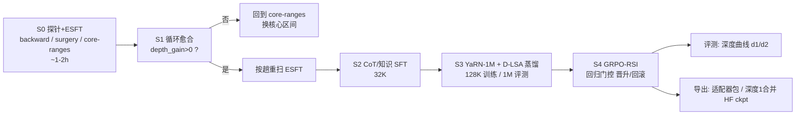

# Qwen3.6-35B-A3B → 64 层 Looped Transformer：方案分析与工程落地

本文档对应仓库 `Qwen3.6-35B-A3B-Loop60` 的实现。内容分三部分：原笔记与补充反馈的技术审查（哪些成立、哪些需要修正）、实际落地的架构（64 层循环 + mHC + MoR + D-LSA + ESFT/APOLLO/CCE），以及按风险排序的执行路线。

> [!IMPORTANT]
> 结论先行：循环深度改造 **可行且已实现**，并且在玩具模型上逐项验证了不变量：初始化 bit 级等价、增量解码与整段前向一致、activation checkpoint 梯度一致。真正的不确定性有三个，分别是 **算力预算**（ETD 的收益来自 mid-training 量级的数据）、**NVFP4 冻结底座能否反向**，以及 **循环模型的高吞吐推理**（vLLM 不认识这个新结构）。这三点都在 S0 阶段用廉价探针先验证，确认后再投入大规模算力。

---

## 1. 原笔记与反馈的技术审查

### 1.1 成立的部分（保留）

| 论点 | 核查结果 |
|---|---|
| 35B-A3B 稀疏激活的带宽优势 | 成立。每层激活约 66M 参数（DeltaNet≈38M、路由 8×3.15M≈25M、共享专家≈3M），40 层合计约 2.6B，加上 lm_head 约 3.1B/token |
| 1M 上下文 KV ≈ 10.24 GB（FP8） | 计算正确：10 层 × 2(K/V) × 2 KV 头 × 256 × 1,048,576 × 1 B |
| 只动 10 层全注意力做长上下文 | 成立。D-LSA 只挂在 full-attention 层 |
| ETD 三段式（只循环中段） | 成立。ETD（arXiv 2510.07358）在 OLMo-2 1B 上 MATH 相对提升 +36% |
| MoR 跨递归 KV 共享 | 成立，且与 token-choice 路由配合最好（MoR 论文指出 expert-choice + KV 共享会掉点） |
| 跨步动态专家重路由 | 机制上成立：第 2 趟输入不同，router 会选出不同的 top-8。仓库提供 `routing_overlap()`，可以实测两趟之间的 Jaccard |
| Colab 无 Docker → 容器类评测走远端沙箱 | 成立。Harbor 支持 `--env daytona/modal`，仓库默认 daytona，并拒绝在没有 docker.sock 时使用 `--env docker` |

### 1.2 需要修正的部分（已在实现中处理）

1. **FlashAttention-3 不适用于 RTX PRO 6000**。这张卡是 Blackwell 工作站架构（sm_120），而 FA3 只支持 Hopper（sm_90）。默认使用 `attn_implementation: sdpa`，`doctor` 会对此给出提示。
2. **"960 TFLOPS BF16" 偏高**。4,000 AI TOPS 是 FP4 含 2:4 稀疏的口径，BF16 稠密约 500 TFLOPS 量级。MoE 在单卡 HF 路径上的 MFU 通常只有 15–30%，所以原笔记 "9,000–13,000 tok/s" 的 SFT 吞吐过于乐观。现实估计是：不循环时 3k–6k tok/s，64 层循环（中段多跑一趟，计算量约 +51%）约 2k–4k tok/s。按这个估算，2.5 亿 token 需要 17–35 小时，因此所有阶段都实现了**时间预算 + 原子 checkpoint + 精确续训**（模型、优化器、数据流、RNG 全部可恢复）。
3. **1M 上下文"纯显存训练"不可行**。KV 只有 10 GB 没错，但训练时的瓶颈是**激活**：1M token 的单层残差输入在 BF16 下是 4 GiB，64 个虚拟层做 checkpoint 就要 ~256 GiB。因此 S3 在 **128K 训练 D-LSA 索引器，1M 只做推理/评测**。由于 KV 共享，第 2 趟直接复用第 1 趟的 bucket 索引，不会重复聚类。
4. **NVFP4-Fast 是推理格式**。在冻结的 NVFP4 专家上做反向（对输入求梯度）依赖 kernel 支持，HF 路径没有这个保证。另外 transformers 里 Qwen3.5/3.6 的专家权重是**融合的 3D 张量**（`gate_up_proj [E,2I,H]`），无法对单个专家切片设 `requires_grad`。对应的处理：
   - 训练默认使用 BF16 官方权重（`configs/model/qwen36_bf16.yaml`）。NVFP4 必须先通过 `qloop probe --backward` 才能用作训练底座。
   - "解冻热点专家"改为 **零初始化的热点专家增量 `HotExpertDeltas`**：底座权重完全不动（可以是任意量化格式），只给选中的专家加可训练的 ΔW。初始化时输出 bit 级不变；循环中同一层跑两趟时，每趟的路由都单独捕获；导出时可以 `merge_into_base_()` 合并回底座。
5. **`from apollo_torch import APOLLOMini` 这个类不存在**。APOLLO-Mini 实际是 `APOLLOAdamW` 的参数组配置：`rank=1, proj=random, scale_type=tensor, scale=128`。APOLLO 只作用于 2D 矩阵，1D/3D 参数走 AdamW。仓库在 `apollo_torch` 不可用时提供忠实复现论文 Algorithm 1 的本地实现（含 Fira 限幅器）。
6. **逐层即时更新（post-accumulate hook）有两个隐藏冲突**：
   - 与**梯度累积**冲突。笔记里的代码每次 backward 都会 step。修正为 `set_boundary()`：只在最后一个 micro-batch 时 step 并释放梯度。
   - **全局梯度裁剪**无法在 backward 中完成。改为逐参数裁剪，并在事后记录精确的全局范数。
   - 循环核心里的参数每次 forward 被用两次，hook 恰好触发一次（PyTorch 的 AccumulateGrad 语义），已有测试覆盖。
7. **MTP 头与推理引擎**。循环之后 coda 的输入分布变了，原 MTP 头的投机接受率会下降，需要重训 MTP。vLLM 也不认识循环结构。仓库的处理方式：
   - 推理与 RL rollout 使用仓库自带的 cache 采样器（`qloop.eval.generate`）。它严格 on-policy，并支持循环深度切换。
   - 利用一个关键性质：**深度 1 的计算图就是原版 Qwen3.6**。`qloop export --merged-depth1` 可以导出一个 vLLM 可直接服务的标准 HF checkpoint（合并专家增量，不含循环），作为高吞吐兜底。
   - 训练时以 `train_pass_probs` 随机采样深度 1，保证这条兜底路径的质量。

### 1.3 对"循环改造"四条准则的补充与纠偏

**(a) 三段式切分与 64 层目标。**
- 默认切分为前奏 `[0,8)` 跑 1 趟，核心 `[8,32)` 跑 2 趟，尾段 `[32,40)` 跑 1 趟，合计 **8 + 24×2 + 8 = 64** 个虚拟层，与宏块（3 层 DeltaNet + 1 层全注意力）对齐。
- 64 层的其他对齐方案还有 4/28×2/8、12/24×2/4，以及 3 趟、核心 12 层的组合（如 8 + 12×3 + 20）。`qloop probe --core-ranges` 会在你的数据上为全部候选打分，依据两个指标：ETD 的逐层角距离，以及零样本"直接跑两趟"的 loss 增量。建议以实测排名为准，再决定是否偏离默认值。
- ETD 的收益来自 mid-training 量级的训练，"零新增参数"不等于"零训练"。S1 设了明确的 go/no-go 指标 `eval/depth_gain = loss(d1) − loss(d2)`：约 1 亿 token 后若仍 ≤ 0，就应先停下来复查核心区间。

**(b) mHC 回跳桥与"100% 数值无损"。**
- mHC 的核心性质是残差混合矩阵投影到 Birkhoff 多面体（双随机矩阵，用 Sinkhorn 实现），从而**不放大信号**。在单一回跳点上，读出是双随机矩阵的一行，也就是单纯形上的凸组合。实现中桥的形式为：凸组合 [h_prev, 前奏锚点, 按锚点 RMS 归一的 h_prev] + 步嵌入，外加可选的零初始化低秩适配器。第三路直接抵消"残差范数休克"。
- **精确等价不是靠"回跳门置零"得到的**：如果只把桥的输入置零，第 2 趟仍然会改变输出。正确做法是让**第 r 趟的残差更新**过一个零初始化门：h_r = h_{r−1} + α_r ⊙ m ⊙ (Core(bridge(h_{r−1})) − h_{r−1})。α=0 时 x + 0·δ ≡ x，结果 bit 级精确，同时 α 仍能收到梯度。测试中 `torch.equal` 通过。
- 完整的 n 流逐层 mHC 残差（`BirkhoffMix`，λ=0 时为恒等）已作为构件实现并测试。它会使核心层的激活显存成倍增加，建议在 S1 证明循环有效之后再做实验。

**(c) DeltaNet 分槽 + 全注意力 KV 共享。**
- 实现上把 `config.num_hidden_layers / layer_types` 改写为 64 层的虚拟调度。这样 HF 自己的 cache 会为每个虚拟层分配独立槽位，DeltaNet 状态按（物理层, 趟次）自动隔离。
- 全注意力的第 2 趟通过 forward hook 复用第 1 趟的 `k_proj/v_proj` 输出（训练），并通过零长度 `update` 读取第 1 趟的 KV 槽（解码），KV 不增长。
- 补充一点：笔记说"多开几趟只增几百 MB"只对单序列成立。DeltaNet 状态约为 32 头 × 128 × 128 × 4 B = 2 MiB/层/序列，额外 24 个槽在 100 路并发 rollout 下约 4.8 GB，需要计入显存预算。

**(d) MoR 词元级早退。**
- 路由必须是**因果的 token-choice**。expert-choice 需要看到整个序列的 top-k，在自回归解码时不可用。
- **混合架构特有的陷阱**：已早退的词元仍处在 DeltaNet 的递推序列中。如果训练时它写入了第 2 趟的状态，而解码时跳过了它，训练与推理就会不一致。实现的"写屏蔽"会对早退词元做两件事：把 `in_proj_qkv(z)` 输出置零（不进入短卷积窗口），并把 `in_proj_ba` 置为 −30（β≈0 不写、衰减≈1 不遗忘）。fp64 测试证明，开启 MoR 后增量解码与整段前向仍然一致（误差 1e-10）。
- 带宽收益只对**单流解码**成立。高并发时瓶颈转为计算，收益等于平均深度的节省；因此 MoR 默认关闭，等循环收敛后再开。

### 1.4 关于 "原版 Qwen3.6 存在设计缺陷"

更准确的说法是：固定深度在测试时无法按难度分配计算，这是**能力缺口**而不是缺陷。循环深度提供的是"深度维度的 test-time scaling"。它能否兑现，要看 ARC-AGI-2 / AIME 上的**深度曲线**（d1 → d2 → d3）。评测 runner 默认对每个 benchmark 输出 `depth_curve`。

### 1.5 Spark-X2.6（稠密 4B）的经验不能直接平移

| 差异 | 对循环的影响 | 仓库中的对策 |
|---|---|---|
| MoE router 在第 2 趟遇到分布外输入 | 负载可能塌缩到少数专家 | 训练 router，记录逐层重路由 Jaccard，S1 之后按趟重新做 ESFT 扫描（`per_pass: union`） |
| 冷专家冻结且从未见过第 2 趟分布 | 第 2 趟质量受限 | 热点增量按第 2 趟的路由统计选取 |
| DeltaNet 递推状态 | 分槽 + 早退一致性 | 虚拟 cache 槽 + 写屏蔽 |
| 量化冻结底座 | 反向可能不通 | `probe --backward` 逐层定位梯度消失点 |
| 推理引擎 / MTP | 新结构不被支持 | 自带采样器 + 深度 1 合并导出 |

---

## 2. D-LSA（Latent Sparse Attention）实现要点

实现位于 `src/qloop/model/lsa.py`，挂接点是 HF `AttentionInterface`，所以不需要改写任何注意力模块。流程如下：

1. **索引投影**：只投影每个头 192 维的 **非 RoPE 维度**（Qwen3.6 的 rotary_dim=64），映射到 64 维潜空间并做 L2 归一化。初始化时 q/k 共享同一个 JL 随机投影，使 q·k 在潜空间中近似余弦。
2. **4:1 池化**成 unit，然后在每个完整的 512-key 块内做 **批量 Ward 凝聚聚类**（GPU 张量化实现），平均每个 bucket 8 个 key、上限 32 个。每个 bucket 缓存其质心和成员位置。
3. **逐 query 选择**：有 flat 搜索和两级 tree 搜索两种。tree 搜索的超节点质心按 query **因果前缀**计算，这个信息泄漏 bug 是被解码一致性测试抓出来的。选中的 bucket 与局部窗口（≥ block_size）和 sink token 合并去重，再做标准 softmax。
4. **D-LSA 蒸馏**：底座冻结，只训练索引投影，目标为 KL(真实注意力的 bucket 质量 ‖ softmax(q·c/τ))，在采样的 query 上计算。前向输出保持稠密，因此蒸馏期间模型行为完全不变（有测试保证）。
5. **YaRN**：`apply_yarn(config, 1_048_576)`，即在 262K 原生 RoPE 上取 factor=4，必须在模型初始化之前设置。

已验证的性质：
- 选中全部 bucket 时与稠密注意力精确一致；
- 稀疏模式下增量解码与整段前向一致（flat 与 tree 都验证过）；
- 蒸馏使 KL 下降；
- 与循环 + KV 共享组合时，第 2 趟零次重新聚类。

---

## 3. 新增评测基准的定位与污染关系

| 基准 | 维度 | 运行方式 | 注意 |
|---|---|---|---|
| ARC-AGI-2（公开评估 120 题） | 流体智能，**循环深度增益的主要标尺** | 本地 pass@2 | 训练题（1000 道）可用于 SFT，评估集严格隔离 |
| AIME 2026 / GPQA-D / HLE | 数理 / 科学 / 前沿知识 | 本地 | HLE 本地评分为精确匹配，是官方 LLM judge 结果的下界 |
| LongBench v2 | 8K–2M 深度推理，检验 1M D-LSA | 本地 MCQ | 评测时开启 `lsa.mode: sparse` |
| KernelBench | CUDA/Triton 自优化 | 本地子进程编译 + 正确性 + 加速比 | L1–2 进 RL，**L3–4 只做评测** |
| LiveCodeBench | 代码与自修复 | 本地单元测试 | 按发布时间窗过滤 |
| Terminal-Bench 2.0 / SWE-bench Pro | 容器化智能体 | Harbor `--env daytona/modal` + `qloop serve` | Colab 无 Docker |
| AgentWorldBench | 语言世界模型 | 远端 | **由 TB2 轨迹构建，与 TB2 同属一个污染组** |
| τ-bench-LILT / GAIA | 多轮工具调用 / 复杂任务 | OpenAI 兼容端点 | GAIA 只有 validation 集有答案 |
| MMMU-Pro | 多模态 | 需要视觉分支 | 当前训练走 text-only，暂不评测 |

数据管线内置 13-gram 去污染（aime_2026 / gpqa / hle / arc_agi_2）。OpenThoughts-Agent 系列数据与终端类评测存在潜在重叠，需要谨慎使用。

---

## 4. 执行路线（按风险排序）

| 阶段 | 配置 | 可训练部分 | 关键指标 |
|---|---|---|---|
| S0 | `configs/stages/s0_probe.yaml` | — | 反向不中断；surgery 结果 bit 级等价、解码一致 |
| S1 | `s1_loop_heal.yaml` | 循环适配器、router、共享专家、o_proj/qk-norm、层归一化、热点增量 | `eval/depth_gain`、重路由 Jaccard |
| S2 | `s2_sft.yaml` | 在 S1 基础上加全注意力与 DeltaNet 投影 | 两个深度下的 loss |
| S3 | `s3_long_lsa.yaml` | LSA 索引器、q/k-norm、循环适配器 | `lsa/distill_kl`、LongBench v2 |
| S4 | `s4_rl.yaml` | 收窄到 router、共享专家、o_proj、2–3% 热点增量 | 门控分数、熵、长度 |

---

## 5. 尚未在真机验证的事项（会在 Colab 上直接报错，而不是静默失败）

- 真实 `qwen3_5_moe` 的 cache / attention / router 接口：`qloop probe --surgery` 在真机上检查 bit 级等价与解码一致性，任一项不满足都会带上下文报错。
- NVFP4 / FP8 冻结底座的反向：`qloop probe --backward`。
- 数据集与基准的元数据：标记为 `verified=False` 的条目（例如 davinci 是 `.jsonl.7z`，需要本地解压），用 `qloop doctor --datasets` 逐一核验访问权限与 gated 状态。
- Harbor / τ-bench 的 CLI 参数名，以及 RL 数学题源 `BytedTsinghua-SIA/DAPO-Math-17k` 的字段名：首次使用前请先跑 `--dry-run` 核对。
- APOLLO 的 `√scale` 细节：本地 fallback 按参考实现编写。Colab 上安装 `apollo-torch` 后会自动改用官方实现。

---

## 6. 跨趟动态专家重路由（突破 3B 激活上限）与 Spark-X2.6-Recursion 经验迁移

### 6.1 突破单趟 3B 激活参数的物理机制 (`PassRouterAdapters`)
原版 `Qwen3.6-35B-A3B` 虽然拥有 35B 总参数（其中 32.2B 在 256 个路由专家中），但每个词元只跑 40 层且每层固定只激活 Top-8 专家（合计约 3B 激活参数）。仅靠共享的物理路由器权重 $W_{\text{gate}}$ 在第 2 趟重跑时，容易继续掉入第 1 趟已选过的同一批热点专家。

参考 `Spark-X2.6-Recursion` 中按递归趟次挂载低秩深思适配器（Per-Pass Deliberation Adapters）的设计，我们在 `src/qloop/model/loop.py` 中实现了 **`PassRouterAdapters`**：
1. **按 `(趟次 r ≥ 2, 核心层)` 独立的门控残差适配器**：低秩瓶颈 `down -> SiLU -> 零初始化 up + 零初始化 bias`，兼容旧版 `nn.Linear` 路由器与 HF≥5 的 `Qwen3_5MoeTopKRouter` 三元组输出 `(probs, scores, indices)`。第 0 步残差严格为 0，保持与原版 40 层模型 100% bit 级一致。
2. **跨趟专家排斥门（Cross-Pass Expert Repulsion）与多样性辅助损失**：跟踪同一序列位置在前序趟次已激活的专家掩码 $M_{<r}$，通过零初始化可学习排斥系数 $\gamma_{r,\ell}$ 抑制重复唤醒同一批专家，并可选叠加跨趟路由概率内积惩罚 `router_diversity_weight`。
3. **有效咨询参数量扩展**：无需复制 1 MB 底座权重，24 层核心区跑 2 趟即可在每层唤醒最多 16 个不同专家（3 趟最多 24 个），使单 token 实际调用的独特参数规模从 `~3.0B` 扩展至 `~4.5B–5.9B`，配套实时监控指标 `loop/reroute_rate`、`loop/unique_experts_core` 与 `loop/effective_expert_mult`。

### 6.2 Colab 230 GB 磁盘预算与 Hugging Face 提交历史同步 (`TassP0lar/Qwen3.6-35B-A3B-Loop64`)
针对 Google Colab 单实例 230 GB 本地磁盘上限与 24 小时会话超时限制，吸收 `Spark-X2.6-Recursion` 的 `HubSync` + `super_squash_history` 机制并针对 35B MoE 做了升级（`src/qloop/hub.py`）：
1. **零 Google Drive 依赖，全提交历史驱动**：通过 Colab Secret `HF_TOKEN` 将每个阶段的增量可训练权重包（`~1–3 GB`，绝不重复上传 70 GB BF16 底座）、`manifest.json` 阶段状态机以及自动渲染的 `README.md` 模型卡原子提交到公开仓库 `TassP0lar/Qwen3.6-35B-A3B-Loop64`；若远端触发存储配额限制，自动调用 `super_squash_history` 压缩历史快照后重试。
2. **跨阶段累积增量传递（Cumulative Delta Handoff）**：`Stack.checkpoint_params()` 与 `Stack.restore_checkpoint()` 自动保留跨阶段冻结切片（`carried_params`）、未挂载组件（如穿过 S4 保留到评测阶段的 `lsa_indexer`）并将前序阶段未挂载的 `HotExpertDeltas` 原地折叠进浮点专家底座，确保 `S1 -> S2 -> S3 -> S4 -> Eval -> load_qloop_from_hub` 全链路零信息丢失。
3. **230 GB 磁盘水位守卫**：底座缓存（`~70 GB`）固定保留在 `/content/hf_cache/hub`；`keep_last: 1` 仅保留最新本地步，阶段完成后自动剥离本地 `optim.pt`/`rng.pt`、清理前序阶段 `checkpoints/` 与 `$HF_HOME/{xet,upload}` 临时分片缓存，全程将空闲磁盘稳定维持在 `85–110 GiB` 以上。

---

## 7. NVIDIA Gated DeltaNet-2 (`GDN-2`) 无损升级 (`src/qloop/model/gdn2.py`)

原版 `Qwen3.6-35B-A3B` 的 30 层线性注意力采用标准 Gated DeltaNet，将每个头的擦除（Key 侧）与写入（Value 侧）强行绑定在同一个标量门 $\beta_t \in (0, 1)$ 与标量衰减 $g_t \le 0$ 上。这在循环深度重入（同一物理层跨趟处理不同粒度的潜状态）与超长上下文精细记忆编辑中会造成通道级覆盖冲突。

我们基于 NVIDIA Research 的 **Gated DeltaNet-2**（Hatamizadeh, Choi, Kautz, *arXiv:2605.22791*, `NVlabs/GatedDeltaNet-2`），将全部 30 层线性注意力原地升级为通道级解耦状态演化：
$$S_t = \left(I - \mathbf{k}_t (\mathbf{b}_t \odot \mathbf{k}_t)^\top\right) \operatorname{Diag}(\exp(\mathbf{g}_t)) S_{t-1} + \mathbf{k}_t (\mathbf{w}_t \odot \mathbf{v}_t)^\top, \qquad \mathbf{o}_t = S_t^\top \mathbf{q}_t$$

1. **严格泛化与第 0 步 100% Bit 级无损兼容**：当 $\mathbf{b}_t = \beta_t \mathbf{1}_{d_k}$、$\mathbf{w}_t = \beta_t \mathbf{1}_{d_v}$、$\mathbf{g}_t = g_t^{\text{base}} \mathbf{1}_{d_k}$ 时，GDN-2 严格退化为原版 GDN。`GDN2Adapter` 采用零初始化低秩残差（30 层 `rank=64` 合计仅约 `27.5M` 参数），并通过无奇点的对数几率平移恒等式
   $$\sigma(\operatorname{logit}(\beta) + \delta) \equiv \beta + \frac{2\beta(1-\beta)\tanh(\delta/2)}{1 + (2\beta-1)\tanh(\delta/2)}$$
   与非正衰减缩放 $\mathbf{g}_t = g_t^{\text{base}} \odot \exp(\tanh(\Delta \mathbf{g}_t)) \le 0$ 合成通道门控：无需调用 `logit()`，在 $\delta=0$ 时浮点 bit 级精确返回原版 $\beta$，且在 $\beta \in \{0, 1\}$（含 MoR 早退写屏蔽）处完全消除 `log(0)` / `NaN` 风险。
2. **分块 WY 并行核 (`chunk_gdn2`) 与 $O(1)$ 解码核 (`recurrent_gdn2`)**：训练与预填充采用中点中心化的 Tensor-Core 分块 WY 表示（通过 `solve_triangular(..., unitriangular=True)` 批量求解非对称通道衰减下的下三角系统，并带宏段激活重计算），自回归单步解码走 $O(1)$ 状态的 `recurrent_gdn2`，在 `float64` 下前向/反向与逐步递推误差 `< 1e-10` / `< 1e-9`。
