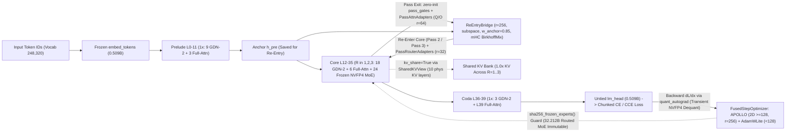
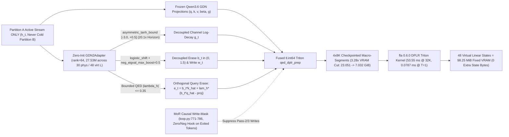
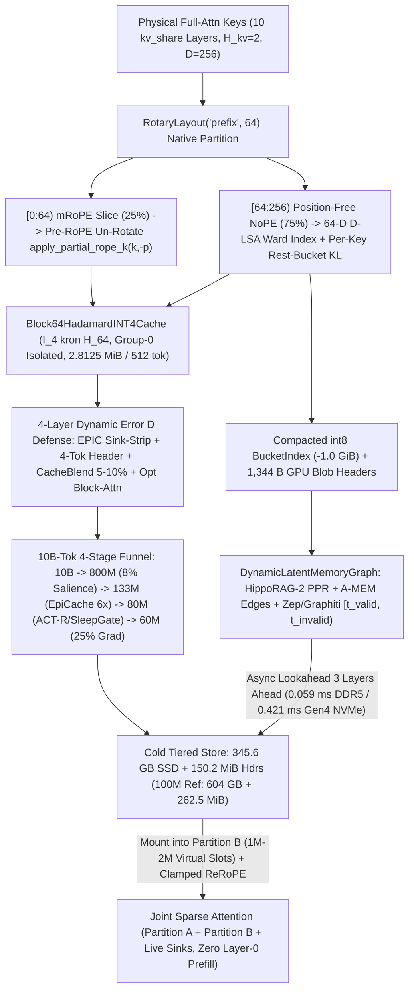
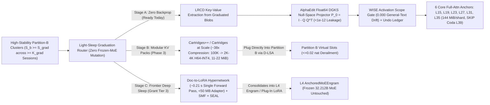
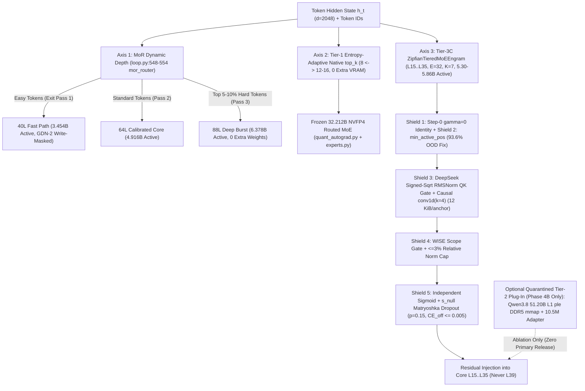
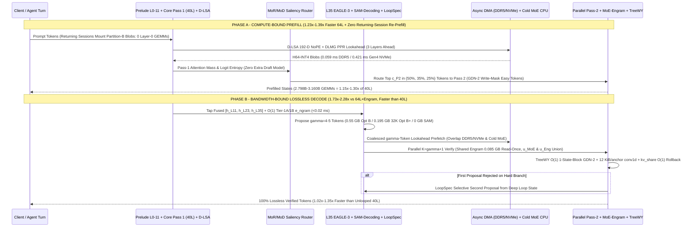

# Component-by-Component Architecture & Implementation Specification (`v1.0`): `Qwen3.6-64L-CoMem` (`LSA-NL`)

> **Document Class:** Engineer-Ready Component Architecture & Implementation Blueprint (`v1.0`) · **Target System:** `Qwen3.6-64L-CoMem` (`LSA-NL` v2.0 5-Frequency Continuum Memory System & 3-Axis Elastic Compute)  
> **Primary Backbone:** Frozen `Qwen/Qwen3.6-35B-A3B` (`34.661B` total text params / `32.212B` frozen NVFP4 routed MoE / `2.448B` dense core; `[0,12)×1 + [12,36)×R + [36,40)×1` → `40L [3.454B]` / `64L [4.916B]` / `88L [6.378B]` active; `10` physical `kv_share=True` full-attention layers with `partial_rotary_factor=0.25` [`64`-D `3D mRoPE` + `192`-D NoPE]; `30` physical / `48` virtual `GDN-2-1M + QED` linear layers)  
> **Development Hardware:** `1× NVIDIA RTX PRO 6000 Blackwell Server Edition` (`GB202`, `sm_120`, **`96 GB GDDR7 ECC`** [`94.97 GiB` CUDA-usable], `512-bit`, **`1,597 GB/s`** peak bandwidth, `24,064` CUDA cores, `600 W` TDP) · **Consumer Targets:** `16 GB` (`RTX 4080 / 5070 Ti`), `24 GB` (`RTX 3090 / 4090`), `32 GB` (`RTX 5090`)  
> **Companion Documents:** [中文架构与实现规范 (`ARCHITECTURE_NEXTGEN_LOOP64_LSANL_ZH.md`)](ARCHITECTURE_NEXTGEN_LOOP64_LSANL_ZH.md) · [LSA-NL Research Proposal (EN)](PROPOSAL_LSA_NESTED_LEARNING.md) · [LSA-NL Research Proposal (ZH)](PROPOSAL_LSA_NESTED_LEARNING_ZH.md) · [Next-Gen Roadmap (EN)](ROADMAP_NEXTGEN_LOOP64_COMEM.md) · [Next-Gen Roadmap (ZH)](ROADMAP_NEXTGEN_LOOP64_COMEM_ZH.md) · [Compute Grant Proposal (EN)](COMPUTE_GRANT_PROPOSAL.md) · [Compute Grant Proposal (ZH)](COMPUTE_GRANT_PROPOSAL_ZH.md) · [Empirical Report (EN)](EXPERIMENT_REPORT.md) · [Empirical Report (ZH)](EXPERIMENT_REPORT_ZH.md)

> [!IMPORTANT]
> **Branch Scope & Parallel Module Alignment:** Every existing `src/qloop/` path and line anchor linked in this specification is verified directly on this repository. The Phase-2A/2B memory-core foundation modules (`src/qloop/memory/kv_blob.py`, `src/qloop/memory/esm.py`, and `tests/test_lsanl_memory.py`) are being authored concurrently on a parallel branch alongside this specification and are referenced as backtick code paths until merged. Every figure is grounded in measured Blackwell telemetry or closed-form architecture formulas (`0` unmeasured benchmark scores claimed).

---

## §0. Global System Overview & Non-Negotiable Invariants

`Qwen3.6-64L-CoMem` instantiates **Latent-Sparse Nested Learning (`LSA-NL`)** across seven composable components (**C0–C6**), realizing a five-frequency Continuum Memory System (`L0 → L4`) and three-axis elastic compute engine atop a frozen `34.661B` hybrid MoE backbone without scratch pretraining or proactive interference. Four system-wide invariants bind every module:

1. **Step-0 IEEE-754 Bit-Identity (`max_abs_diff == 0.0`):** Every new residual adapter (`LoopAdapters`, `GDN2Adapter`, `EpisodicSideMemory`, `ZipfianTieredMoEEngram`) initializes to exact zero output contribution so the wrapped model matches stock `Qwen3.6-35B-A3B` bit-for-bit before step 1.
2. **Cryptographically Frozen `32.212B` NVFP4 Routed MoE Prior:** All `40 × 256` routed SwiGLU experts remain immutable across every training, consolidation, and sleep phase, enforced before and after updates via `sha256_frozen_experts()` in [`src/qloop/model/loop.py`](../src/qloop/model/loop.py#L1315) and [`src/qloop/model/experts.py`](../src/qloop/model/experts.py).
3. **Strict Split-Horizon Isolation:** Online recurrent linear attention (`L0`, `GDN-2-1M + QED`, `98.25 MiB` across `48` virtual states) runs **exclusively** on live **Partition A (`1M–2M` active workspace)** and never ingests cold **Partition B (`1M–2M` mounted KV-Mem Blobs backed by `100M+` cold SSD tokens)**.
4. **Pure `Qwen3.6` Primary Release:** Zero external-donor weights enter the primary checkpoint; the `51.20B` `Qwen3.8-Flash-Next` Layer-1 `ple` table is strictly quarantined as an optional DDR5 `mmap` plugin ablation (`Phase 4B`).

| Component | Timescale / Frequency | Role in `Qwen3.6-64L-CoMem` | Primary Footprint (`1× 96 GB GDDR7`) | Primary Code Surface |
| :---: | :---: | :--- | :---: | :--- |
| **C0** | Static Prior (`0`) | Frozen NVFP4 Backbone + `[12,36)` Sandwich Loop (`40L/64L/88L`) + APOLLO | `21.85 GiB` pure NVFP4 (`24.09 GiB` mixed) | `model/{loop,mhc,experts,quant_autograd}.py`, `train/optim.py` |
| **C1** | **L0** (`1 / tok`) | Active-Stream `GDN-2-1M + Bounded QED + Soft Neg-Eigval` (`fla 0.6.0` DPLR) | `98.25 MiB` fixed state (`27.53M` adapter) | `model/gdn2.py`, `model/loop.py` |
| **C2** | **L1–L2** (`1/512 tok`, `1/sess`) | Upgraded `D-LSA` + Split-Horizon `KVMemBlobStore` + `DLMG` + `10B` Funnel | `11.25–22.50 GiB` KV + `150.2–262.5 MiB` hdrs | `model/{lsa,offload,pos_rerope}.py`, `memory/kv_blob.py` |
| **C3** | **L3** (`1 / task`) | `EpisodicSideMemory` (`AlphaEdit` + `WISE`) + `Cartridges++` + `Doc-to-LoRA` | `144 MiB/shard` (`ESM`) / `11–22 MiB` (`Cart++`) | `memory/esm.py`, planned `model/cartridges.py` |
| **C4** | **L4** (`1 / week`) | 3-Axis Elastic Compute (`MoR` + Adaptive `top_k` + `ZipfianTieredMoEEngram`) | `0.65–0.99 GiB` NVFP4 Engram (`0` for `top_k`) | `model/{loop,experts,quant_autograd}.py`, planned `engram.py` |
| **C5** | Runtime Engine | `MoR`/`MoD` Prefill + Engram-Coupled `L35` `EAGLE-3`/`SAM`/`TreeWY` + `<= 24 GB` | `17.66–18.93 GiB` (`24 GB`) / `10.89 GiB` (`16 GB`) | `infer/engine.py`, planned `infer/spec_draft.py` |
| **C6** | Phase 5 Appendix | Native Multimodal KV-Mem Blobs (`Qwen3.6` 27L ViT, `3D mRoPE [11,11,10]`) | Shared `2.8125 MiB/blob` (`192`-D NoPE) | `model/pos_rerope.py`, `memory/kv_blob.py`, planned `vlm_blobs.py` |

---

## C0 — Frozen Base Backbone & `[12, 36)` Sandwich Loop (`40L / 64L / 88L`)

### How It Works
Stock `Qwen/Qwen3.6-35B-A3B` [1] packs `34.661B` text parameters across `40` physical layers (`10 × [3 Gated DeltaNet + 1 Gated Full Attention]`), of which `32.212B` (`92.93%`) live in `256` routed SwiGLU experts (`k = 8` active/token) and only `2.448B` form the always-active dense core (`1.017B` untied `embed_tokens` + `lm_head`, `1.011B` linear mixers, `0.273B` full-attention mixers, `0.126B` shared experts, `0.021B` routers). C0 wraps the calibrated middle `24` physical layers `[12, 36)` in a **subspace-aligned sandwich loop** executing `Prelude [0,12)×1 + Core [12,36)×R + Coda [36,40)×1` for `R ∈ {1, 2, 3}` (`40L` / `64L` / `88L` effective depth). On Pass `r >= 2`, a manifold-constrained **`ReEntryBridge`** (grounded in `mHC` [2]) fuses the previous pass output $h^{(r-1)}$ with the saved Prelude anchor $h_{\text{pre}}$ via doubly-stochastic Birkhoff mixing (`w_anchor = 0.85`), while **`PassRouterAdapters`** inject low-rank logit deltas (`r = 32`) into each core MoE router so later passes recruit complementary experts from the frozen `32.212B` pool (`82.27%` Pass-2 re-routing, `17.36` unique experts/token measured in `s1_loop_a6b@1000`). All `10` physical full-attention layers share a single `1.0×` KV cache across passes (`kv_share=True`).

### How We Design It
- **Exact Active-Parameter Accounting (`Derived Formula`):** `40L (R=1)` executes **`3.454B`** total active params (`2.436B` prefill GEMMs ex-embed/head); **`64L (R=2)`** executes **`4.916B`** exact active (`1.017B` embed+head + `2.053B` mixers + `1.845B` MoE; `3.885B` prefill GEMMs with `kv_share=True` saving `0.0126B` on `6` core `k_proj/v_proj`); **`88L (R=3)`** executes **`6.378B`** active (`22` virtual global-attention layers).
- **Zero-Shock Step-0 Identity & Manifold Safety:** `s0_probe` verified `[12, 36)` cuts zero-shot re-entry shock `3.26×` relative to `[8, 32)`. `pass_gates`, `PassAttnAdapters` (`q_proj`, `o_proj` `r = 64`), and `PassRouterAdapters` initialize strictly to `0.0` so $R=1,2,3$ match stock `Qwen3.6` identically at step 0, avoiding the non-identity manifold fracture that doomed pure *Nested Learning (HOPE)* [3] / *Titans* [4] grafting.
- **Single-Card `96 GB GDDR7 ECC` Training via `quant_autograd` + `APOLLO` [5]:** Base weights stay packed in NVFP4 (`21.85 GiB` pure / `24.09 GiB` Unsloth mixed NVFP4/FP8). During backward, fused Triton dequantization materializes transient BF16 weights per chunk for exact input/router gradients `dL/dx` (`18.99×` Blackwell speedup hitting `1,148 GB/s = 71.9%` of `1,597 GB/s` peak) without retaining persistent BF16 copies. **APOLLO** [5] (`rank=256`, `scale_type=channel`, `update_proj_gap=200`, `min_dim=128`) compresses optimizer states on all large 2D matrices `4.2×–5.0×` (`0.186 GiB` vs `0.781 GiB` AdamW on `104.86M` `s2_v2` attention params), holding `4×32K` `d=3` peak VRAM to `67.19–67.77 GiB` (`~27.2 GiB` free on `94.97 GiB` usable GDDR7).

### How We Implement It
- **Loop Schedule, Adapters & KV Sharing — [`src/qloop/model/loop.py`](../src/qloop/model/loop.py):** `LoopSpec` (`:75`), `build_schedule` (`:173`), `SharedKVView` (`:280`, caches Pass-1 K/V and returns read-only views on Passes `2..R`), `PassRouterAdapters` (`:376`, `rank=32`), `PassAttnAdapters` (`:466`, `rank=64` on `q_proj`/`o_proj`), `LoopAdapters` (`:508`, `gates` + `bridge` + `pass_router` + `pass_attn` + `mor_router`), `VirtualLayer` (`:563`), `LoopController` (`:658`, registers forward hooks with `prepend=True` on routers at `:793`), and `sha256_frozen_experts` (`:1315`).
- **Manifold-Constrained Bridge — [`src/qloop/model/mhc.py`](../src/qloop/model/mhc.py):** `sinkhorn_project` (`:35`, `20` iters), `BirkhoffMix` (`:44`), `LoopBridge` (`:74`), and `ReEntryBridge` (`:162`, `bridge_mode="subspace"`, `bridge_rank=256`, `bridge_init=[0.05, 0.85, 0.10]`).
- **Freeze Guards & Quantized Autograd — [`src/qloop/model/experts.py`](../src/qloop/model/experts.py) & [`src/qloop/model/quant_autograd.py`](../src/qloop/model/quant_autograd.py):** `freeze_all_but` (`experts.py:850`), `HotExpertDeltas` (`experts.py:450`), `_nvfp4_dequant_fused_kernel` (`quant_autograd.py:506`), `_QuantLinearAutogradFn` (`:1515`), `_QuantMoERoutedAutogradFn` (`:2095`), and `install_quantized_autograd_bridge` (`:3150`).
- **Optimizer — [`src/qloop/train/optim.py`](../src/qloop/train/optim.py) & [`configs/base.yaml`](../configs/base.yaml#L89-L97):** `build_param_groups` (`optim.py:382-421`) routes `p.dim() == 2 and min(p.shape) >= 128` to `apollo_torch.APOLLOAdamW` and `< 128`-D params to batched `AdamWLite` inside `FusedStepOptimizer` (`:525`), run with `fused=False` in `s1b`/`s3*`/`s2*`/`s4*` for atomic whole-step non-finite rollback and `_foreach_norm(..., dtype=fp32)` global clipping.

---

## C1 — Timescale L0 (`1/tok`): Active-Stream `GDN-2-1M + QED + Soft Neg-Eigval`

### How It Works
Stock `Qwen3.6` interleaves `30` physical Gated DeltaNet [6] layers (`48` virtual layers in `64L`) whose coupled scalar update gate $\beta_t \in (0,1)$ ties memory erasure to memory writing and limits state-tracking expressivity. Component **C1** upgrades every linear-attention layer in-place to **`GDN-2-1M + Bounded QED + Soft Neg-Eigval`** [7], [8], [9]:
$$S_t = \big(I - \hat{k}_t e_t^{\top}\big)\operatorname{Diag}\!\big(\exp(g_t)\big) S_{t-1} + \hat{k}_t (w_t \odot v_t)^{\top}, \qquad e_t = b_t \odot \hat{k}_t + \lambda_h \Big(b_t \odot \hat{q}_t - \langle \hat{k}_t, b_t \odot \hat{q}_t \rangle \hat{k}_t\Big),$$
where:
1. **Decoupled Erase/Write/Decay (`GDN-2` [7]):** Channel-wise write gate $w_t$, erase gate $b_t$ (`logistic_shift`), and asymmetric log-decay multiplier (`asymmetric_tanh_bound` on `[-3.0, +0.5]`, stretching effective retention horizon up to $\exp(3.0) \approx 20.1\times$ for `1M`-token streams) allow retaining old associations while writing new ones.
2. **Bounded Query-Enhanced Erasure (`QED` [8]):** Adds a second query-aligned orthogonal erasure direction with per-head coupling bounded smoothly via $|\lambda_h| \le 0.35$ (`qed_max_lambda=0.35`) so the query actively clears stale keys along its read direction without destabilizing the rank-1 update.
3. **Soft Negative Eigenvalues [9]:** Scales per-head erase strength by $1 + 0.5\tanh(\text{raw}_h) \in (0.5, 1.5)$ (`neg_eigval_max_boost=0.5`), placing $b_t \in (0, 1.5)$ so eigenvalues of $(I - \hat{k}_t e_t^{\top})$ smoothly cross below `0` to unlock parity/state-tracking dynamics while avoiding the explosive `b_t -> 2.0` boundary.

### How We Design It
- **Exact `fla 0.6.0` `DPLR` Equivalence & `0` Extra State Bytes:** Because the recurrence has the exact Diagonal-Plus-Low-Rank (DPLR) structure $S_t = (\operatorname{Diag}(e^{g_t}) + a_t b_t^\top) S_{t-1} + \tilde{k}_t \tilde{v}_t^\top$, C1 maps directly onto production `fla 0.6.0` [10] `chunk_dplr_delta_rule` / `fused_recurrent_dplr_delta_rule` Triton kernels with **zero extra recurrent state bytes** beyond stock GDN: **`98.25 MiB`** exact across all `48` virtual linear states in `64L` (`fp32` `[H_v, d_k, d_v]` state + `bf16` short-conv state) and **`27.53M`** total adapter params (`0.079%` of `34.661B`).
- **`4×8K` Checkpointed Macro-Segmenting (`3.28×` VRAM Cut):** During `4×32K` BPTT training, running `32K` sequences monolithically through the Python/Triton prep wrapper spikes temporary activations to `23.051 GiB`. Splitting each `32K` segment into `4 × 8,192`-token checkpointed macro-segments (`fla_segment_len=8192`) passing only the terminal `h_T` state across boundaries cuts wrapper VRAM **`3.28×` (`23.051 → 7.032 GiB`, `Measured`)** with exact gradients (`38/38` Blackwell CUDA pytest green; `53.55 ms` @ `32K` [`2.00×`], `0.0787 ms` @ `T=1` [`2.41×`]).
- **Strict Partition-A Isolation & `MoR` Write-Masking:** Cold Partition-B blobs are **never** fed into `GDN-2`, preventing archival churn from erasing active reasoning traces. Under `MoR` [11] dynamic depth, tokens exiting at Pass 1 have their Pass-2/3 `in_proj_qkvz` outputs zeroed and `in_proj_ba` logits clamped to `-30.0` (`loop.py:771-786`), keeping train and decode recurrent state semantics bit-identical.

### How We Implement It
- **Core Math & Fused Triton Prep — [`src/qloop/model/gdn2.py`](../src/qloop/model/gdn2.py):** `GDN2Config` (`:96`, `rank=64`, `fla_segment_len=8192`, `decay_log_min=-3.0`, `decay_log_max=0.5`, `qed_max_lambda=0.35`, `neg_eigval_max_boost=0.5`), `asymmetric_tanh_bound` (`:156`), `logistic_shift` (`:173`), `_compute_qed_erase` (`:200`), fused `tl.int64` Triton kernels `_qed_dplr_prep_fwd_kernel` (`:419`) & `_qed_dplr_prep_bwd_kernel` (`:497`), `qed_dplr_prep` (`:925`), `_run_fla_dplr` (`:1050`), `_run_fla_segmented` (`:1182`), `recurrent_gdn2` (`:1327`), `chunk_gdn2` (`:1488`), `GDN2Adapter` (`:1637`), `GDN2Manager` (`:1850`), and `install_gdn2` (`:2176`).
- **`MoR` Write-Mask Hooks — [`src/qloop/model/loop.py`](../src/qloop/model/loop.py#L771-L786):** Registers `_write_hook(None)` on `write_zero_names` (`in_proj_qkvz`, `gdn2_adapter.down`) and `_write_hook(-30.0)` on `write_neg_names` (`in_proj_ba`) across all core linear layers.
- **Verification Contract:** `tests/test_gdn2.py` enforces Step-0 `torch.equal`, `fp64` parity (`<= 1e-10` fwd / `<= 1e-9` bwd) between `chunk_gdn2` and `recurrent_gdn2`, `4×8K` segmented gradient parity, and `MoR` write-masked decode invariance.

---

## C2 — Timescales L1–L2 (`1/512 tok` & `1/session`): Upgraded `D-LSA` + Split-Horizon `KVMemBlobStore` + `DynamicLatentMemoryGraph`

### How It Works
Component **C2** unifies **L1** (Partition-A active working context, `1M–2M` tokens, updated every `512` tokens) and **L2** (Partition-B consolidated episodic memory, `1M–2M` GPU-mounted virtual slots backed by `100M+` cold SSD tokens) around `Qwen3.6`'s native **`RotaryLayout("prefix", 64)`** (`partial_rotary_factor = 0.25`, `64`-D mRoPE + `192`-D NoPE) [12], [13]:
1. **Six Surgical Upgrades Over Original `LSA` [12]:**
   - *Per-Key Rest-Bucket Forward KL + `calibrate_tau`:* Upgrades `_distill_kl()` (`lsa.py:1231-1268`) from bucket-mass KL to Original LSA's per-key forward KL over selected leaves plus a truncated-depth "rest bucket" absorbing unvisited tail mass, paired with post-hoc temperature calibration (`calibrate_tau`), lifting `512K–1M` head recall from `0.5715` toward `> 0.75`.
   - *`-1.0 GiB` `int8` `BucketIndex` Compaction:* Replaces eager `int64` member arrays in `_assemble()` (`lsa.py:728-768`, `+1.04 GiB` at `1M`) with compact `int8` block-relative offsets (`<= 0.06 GiB`, reclaiming `-1.0 GiB` GDDR7).
   - *Untied Per-Pass `W_q^{(p)}` (`num_query_passes = 2–3`):* Already live in `lsa.py:175,376-384`, enabling distinct 2nd/3rd-hop sparse retrieval over `1.0×` `kv_share` KV.
   - *Mutable `DLMG`, Pre-RoPE Cross-Session Mounting, GPU-Header/SSD-Payload Tiering, and Horizontal→Vertical Graduation.*
2. **Exact Geometric Error ($G$) Neutralization & 4-Layer Dynamic Error ($D$) Defense:**
   When sealing a `512`-token blob during Micro-Sleep [14], only `[0:64)` is un-rotated via $k_j^{\text{pre}} = [R(-(p_s+j)\omega) k_{\text{rot}}^{(s)}(j),\; k_{\text{nope}}^{(s)}(j)]$ (`apply_partial_rope_k(k, -p)`), while `[64:256)` (`75%` of `K`) stays bit-for-bit position-invariant. Because `walsh_hadamard_block` applies $I_4 \otimes H_{64}$ (`offload.py:32-56`, grounded in `TurboQuant` [15]), Group 0 (`[0:64)`) is orthogonally isolated from Groups 1–3 (`[64:256)`, `< 1e-12` commutativity error in `fp64`): at Partition-B mount time, only Group 0 undergoes clamped ReRoPE (`linear_ceil=131,072`, `log_scale=32,768`, `max_pos=240,000 < 262,144`), while Groups 1–3 stay directly in $H_{64}$ space! Dynamic/Sink Error ($D$) is countered by four layered defenses: (1) **`EPIC`** [16] `[0:4)` original-session sink stripping, (2) **`TurboRAG`** [17] `4`-token Boundary & Abstraction Header + **`Zep/Graphiti`** [18] / **`SleepGate`** [19] `[t_valid, t_invalid)` conflict masking, (3) **`CacheBlend`** [20] selective top-`5%–10%` HKVD refresh (`~10×–18×` cheaper than Layer-0 prefill), and (4) contingency `2–4 h` **`Block-Attention`** [21] adapter calibration only if Kill-Gate `K0` triggers Yellow-B.
3. **`DLMG` + `10B`-Token Forgetting & Hardening Funnel:**
   `Spark-X2.6` [22]'s **`DynamicLatentMemoryGraph` (`DLMG`)** links blobs via reciprocal `A-MEM` [23] semantic edges and expands `1–2` hops via `HippoRAG 2` [24] Personalized PageRank before filtering expired `[t_valid, t_invalid)` tombstones (`SleepGate` [19], `Zep/Graphiti` [18]). Over `10B` lifelong tokens (`57.60 TB` raw SSD, `24.45 GiB` raw headers), a 4-stage funnel—`~8%` salience cherry-picking (`800M`) → `EpiCache` [25] `6×` `192`-D NoPE dedup (`133M`) → `SleepGate` + ACT-R retention $R_b(t) = \exp(-\Delta t / S_b)$ with spaced-repetition hardening $S_b \leftarrow 2S_b$ (`~40%` pruned → `80M`) → `25%` hottest clusters graduating to `L3`/`L4`—bounds steady-state storage to **`60M` tokens (`117,188` blobs = `345.6 GB` SSD + `150.2 MiB` GPU headers)**.

### How We Design It
- **Closed-Form Blob & Header Ledger (`Derived Formula`):**
  - `1` `512`-tok blob across `10` physical `kv_share` layers (`5,242,880` scalars): **`5.00 MiB`** FP8 (`FP8KVCacheQuantizer`) or **`2.8125 MiB`** (`2,949,120 B`, `288.0 KiB/layer` = `128 × 2,304 B` micro-pages) in `Block64HadamardINT4Cache` (`36 B / 64 scalars`).
  - GPU-resident coarse semantic header: `10 × 64 × 2 B = 1,280 B` `fp16` NoPE centroids + `64 B` bi-temporal/salience/CSR/LBA metadata = **`1,344 B/blob`**.
  - `100 Mi-tokens` (`204,800` blobs) = **`604.0 GB` SSD** (`562.50 GiB`) + **`262.50 MiB` GPU headers** (`250.00 MiB` centroids + `12.50 MiB` metadata; exhaustive `10L` scan takes `~0.23 ms` at `70%` of `1,597 GB/s`).
  - Streaming fetch (inspired by `ShadowKV` [26], `InfiniGen` [27], `Quest` [28]): **`0.421 ms/blob`** (`0.0421 ms/layer`) on Gen4 ×4 NVMe (`7.0 GB/s`) or **`0.059 ms/blob`** (`0.0059 ms/layer`) on pinned DDR5 (`50.0 GB/s`), hidden cleanly behind `3` interleaved `GDN-2 + MoE` layers via `prefetch_layers_ahead=3`.
- **Server GDDR7 Envelopes (`94.97 GiB` usable):** Env. A `3M` Precision (`1M` FP8 + `2M` H64 = `21.25 GiB` KV → **`43.55–43.81 GiB`** total, `~51.2–51.4 GiB` free); Env. B `4M` Max Split (`2M` H64 + `2M` H64 = `22.50 GiB` KV → **`45.16–45.41 GiB`** total, `~49.6–49.8 GiB` free); Env. C `2M` Hot + `100M` SSD (`11.25 GiB` KV → **`33.81 GiB`** total, `~61.2 GiB` free).

### How We Implement It
- **Existing Code Anchors:** [`src/qloop/model/lsa.py`](../src/qloop/model/lsa.py) (`index_on="nope":154`, `num_query_passes:175`, `_assemble:728-768`, `_distill_kl:1231-1268`, `lsa_attention:3128`, `LSAManager:3424`); [`src/qloop/model/offload.py`](../src/qloop/model/offload.py) (`walsh_hadamard_block:32-56`, `pack_group64_int4:59`, `Block64HadamardINT4Cache:115`, `prefetch_micro_pages:321-355`, `gather_kv_and_reconstruct_v:445-514`, `FP8KVCacheQuantizer:551`); [`src/qloop/model/pos_rerope.py`](../src/qloop/model/pos_rerope.py) (`clamped_relative_distance:89-124`, `apply_partial_rope_k:166-195`, `apply_partial_rerope_q:198-261`).
- **Parallel Phase-2A/2B Foundation (Memory-Core Branch):** `src/qloop/memory/kv_blob.py` (`KVBlobConfig`, `KVBlobHeader`, `KVMemBlob`, `strip_sinks_and_unrotate_k`, `pack_kv_blob`, `mount_kv_blob`, `DynamicLatentMemoryGraph` PPR + bi-temporal `[t_valid, t_invalid)` filter, and `SplitHorizonKVBlobStore` 4-stage `10B`-token funnel) validated by `tests/test_lsanl_memory.py` alongside `K0` harness `scripts/eval_killgate_k0_kv_blobs.py`.

---

## C3 — Timescale L3 (`1/task`, Light Sleep): `EpisodicSideMemory` & 3-Stage KV-Blob → Engram Distillation

### How It Works
Repeatedly mounting the same `100K`-token repository invariants, MCP schemas, or user conventions into Partition B wastes horizontal sparse-attention slots. During **Light Sleep** (task/repo completion), **C3** graduates recurring `L2` KV-Mem Blobs vertically into compact $O(1)$ residual parameters or ultra-dense synthetic KV packs across **three progressive stages** that never touch the frozen `32.212B` MoE backbone:
- **Stage A — Zero-Backprop `EpisodicSideMemory` (`ESM`, Ready Today):** Extracts residual `(key, target_delta)` pairs via `Spark-X2.6` [22]'s **`LRCD`**, projects them strictly into the orthogonal complement of general-knowledge activations $K_0$ using **`AlphaEdit`** [29] **`Float64` Double Gram-Schmidt (`DGKS`)** null-space ridge regression:
  $$\Delta W = R K_e^{\top} \big(K_e K_e^{\top} + \lambda I\big)^{-1} P_0, \qquad P_0 = I - Q_0 Q_0^{\top}, \qquad \|\Delta W K_0\|_F / \|K_0\|_F < 10^{-12},$$
  and shields inference behind a **`WISE`** [30] activation scope gate so out-of-scope general text experiences exact **`0.000` drift**. Every write appends a reversible delta record to a transactional **Undo Ledger**, enabling exact millisecond rollback when a project is archived or a fact is retracted.
- **Stage B — Modular Compressed KV Packs (`Cartridges++`):** Uses **`Cartridges`** [31], **`Cartridges++`** [32] (routing/data-mixing eliminating off-context derailment), and **`Cartridges at Scale`** [33] to distill `100K`-token document/code clusters into `2K–4K` synthetic `H64-INT4` KV tokens (`4–8` blobs = **`11.25–22.50 MiB`**, **`~38×`** typical compression) that plug straight back into Partition B via `D-LSA` with zero architecture changes.
- **Stage C — Single-Forward-Pass Hypernetwork & Self-Edit Compilation (`Deep Sleep / Tier 3`):** **`Doc-to-LoRA`** [34] meta-trains a lightweight hypernetwork compiling a hot blob cluster into a plug-in knowledge LoRA/Engram adapter in **`~0.21 s`** (`< 50 MB` adapter memory, zero per-document SGD), complemented by weekly **`SMF`** [35] (TF-IDF/surprise sparse slot updates) and **`SEAL`** [36] RL-generated self-edit directives.

### How We Design It
- **Exact Anchor Placement (`6` Core Full-Attn Boundaries, Strictly Skipping Coda `L39`):** `ESM` attaches strictly at **`L15, L19, L23, L27, L31, L35`** (`12` virtual visits in `64L`), **explicitly skipping Coda `L39`** per our verified `S2` calibration rule because editing the final pre-`lm_head` layer induces direct logit-distribution shock on unrelated prompts.
- **Exact `144 MiB/shard` Memory Budget (`Derived Formula`):** `6` anchors × two `bf16` projection blocks (`[2048, 2048]` or factorized side-MLP equivalent = `24 MiB/anchor`) = **`144.0 MiB` (`0.141 GiB`) per shard** (`< 0.15%` of `94.97 GiB` GDDR7 ECC), allowing dozens of domain/project shards to reside simultaneously or hot-swap in `< 3 ms`.
- **Numerical Rigor:** `DGKS` orthogonalization runs strictly in `torch.float64` (two-pass re-orthogonalization guaranteeing $\|Q_0^\top Q_0 - I\|_\infty < 10^{-14}$ and null-space leakage `< 1e-12`), preventing the rank-deficiency collapse seen in naive `fp32` normal equations.

### How We Implement It
- **Parallel Phase-2B Foundation (Memory-Core Branch):** `src/qloop/memory/esm.py` implements `ESMConfig` (`anchors=(15, 19, 23, 27, 31, 35)`, strict Coda `>= 36` guard blocking `L39`), `ESMLedgerEntry`, `NullSpaceESMAnchor` (SVD `register_general_subspace`, `Float64` AlphaEdit + DGKS `compile_nullspace_ridge`, `WISE` activation scope gate, relative norm cap, transactional `rollback_entry`), and `EpisodicSideMemoryBank` (`144.0 MiB` shard ledger), verified by `tests/test_lsanl_memory.py` (`< 1e-12` null-space leakage, `0.0` Step-0 diff, `0.000` out-of-scope drift, `100%` bit-exact rollback).
- **Stage B & Stage C Hooks:** Planned `src/qloop/model/cartridges.py` (`Cartridges++` synthesizer emitting standard `H64-INT4` Partition-B blobs) and Phase-3/Grant-Tier-3 `Doc-to-LoRA` hypernetwork + `SMF` mask trainer reusing `FusedStepOptimizer` (`optim.py`) with frozen-MoE SHA-256 verification.

---

## C4 — Timescale L4 (`1/week`, Deep Sleep): 3-Axis Elastic Compute (`MoR` + Adaptive `top_k` + Native `2048`-D `ZipfianTieredMoEEngram`)

### How It Works
Rather than locking every token into fixed depth and static active width, **C4** allocates compute and long-term parametric memory along **three orthogonal elastic axes** spanning `3.454B ↔ 6.378B+` active parameters:
1. **Axis 1 — Token-Level Dynamic Recursive Depth (`MoR` [11] + `Recurrent Depth` [37]):** A causal per-token router (`mor_router`, `loop.py:548-554`) routes easy/boilerplate tokens to exit after Pass 1 (`40L`, `3.454B`), standard reasoning tokens through `64L` (`4.916B`), and the hardest `5%–10%` branch/proof tokens through `88L` (`6.378B`) with zero extra weights and strict `GDN-2` write-masking (`loop.py:771-786`).
2. **Axis 2 — Tier-1 Entropy-Adaptive Native `top_k` (`0` Extra VRAM):** Dynamically escalates native MoE routing width from `k = 8` up to `k = 10/12/14/16` (`+0.30B..+1.21B` active params) on high-entropy tokens or Pass-2 core layers using already-loaded frozen NVFP4 experts (`0` extra weight VRAM, `0.0` `top_k=8` parity diff).
3. **Axis 3 — Tier-3C Native `2048`-D `ZipfianTieredMoEEngram` (`5.30 / 5.45 / 5.86B` Active):** Combines a fast Tier-1A/1B causal N-gram lookup + `conv1d(k=4)` (`12 KiB/anchor` rolling 3-token buffer) with native `2048`-D routed SwiGLU Engram experts (`E = 32, K = 7`, plus `1` shared expert = `0.085 GB` read-once across `12` virtual visits at `L15..L35`, `+0.944B` active → `5.86B` total active; `0.65–0.99 GiB` NVFP4 footprint), updated offline via `SMF` [35] TF-IDF/surprise masking.

### How We Design It
- **Five Mandatory Engram Stability Shields (Closing All v1/Spark-X2.6 Failure Modes):**
  1. *Shield 1 — Step-0 `γ = 0` Identity:* Zero-initialized residual scale $\gamma = 0$ enforces `max_abs_diff == 0.0` at initialization.
  2. *Shield 2 — `min_active_pos` Prefix Suppression:* Suppresses Engram writes on early prefix positions where context is under-determined, resolving the `93.6%` OOD early-prefix drift failure mode documented in `Spark-X2.6` [22].
  3. *Shield 3 — `DeepSeek Engram` [38] Signed-Sqrt RMSNorm QK Gate:* Computes content-aware scalar gate $\alpha_t = \sigma(\operatorname{RMSNorm}(h_t)^\top \operatorname{RMSNorm}(W_K e_t) / \sqrt{d})$ with signed square-root damping so irrelevant N-gram hits cannot inject magnitude spikes.
  4. *Shield 4 — `WISE` [30] Scope Gate + `<= 3%` Relative Norm Cap:* Hard-caps $\|\Delta h_{\text{eng}}\|_2 \le 0.03 \|h_t\|_2$ on top of scope gating, guaranteeing frozen downstream MoE routers stay inside their pretrained activation cone.
  5. *Shield 5 — Independent Sigmoid Routing + `s_null` Matryoshka Dropout (`p = 0.15`):* Replaces forced softmax expert selection with independent sigmoid gates competing against a learned null sink $s_{\text{null}}$ plus nested Matryoshka width slicing and `p = 0.15` module dropout, enforcing off-state drift `CE_off <= 0.005` nats.
- **Quarantined Optional Tier-2 Ablation (Phase 4B Only):** Direct safetensors audit confirmed `Qwen/Qwen3.8-Flash-Next` shares bit-exact token IDs `0..248069` (`verify_q36_q38_tokenizer_parity.py`) and stores `137` `.ple.` tensors (`51.20B` params) at 0-indexed `layers.1.ple.*`. If evaluated in Phase 4B, it runs strictly as an isolated zero-copy DDR5 `mmap` plugin with a `~10.5M` GPU projection (`2560 ↔ 2048`, bypassing the `10240`-D 4-branch GR `key_proj/conv1d`) and is killed if pure-`Qwen3.6` Tier-3C captures `>= 95%` of its gain.

### How We Implement It
- **Existing Code Anchors:** [`src/qloop/model/loop.py`](../src/qloop/model/loop.py#L548-L554) (`mor_router`, zero-init weight with `bias[-1] = 2.0`), [`src/qloop/model/loop.py`](../src/qloop/model/loop.py#L771-L786) (`MoR` write-masking), [`src/qloop/model/quant_autograd.py`](../src/qloop/model/quant_autograd.py) (`_QuantMoERoutedAutogradFn` dynamic `top_k` dispatch), and [`src/qloop/model/experts.py`](../src/qloop/model/experts.py#L104) (`parse_router_output` + `ExpertStats` Zipfian profiling).
- **Planned Phase-3 Modules:** `src/qloop/model/engram.py` (`ZipfianTieredMoEEngram`, 5 shields, `conv1d(k=4)` `12 KiB/anchor` rollback buffer, `SMF` gradient mask) configured via `configs/stages/s2b_comem_engram.yaml`, plus optional quarantined `src/qloop/plugins/ple_mmap.py`.

---

## C5 — End-to-End Throughput & `<= 24 GB` Consumer Serving Engine

### How It Works
Component **C5** solves both physical serving bottlenecks separately—**compute-bound Prefill** (`T >> 1`) and **bandwidth-bound Decode** (`T = 1`)—while scaling identically from a `96 GB GDDR7 ECC` server card down to commodity **`16–32 GB` consumer GPUs**:
1. **Prefill Acceleration (`1.23×–1.39×` Faster `64L` + Zero Returning-Session Re-Prefill):** Speculative drafting does *not* accelerate prefill because all prompt tokens are already known. Excluding `embed_tokens` and last-token `lm_head`, `40L` uses `2.436B` GEMM params/tok while full `64L` (`kv_share=True`, saving `0.0126B` on `6` core `k_proj/v_proj`) uses `3.885B` (`1.595×`). Combining **`MoR` [11] + `Mixture-of-Depths` (`MoD`) [39]** capacity-factor Pass-2 token skipping ($c_{\text{P2}} \in \{50\%, 35\%, 25\%\}$ with `GDN-2` write-masking) guided by zero-extra-model **Pass-1 saliency** (`Speculative Prefill` [40], `Cross-Family Speculative Prefill` [41]) drops active prefill GEMMs to **`3.160B / 2.943B / 2.798B`** (**`1.23× / 1.32× / 1.39×`** faster than full `64L`, just `1.15×–1.30×` of `40L`), while `D-LSA` [12] cuts `10M` attention `22.7×–72.4×` and Partition-B mounts eliminate $O(T)$ returning-session re-prefill completely.
2. **Engram-Coupled Lossless Mid-Flight Decode (`1.73×–2.28×` vs `64L+Engram`, Faster than `40L`!):** A naive full-`40L` Pass-1 drafter (Option A) already pays `67.8%` of `64L` traffic before the MoE Zipfian expert-union penalty $u_{\text{MoE}}(K) \in \{2.83\times, 3.40\times, 3.96\times\}$ (`K = γ+1 ∈ {4,5,6}`), stalling at `1.03×–1.30×` vs `64L` (`< 40L` speed). Instead, our **`~35M` 1-layer `L35` `EAGLE-3` [42]** head fuses **$[h_{L11}, h_{L23}, h_{L35}, e_{\text{ngram}}]$** (using `< 0.02 ms` $O(1)$ Tier-1A/1B N-gram lookups while **skipping all routed `MoE-Engram` SwiGLU reads during drafting**), trained with direct-token TTT (`~100M–120M` target tokens / `~532K` on-policy trajectories) and hybridized with **`SAM-Decoding`** [43] ($O(1)$ prompt/codebase suffix automaton at `0` weight traffic) and **`LoopSpec`** [44] Selective Second Proposal. The `γ = 4–5` draft tokens trigger coalesced DDR5/SSD lookahead prefetching before parallel verification executes **`TreeWY`** [45] (`O(1)` 1-state-block/layer `GDN-2` rollback, `2–3×` lower peak state memory), `12 KiB/anchor` `O(1)` `conv1d(k=4)` rollback, and `kv_share` `O(1)` KV pointer trim. Because `MoE-Engram` (`E = 32, K = 7`) saturates faster ($u_{\text{Eng}}(K) \in \{2.21\times, 2.46\times, 2.65\times\}$) and its `0.085 GB` shared experts are read once, even **`64L + Full MoE-Engram (5.86B active, 4.131 GB/tok)`** runs **losslessly faster than unlooped `40L (3.45B)`**: **`1.73×–1.90×` (`1.02×–1.12×` > `40L`) under Option B** (`0.55 GB` FP8 full `lm_head`, `α=0.90–0.92`) and **`1.84×–2.28×` (`1.09×–1.35×` > `40L`) under Option B+** (`0.195 GB` conservative BF16 `32K` shortlist [`0.119 GB` FP8], `α=0.85–0.92`), alongside **`1.58×–1.76×` bare `64L` (`1.07×–1.19×` > `40L`)**—surpassing static `Inkling 2 Mini` [46] without an external multi-billion drafter.

### How We Design It (`<= 24 GB` Consumer Zipfian Hot NVFP4 Split)
Because `Qwen3.6`'s entire always-active dense core is only **`2.42 GiB`** (FP8/Q8) plus **`1.706 GiB`** fixed runtime (`0.10 GiB` adapters + `0.096 GiB` `GDN-2` + `0.35 GiB` `64K` Partition-B LRU + `0.26 GiB` `100M`-SSD headers + `0.90 GiB` CUDA scratch), while `32.212B` (`16.875 GiB` NVFP4) sits in Zipfian routed experts, hybrid CPU/GPU execution (`KTransformers` [47] AMX/AVX-512, `MoE-Lightning` [48] `CGOPipe`, `Fiddler` [49]) deploys the exact same `64L` + `100M`-SSD agent onto consumer GPUs with `>= 5.0 GiB` headroom:

| Consumer Profile & GPU | GPU Dense + Fixed (`GiB`) | GPU Hot Routed MoE | Active `H64-INT4` KV + Idx (`GiB`) | **Total GPU VRAM (`GiB`)** | Host DDR5 Cold MoE (`GiB`) | Cold Archive |
| :--- | :---: | :---: | :---: | :---: | :---: | :---: |
| **`24 GB` Profile A (`RTX 3090/4090`)** | `2.42 + 1.706` | `11.81` (`256/256` `IQ3_XXS`) | `2.813 + 0.176` (`512K`) | **`18.93 GiB`** | `0.00 GiB` | `100M` (`604 GB`) |
| **`24 GB` Profile C (`RTX 3090/4090`)** | `2.42 + 1.706` | `10.55` (`160/256` NVFP4) | `2.813 + 0.176` (`512K`) | **`17.66 GiB`** | `6.33 GiB` (`96/256`) | `100M` (`604 GB`) |
| **`24 GB` Profile D (`RTX 3090/4090`)** | `2.42 + 1.706` | `8.44` (`128/256` NVFP4) | `5.625 + 0.353` (**`1M`**) | **`18.54 GiB`** | `8.44 GiB` (`128/256`) | `100M` (`604 GB`) |
| **`16 GB` Profile E (`RTX 4080/5070 Ti`)** | `2.42 + 1.706` | `5.27` (`80/256` NVFP4) | `1.406 + 0.088` (`256K`) | **`10.89 GiB`** | `11.60 GiB` (`176/256`) | `100M` (`604 GB`) |
| **`32 GB` Profile F (`RTX 5090`)** | `2.42 + 1.706` | `16.88` (`256/256` NVFP4) | `5.625 + 0.353` (**`1M`**) | **`26.98 GiB`** | `0.00 GiB` | `100M` (`604 GB`) |

### How We Implement It
- **Existing Inference Core — [`src/qloop/infer/engine.py`](../src/qloop/infer/engine.py):** `InferenceConfig` (`:52`), `QuantizedHybridCache` (`:274`, supporting `_FP8Slot` `:185` and `_HadamardINT4Slot` `:221`), and `OptimizedLoopInferenceEngine` (`:504`, runtime `depth(r)` switching `:640`, chunked `prefill` `:811`, compiled decode `:665`, and `generate` `:896`).
- **Planned Phase-2C/3 Speculative & Hybrid Modules:** `src/qloop/infer/spec_draft.py` (`L35` `EAGLE-3` fused head with `32K` shortlist, `SAM-Decoding` suffix automaton, `LoopSpec` 2nd proposal, `TreeWY` Triton triangular verification kernel, `conv1d(k=4)` `12 KiB/anchor` rollback, and `MoR`/`MoD` prefill capacity router) + `KTransformers`/`MoE-Lightning` hot-expert pinning loader driven by `ExpertStats.select_hot()` (`src/qloop/model/experts.py:236`).

---

## C6 — Long-Term Phase-5 Appendix: Native Multimodal KV-Mem Blobs

```mermaid
flowchart LR
    VIS["Visual Inputs (UI Screenshots, Multi-Page PDFs, IDE Captures, Video Streams)"] --> VIT["Stock Qwen3.6 27L ViT Tower (d=1152, d_ff=4304, Built-In)"]
    VIT --> DEC["Shared 2048-D Looped Hybrid Decoder (3D mRoPE [11, 11, 10] on [0:64))"]
    DEC --> KEYS["10 Physical Full-Attn KV Layers (64-D 3D mRoPE + 192-D Position-Free NoPE)"]
    KEYS --> UNROT["Pre-3D-mRoPE Un-Rotation [0:64) + EPIC Sink-Strip + Block64HadamardINT4Cache"]
    UNROT --> BLOB["Unified 512-Tok Multimodal KV-Mem Blobs (2.8125 MiB/blob, 1,344 B Header)"]
    BLOB --> GRAPH["Shared D-LSA + DLMG (M3-Agent Entity Graph + ReKV Paged Retrieval + M+ Retriever)"]
    GRAPH --> SSD["Identical 100M-Token Cold NVMe Archive (604 GB SSD, Zero Redesign)"]
```

### How It Works
`Qwen/Qwen3.6-35B-A3B` [1] is natively `image-text-to-text`, shipping an integrated `27`-layer Vision Transformer (`d = 1152`, `d_ff = 4304`) feeding the shared `2048`-D text decoder under **`3D mRoPE` (`mrope_section = [11, 11, 10]`, `32` rotary pairs = `64` rotary dims)**. Because `3D mRoPE` occupies strictly `[0:64)` while `[64:256)` remains **`192`-D position-free NoPE**, visual tokens from UI screenshots, scientific PDFs, and streaming video automatically produce the **exact same `192`-D NoPE semantic keys and `Block64HadamardINT4Cache` `512`-token KV-Mem Blobs** as text and code.

### How We Design It
- **Strict Scope Gate:** Phases `0–4` remain 100% text-and-code focused (`visual` pruned during text training while preserving stock `embed_tokens` and `3D mRoPE` layout). Phase 5 activates **only after** text/code `K0–K4` pass, targeting Paper 3 (`ScreenSpot Pro`, `OmniDocBench`, streaming video QA).
- **Grounded Multimodal Memory Primitives:** Directly maps **`ReKV`** [50] (training-free on-demand streaming video KV offloading/retrieval), **`M3-Agent`** [51] (entity-centric multimodal episodic/semantic graphs), and **`M+`** [52] (co-trained long-term latent retriever past `160K+` tokens) onto our existing `KVMemBlobStore` and `DLMG` without adding a single new storage format.

### How We Implement It
- Re-attach stock `visual` tower without re-aligning frozen text/MoE weights; extend `apply_partial_rope_k` (`src/qloop/model/pos_rerope.py:166-195`) with 3D `(t, h, w)` inverse mRoPE un-rotation inside planned `src/qloop/model/vlm_blobs.py`, emitting standard `2.8125 MiB` `H64-INT4` blobs + `1,344 B` headers into `src/qloop/memory/kv_blob.py` (`K0` multimodal gate: Pre-`3D-mRoPE` visual blobs `>= 90%` of contiguous VLM oracle, `0` text/code regression).

---

## §8. Implementation Module Map & Staged Build Order

| Build Stage | Component | Exact File Path | Core Tensor / API Contract | Unit Tests | Kill-Gate |
| :---: | :---: | :--- | :--- | :--- | :---: |
| **Live (Ph 0)** | **C0, C1** | [`src/qloop/model/loop.py`](../src/qloop/model/loop.py), [`mhc.py`](../src/qloop/model/mhc.py), [`gdn2.py`](../src/qloop/model/gdn2.py), [`quant_autograd.py`](../src/qloop/model/quant_autograd.py), [`train/optim.py`](../src/qloop/train/optim.py) | `64L/88L` `[12,36)` loop, `GDN-2-1M+QED` `fla 0.6.0` DPLR (`4×8K`, `98.25 MiB`), APOLLO `r=256`, `sha256_frozen_experts()` | `test_loop.py`, `test_loop_v3.py`, `test_gdn2.py`, `test_optim_loss.py` | Gate 1/2/3 (`s2_v2@600`) |
| **Phase 1** | **C2, C4** | [`src/qloop/model/lsa.py`](../src/qloop/model/lsa.py#L728-L768), [`experts.py`](../src/qloop/model/experts.py), [`quant_autograd.py`](../src/qloop/model/quant_autograd.py) | `int8` `BucketIndex` compaction (`<= 0.06 GiB` @ `1M`, `-1.0 GiB` saved); zero-VRAM dynamic `top_k` (`8 ↔ 16`) | `test_lsa.py`, `test_loop_v3.py` | `K1` (`top_k=8` `0.0` parity) |
| **Phase 2A** | **C2** | [`src/qloop/model/lsa.py`](../src/qloop/model/lsa.py#L1231-L1268), [`pos_rerope.py`](../src/qloop/model/pos_rerope.py), [`offload.py`](../src/qloop/model/offload.py), `src/qloop/memory/kv_blob.py` *(parallel)* | Pre-RoPE `[0:64)` un-rotate + `H64-INT4` `512`-tok blobs (`2.8125 MiB`, `1,344 B` hdr); per-key rest-bucket KL + `calibrate_tau` | `tests/test_lsanl_memory.py` *(parallel)*, `test_longctx_v3.py` | **`K0`** (`>= 92%` oracle, `<= 0.05` nats) & `LSA > 0.75` |
| **Phase 2B** | **C2, C3** | `src/qloop/memory/kv_blob.py` & `src/qloop/memory/esm.py` *(parallel)*, [`infer/engine.py`](../src/qloop/infer/engine.py) | Split-Horizon `3M–4M` + `HotColdPagedKVStore` (`async_lookahead`); `DLMG` (`PPR`/`A-MEM`/`SleepGate`); `ESM` (`L15..L35`, skip `L39`, `Float64 DGKS` `<1e-12`, `WISE`, undo ledger) | `tests/test_lsanl_memory.py` *(parallel)* | **`K1`**, **`K2`** (`+15` pts conflict), **`K3`** (`0.000` drift) |
| **Phase 2C** | **C4, C5** | [`src/qloop/model/loop.py`](../src/qloop/model/loop.py#L548-L554), [`gdn2.py`](../src/qloop/model/gdn2.py), `src/qloop/infer/spec_draft.py` *(planned)* | `MoR`/`MoD` Pass-2 prefill skipping (`c_P2 ∈ [0.25, 0.50]`) + Pass-1 saliency; `L35` `EAGLE-3` (`~35M`, `32K` shortlist) + `SAM-Decoding` + `LoopSpec` + `TreeWY` | `test_gdn2.py`, planned `test_spec_draft.py` | **`K4`** (`>= 1.20×` prefill; `TreeWY <= 1e-9`; `>= 1.45×` bare `64L`) |
| **Phase 3** | **C2, C3, C4, C5** | `src/qloop/model/engram.py`, `src/qloop/model/cartridges.py`, `configs/stages/s2b_comem_engram.yaml` *(planned)* | `10B`-tok ACT-R funnel (`<= 400 GB` SSD); `Cartridges++` (`11–22 MiB`); `ZipfianTieredMoEEngram` (5 shields, `conv1d` `12 KiB/anchor`) + Engram-coupled `L35` + `<= 24 GB` profiles | Planned `test_engram.py`, `test_cartridges.py` | **`K3`** (`CE_off <= 0.005`), **Engram `K4`** (`>= 1.60×`, `> 40L`), `<= 19.0 GiB` |
| **Phase 4** | **C0, C3, C4** | [`src/qloop/train/rl.py`](../src/qloop/train/rl.py), [`eval/registry.py`](../src/qloop/eval/registry.py), opt. `src/qloop/plugins/ple_mmap.py` *(planned)* | `64L` `SI-RSI` GRPO/DAPO + `SEAL` rollouts accelerated by `L35`+`TreeWY`; optional quarantined `4B` `51.20B` `ple` DDR5 `mmap` ablation | `test_rl.py`, `test_pack_infer.py` | Holdout promotion gate (`min_delta >= 0`, `0` loops) |
| **Phase 5** | **C6** | `src/qloop/model/vlm_blobs.py` *(long-term)*, [`pos_rerope.py`](../src/qloop/model/pos_rerope.py), `memory/kv_blob.py` | Stock 27L ViT re-attach + Pre-`3D-mRoPE` `[11,11,10]` `H64-INT4` visual blobs (`ReKV`/`M3-Agent`/`M+`) | Planned `test_vlm_blobs.py` | Visual `K0 >= 90%` oracle; `0` text regression |

---

## References

[1] Qwen Team, "Qwen3.6-35B-A3B," Alibaba Cloud, Model Release, Apr. 16, 2026. [Online]. Available: https://huggingface.co/Qwen/Qwen3.6-35B-A3B

[2] Z. Xie *et al.* (DeepSeek-AI), "mHC: Manifold-Constrained Hyper-Connections," *arXiv preprint arXiv:2512.24880*, Dec. 2025.

[3] A. Behrouz, M. Razaviyayn, P. Zhong, and V. Mirrokni, "Nested Learning: The Illusion of Deep Learning Architectures," in *Adv. Neural Inf. Process. Syst. (NeurIPS)*, 2025, arXiv:2512.24695.

[4] A. Behrouz, P. Zhong, and V. Mirrokni, "Titans: Learning to Memorize at Test Time," *arXiv preprint arXiv:2501.00663*, Jan. 2025.

[5] H. Zhu, Z. Zhang, W. Cong, X. Liu, S. Park, V. Chandra, B. Long, D. Z. Pan, Z. Wang, and J. Lee, "APOLLO: SGD-like Memory, AdamW-level Performance," *arXiv preprint arXiv:2412.05270*, Dec. 2024.

[6] S. Yang, J. Kautz, and A. Hatamizadeh, "Gated Delta Networks: Improving Mamba2 with Delta Rule," in *Proc. Int. Conf. Learn. Represent. (ICLR)*, 2025, arXiv:2412.06464.

[7] A. Hatamizadeh, Y. Choi, and J. Kautz, "Gated DeltaNet-2: Decoupling Erase and Write in Linear Attention," *arXiv preprint arXiv:2605.22791*, May 2026.

[8] D. Gupta, A. Das, and D. Gupta, "The Query Knows What to Forget: A Second Erase Direction for Linear Attention," *arXiv preprint arXiv:2608.13668*, Aug. 2026.

[9] R. Grazzi, J. Siems, A. Zela, J. K. H. Franke, F. Hutter, and M. Pontil, "Unlocking State-Tracking in Linear RNNs Through Negative Eigenvalues," in *Proc. Int. Conf. Learn. Represent. (ICLR)*, 2025, arXiv:2411.12537.

[10] S. Yang and Y. Zhang, "FLA: A Triton-Based Library for Hardware-Efficient Implementations of Linear Attention Mechanisms," GitHub Repository (`fla-org/flash-linear-attention`, v0.6.0), 2024–2026.

[11] S. Bae, Y. Kim, R. Bayat, S. Kim, J. Ha, T. Schuster, A. Fisch, H. Harutyunyan, Z. Ji, A. Courville, and S.-Y. Yun, "Mixture-of-Recursions: Learning Dynamic Recursive Depths for Adaptive Token-Level Computation," *arXiv preprint arXiv:2507.10524*, Jul. 2025.

[12] A. Kubicek, A. Caciolai, L. Peng, S. Sumant, B. Hoover, F. Greenlee, R. M. Battleday, R. Urban, T. Hoefler, and J. C. R. Whittington, "Latent Sparse Attention: Towards Subquadratic Ultra-Long Context Attention," *arXiv preprint arXiv:2610.42147*, Oct. 2026.

[13] B. Peng, J. Quesnelle, H. Fan, and E. Shippole, "YaRN: Efficient Context Window Extension of Large Language Models," in *Proc. Int. Conf. Learn. Represent. (ICLR)*, 2024, arXiv:2309.00071.

[14] K. Lin, C. Snell, Y. Wang, C. Packer, S. Wooders, I. Stoica, and J. E. Gonzalez, "Sleep-time Compute: Beyond Inference Scaling at Test-time," *arXiv preprint arXiv:2504.13171*, Apr. 2025.

[15] A. Zandieh, M. Daliri, M. Hadian, and V. Mirrokni, "TurboQuant: Online Vector Quantization with Near-optimal Distortion Rate," in *Proc. Int. Conf. Learn. Represent. (ICLR)*, 2026, arXiv:2504.19874.

[16] J. Hu, W. Huang, W. Wang, H. Wang, T. Hu, Q. Zhang, H. Feng, X. Chen, Y. Shan, and T. Xie, "EPIC: Efficient Position-Independent Caching for Serving Large Language Models," in *Proc. Int. Conf. Mach. Learn. (ICML)*, 2025, arXiv:2410.15332.

[17] S. Lu, H. Wang, Y. Rong, Z. Chen, and Y. Tang, "TurboRAG: Accelerating Retrieval-Augmented Generation with Precomputed KV Caches for Chunked Text," in *Proc. Conf. Empirical Methods Nat. Lang. Process. (EMNLP)*, 2025, arXiv:2410.07590.

[18] P. Rasmussen, P. Paliychuk, T. Beauvais, J. Ryan, and D. Chalef, "Zep: A Temporal Knowledge Graph Architecture for Agent Memory (Graphiti)," *arXiv preprint arXiv:2501.13956*, Jan. 2025.

[19] Y. Xie, "Learning to Forget: Sleep-Inspired Memory Consolidation for Resolving Proactive Interference in Large Language Models (SleepGate)," *arXiv preprint arXiv:2603.14517*, Mar. 2026.

[20] J. Yao, H. Li, Y. Liu, S. Ray, Y. Cheng, Q. Zhang, K. Du, S. Lu, and J. Jiang, "CacheBlend: Fast Large Language Model Serving for RAG with Cached Knowledge Fusion," in *Proc. ACM Eur. Conf. Comput. Syst. (EuroSys)*, 2025, arXiv:2405.16444.

[21] D. Ma, Y. Wang, and T. Lan, "Block-Attention for Efficient Prefilling," in *Proc. Int. Conf. Learn. Represent. (ICLR)*, 2025, arXiv:2409.15355.

[22] BaiTian6641, "Spark-X2.6-Recursion: Dynamic Latent Memory Graphs, Null-Space Vertical Episodic Adapters, and Anchored MoE-Engram Stability Shields," GitHub Repository, 2026. [Online]. Available: https://github.com/BaiTian6641/Spark-X2.6-Recursion

[23] W. Xu, Z. Liang, K. Mei, H. Gao, J. Tan, and Y. Zhang, "A-MEM: Agentic Memory for LLM Agents," *arXiv preprint arXiv:2502.12110*, Feb. 2025.

[24] B. J. Gutiérrez, Y. Shu, W. Qi, S. Zhou, and Y. Su, "From RAG to Memory: Non-Parametric Continual Learning for Large Language Models (HippoRAG 2)," *arXiv preprint arXiv:2502.14802*, Feb. 2025.

[25] M. Kim, A. Kundu, H.-B. Kim, R. Dixit, and M. Cho, "EpiCache: Episodic KV Cache Management for Long Conversational Question Answering," *arXiv preprint arXiv:2509.17396*, Sep. 2025.

[26] H. Sun, L.-W. Chang, W. Bao, S. Zheng, N. Zheng, X. Liu, H. Dong, Y. Chi, and B. Chen, "ShadowKV: KV Cache in Shadows for High-Throughput Long-Context LLM Inference," in *Proc. Int. Conf. Mach. Learn. (ICML)*, 2025, arXiv:2410.21465.

[27] W. Lee, J. Lee, J. Seo, and J. Sim, "InfiniGen: Efficient Generative Inference of Large Language Models with Dynamic KV Cache Management," in *Proc. USENIX Symp. Operating Syst. Des. Implement. (OSDI)*, 2024, arXiv:2406.19707.

[28] J. Tang, Y. Zhao, K. Zhu, G. Xiao, B. Kasikci, and S. Han, "Quest: Query-Aware Sparsity for Efficient Long-Context LLM Inference," in *Proc. Int. Conf. Mach. Learn. (ICML)*, 2024, arXiv:2406.10774.

[29] J. Fang *et al.*, "AlphaEdit: Null-Space Constrained Knowledge Editing for Language Models," in *Proc. Int. Conf. Learn. Represent. (ICLR)*, 2025, arXiv:2410.02355.

[30] P. Wang *et al.*, "WISE: Rethinking the Knowledge Memory for Lifelong Model Editing of Large Language Models," in *Adv. Neural Inf. Process. Syst. (NeurIPS)*, 2024, arXiv:2405.14768.

[31] S. Eyuboglu, R. Ehrlich, S. Arora, N. Guha, D. Zinsley, E. Liu, W. Tennien, A. Rudra, J. Zou, A. Mirhoseini, and C. Ré, "Cartridges: Lightweight and General-Purpose Long Context Representations via Self-Study," *arXiv preprint arXiv:2506.06266*, Jun. 2025.

[32] S. Laguna, J. Monteiro, M. Cuturi, P. Ablin, and E. Gualdoni, "Cartridges++: KV Cache Compression without Off-Context Derailment," *arXiv preprint arXiv:2609.35621*, Sep. 2026.

[33] M. Hardalov, G. Iglesias, and A. de Gispert, "Cartridges at Scale: Training Modular KV Caches over Large Document Collections," *arXiv preprint arXiv:2606.04557*, Jun. 2026.

[34] R. Charakorn, E. Cetin, S. Uesaka, and R. T. Lange, "Doc-to-LoRA: Learning to Instantly Internalize Contexts," in *Proc. Int. Conf. Mach. Learn. (ICML)*, 2026, arXiv:2602.15902.

[35] J. Lin, L. Zettlemoyer, G. Ghosh, W.-T. Yih, A. Markosyan, V.-P. Berges, and B. Oğuz, "Continual Learning via Sparse Memory Finetuning," *arXiv preprint arXiv:2510.15103*, Oct. 2025.

[36] A. Zweiger, J. Pari, H. Guo, E. Akyürek, Y. Kim, and P. Agrawal, "Self-Adapting Language Models (SEAL)," *arXiv preprint arXiv:2506.10943*, Jun. 2025.

[37] J. Geiping, S. McLeish, N. Jain, J. Kirchenbauer, S. Singh, B. R. Bartoldson, B. Kailkhura, A. Bhatele, and T. Goldstein, "Scaling up Test-Time Compute with Latent Reasoning: A Recurrent Depth Approach," *arXiv preprint arXiv:2502.05171*, Feb. 2025.

[38] DeepSeek-AI, "Conditional Memory via Scalable Lookup: A New Axis of Sparsity for Large Language Models (Engram / Signed-Sqrt RMSNorm QK Gating)," *arXiv preprint arXiv:2601.07372*, Jan. 2026.

[39] D. Raposo, S. Ritter, B. Richards, T. Lillicrap, P. C. Humphreys, and A. Santoro, "Mixture-of-Depths: Dynamically allocating compute in transformer-based language models," *arXiv preprint arXiv:2404.02258*, Apr. 2024.

[40] J. Liu, B. Chen, and C. Zhang, "Speculative Prefill: Turbocharging TTFT with Lightweight and Training-Free Token Importance Estimation," in *Proc. Int. Conf. Mach. Learn. (ICML)*, 2025, arXiv:2502.02789.

[41] S. Upasani, R. S. Raju, B. Li, M. Ji, J. Long, C. Wu, U. Thakker, and G. Wang, "Cross-Family Speculative Prefill: Training-Free Long-Context Compression with Small Draft Models," *arXiv preprint arXiv:2603.02631*, Mar. 2026.

[42] Y. Li, F. Wei, C. Zhang, and H. Zhang, "EAGLE-3: Scaling up Inference Acceleration of Large Language Models via Training-Time Test," in *Adv. Neural Inf. Process. Syst. (NeurIPS)*, 2025, arXiv:2503.01840.

[43] Y. Hu, K. Wang, X. Zhang, F. Zhang, C. Li, H. Chen, and J. Zhang, "SAM Decoding: Speculative Decoding via Suffix Automaton," in *Proc. Annu. Meeting Assoc. Comput. Linguistics (ACL)*, 2025, arXiv:2411.10666.

[44] S. Cho, L. Cui, S. Kim, D. Han, and I. Han, "LoopSpec: Pipelined Self-Speculative Decoding for Looped Transformers," *arXiv preprint arXiv:2609.17184*, Sep. 2026.

[45] S. M. Ghantasala, "TreeWY: Speculative Verification for Gated DeltaNet Hybrids," *arXiv preprint arXiv:2608.20961*, Aug. 2026.

[46] Thinking Machines Lab, "Inkling 2 Mini," Technical Release, Nov. 20, 2026. [Online]. Available: https://thinkingmachines.ai

[47] H. Chen *et al.*, "KTransformers: Unleashing the Full Potential of CPU/GPU Hybrid Inference for MoE Models," in *Proc. ACM Symp. Operating Syst. Principles (SOSP)*, 2025. [Online]. Available: https://github.com/kvcache-ai/ktransformers

[48] S. Cao, S. Liu, T. Griggs, P. Schafhalter, X. Liu, Y. Sheng, J. E. Gonzalez, M. Zaharia, and I. Stoica, "MoE-Lightning: High-Throughput MoE Inference on Memory-Constrained GPUs," in *Proc. ACM Int. Conf. Architectural Support Program. Lang. Operating Syst. (ASPLOS)*, 2025, arXiv:2411.11217.

[49] K. Kamahori, T. Tang, Y. Gu, K. Zhu, and B. Kasikci, "Fiddler: CPU-GPU Orchestration for Fast Inference of Mixture-of-Experts Models," in *Proc. Int. Conf. Learn. Represent. (ICLR)*, 2025, arXiv:2402.07033.

[50] S. Di, Z. Yu, G. Zhang, H. Li, T. Zhong, H. Cheng, B. Li, W. He, F. Shu, and H. Jiang, "Streaming Video Question-Answering with In-Context Video KV-Cache Retrieval (ReKV)," in *Proc. Int. Conf. Learn. Represent. (ICLR)*, 2025, arXiv:2503.00540.

[51] L. Long, Y. He, W. Ye, Y. Pan, Y. Lin, H. Li, J. Zhao, and W. Li, "Seeing, Listening, Remembering, and Reasoning: A Multimodal Agent with Long-Term Memory (M3-Agent)," *arXiv preprint arXiv:2508.09736*, Aug. 2025.

[52] Y. Wang, D. Krotov, Y. Hu, Y. Gao, W. Zhou, J. McAuley, D. Gutfreund, R. Feris, and Z. He, "M+: Extending MemoryLLM with Scalable Long-Term Memory," in *Proc. Int. Conf. Mach. Learn. (ICML)*, 2025, arXiv:2502.00592.
