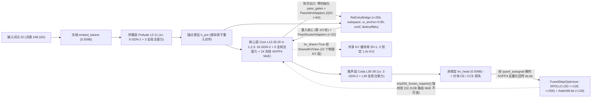
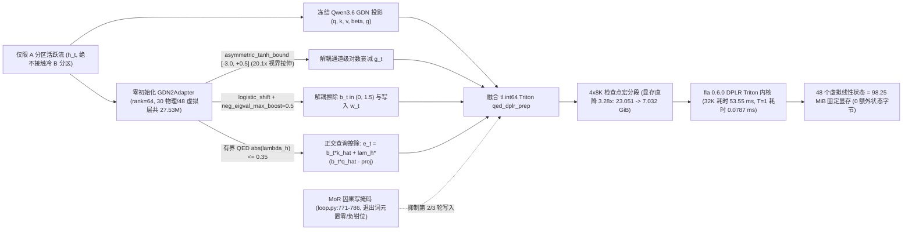
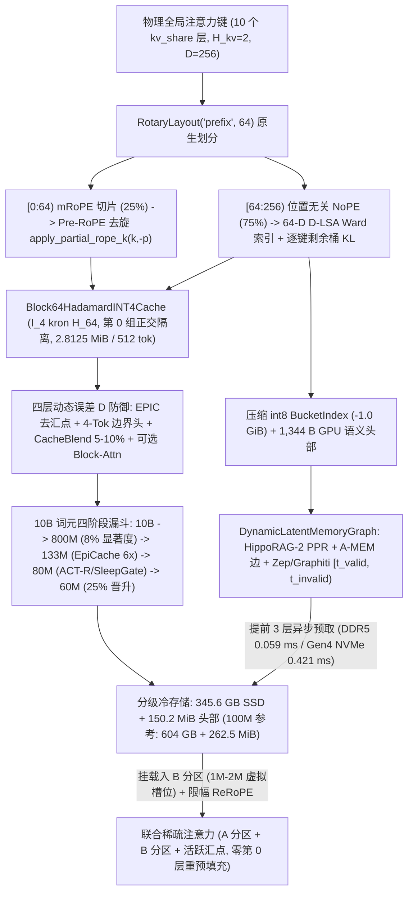
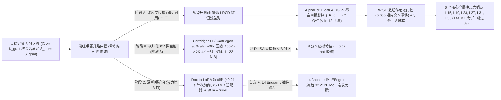
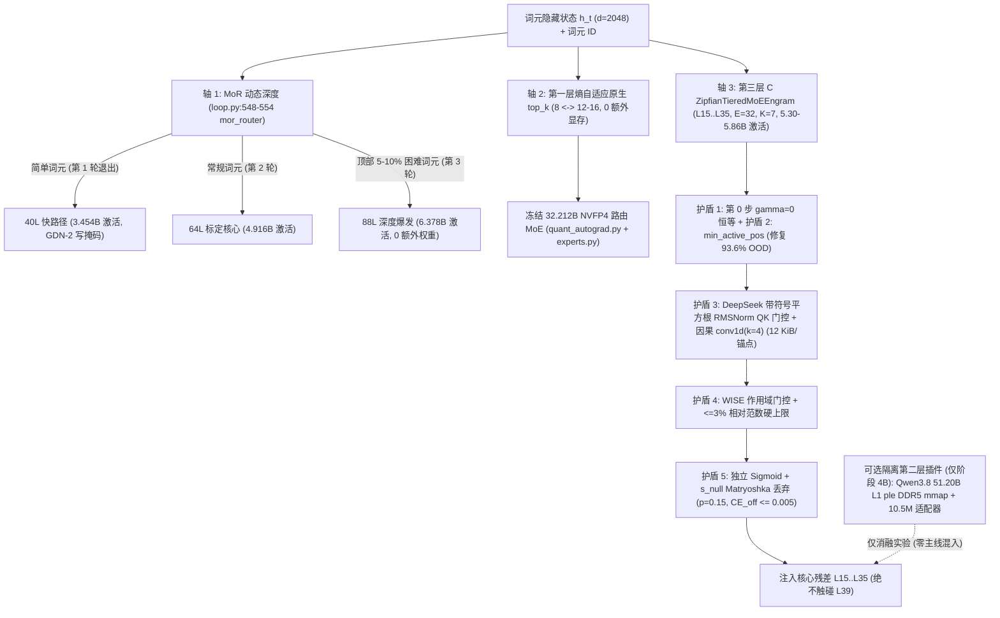
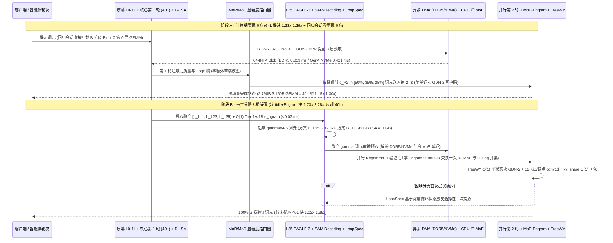

# 逐组件架构与工程实现规范（`v1.0`）：`Qwen3.6-64L-CoMem`（`LSA-NL`）

> **文档类别：** 工程师就绪的逐组件架构与实现蓝图（`v1.0`） · **目标系统：** `Qwen3.6-64L-CoMem`（`LSA-NL` v2.0 五频段连续记忆系统与三轴动态弹性计算）  
> **核心基座：** 冻结 `Qwen/Qwen3.6-35B-A3B`（文本总参 `34.661B` / 冻结 NVFP4 路由 MoE `32.212B` / 稠密核心 `2.448B`；`[0,12)×1 + [12,36)×R + [36,40)×1` → `40L [3.454B]` / `64L [4.916B]` / `88L [6.378B]` 激活参数；`10` 个 `kv_share=True` 物理全局注意力层，`partial_rotary_factor=0.25` [`64`-D `3D mRoPE` + `192`-D NoPE]；`30` 物理层 / `48` 虚拟层 `GDN-2-1M + QED` 线性注意力）  
> **研发硬件：** `1× NVIDIA RTX PRO 6000 Blackwell Server Edition`（`GB202`，`sm_120`，**`96 GB GDDR7 ECC`** [`94.97 GiB` CUDA 可用]，`512-bit`，**`1,597 GB/s`** 峰值带宽，`24,064` CUDA 核心，`600 W` TDP） · **消费级目标：** `16 GB`（`RTX 4080 / 5070 Ti`）、`24 GB`（`RTX 3090 / 4090`）、`32 GB`（`RTX 5090`）  
> **配套文档：** [英文架构与实现规范 (`ARCHITECTURE_NEXTGEN_LOOP64_LSANL.md`)](ARCHITECTURE_NEXTGEN_LOOP64_LSANL.md) · [LSA-NL 旗舰研究提案（英文）](PROPOSAL_LSA_NESTED_LEARNING.md) · [LSA-NL 旗舰研究提案（中文）](PROPOSAL_LSA_NESTED_LEARNING_ZH.md) · [下一代路线图（英文）](ROADMAP_NEXTGEN_LOOP64_COMEM.md) · [下一代路线图（中文）](ROADMAP_NEXTGEN_LOOP64_COMEM_ZH.md) · [算力申请提案（英文）](COMPUTE_GRANT_PROPOSAL.md) · [算力申请提案（中文）](COMPUTE_GRANT_PROPOSAL_ZH.md) · [实证技术报告（英文）](EXPERIMENT_REPORT.md) · [实证技术报告（中文）](EXPERIMENT_REPORT_ZH.md)

> [!IMPORTANT]
> **分支范围与并行模块对齐说明：** 本规范中链接的所有现有 `src/qloop/` 文件路径与行号锚点均已在当前仓库直接核验。阶段 2A/2B 记忆核心底座模块（`src/qloop/memory/kv_blob.py`、`src/qloop/memory/esm.py` 与 `tests/test_lsanl_memory.py`）正于并行分支同步实现，在合入主干前以反引号代码路径形式引用。全文所有数值均源自 Blackwell 实测遥测或闭式架构推导（`0` 未测基准宣称）。

---

## §0. 全局系统总览与不可妥协不变量

`Qwen3.6-64L-CoMem` 通过七个可组合组件（**C0–C6**）实例化**潜在稀疏嵌套学习（`LSA-NL`）**，在冻结的 `34.661B` 混合 MoE 基座之上构建五频段连续记忆系统（`L0 → L4`）与三轴弹性计算引擎，既无需从零预训练，亦彻底避免前摄干扰。四条全局不变量约束全部模块：

1. **第 0 步 IEEE-754 位级恒等（`max_abs_diff == 0.0`）：** 每个新增残差适配器（`LoopAdapters`、`GDN2Adapter`、`EpisodicSideMemory`、`ZipfianTieredMoEEngram`）均初始化为精确零输出贡献，确保第 1 步之前封装模型与原生 `Qwen3.6-35B-A3B` 逐位完全等价。
2. **密码学冻结 `32.212B` NVFP4 路由 MoE 先验：** 全部 `40 × 256` 个路由 SwiGLU 专家在所有训练、巩固与睡眠阶段保持 100% 不可变，每次更新前后均经 [`src/qloop/model/loop.py`](../src/qloop/model/loop.py#L1315) 与 [`src/qloop/model/experts.py`](../src/qloop/model/experts.py) 中的 `sha256_frozen_experts()` 强校验。
3. **严格分域隔离（Split-Horizon Isolation）：** 在线循环线性注意力（`L0`，`GDN-2-1M + QED`，`48` 个虚拟状态固定 `98.25 MiB`）**仅**运行于实时 **A 分区（`1M–2M` 活跃工作区）**，绝不摄入冷 **B 分区（`1M–2M` GPU 挂载 KV-Mem Blob，底层依托 `100M+` 冷 SSD 词元）**。
4. **100% 纯 `Qwen3.6` 主线发布：** 主检查点不混入任何外部供体权重；`Qwen3.8-Flash-Next` 的 `51.20B` 第 1 层 `ple` 查表严格隔离为可选 DDR5 `mmap` 插件消融（`阶段 4B`）。

| 组件 | 时间尺度 / 频率 | 在 `Qwen3.6-64L-CoMem` 中的核心职责 | 主要显存占用（`1× 96 GB GDDR7`） | 主要代码触点 |
| :---: | :---: | :--- | :---: | :--- |
| **C0** | 静态先验（`0`） | 冻结 NVFP4 基座 + `[12,36)` 三明治循环（`40L/64L/88L`）+ APOLLO | `21.85 GiB` 纯 NVFP4（`24.09 GiB` 混合） | `model/{loop,mhc,experts,quant_autograd}.py`, `train/optim.py` |
| **C1** | **L0**（`1 / tok`） | 活跃流 `GDN-2-1M + Bounded QED + Soft Neg-Eigval`（`fla 0.6.0` DPLR） | `98.25 MiB` 固定状态（`27.53M` 适配器） | `model/gdn2.py`, `model/loop.py` |
| **C2** | **L1–L2**（`1/512 tok`, `1/sess`） | 升级版 `D-LSA` + `SplitHorizonKVBlobStore`（`KVMemBlobStore`）+ `DLMG` + `10B` 漏斗 | `11.25–22.50 GiB` KV + `150.2–262.5 MiB` 头部 | `model/{lsa,offload,pos_rerope}.py`, `memory/kv_blob.py` |
| **C3** | **L3**（`1 / task`） | `EpisodicSideMemory`（`AlphaEdit` + `WISE`）+ `Cartridges++` + `Doc-to-LoRA` | `144 MiB/分片`（`ESM`）/ `11–22 MiB`（`Cart++`） | `memory/esm.py`, 规划 `model/cartridges.py` |
| **C4** | **L4**（`1 / week`） | 三轴弹性计算（`MoR` + 自适应 `top_k` + `ZipfianTieredMoEEngram`） | `0.65–0.99 GiB` NVFP4 Engram（`top_k` 为 `0`） | `model/{loop,experts,quant_autograd}.py`, 规划 `engram.py` |
| **C5** | 运行时引擎 | `MoR`/`MoD` 预填充 + Engram 耦合 `L35` `EAGLE-3`/`SAM`/`TreeWY` + `<= 24 GB` | `17.66–18.93 GiB`（`24 GB`）/ `10.89 GiB`（`16 GB`） | `infer/engine.py`, 规划 `infer/spec_draft.py` |
| **C6** | 阶段 5 附录 | 原生多模态 KV-Mem Blob（`Qwen3.6` 27L ViT，`3D mRoPE [11,11,10]`） | 共享 `2.8125 MiB/blob`（`192`-D NoPE） | `model/pos_rerope.py`, `memory/kv_blob.py`, 规划 `vlm_blobs.py` |

---

## C0 — 冻结基座主干与 `[12, 36)` 三明治循环（`40L / 64L / 88L`）

### 工作原理（How It Works）
原生 `Qwen/Qwen3.6-35B-A3B` [1] 在 `40` 个物理层（`10 × [3 Gated DeltaNet + 1 Gated Full Attention]`）中封装了 `34.661B` 文本参数，其中 `32.212B`（`92.93%`）驻留于 `256` 个路由 SwiGLU 专家（每词元激活 `k = 8`），而常驻全激活的稠密核心仅占 `2.448B`（`1.017B` 非绑定 `embed_tokens` + `lm_head`、`1.011B` 线性混合器、`0.273B` 全局注意力混合器、`0.126B` 共享专家、`0.021B` 路由器）。C0 将经零训练校准的中部 `24` 个物理层 `[12, 36)` 封装为**子空间对齐三明治循环**，按 `R ∈ {1, 2, 3}` 执行 `Prelude [0,12)×1 + Core [12,36)×R + Coda [36,40)×1`（等效深度 `40L` / `64L` / `88L`）。在第 `r >= 2` 轮重入时，流形约束 **`ReEntryBridge`**（源于 `mHC` [2]）借由双随机 Birkhoff 混合（`w_anchor = 0.85`）融合上一轮输出 $h^{(r-1)}$ 与序幕锚点 $h_{\text{pre}}$；同时 **`PassRouterAdapters`** 向每个核心 MoE 路由器注入低秩（`r = 32`）logit 增量，促使后续轮次从冻结 `32.212B` 专家池中征召互补专家（`s1_loop_a6b@1000` 实测第 2 轮重路由率达 `82.27%`，每词元唯一专家数 `17.36`）。全部 `10` 个物理全局注意力层跨轮次复用同一份 `1.0×` KV 缓存（`kv_share=True`）。

### 设计决策（How We Design It）
- **精确激活参数账本（`闭式推导`）：** `40L (R=1)` 执行 **`3.454B`** 总激活参数（扣除 embed/head 后预填充 GEMM 为 `2.436B`）；**`64L (R=2)`** 执行精确 **`4.916B`** 激活参数（`1.017B` embed+head + `2.053B` 混合器 + `1.845B` MoE；`kv_share=True` 跳过 `6` 个核心层的 `k_proj/v_proj` 节省 `0.0126B`，预填充 GEMM 为 `3.885B`）；**`88L (R=3)`** 执行 **`6.378B`** 激活参数（`22` 个虚拟全局注意力层）。
- **零冲击第 0 步恒等与流形安全：** `s0_probe` 实测 `[12, 36)` 较 `[8, 32)` 将零样本重入冲击降低 `3.26×`。`pass_gates`、`PassAttnAdapters`（`q_proj`、`o_proj` `r = 64`）与 `PassRouterAdapters` 均严格初始化为 `0.0`，使 $R=1,2,3$ 在第 0 步与原生 `Qwen3.6` 逐位一致，从根本上避免纯 *Nested Learning (HOPE)* [3] / *Titans* [4] 直接嫁接冻结权重时引发的非恒等流形撕裂。
- **单卡 `96 GB GDDR7 ECC` 训练机制（`quant_autograd` + `APOLLO` [5]）：** 基座权重常驻 NVFP4（纯 NVFP4 `21.85 GiB` / Unsloth 混合 NVFP4/FP8 `24.09 GiB`）。反向传播期间，融合 Triton 反量化核按分块瞬时生成 BF16 权重以精确计算输入与路由器梯度 `dL/dx`（Blackwell 实测提速 `18.99×`，达 `1,148 GB/s = 71.9%` 的 `1,597 GB/s` 峰值带宽），且不保留常驻 BF16 副本。**APOLLO** [5]（`rank=256`、`scale_type=channel`、`update_proj_gap=200`、`min_dim=128`）将全部大型二维矩阵的优化器状态压缩 `4.2×–5.0×`（在 `s2_v2` 的 `104.86M` 注意力参数上仅占 `0.186 GiB`，对比全 AdamW 的 `0.781 GiB`），将 `4×32K` `d=3` 峰值显存牢牢压在 `67.19–67.77 GiB`（在 `94.97 GiB` 可用 GDDR7 上余留 `~27.2 GiB`）。

### 工程实现（How We Implement It）
- **循环调度、适配器与 KV 共享 —— [`src/qloop/model/loop.py`](../src/qloop/model/loop.py)：** `LoopSpec`（`:75`）、`build_schedule`（`:173`）、`SharedKVView`（`:280`，缓存第 1 轮 K/V 并在第 `2..R` 轮返回只读视图）、`PassRouterAdapters`（`:376`，`rank=32`）、`PassAttnAdapters`（`:466`，`q_proj`/`o_proj` `rank=64`）、`LoopAdapters`（`:508`，含 `gates` + `bridge` + `pass_router` + `pass_attn` + `mor_router`）、`VirtualLayer`（`:563`）、`LoopController`（`:658`，在 `:793` 以 `prepend=True` 注册路由前向钩子）与 `sha256_frozen_experts`（`:1315`）。
- **流形约束桥接 —— [`src/qloop/model/mhc.py`](../src/qloop/model/mhc.py)：** `sinkhorn_project`（`:35`，`20` 次迭代）、`BirkhoffMix`（`:44`）、`LoopBridge`（`:74`）及 `ReEntryBridge`（`:162`，`bridge_mode="subspace"`、`bridge_rank=256`、`bridge_init=[0.05, 0.85, 0.10]`）。
- **冻结护栏与量化自动微分 —— [`src/qloop/model/experts.py`](../src/qloop/model/experts.py) 与 [`src/qloop/model/quant_autograd.py`](../src/qloop/model/quant_autograd.py)：** `freeze_all_but`（`experts.py:850`）、`HotExpertDeltas`（`experts.py:450`）、`_nvfp4_dequant_fused_kernel`（`quant_autograd.py:506`）、`_QuantLinearAutogradFn`（`:1515`）、`_QuantMoERoutedAutogradFn`（`:2095`）与 `install_quantized_autograd_bridge`（`:3150`）。
- **优化器 —— [`src/qloop/train/optim.py`](../src/qloop/train/optim.py) 与 [`configs/base.yaml`](../configs/base.yaml#L89-L97)：** `build_param_groups`（`optim.py:382-421`）将满足 `p.dim() == 2 and min(p.shape) >= 128` 的参数路由至 `apollo_torch.APOLLOAdamW`，其余 `< 128` 维参数归入 `FusedStepOptimizer`（`:525`）内的批量 `AdamWLite`；`s1b`/`s3*`/`s2*`/`s4*` 阶段统一以 `fused=False` 运行，提供整步原子非有限值回滚与 `_foreach_norm(..., dtype=fp32)` 全局梯度裁剪。

---

## C1 — 时间尺度 L0（`1/tok`）：活跃流 `GDN-2-1M + QED + Soft Neg-Eigval`

### 工作原理（How It Works）
原生 `Qwen3.6` 交替排布了 `30` 个物理 Gated DeltaNet [6] 层（`64L` 下对应 `48` 个虚拟层），其耦合标量更新门 $\beta_t \in (0,1)$ 将记忆擦除与写入绑定在一起，限制了长程状态追踪表达力。组件 **C1** 将全部线性注意力层就地升级为 **`GDN-2-1M + Bounded QED + Soft Neg-Eigval`** [7], [8], [9]：
$$S_t = \big(I - \hat{k}_t e_t^{\top}\big)\operatorname{Diag}\!\big(\exp(g_t)\big) S_{t-1} + \hat{k}_t (w_t \odot v_t)^{\top}, \qquad e_t = b_t \odot \hat{k}_t + \lambda_h \Big(b_t \odot \hat{q}_t - \langle \hat{k}_t, b_t \odot \hat{q}_t \rangle \hat{k}_t\Big),$$
其中：
1. **解耦擦除 / 写入 / 衰减（`GDN-2` [7]）：** 通道级写入门 $w_t$、擦除门 $b_t$（`logistic_shift`）及非对称对数衰减乘子（在 `[-3.0, +0.5]` 上采用 `asymmetric_tanh_bound`，将有效记忆视界最高拉伸 $\exp(3.0) \approx 20.1\times$ 以适配 `1M` 词元流），使模型能够在保留旧关联的同时写入新状态。
2. **有界查询增强擦除（`QED` [8]）：** 引入沿查询方向正交的第二擦除分量，并通过 $|\lambda_h| \le 0.35$（`qed_max_lambda=0.35`）平滑限幅，令当前查询主动清理读路径上的陈旧键值而不破坏秩-1 更新稳定性。
3. **软负特征值（Soft Negative Eigenvalues [9]）：** 以 $1 + 0.5\tanh(\text{raw}_h) \in (0.5, 1.5)$（`neg_eigval_max_boost=0.5`）缩放每头擦除强度，使 $b_t \in (0, 1.5)$，从而让 $(I - \hat{k}_t e_t^{\top})$ 的特征值平滑跨入负半轴以解锁奇偶校验与状态追踪能力，同时避开 `b_t -> 2.0` 的数值爆炸边界。

### 设计决策（How We Design It）
- **精确 `fla 0.6.0` `DPLR` 等价与 `0` 额外状态字节：** 上述递推具有精确的对角加低秩（DPLR）形式 $S_t = (\operatorname{Diag}(e^{g_t}) + a_t b_t^\top) S_{t-1} + \tilde{k}_t \tilde{v}_t^\top$，可直接映射至生产级 `fla 0.6.0` [10] `chunk_dplr_delta_rule` / `fused_recurrent_dplr_delta_rule` Triton 内核，较原生 GDN **零新增循环状态字节**：`64L` 全部 `48` 个虚拟线性状态精确占用 **`98.25 MiB`**（`fp32` `[H_v, d_k, d_v]` 状态 + `bf16` 短卷积状态），适配器总参数量仅 **`27.53M`**（占 `34.661B` 的 `0.079%`）。
- **`4×8K` 检查点宏分段（显存直降 `3.28×`）：** 在 `4×32K` BPTT 训练期间，整段 `32K` 直接穿越 Python/Triton 预处理包装层会将临时激活推高至 `23.051 GiB`。将每段 `32K` 切分为 `4 × 8,192` 词元检查点宏分段（`fla_segment_len=8192`），段间仅传递末端状态 `h_T`，实测将包装层显存压降 **`3.28×`（`23.051 → 7.032 GiB`，`Measured`）**且梯度完全精确（`38/38` Blackwell CUDA pytest 全绿；`32K` 耗时 `53.55 ms` [`2.00×`]，`T=1` 耗时 `0.0787 ms` [`2.41×`]）。
- **严格 A 分区隔离与 `MoR` 写掩码：** B 分区冷 Blob **绝不**输入 `GDN-2`，防止归档噪声冲刷当前活跃推理轨迹。在 `MoR` [11] 动态深度下，第 1 轮提前退出的简单词元在第 2/3 轮的 `in_proj_qkvz` 输出被置零、`in_proj_ba` logits 被钳位至 `-30.0`（`loop.py:771-786`），确保训练与解码阶段的循环状态语义逐位一致。

### 工程实现（How We Implement It）
- **核心数学与融合 Triton 预处理 —— [`src/qloop/model/gdn2.py`](../src/qloop/model/gdn2.py)：** `GDN2Config`（`:96`，`rank=64`、`fla_segment_len=8192`、`decay_log_min=-3.0`、`decay_log_max=0.5`、`qed_max_lambda=0.35`、`neg_eigval_max_boost=0.5`）、`asymmetric_tanh_bound`（`:156`）、`logistic_shift`（`:173`）、`_compute_qed_erase`（`:200`）、融合 `tl.int64` Triton 核 `_qed_dplr_prep_fwd_kernel`（`:419`）与 `_qed_dplr_prep_bwd_kernel`（`:497`）、`qed_dplr_prep`（`:925`）、`_run_fla_dplr`（`:1050`）、`_run_fla_segmented`（`:1182`）、`recurrent_gdn2`（`:1327`）、`chunk_gdn2`（`:1488`）、`GDN2Adapter`（`:1637`）、`GDN2Manager`（`:1850`）与 `install_gdn2`（`:2176`）。
- **`MoR` 写掩码钩子 —— [`src/qloop/model/loop.py`](../src/qloop/model/loop.py#L771-L786)：** 在全部核心线性层上为 `write_zero_names`（`in_proj_qkvz`、`gdn2_adapter.down`）注册 `_write_hook(None)`，为 `write_neg_names`（`in_proj_ba`）注册 `_write_hook(-30.0)`。
- **验证契约：** `tests/test_gdn2.py` 强制验证第 0 步 `torch.equal`、`chunk_gdn2` 与 `recurrent_gdn2` 的 `fp64` 等价性（前向 `<= 1e-10` / 反向 `<= 1e-9`）、`4×8K` 分段梯度一致性以及 `MoR` 写掩码解码不变性。

---

## C2 — 时间尺度 L1–L2（`1/512 tok` 与 `1/session`）：升级版 `D-LSA` + `SplitHorizonKVBlobStore`（`KVMemBlobStore`）+ `DynamicLatentMemoryGraph`

### 工作原理（How It Works）
组件 **C2** 围绕 `Qwen3.6` 原生的 **`RotaryLayout("prefix", 64)`**（`partial_rotary_factor = 0.25`，`64`-D mRoPE + `192`-D NoPE）[12], [13]，统一构建 **L1**（A 分区活跃工作上下文，`1M–2M` 词元，每 `512` 词元更新）与 **L2**（B 分区巩固情景记忆，`1M–2M` GPU 挂载虚拟槽位，底层由 `100M+` 冷 SSD 词元支撑）：
1. **对原始 `LSA` [12] 的六项外科手术式升级：**
   - *逐键剩余桶前向 KL + `calibrate_tau`：* 将 `_distill_kl()`（`lsa.py:1231-1268`）由桶级质量 KL 升级为原始 LSA 的选中叶节点逐键前向 KL，并加入吸收未访问尾部概率质量的截断深度“剩余桶”与事后温度校准 `calibrate_tau`，将 `512K–1M` 头级召回从 `0.5715` 推升至 `> 0.75`。
   - *`-1.0 GiB` `int8` `BucketIndex` 压缩：* 以紧凑的 `int8` 块内相对偏移替代 `_assemble()`（`lsa.py:728-768`，`1M` 下占 `+1.04 GiB`）中的即席 `int64` 成员数组（压至 `<= 0.06 GiB`，净省 `-1.0 GiB` GDDR7）。
   - *每轮解耦 `W_q^{(p)}`（`num_query_passes = 2–3`）：* 已在 `lsa.py:175,376-384` 实现，在 `1.0×` `kv_share` KV 上执行差异化第 2/3 跳稀疏检索。
   - *可变 `DLMG` 图谱、Pre-RoPE 跨会话挂载、GPU 头部/SSD 载荷分级与横向→纵向记忆晋升。*
2. **精确中和几何误差（$G$）与四层动态误差（$D$）防御：**
   在微睡眠 [14] 封存 `512` 词元 Blob 时，仅对 `[0:64)` 执行逆向去旋 $k_j^{\text{pre}} = [R(-(p_s+j)\omega) k_{\text{rot}}^{(s)}(j),\; k_{\text{nope}}^{(s)}(j)]$（`apply_partial_rope_k(k, -p)`），而 `[64:256)`（占 `K` 的 `75%`）天然保持逐位位置不变。由于 `walsh_hadamard_block` 施加块对角变换 $I_4 \otimes H_{64}$（`offload.py:32-56`，源自 `TurboQuant` [15]），第 0 组（`[0:64)`）与第 1–3 组（`[64:256)`）完全正交隔离（`fp64` 交换律误差 `< 1e-12`）：在 B 分区挂载时仅第 0 组执行限幅 ReRoPE（`linear_ceil=131,072`、`log_scale=32,768`、`max_pos=240,000 < 262,144`），第 1–3 组直接留在 $H_{64}$ 空间完成内积评分。针对动态与汇点误差（$D$），逐层叠加四道防线：(1) **`EPIC`** [16] 剥离原会话 `[0:4)` 汇点，(2) **`TurboRAG`** [17] `4` 词元边界摘要头 + **`Zep/Graphiti`** [18] / **`SleepGate`** [19] `[t_valid, t_invalid)` 冲突屏蔽，(3) **`CacheBlend`** [20] 仅对最高 HKVD 的 `5%–10%` 词元执行选择性刷新（较第 0 层预填充省 `~10×–18×`），(4) 仅当熔断门 `K0` 触发黄灯 B 时才启动的 `2–4 h` **`Block-Attention`** [21] 适配器校准。
3. **`DLMG` 与 `10B` 词元遗忘/硬化漏斗：**
   `Spark-X2.6` [22] 的 **`DynamicLatentMemoryGraph`（`DLMG`）** 借由互逆 `A-MEM` [23] 语义边连接 Blob，通过 `HippoRAG 2` [24] 个性化 PageRank 扩展 `1–2` 跳并滤除过期 `[t_valid, t_invalid)` 墓碑（`SleepGate` [19]、`Zep/Graphiti` [18]）。面对 `10B` 终身词元流（原始 SSD `57.60 TB`、原始头部 `24.45 GiB`），四阶段漏斗——`~8%` 显著度精选（`800M`）→ `EpiCache` [25] `6×` `192`-D NoPE 去重（`133M`）→ `SleepGate` + 艾宾浩斯 ACT-R 保持律 $R_b(t) = \exp(-\Delta t / S_b)$ 叠加间隔重复硬化 $S_b \leftarrow 2S_b$（修剪 `~40%` → `80M`）→ 最热 `25%` 簇晋升 `L3`/`L4`——将稳态归档严格收敛在 **`60M` 词元（`117,188` 个 Blob = `345.6 GB` SSD + `150.2 MiB` GPU 头部）**。

### 设计决策（How We Design It）
- **Blob 与语义头闭式账本（`闭式推导`）：**
  - `1` 个跨 `10` 个物理 `kv_share` 层的 `512` 词元 Blob（`5,242,880` 标量）：FP8（`FP8KVCacheQuantizer`）占 **`5.00 MiB`**，`Block64HadamardINT4Cache`（`36 B / 64 标量`）占 **`2.8125 MiB`**（`2,949,120 B`，每层 `288.0 KiB` = `128 × 2,304 B` 微页）。
  - 常驻 GPU 粗粒度语义头：`10 × 64 × 2 B = 1,280 B` `fp16` NoPE 质心 + `64 B` 双时间/显著度/CSR/LBA 元数据 = **`1,344 B/blob`**。
  - `100 Mi-tokens`（`204,800` 个 Blob）= **`604.0 GB` SSD**（`562.50 GiB`）+ **`262.50 MiB` GPU 头部**（`250.00 MiB` 质心 + `12.50 MiB` 元数据；在 `1,597 GB/s` 的 `70%` 实测带宽下全量扫描 `10` 层仅需 `~0.23 ms`）。
  - 流式预取（借鉴 `ShadowKV` [26]、`InfiniGen` [27]、`Quest` [28]）：Gen4 ×4 NVMe（`7.0 GB/s`）为 **`0.421 ms/blob`**（`0.0421 ms/层`），锁页 DDR5（`50.0 GB/s`）为 **`0.059 ms/blob`**（`0.0059 ms/层`），借 `prefetch_layers_ahead=3` 完整掩盖于 `3` 个交替 `GDN-2 + MoE` 层之后。
- **服务器 GDDR7 运行包络（`94.97 GiB` 可用）：** 包络 A `3M` 精度分域（`1M` FP8 + `2M` H64 = `21.25 GiB` KV → 总计 **`43.55–43.81 GiB`**，余 `~51.2–51.4 GiB`）；包络 B `4M` 最大分域（`2M` H64 + `2M` H64 = `22.50 GiB` KV → 总计 **`45.16–45.41 GiB`**，余 `~49.6–49.8 GiB`）；包络 C `2M` 热槽 + `100M` SSD（`11.25 GiB` KV → 总计 **`33.81 GiB`**，余 `~61.2 GiB`）。

### 工程实现（How We Implement It）
- **现有代码锚点：** [`src/qloop/model/lsa.py`](../src/qloop/model/lsa.py)（`index_on="nope":154`、`num_query_passes:175`、`_assemble:728-768`、`_distill_kl:1231-1268`、`lsa_attention:3128`、`LSAManager:3424`）；[`src/qloop/model/offload.py`](../src/qloop/model/offload.py)（`walsh_hadamard_block:32-56`、`pack_group64_int4:59`、`Block64HadamardINT4Cache:115`、`prefetch_micro_pages:321-355`、`gather_kv_and_reconstruct_v:445-514`、`FP8KVCacheQuantizer:551`）；[`src/qloop/model/pos_rerope.py`](../src/qloop/model/pos_rerope.py)（`clamped_relative_distance:89-124`、`apply_partial_rope_k:166-195`、`apply_partial_rerope_q:198-261`）。
- **并行阶段 2A/2B 底座（Memory-Core 分支）：** `src/qloop/memory/kv_blob.py`（`KVBlobConfig`、`KVBlobHeader`、`KVMemBlob`、`strip_sinks_and_unrotate_k`、`pack_kv_blob`、`mount_kv_blob`、`DynamicLatentMemoryGraph` PPR + 双时间 `[t_valid, t_invalid)` 过滤器及 `SplitHorizonKVBlobStore` 四阶段 `10B` 词元漏斗），由 `tests/test_lsanl_memory.py` 协同 `K0` 评测脚本 `scripts/eval_killgate_k0_kv_blobs.py` 严格验证。

---

## C3 — 时间尺度 L3（`1/task`，浅睡眠）：`EpisodicSideMemory` 与三阶段 KV-Blob → Engram 蒸馏

### 工作原理（How It Works）
反复将相同的 `100K` 词元代码库不变量、MCP 工具模式或用户偏好挂载进 B 分区，会持续挤占宝贵的横向稀疏注意力槽位。在**浅睡眠**（任务/仓库完结）阶段，**C3** 通过**三阶段渐进通路**将高频复现的 `L2` KV-Mem Blob 纵向晋升为紧凑 $O(1)$ 残差参数或高密度合成 KV 包，全程绝不修改冻结的 `32.212B` MoE 基座：
- **阶段 A —— 零反向传播 `EpisodicSideMemory`（`ESM`，即刻可用）：** 借由 `Spark-X2.6` [22] 的 **`LRCD`** 提取 `(key, target_delta)` 残差对，先将触发键严格投影至通用知识激活 $K_0$ 的正交补空间，再采用 **`AlphaEdit`** [29] **`Float64` 双重格拉姆-施密特（`DGKS`）** 零空间岭回归求解：
  $$K_{e,\perp} = P_0 K_e, \qquad \Delta W = R \big(K_{e,\perp}^{\top} K_{e,\perp} + \lambda I\big)^{-1} K_{e,\perp}^{\top} = R K_e^{\top} P_0 \big(P_0 K_e K_e^{\top} P_0 + \lambda I\big)^{-1} P_0, \qquad P_0 = I - Q_0 Q_0^{\top}, \qquad \|\Delta W K_0\|_F / \|K_0\|_F < 10^{-12},$$
  并在推理期套以 **`WISE`** [30] 激活作用域门控，保证作用域外的通用文本漂移精确为 **`0.000`**。每次写入均在事务级 **回滚账本（Undo Ledger）** 记录可逆增量，支持项目归档或事实撤销时的毫秒级位精确回滚。
- **阶段 B —— 模块化压缩 KV 弹匣包（`Cartridges++`）：** 结合 **`Cartridges`** [31]、**`Cartridges++`** [32]（借路由与数据混合消除跨上下文偏航）与 **`Cartridges at Scale`** [33]，将 `100K` 词元文档/代码簇蒸馏为 `2K–4K` 合成 `H64-INT4` KV 词元（`4–8` 个 Blob = **`11.25–22.50 MiB`**，典型压缩比 **`~38×`**），零架构改动即可直接借 `D-LSA` 插回 B 分区。
- **阶段 C —— 单次前向超网络与自编辑编译（`深睡眠 / 第 3 档`）：** **`Doc-to-LoRA`** [34] 元训练轻量化超网络，在**单次亚秒级前向（`~0.21 s`、`适配器显存 < 50 MB`、零单文档 SGD）**内将热 Blob 簇编译为即插即用知识 LoRA/Engram 适配器，并配套按周 **`SMF`** [35]（TF-IDF/惊奇度稀疏槽位更新）与 **`SEAL`** [36] 强化学习自编辑指令。

### 设计决策（How We Design It）
- **精确锚点选址（`6` 个核心全局注意力边界，严格跳过尾声层 `L39`）：** `ESM` 仅挂载于 **`L15, L19, L23, L27, L31, L35`**（`64L` 中共 `12` 次虚拟访问），严格遵循已验证的 `S2` 校准规则**跳过尾声层 `L39`**，避免直接扰动紧邻 `lm_head` 的最终残差层而在无关提示词上引发 logit 分布冲击。
- **精确 `144.0 MiB/分片` 显存预算（`闭式推导`，`Spark-X2.6 §C5.2`）：** `6` 个锚点 ×（`w_in` `[2048, 2048]` 冻结正交 `bf16` [`2 B` = `8.0 MiB/锚点`] 配归一化 `GELU` 特征 + `w_down` `[2048, 2048]` 编译 `fp32` [`4 B` = `16.0 MiB/锚点`] = `24.0 MiB/锚点`，共 `50.33M` 参数）= **`150,994,944 B = 144.0 MiB`（`0.141 GiB`）/ 分片**（不足 `94.97 GiB` GDDR7 ECC 的 `0.15%`），可同时常驻数十个项目分片或 `< 3 ms` 热切换。
- **数值严谨性：** `DGKS` 正交化强制在 `torch.float64` 下执行两遍重正交化（保证 $\|Q_0^\top Q_0 - I\|_\infty < 10^{-14}$ 与零空间泄漏 `< 1e-12`），彻底杜绝朴素 `fp32` 正规方程常见的秩亏塌缩。

### 工程实现（How We Implement It）
- **并行阶段 2B 底座（Memory-Core 分支）：** `src/qloop/memory/esm.py` 实现 `ESMConfig`（`anchor_layers=(15, 19, 23, 27, 31, 35)`，严格守卫 `>= 36` 尾声层以屏蔽 `L39`）、`ESMLedgerEntry`、`NullSpaceESMAnchor`（`w_in` `bf16` 正交 + `w_down` `fp32`、SVD `register_general_subspace`、`Float64` AlphaEdit + DGKS `compile_nullspace_ridge`、`WISE` 激活作用域门控、相对范数硬上限与事务型 `rollback_entry`）及 `EpisodicSideMemoryBank`（`144.0 MiB` 分片账本），由 `tests/test_lsanl_memory.py` 校验（`< 1e-12` 零空间泄漏、`0.0` 第 0 步偏差、`0.000` 域外漂移与 `100%` 逐位回滚）。
- **阶段 B 与阶段 C 触点：** 规划 `src/qloop/model/cartridges.py`（产出标准 `H64-INT4` B 分区 Blob 的 `Cartridges++` 合成器），以及阶段 3 / 算力第 3 档复用 `FusedStepOptimizer`（`optim.py`）并受冻结 MoE SHA-256 守卫的 `Doc-to-LoRA` 超网络与 `SMF` 掩码训练器。

---

## C4 — 时间尺度 L4（`1/week`，深睡眠）：三轴弹性计算（`MoR` + 自适应 `top_k` + 原生 `2048`-D `ZipfianTieredMoEEngram`）

### 工作原理（How It Works）
不同于把每个词元死锁在固定深度与静态激活宽度的循环模型，**C4** 沿着**三条正交弹性轴**动态分配算力与长期参数化记忆，激活参数覆盖 `3.454B ↔ 6.378B+`：
1. **轴 1 —— 词元级动态递归深度（`MoR` [11] + `Recurrent Depth` [37]）：** 因果词元路由器（`mor_router`，`loop.py:548-554`）令简单/样板词元于第 1 轮后直接退出（`40L`，`3.454B`），常规推理词元走 `64L`（`4.916B`），而最难的 `5%–10%` 分支/证明词元零额外权重爆发至 `88L`（`6.378B`），全程配 `GDN-2` 写掩码（`loop.py:771-786`）。
2. **轴 2 —— 第一层熵自适应原生 `top_k`（`0` 额外显存）：** 在高熵词元或第 2 轮核心层上，直接利用已加载的冻结 NVFP4 专家动态放宽原生 MoE 路由宽度 `k = 8 → 10/12/14/16`（`+0.30B..+1.21B` 激活参数，`0` 额外权重显存，`top_k=8` 等价差 `0.0`）。
3. **轴 3 —— 第三层 C 原生 `2048`-D `ZipfianTieredMoEEngram`（`5.30 / 5.45 / 5.86B` 激活）：** 将快速 Tier-1A/1B 因果 N-gram 查表 + `conv1d(k=4)`（`12 KiB/锚点` 3 词元滚动缓存）与原生 `2048`-D 路由 SwiGLU Engram 专家（`E = 32, K = 7` 外加 `1` 个共享专家 = 在 `L15..L35` `12` 次虚拟访问间只读一次 `0.085 GB`，`+0.944B` 激活 → 总激活 `5.86B`；NVFP4 显存占用 `0.65–0.99 GiB`）相结合，并经由 `SMF` [35] TF-IDF/惊奇度掩码离线巩固。

### 设计决策（How We Design It）
- **五重强制 Engram 稳定性护盾（彻底封堵 v1 / Spark-X2.6 全部失效模式）：**
  1. *护盾 1 —— 第 0 步 `γ = 0` 恒等：* 零初始化残差缩放 $\gamma = 0$ 强制初始化阶段 `max_abs_diff == 0.0`。
  2. *护盾 2 —— `min_active_pos` 前缀抑制：* 在上下文尚未充分确立的早期前缀位置屏蔽 Engram 写入，根治 `Spark-X2.6` [22] 记录的 `93.6%` 早期前缀 OOD 漂移失效。
  3. *护盾 3 —— `DeepSeek Engram` [38] 带符号平方根 RMSNorm QK 门控：* 计算内容感知标量门 $\alpha_t = \sigma(\operatorname{RMSNorm}(h_t)^\top \operatorname{RMSNorm}(W_K e_t) / \sqrt{d})$ 并辅以带符号平方根阻尼，防止无关 N-gram 命中注入幅值尖峰。
  4. *护盾 4 —— `WISE` [30] 作用域门控 + `<= 3%` 相对范数硬上限：* 在作用域门控之上强制 $\|\Delta h_{\text{eng}}\|_2 \le 0.03 \|h_t\|_2$，保证冻结下游 MoE 路由器始终停留在预训练激活锥内。
  5. *护盾 5 —— 独立 Sigmoid 路由 + `s_null` Matryoshka 丢弃（`p = 0.15`）：* 以独立 Sigmoid 门控对抗可学习空汇点 $s_{\text{null}}$，取代强制 Softmax 路由，叠加嵌套 Matryoshka 宽度切片与 `p = 0.15` 模块丢弃，确保关闭态漂移 `CE_off <= 0.005` nats。
- **严格隔离的可选第二层消融（仅阶段 4B）：** 直接 safetensors 文件头审计确认 `Qwen/Qwen3.8-Flash-Next` 在 `0..248069` 上与 `Qwen3.6` 逐位词表等价（`verify_q36_q38_tokenizer_parity.py`），并在 0 索引 `layers.1.ple.*` 存有 `137` 个 `.ple.` 张量（`51.20B` 参数）。阶段 4B 若开展评测，仅作为零拷贝 DDR5 `mmap` 隔离插件运行（搭配 `~10.5M` GPU `2560 ↔ 2048` 投影并绕过 `10240`-D 四分支 GR `key_proj/conv1d`）；只要纯 `Qwen3.6` 第三层 C 达到其 `>= 95%` 收益即直接淘汰。

### 工程实现（How We Implement It）
- **现有代码锚点：** [`src/qloop/model/loop.py`](../src/qloop/model/loop.py#L548-L554)（`mor_router`，权重零初始化且 `bias[-1] = 2.0`）、[`src/qloop/model/loop.py`](../src/qloop/model/loop.py#L771-L786)（`MoR` 写掩码）、[`src/qloop/model/quant_autograd.py`](../src/qloop/model/quant_autograd.py)（`_QuantMoERoutedAutogradFn` 动态 `top_k` 调度）以及 [`src/qloop/model/experts.py`](../src/qloop/model/experts.py#L104)（`parse_router_output` 与 `ExpertStats` Zipf 热度画像）。
- **规划阶段 3 模块：** `src/qloop/model/engram.py`（`ZipfianTieredMoEEngram`、五重护盾、`conv1d(k=4)` `12 KiB/锚点` 回滚缓存与 `SMF` 梯度掩码），由 `configs/stages/s2b_comem_engram.yaml` 驱动，外加可选隔离插件 `src/qloop/plugins/ple_mmap.py`。

---

## C5 — 端到端吞吐与 `<= 24 GB` 消费级推理引擎

### 工作原理（How It Works）
组件 **C5** 分别攻克**计算受限预填充（Prefill，`T >> 1`）**与**带宽受限解码（Decode，`T = 1`）**两类物理瓶颈，并让同一份检查点从 `96 GB GDDR7 ECC` 服务器平滑下探至 **`16–32 GB` 消费级显卡**：
1. **预填充加速（`64L` 提速 `1.23×–1.39×` + 回归会话零重预填充）：** 因提示词元已全部并行已知，投机草稿无法加速预填充。扣除 `embed_tokens` 与末词元 `lm_head` 后，`40L` 消耗 `2.436B` GEMM 参数/词元，而启用 `kv_share=True`（在 `6` 个核心层跳过 `k_proj/v_proj` 节省 `0.0126B`）的完整 `64L` 为 `3.885B`（`1.595×`）。将 **`MoR` [11] + `Mixture-of-Depths`（`MoD`）[39]** 容量因子第 2 轮词元跳过（$c_{\text{P2}} \in \{50\%, 35\%, 25\%\}$ 配 `GDN-2` 写掩码）与零额外模型的**第 1 轮显著度引导**（`Speculative Prefill` [40]、`Cross-Family Speculative Prefill` [41]）结合，可将激活预填充 GEMM 压至 **`3.160B / 2.943B / 2.798B`**（**较完整 `64L` 快 `1.23× / 1.32× / 1.39×`**，仅 `40L` 的 `1.15×–1.30×`）；同时 `D-LSA` [12] 在 `10M` 长度下将注意力加速 `22.7×–72.4×`，B 分区直挂更彻底消除回归会话的 $O(T)$ 重预填充。
2. **Engram 耦合无损中途解码（较 `64L+Engram` 快 `1.73×–2.28×`，反超 `40L`！）：** 朴素的完整 `40L` 第 1 轮起草（方案 A）在叠加 MoE Zipf 专家并集惩罚 $u_{\text{MoE}}(K) \in \{2.83\times, 3.40\times, 3.96\times\}$（`K = γ+1 ∈ {4,5,6}`）之前就已付出 `64L` `67.8%` 的访存，因此相对 `64L` 仅止步于 `1.03×–1.30×`（慢于 `40L`）。相反，我们的 **`~35M` 单层 `L35` `EAGLE-3` [42]** 草稿头融合 **$[h_{L11}, h_{L23}, h_{L35}, e_{\text{ngram}}]$**（以 `< 0.02 ms` $O(1)$ Tier-1A/1B N-gram 查表替代重量级路由 `MoE-Engram` SwiGLU 读取），经直接词元 TTT（`~100M–120M` 目标词元 / `~532K` 在策略轨迹）训练，并与 **`SAM-Decoding`** [43]（`0` 权重访存的 $O(1)$ 提示词/代码库后缀自动机）及 **`LoopSpec`** [44] 选择性二次提议协同。起草出的 `γ = 4–5` 个词元在并行验证前触发聚合 DDR5/SSD 前瞻预取，随后验证阶段借 **`TreeWY`** [45]（每层 `O(1)` 单状态块 `GDN-2` 回滚，峰值状态显存低 `2–3×`）、`12 KiB/锚点` `O(1)` `conv1d(k=4)` 回滚与 `kv_share` `O(1)` KV 指针截断完成精确校验。因 `MoE-Engram`（`E = 32, K = 7`）并集饱和更快（$u_{\text{Eng}}(K) \in \{2.21\times, 2.46\times, 2.65\times\}$）且 `0.085 GB` 共享专家仅读一次，即便 **`64L + 全量 MoE-Engram（5.86B 激活，4.131 GB/词元）`** 也能**无损反超未循环 `40L（3.45B）`**：**方案 B**（`0.55 GB` FP8 全词表 `lm_head`，`α=0.90–0.92`）达 **`1.73×–1.90×`（较 `40L` 快 `1.02×–1.12×`）**，**方案 B+**（保守 BF16 `32K` 短名单 `0.195 GB` [`FP8` 为 `0.119 GB`]，`α=0.85–0.92`）达 **`1.84×–2.28×`（较 `40L` 快 `1.09×–1.35×`）**，裸 `64L` 亦达 **`1.58×–1.76×`（较 `40L` 快 `1.07×–1.19×`）**——无需外挂数十亿草稿模型即全面超越静态 `Inkling 2 Mini` [46]。

### 设计决策（`<= 24 GB` 消费级 Zipf 热 NVFP4 切分）
因 `Qwen3.6` 全部常驻稠密核心仅占 **`2.42 GiB`**（FP8/Q8）外加 **`1.706 GiB`** 固定运行时开销（`0.10 GiB` 适配器 + `0.096 GiB` `GDN-2` + `0.35 GiB` `64K` B 分区 LRU + `0.26 GiB` `100M` SSD 头部 + `0.90 GiB` CUDA 临时区），而 `32.212B`（`16.875 GiB` NVFP4）集中于 Zipf 路由专家，混合 CPU/GPU 执行框架（`KTransformers` [47] AMX/AVX-512、`MoE-Lightning` [48] `CGOPipe`、`Fiddler` [49]）可将完全相同的 `64L` + `100M` SSD 智能体部署于消费级 GPU 并留足 `>= 5.0 GiB` 显存余量：

| 消费级档位与目标 GPU | GPU 稠密 + 固定项（`GiB`） | GPU 热路由 MoE | 活跃 `H64-INT4` KV + 索引（`GiB`） | **GPU 总显存（`GiB`）** | 主机 DDR5 冷 MoE（`GiB`） | 冷归档 |
| :--- | :---: | :---: | :---: | :---: | :---: | :---: |
| **`24 GB` 档位 A（`RTX 3090/4090`）** | `2.42 + 1.706` | `11.81`（`256/256` `IQ3_XXS`） | `2.813 + 0.176`（`512K`） | **`18.93 GiB`** | `0.00 GiB` | `100M`（`604 GB`） |
| **`24 GB` 档位 C（`RTX 3090/4090`）** | `2.42 + 1.706` | `10.55`（`160/256` NVFP4） | `2.813 + 0.176`（`512K`） | **`17.66 GiB`** | `6.33 GiB`（`96/256`） | `100M`（`604 GB`） |
| **`24 GB` 档位 D（`RTX 3090/4090`）** | `2.42 + 1.706` | `8.44`（`128/256` NVFP4） | `5.625 + 0.353`（**`1M`**） | **`18.54 GiB`** | `8.44 GiB`（`128/256`） | `100M`（`604 GB`） |
| **`16 GB` 档位 E（`RTX 4080/5070 Ti`）** | `2.42 + 1.706` | `5.27`（`80/256` NVFP4） | `1.406 + 0.088`（`256K`） | **`10.89 GiB`** | `11.60 GiB`（`176/256`） | `100M`（`604 GB`） |
| **`32 GB` 档位 F（`RTX 5090`）** | `2.42 + 1.706` | `16.88`（`256/256` NVFP4） | `5.625 + 0.353`（**`1M`**） | **`26.98 GiB`** | `0.00 GiB` | `100M`（`604 GB`） |

### 工程实现（How We Implement It）
- **现有推理内核 —— [`src/qloop/infer/engine.py`](../src/qloop/infer/engine.py)：** `InferenceConfig`（`:52`）、`QuantizedHybridCache`（`:274`，支持 `_FP8Slot` `:185` 与 `_HadamardINT4Slot` `:221`）以及 `OptimizedLoopInferenceEngine`（`:504`，运行时 `depth(r)` 切换 `:640`、分块 `prefill` `:811`、编译解码 `:665` 与 `generate` `:896`）。
- **规划阶段 2C/3 投机与混合模块：** `src/qloop/infer/spec_draft.py`（带 `32K` 短名单的 `L35` `EAGLE-3` 融合头、`SAM-Decoding` 后缀自动机、`LoopSpec` 二次提议、`TreeWY` Triton 三角验证核、`conv1d(k=4)` `12 KiB/锚点` 回滚与 `MoR`/`MoD` 预填充容量路由器）+ 基于 `ExpertStats.select_hot()`（`src/qloop/model/experts.py:236`）的 `KTransformers`/`MoE-Lightning` 热专家驻留加载器。

---

## C6 — 长期阶段 5 附录：原生多模态 KV-Mem Blob

```mermaid
flowchart LR
    VIS["视觉输入 (UI 截图, 多页 PDF, IDE 画面, 视频流)"] --> VIT["内置原生 Qwen3.6 27L ViT 视觉塔 (d=1152, d_ff=4304)"]
    VIT --> DEC["共享 2048-D 循环混合解码器 ([0:64) 施加 3D mRoPE [11, 11, 10])"]
    DEC --> KEYS["10 个物理全局注意力 KV 层 (64-D 3D mRoPE + 192-D 位置无关 NoPE)"]
    KEYS --> UNROT["Pre-3D-mRoPE 去旋 [0:64) + EPIC 去汇点 + Block64HadamardINT4Cache"]
    UNROT --> BLOB["统一 512 词元多模态 KV-Mem Blob (2.8125 MiB/blob, 1,344 B 头部)"]
    BLOB --> GRAPH["共享 D-LSA + DLMG (M3-Agent 实体图 + ReKV 分页检索 + M+ 检索器)"]
    GRAPH --> SSD["完全同构的 100M 词元冷 NVMe 归档 (604 GB SSD, 零架构重构)"]
```

### 工作原理（How It Works）
`Qwen/Qwen3.6-35B-A3B` [1] 原生支持 `image-text-to-text`，内置 `27` 层视觉 Transformer（`d = 1152`、`d_ff = 4304`），在 **`3D mRoPE`（`mrope_section = [11, 11, 10]`，`32` 对旋转维 = `64` 维旋转子空间）**下直接馈入共享 `2048`-D 文本解码器。由于 `3D mRoPE` 严格局限于 `[0:64)`，而 `[64:256)` 保持为 **`192`-D 位置无关 NoPE**，来自 UI 截图、科研 PDF 与流式视频的视觉词元天然产出与文本/代码**完全同构的 `192`-D NoPE 语义键与 `Block64HadamardINT4Cache` `512` 词元 KV-Mem Blob**。

### 设计决策（How We Design It）
- **严格范围门控：** 阶段 `0–4` 保持 100% 聚焦文本与代码（训练期裁剪 `visual` 塔，但完整保留原生 `embed_tokens` 与 `3D mRoPE` 几何结构）。阶段 5 **严格仅在**文本/代码 `K0–K4` 全部通过后启用，直接服务论文 3（`ScreenSpot Pro`、`OmniDocBench` 与流式视频问答）。
- **文献落地映射：** 将 **`ReKV`** [50]（免训练按需流式视频 KV 卸载与检索）、**`M3-Agent`** [51]（实体中心多模态情景/语义图谱）及 **`M+`** [52]（超越 `160K+` 词元的协同训练长期潜在检索器）直接映射至既有 `SplitHorizonKVBlobStore`（`KVMemBlobStore`）与 `DLMG`，无需新增任何存储格式。

### 工程实现（How We Implement It）
- 零重新对齐冻结文本/MoE 权重直接挂回内置 `visual` 视觉塔；在规划模块 `src/qloop/model/vlm_blobs.py` 中为 `apply_partial_rope_k`（`src/qloop/model/pos_rerope.py:166-195`）扩展 3D `(t, h, w)` 逆向 mRoPE 去旋，并向 `src/qloop/memory/kv_blob.py` 输出标准 `2.8125 MiB` `H64-INT4` Blob 与 `1,344 B` 头部（多模态 `K0` 熔断门：Pre-`3D-mRoPE` 视觉 Blob 达连续 VLM 神谕 `>= 90%`，且文本/代码指标 `0` 回退）。

---

## §8. 实现模块映射与分阶段构建顺序

| 构建阶段 | 对应组件 | 精确文件路径 | 核心张量 / API 契约 | 单元测试套件 | 熔断门 |
| :---: | :---: | :--- | :--- | :--- | :---: |
| **已运行（阶段 0）** | **C0, C1** | [`src/qloop/model/loop.py`](../src/qloop/model/loop.py), [`mhc.py`](../src/qloop/model/mhc.py), [`gdn2.py`](../src/qloop/model/gdn2.py), [`quant_autograd.py`](../src/qloop/model/quant_autograd.py), [`train/optim.py`](../src/qloop/train/optim.py) | `64L/88L` `[12,36)` 循环、`GDN-2-1M+QED` `fla 0.6.0` DPLR（`4×8K`，`98.25 MiB`）、APOLLO `r=256`、`sha256_frozen_experts()` | `test_loop.py`, `test_loop_v3.py`, `test_gdn2.py`, `test_optim_loss.py` | Gate 1/2/3（`s2_v2@600`） |
| **阶段 1** | **C2, C4** | [`src/qloop/model/lsa.py`](../src/qloop/model/lsa.py#L728-L768), [`experts.py`](../src/qloop/model/experts.py), [`quant_autograd.py`](../src/qloop/model/quant_autograd.py) | `int8` `BucketIndex` 压缩（`1M` 下 `<= 0.06 GiB`，省 `-1.0 GiB`）；零额外显存动态 `top_k`（`8 ↔ 16`） | `test_lsa.py`, `test_loop_v3.py` | `K1`（`top_k=8` `0.0` 等价） |
| **阶段 2A** | **C2** | [`src/qloop/model/lsa.py`](../src/qloop/model/lsa.py#L1231-L1268), [`pos_rerope.py`](../src/qloop/model/pos_rerope.py), [`offload.py`](../src/qloop/model/offload.py), `src/qloop/memory/kv_blob.py` *（并行）* | Pre-RoPE `[0:64)` 去旋 + `H64-INT4` `512` 词元 Blob（`2.8125 MiB`、`1,344 B` 头）；逐键剩余桶 KL + `calibrate_tau` | `tests/test_lsanl_memory.py` *（并行）*, `test_longctx_v3.py` | **`K0`**（`>= 92%` 神谕、`<= 0.05` nats）与 `LSA > 0.75` |
| **阶段 2B** | **C2, C3** | `src/qloop/memory/kv_blob.py` 与 `src/qloop/memory/esm.py` *（并行）*, [`infer/engine.py`](../src/qloop/infer/engine.py) | `3M–4M` 分域 + `HotColdPagedKVStore`（`async_lookahead`）；`DLMG`（`PPR`/`A-MEM`/`SleepGate`）；`ESM`（`L15..L35`、跳过 `L39`、`Float64 DGKS` `<1e-12`、`WISE`、回滚账本） | `tests/test_lsanl_memory.py` *（并行）* | **`K1`**、**`K2`**（冲突 `+15` 分）、**`K3`**（`0.000` 漂移） |
| **阶段 2C** | **C4, C5** | [`src/qloop/model/loop.py`](../src/qloop/model/loop.py#L548-L554), [`gdn2.py`](../src/qloop/model/gdn2.py), `src/qloop/infer/spec_draft.py` *（规划）* | `MoR`/`MoD` 第 2 轮预填充跳过（`c_P2 ∈ [0.25, 0.50]`）+ 第 1 轮显著度；`L35` `EAGLE-3`（`~35M`、`32K` 短名单）+ `SAM-Decoding` + `LoopSpec` + `TreeWY` | `test_gdn2.py`, 规划 `test_spec_draft.py` | **`K4`**（预填充 `>= 1.20×`；`TreeWY <= 1e-9`；裸 `64L >= 1.45×`） |
| **阶段 3** | **C2, C3, C4, C5** | `src/qloop/model/engram.py`, `src/qloop/model/cartridges.py`, `configs/stages/s2b_comem_engram.yaml` *（规划）* | `10B` 词元 ACT-R 漏斗（`<= 400 GB` SSD）；`Cartridges++`（`11–22 MiB`）；`ZipfianTieredMoEEngram`（五护盾、`conv1d` `12 KiB/锚点`）+ Engram 耦合 `L35` + `<= 24 GB` 档位 | 规划 `test_engram.py`, `test_cartridges.py` | **`K3`**（`CE_off <= 0.005`）、**Engram `K4`**（`>= 1.60×`, `> 40L`）、`<= 19.0 GiB` |
| **阶段 4** | **C0, C3, C4** | [`src/qloop/train/rl.py`](../src/qloop/train/rl.py), [`eval/registry.py`](../src/qloop/eval/registry.py), 可选 `src/qloop/plugins/ple_mmap.py` *（规划）* | 经 `L35`+`TreeWY` 加速的 `64L` `SI-RSI` GRPO/DAPO + `SEAL` 采样；可选隔离 `4B` `51.20B` `ple` DDR5 `mmap` 消融 | `test_rl.py`, `test_pack_infer.py` | 留出晋升门（`min_delta >= 0`, `0` 复读） |
| **阶段 5** | **C6** | `src/qloop/model/vlm_blobs.py` *（长期）*, [`pos_rerope.py`](../src/qloop/model/pos_rerope.py), `memory/kv_blob.py` | 挂回原生 27L ViT + Pre-`3D-mRoPE` `[11,11,10]` `H64-INT4` 视觉 Blob（`ReKV`/`M3-Agent`/`M+`） | 规划 `test_vlm_blobs.py` | 视觉 `K0 >= 90%` 神谕；文本 `0` 回退 |

---

## 参考文献

[1] Qwen Team, "Qwen3.6-35B-A3B," Alibaba Cloud, Model Release, Apr. 16, 2026. [Online]. Available: https://huggingface.co/Qwen/Qwen3.6-35B-A3B

[2] Z. Xie *et al.* (DeepSeek-AI), "mHC: Manifold-Constrained Hyper-Connections," *arXiv preprint arXiv:2512.24880*, Dec. 2025.

[3] A. Behrouz, M. Razaviyayn, P. Zhong, and V. Mirrokni, "Nested Learning: The Illusion of Deep Learning Architectures," in *Adv. Neural Inf. Process. Syst. (NeurIPS)*, 2025, arXiv:2512.24695.

[4] A. Behrouz, P. Zhong, and V. Mirrokni, "Titans: Learning to Memorize at Test Time," *arXiv preprint arXiv:2501.00663*, Jan. 2025.

[5] H. Zhu, Z. Zhang, W. Cong, X. Liu, S. Park, V. Chandra, B. Long, D. Z. Pan, Z. Wang, and J. Lee, "APOLLO: SGD-like Memory, AdamW-level Performance," *arXiv preprint arXiv:2412.05270*, Dec. 2024.

[6] S. Yang, J. Kautz, and A. Hatamizadeh, "Gated Delta Networks: Improving Mamba2 with Delta Rule," in *Proc. Int. Conf. Learn. Represent. (ICLR)*, 2025, arXiv:2412.06464.

[7] A. Hatamizadeh, Y. Choi, and J. Kautz, "Gated DeltaNet-2: Decoupling Erase and Write in Linear Attention," *arXiv preprint arXiv:2605.22791*, May 2026.

[8] D. Gupta, A. Das, and D. Gupta, "The Query Knows What to Forget: A Second Erase Direction for Linear Attention," *arXiv preprint arXiv:2608.13668*, Aug. 2026.

[9] R. Grazzi, J. Siems, A. Zela, J. K. H. Franke, F. Hutter, and M. Pontil, "Unlocking State-Tracking in Linear RNNs Through Negative Eigenvalues," in *Proc. Int. Conf. Learn. Represent. (ICLR)*, 2025, arXiv:2411.12537.

[10] S. Yang and Y. Zhang, "FLA: A Triton-Based Library for Hardware-Efficient Implementations of Linear Attention Mechanisms," GitHub Repository (`fla-org/flash-linear-attention`, v0.6.0), 2024–2026.

[11] S. Bae, Y. Kim, R. Bayat, S. Kim, J. Ha, T. Schuster, A. Fisch, H. Harutyunyan, Z. Ji, A. Courville, and S.-Y. Yun, "Mixture-of-Recursions: Learning Dynamic Recursive Depths for Adaptive Token-Level Computation," *arXiv preprint arXiv:2507.10524*, Jul. 2025.

[12] A. Kubicek, A. Caciolai, L. Peng, S. Sumant, B. Hoover, F. Greenlee, R. M. Battleday, R. Urban, T. Hoefler, and J. C. R. Whittington, "Latent Sparse Attention: Towards Subquadratic Ultra-Long Context Attention," *arXiv preprint arXiv:2610.42147*, Oct. 2026.

[13] B. Peng, J. Quesnelle, H. Fan, and E. Shippole, "YaRN: Efficient Context Window Extension of Large Language Models," in *Proc. Int. Conf. Learn. Represent. (ICLR)*, 2024, arXiv:2309.00071.

[14] K. Lin, C. Snell, Y. Wang, C. Packer, S. Wooders, I. Stoica, and J. E. Gonzalez, "Sleep-time Compute: Beyond Inference Scaling at Test-time," *arXiv preprint arXiv:2504.13171*, Apr. 2025.

[15] A. Zandieh, M. Daliri, M. Hadian, and V. Mirrokni, "TurboQuant: Online Vector Quantization with Near-optimal Distortion Rate," in *Proc. Int. Conf. Learn. Represent. (ICLR)*, 2026, arXiv:2504.19874.

[16] J. Hu, W. Huang, W. Wang, H. Wang, T. Hu, Q. Zhang, H. Feng, X. Chen, Y. Shan, and T. Xie, "EPIC: Efficient Position-Independent Caching for Serving Large Language Models," in *Proc. Int. Conf. Mach. Learn. (ICML)*, 2025, arXiv:2410.15332.

[17] S. Lu, H. Wang, Y. Rong, Z. Chen, and Y. Tang, "TurboRAG: Accelerating Retrieval-Augmented Generation with Precomputed KV Caches for Chunked Text," in *Proc. Conf. Empirical Methods Nat. Lang. Process. (EMNLP)*, 2025, arXiv:2410.07590.

[18] P. Rasmussen, P. Paliychuk, T. Beauvais, J. Ryan, and D. Chalef, "Zep: A Temporal Knowledge Graph Architecture for Agent Memory (Graphiti)," *arXiv preprint arXiv:2501.13956*, Jan. 2025.

[19] Y. Xie, "Learning to Forget: Sleep-Inspired Memory Consolidation for Resolving Proactive Interference in Large Language Models (SleepGate)," *arXiv preprint arXiv:2603.14517*, Mar. 2026.

[20] J. Yao, H. Li, Y. Liu, S. Ray, Y. Cheng, Q. Zhang, K. Du, S. Lu, and J. Jiang, "CacheBlend: Fast Large Language Model Serving for RAG with Cached Knowledge Fusion," in *Proc. ACM Eur. Conf. Comput. Syst. (EuroSys)*, 2025, arXiv:2405.16444.

[21] D. Ma, Y. Wang, and T. Lan, "Block-Attention for Efficient Prefilling," in *Proc. Int. Conf. Learn. Represent. (ICLR)*, 2025, arXiv:2409.15355.

[22] BaiTian6641, "Spark-X2.6-Recursion: Dynamic Latent Memory Graphs, Null-Space Vertical Episodic Adapters, and Anchored MoE-Engram Stability Shields," GitHub Repository, 2026. [Online]. Available: https://github.com/BaiTian6641/Spark-X2.6-Recursion

[23] W. Xu, Z. Liang, K. Mei, H. Gao, J. Tan, and Y. Zhang, "A-MEM: Agentic Memory for LLM Agents," *arXiv preprint arXiv:2502.12110*, Feb. 2025.

[24] B. J. Gutiérrez, Y. Shu, W. Qi, S. Zhou, and Y. Su, "From RAG to Memory: Non-Parametric Continual Learning for Large Language Models (HippoRAG 2)," *arXiv preprint arXiv:2502.14802*, Feb. 2025.

[25] M. Kim, A. Kundu, H.-B. Kim, R. Dixit, and M. Cho, "EpiCache: Episodic KV Cache Management for Long Conversational Question Answering," *arXiv preprint arXiv:2509.17396*, Sep. 2025.

[26] H. Sun, L.-W. Chang, W. Bao, S. Zheng, N. Zheng, X. Liu, H. Dong, Y. Chi, and B. Chen, "ShadowKV: KV Cache in Shadows for High-Throughput Long-Context LLM Inference," in *Proc. Int. Conf. Mach. Learn. (ICML)*, 2025, arXiv:2410.21465.

[27] W. Lee, J. Lee, J. Seo, and J. Sim, "InfiniGen: Efficient Generative Inference of Large Language Models with Dynamic KV Cache Management," in *Proc. USENIX Symp. Operating Syst. Des. Implement. (OSDI)*, 2024, arXiv:2406.19707.

[28] J. Tang, Y. Zhao, K. Zhu, G. Xiao, B. Kasikci, and S. Han, "Quest: Query-Aware Sparsity for Efficient Long-Context LLM Inference," in *Proc. Int. Conf. Mach. Learn. (ICML)*, 2024, arXiv:2406.10774.

[29] J. Fang *et al.*, "AlphaEdit: Null-Space Constrained Knowledge Editing for Language Models," in *Proc. Int. Conf. Learn. Represent. (ICLR)*, 2025, arXiv:2410.02355.

[30] P. Wang *et al.*, "WISE: Rethinking the Knowledge Memory for Lifelong Model Editing of Large Language Models," in *Adv. Neural Inf. Process. Syst. (NeurIPS)*, 2024, arXiv:2405.14768.

[31] S. Eyuboglu, R. Ehrlich, S. Arora, N. Guha, D. Zinsley, E. Liu, W. Tennien, A. Rudra, J. Zou, A. Mirhoseini, and C. Ré, "Cartridges: Lightweight and General-Purpose Long Context Representations via Self-Study," *arXiv preprint arXiv:2506.06266*, Jun. 2025.

[32] S. Laguna, J. Monteiro, M. Cuturi, P. Ablin, and E. Gualdoni, "Cartridges++: KV Cache Compression without Off-Context Derailment," *arXiv preprint arXiv:2609.35621*, Sep. 2026.

[33] M. Hardalov, G. Iglesias, and A. de Gispert, "Cartridges at Scale: Training Modular KV Caches over Large Document Collections," *arXiv preprint arXiv:2606.04557*, Jun. 2026.

[34] R. Charakorn, E. Cetin, S. Uesaka, and R. T. Lange, "Doc-to-LoRA: Learning to Instantly Internalize Contexts," in *Proc. Int. Conf. Mach. Learn. (ICML)*, 2026, arXiv:2602.15902.

[35] J. Lin, L. Zettlemoyer, G. Ghosh, W.-T. Yih, A. Markosyan, V.-P. Berges, and B. Oğuz, "Continual Learning via Sparse Memory Finetuning," *arXiv preprint arXiv:2510.15103*, Oct. 2025.

[36] A. Zweiger, J. Pari, H. Guo, E. Akyürek, Y. Kim, and P. Agrawal, "Self-Adapting Language Models (SEAL)," *arXiv preprint arXiv:2506.10943*, Jun. 2025.

[37] J. Geiping, S. McLeish, N. Jain, J. Kirchenbauer, S. Singh, B. R. Bartoldson, B. Kailkhura, A. Bhatele, and T. Goldstein, "Scaling up Test-Time Compute with Latent Reasoning: A Recurrent Depth Approach," *arXiv preprint arXiv:2502.05171*, Feb. 2025.

[38] DeepSeek-AI, "Conditional Memory via Scalable Lookup: A New Axis of Sparsity for Large Language Models (Engram / Signed-Sqrt RMSNorm QK Gating)," *arXiv preprint arXiv:2601.07372*, Jan. 2026.

[39] D. Raposo, S. Ritter, B. Richards, T. Lillicrap, P. C. Humphreys, and A. Santoro, "Mixture-of-Depths: Dynamically allocating compute in transformer-based language models," *arXiv preprint arXiv:2404.02258*, Apr. 2024.

[40] J. Liu, B. Chen, and C. Zhang, "Speculative Prefill: Turbocharging TTFT with Lightweight and Training-Free Token Importance Estimation," in *Proc. Int. Conf. Mach. Learn. (ICML)*, 2025, arXiv:2502.02789.

[41] S. Upasani, R. S. Raju, B. Li, M. Ji, J. Long, C. Wu, U. Thakker, and G. Wang, "Cross-Family Speculative Prefill: Training-Free Long-Context Compression with Small Draft Models," *arXiv preprint arXiv:2603.02631*, Mar. 2026.

[42] Y. Li, F. Wei, C. Zhang, and H. Zhang, "EAGLE-3: Scaling up Inference Acceleration of Large Language Models via Training-Time Test," in *Adv. Neural Inf. Process. Syst. (NeurIPS)*, 2025, arXiv:2503.01840.

[43] Y. Hu, K. Wang, X. Zhang, F. Zhang, C. Li, H. Chen, and J. Zhang, "SAM Decoding: Speculative Decoding via Suffix Automaton," in *Proc. Annu. Meeting Assoc. Comput. Linguistics (ACL)*, 2025, arXiv:2411.10666.

[44] S. Cho, L. Cui, S. Kim, D. Han, and I. Han, "LoopSpec: Pipelined Self-Speculative Decoding for Looped Transformers," *arXiv preprint arXiv:2609.17184*, Sep. 2026.

[45] S. M. Ghantasala, "TreeWY: Speculative Verification for Gated DeltaNet Hybrids," *arXiv preprint arXiv:2608.20961*, Aug. 2026.

[46] Thinking Machines Lab, "Inkling 2 Mini," Technical Release, Nov. 20, 2026. [Online]. Available: https://thinkingmachines.ai

[47] H. Chen *et al.*, "KTransformers: Unleashing the Full Potential of CPU/GPU Hybrid Inference for MoE Models," in *Proc. ACM Symp. Operating Syst. Principles (SOSP)*, 2025. [Online]. Available: https://github.com/kvcache-ai/ktransformers

[48] S. Cao, S. Liu, T. Griggs, P. Schafhalter, X. Liu, Y. Sheng, J. E. Gonzalez, M. Zaharia, and I. Stoica, "MoE-Lightning: High-Throughput MoE Inference on Memory-Constrained GPUs," in *Proc. ACM Int. Conf. Architectural Support Program. Lang. Operating Syst. (ASPLOS)*, 2025, arXiv:2411.11217.

[49] K. Kamahori, T. Tang, Y. Gu, K. Zhu, and B. Kasikci, "Fiddler: CPU-GPU Orchestration for Fast Inference of Mixture-of-Experts Models," in *Proc. Int. Conf. Learn. Represent. (ICLR)*, 2025, arXiv:2402.07033.

[50] S. Di, Z. Yu, G. Zhang, H. Li, T. Zhong, H. Cheng, B. Li, W. He, F. Shu, and H. Jiang, "Streaming Video Question-Answering with In-Context Video KV-Cache Retrieval (ReKV)," in *Proc. Int. Conf. Learn. Represent. (ICLR)*, 2025, arXiv:2503.00540.

[51] L. Long, Y. He, W. Ye, Y. Pan, Y. Lin, H. Li, J. Zhao, and W. Li, "Seeing, Listening, Remembering, and Reasoning: A Multimodal Agent with Long-Term Memory (M3-Agent)," *arXiv preprint arXiv:2508.09736*, Aug. 2025.

[52] Y. Wang, D. Krotov, Y. Hu, Y. Gao, W. Zhou, J. McAuley, D. Gutfreund, R. Feris, and Z. He, "M+: Extending MemoryLLM with Scalable Long-Term Memory," in *Proc. Int. Conf. Mach. Learn. (ICML)*, 2025, arXiv:2502.00592.
