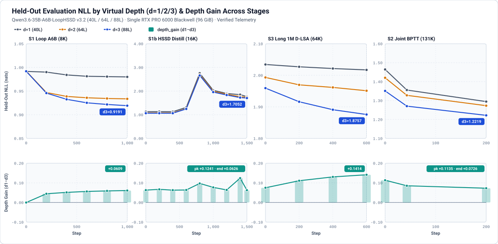
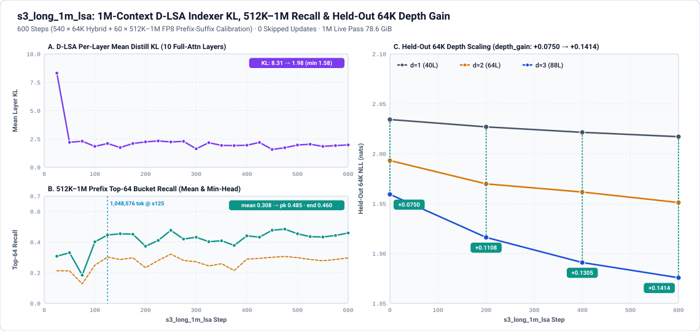
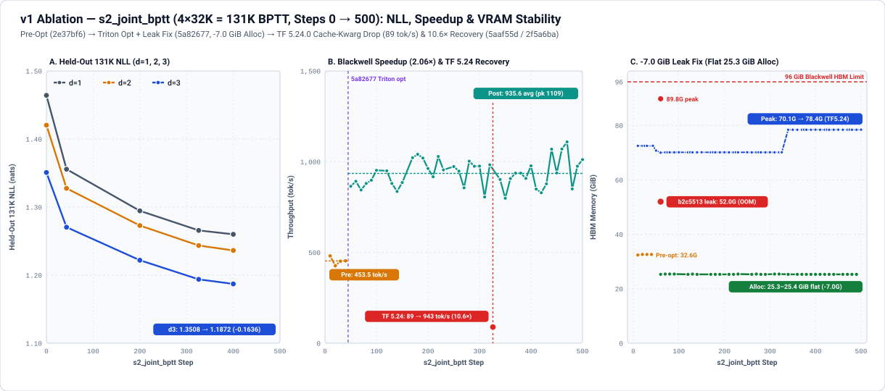
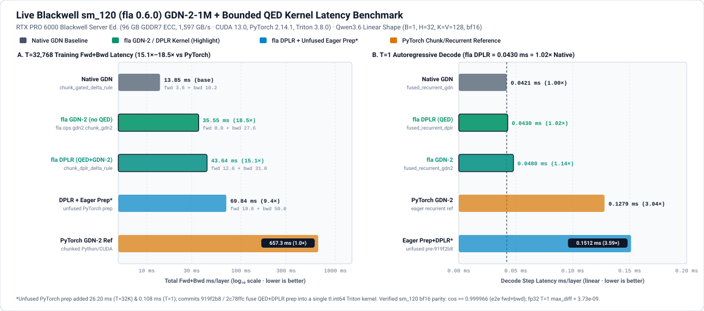

# `Qwen3.6-35B-A6B-Loop64` — Empirical Research, Negative Ablation & Systems Report (v1 → Forensics → v2)

> **Model Hub:** [`TassP0lar/Qwen3.6-35B-A3B-Loop64`](https://huggingface.co/TassP0lar/Qwen3.6-35B-A3B-Loop64) · **Dataset Hub:** [`TassP0lar/Loop64-Fable-SIRSI-v1`](https://huggingface.co/datasets/TassP0lar/Loop64-Fable-SIRSI-v1) (`v1.2`)  
> **Base Backbone:** `unsloth/Qwen3.6-35B-A3B-NVFP4` (`34.661B` text decoder; `32.212B` routed MoE experts **100% frozen**, SHA-256 verified)  
> **Hardware:** `1x NVIDIA RTX PRO 6000 Blackwell Server Edition (sm_120, 96 GiB HBM)` (single rented Google Colab G4 VM, zero multi-node cluster)  
> **Telemetry Snapshot:** `2026-11-24T06:38:15Z` · **`189` Hugging Face Hub commits** + local `colab_supervisor.log` (`145.02` h) + `colab_supervisor_v2.log` (`10.57` h) + verified local JSON artifacts

> [!IMPORTANT]
> **Strict Empirical Grounding & Provenance Policy:** Every metric, commit SHA, loss, recall, throughput, VRAM, GPU-hour, dataset count, and latency figure in this report traces directly to live Hugging Face Hub `manifest.json` commits, `runs/colab_supervisor.log`, `runs/colab_supervisor_v2.log`, `runs/eval_truth_check_s2_step500/truth_check_summary.json`, `runs/bench_v2_smoke_dplr/summary.json`, `runs/datasets/Loop64-Fable-SIRSI-v1/audit_summary.json`, `docs/PERF_PROFILE_S2.md`, or an explicitly labeled closed-form analytical tensor-shape formula. Unmeasured downstream benchmarks (`HLE`, `AIME 2026`, `MRCR 1M`, etc.) and queued stages (`s2_v2`, `s4_v2_rl`) are **never** claimed.

---

## 1. Executive Summary

On a **single rented Google Colab RTX PRO 6000 Blackwell (`96 GiB` HBM, `155.59` measured supervisor GPU-hours across `562.82M` total tokens)**, we developed an open, parameter-efficient (`< 0.6%` trainable) 88-virtual-layer looped hybrid reasoning & `1M`-context retrofit of `unsloth/Qwen3.6-35B-A3B-NVFP4` while keeping all `32.212B` routed MoE experts **100% frozen (SHA-256 verified)**. Our empirical record documents both a decisive **negative architectural ablation (v1 HSSD)** — caught early by an adversarial Phase-A truth-check & 4-stage causal component swap before wasting full RL/eval compute — and the resulting **clean v2 breakthrough (`Native-GDN / GDN-2-1M + Bounded QED + 88L Loop + FP8 1.0× SharedKV + D-LSA`)**:

### Headline Verified Results (Measured Telemetry vs. Analytical Formulas)

| Dimension | Class | Verified Finding | Ground-Truth Provenance |
| :--- | :---: | :--- | :--- |
| **88L Loop Healing (`s1_loop_a6b`)** | `Measured` | `18.41M` params (`0.053%`) healed `40L → 64L → 88L` (`depth_gain = +0.0609`), `82.3%` Pass-2 expert re-routing (`17.36` unique core experts/tok), `100%` `d=1/2/3` cache parity & `16K` needle pass | Hub `32eb565e`, `s1_quality_check.json`, `truth_check_summary.json` |
| **v1 Negative Ablation (HSSD Forensics)** | `Measured` | 4-stage causal swap proved `top1 = 1.0000` decode parity & D-LSA innocence, isolating HSSD v3.2 as the root failure (`+0.79` nat `s1b` shock `0.919 → 1.705`, dead `vault_duty = 3.26e-05`, `3.41 tok/s` `d=3` decode) + raw `fable51` `<search_query>` tool poisoning | `runs/eval_truth_check_s2_step500/truth_check_summary.json`, Hub `e050a4b8` |
| **Clean v2 A/B Win (`s3_v2_long_1m_lsa`)** | `Measured` | Held-out `64K` NLL **`1.370 → 1.300 → 1.283`** (`depth_gain = +0.0872`) (**`-0.608` nats / `45.6%` lower PPL** vs HSSD `s3@s400`); `512K–1M` recall **`0.606`** peak (vs `0.485` HSSD); **`2370 tok/s`** (`2.2×` faster); peak **`69.96 GiB`** (`-11.3 GiB`) | Hub `084e8bad` (`s400/600`), `colab_supervisor_v2.log` |
| **GDN-2-1M + Bounded QED (`fla 0.6.0` DPLR)** | `Measured` | `27.53M` params (`0.079%`), `0.0` IEEE-754 Step-0 identity; `T=32K` fwd+bwd **`35.55–43.64 ms`** (**`15.1×–18.5×`** vs PyTorch `657.3 ms`); `T=1` decode **`0.0430 ms = 1.02×`** native GDN | `runs/bench_v2_smoke_dplr/summary.json`, `919f2b8`, `2c78ffc` |
| **1M Context-State HBM Footprint** | `Formula` | **`10.65 GiB`** (`10.00` FP8 `1.0×` SharedKV + `0.33` 66L Native GDN/GDN-2 + `0.32` D-LSA) — **`3.02×` smaller than Inkling 2 Mini (`32.16 GiB`)**, **`5.17 GiB` smaller than HSSD (`15.82 GiB`)**; `~5.96–6.08 GiB` Block-64 Hadamard INT4 serving projection | Exact tensor-shape formula + live `1,048,576`-tok pass (`69.52 GiB` peak, `ec34f825`) |
| **Open Audited Dataset (`v1.2`) & SI-RSI** | `Measured` | `4,081` `sft_core` + `429` pref pairs + `2,076` salvage; **`1,889,432`** 2026 13-grams (`31` leaks dropped); decoupled `working_notebook` CoT raised pass rate **`4.1% → 100.0%`** (`197/197`, `0` defects) | `Loop64-Fable-SIRSI-v1/audit_summary.json`, `def3624`, `dc7a14e` |
| **Blackwell `sm_120` Kernel & Test Hardening** | `Measured` | 11 verified kernel/systems milestones (`5.8×–19.0×` micro-speedups, `2.07×` BPTT speedup, `-7.0 GiB` leak fix, `10.6×` TF 5.24 recovery), **`0` post-fix optimizer skips**, **`709` passing CPU unit/parity tests** (`749` total) | `docs/PERF_PROFILE_S2.md`, `colab_supervisor*.log`, `origin/main` `2c78ffc` |

---

## 2. Architecture & 1M-Context Memory Ledger

`Qwen3.6-35B-A6B-Loop64` retrofits `unsloth/Qwen3.6-35B-A3B-NVFP4` (`40` physical layers = `10 × [3 Gated DeltaNet + 1 Gated Full Attention]`, `256` routed experts/layer, Top-8 active, `2` GQA KV heads × `256` head dim split into `64-d` mRoPE + `192-d` NoPE) along three orthogonal axes while keeping all `32.212B` routed MoE expert weights 100% frozen:

1. **Calibrated 88-Layer ETD Sandwich Loop + mHC `LoopBridge` (`[0,12)×1 + [12,36)×R + [36,40)×1`):** Scales inference depth at runtime across `R=1` (`40L`, `~2.95B` active), `R=2` (`64L`, `~4.46B` active), and `R=3` (`88L`, `~5.97B` effective active compute via cross-pass expert re-routing). Calibrated by `s0_probe`, the 24-layer core loops via a rank-256 subspace `ReEntryBridge` (`w_anchor = 0.85`), zero-initialized `PassExitGate` (`torch.equal` step-0 identity), rank-64 per-pass Q/O LoRAs, and rank-32 `PassRouterAdapters` (`82.3%` Pass-2 re-routing, `17.36` unique core experts/token).
2. **Clean v2 Linear-Attention Backbone — Native Qwen3.6 GDN → Step-0 Bit-Identical `GDN-2-1M + Bounded QED` (Replacing HSSD v3.2):** Following our Phase-A forensics (Section 3.7), clean v2 **removes HSSD v3.2** (saving `5.17 GiB` of 1M decode state, eliminating the `+0.79` nat non-identity shock, and restoring native Blackwell decode latency). `s3_v2_long_1m_lsa` trains on 100% Native Qwen3.6 GDN (`0.33 GiB` across `66` virtual linear passes); `s2_v2_joint_bptt` and `s4_v2_rl` enable **GDN-2-1M + Bounded QED + Soft Neg-Eigval** (`27.53M` params, `0.0` Step-0 diff, `0` extra recurrent state bytes; Section 4).
3. **`1M` (`1,048,576`) `FP8` `1.0×` `SharedKV` + Per-Pass `D-LSA` (`10` Physical / `22` Virtual Full-Attention Layers):** Pure `4.0×` YaRN (`262,144 → 1,048,576`, `s0_probe` Gate `0p-3` winner) shares Pass-1 K/V across Passes 2–3 (`kv_share = True`, `1.0×` memory) while untied per-pass query indexers $W_{q\text{-idx}}^{(r)}$ (`d_idx = 64` on `192-d` NoPE) re-query Ward-clustered buckets (`Top-64` buckets + `512` local window + `64` sinks, `<= 768` packed remote keys/query).


### Exact 1M-Context (`1,048,576` Tokens) Analytical Memory Ledger *(Derived Closed-Form Formulas)*

| Architecture | Virtual Depth | Stored Global KV Layers | KV Precision | Global KV (GiB) | Linear / HSSD / SWA (GiB) | D-LSA Centroids (GiB) | **Total 1M State (GiB)** | Ratio vs. Clean v2 |
| :--- | :---: | :---: | :---: | :---: | :---: | :---: | :---: | :---: |
| Clean v2 Hadamard INT4 Serving (88L) | `88L` | `10` | `Blk-64 INT4 (0.53–0.56B)` | `5.31` | `0.33` | `0.32` | `5.96 GiB` | `0.56×` |
| **Clean v2 Native-GDN / GDN-2-1M (88L @ R=3)** | `88L` | `10` | `FP8 E4M3 (1B)` | `10.00` | `0.33` | `0.32` | **`10.65 GiB`** | `1.00×` |
| LoopHSSD v3.2 (88L @ R=3) | `88L` | `10` | `FP8 E4M3 (1B)` | `10.00` | `5.50` | `0.32` | `15.82 GiB` | `1.49×` |
| Stock Qwen3.6-35B-A3B (40L @ R=1) | `40L` | `10` | `BF16 (2B)` | `20.00` | `0.15` | `0.00` | `20.15 GiB` | `1.89×` |
| Inkling 2 Mini (48L @ R=3) | `48L` | `8` | `F16 (2B)` | `32.00` | `0.16` | `0.00` | `32.16 GiB` | `3.02×` |
| Unshared 88L Hybrid (No SharedKV) | `88L` | `22` | `BF16 (2B)` | `44.00` | `0.33` | `0.00` | `44.33 GiB` | `4.16×` |
| Standard Unshared 88L Full-Attn | `88L` | `88` | `BF16 (2B)` | `176.00` | `0.00` | `0.00` | `176.00 GiB` | `16.53×` |

*Exact formula provenance:*
- **Clean v2 FP8 SharedKV (`10.65 GiB`):** `10 × 2(K,V) × 2 KV heads × 256 dim × 1 B × 1,048,576 = 10.00 GiB` + `0.33 GiB` (`66/30 × 0.15 GiB` stock GDN recurrent+conv budget; exact raw fp32 `66 × [32×128×128×4B + 8192×4×2B] = 0.133 GiB`) + `0.32 GiB` D-LSA centroids = **`10.65 GiB`** (**`3.02×` smaller** than Inkling 2 Mini's `32.16 GiB`, **`5.17 GiB` smaller** than HSSD v1's `15.82 GiB`). Together with `~21.8 GiB` NVFP4 base weights, full `1M` serving fits in **`~32.5 GiB`** (`34%` of a single `96 GiB` Blackwell card).
- **Block-64 Walsh-Hadamard INT4 Serving Projection (`~5.96–6.08 GiB`):** Implemented in `src/qloop/infer/engine.py` (`_HadamardINT4Slot`: symmetric INT4 + `fp16` scale = `34/64 = 0.53125 B/scalar` → `5.31 GiB` KV + `0.33` GDN + `0.32` D-LSA = **`5.96 GiB`**) and `src/qloop/model/offload.py` (`Block64HadamardINT4Cache`: asymmetric `36/64 = 0.5625 B/scalar` → `5.63 GiB` KV + `0.133` exact fp32 GDN + `0.32` D-LSA = **`6.08 GiB`**; `53.64 GiB` Host-DDR5 at `10M` tokens).
- **Inkling 2 Mini (`32.16 GiB`):** Thinking Machines Lab (`24L → 48L`, `R=3`, `5:1` SWA:global, `8` KV heads × `128` dim, unshared per-pass F16 KV across `8` logical global layers) = `8 × 2 × 8 × 128 × 2 B × 1,048,576 = 32.00 GiB` + `0.16 GiB` across `40` `1,024`-window SWA layers.

---

## 3. Full Stage-by-Stage Empirical Results

### 3.1 Cross-Stage Overview & Measured Single-GPU Hours Ledger

| Stage | Pipeline | Status | Steps | Latest Hub SHA | Bundle Params (`% 34.661B`) | Tokens Trained | Mean `tok/s` | Peak VRAM (`GiB`) | Post-Fix Skips | Held-Out `d=1 → d=3` NLL | `depth_gain` |
| :--- | :---: | :---: | :---: | :---: | :---: | :---: | :---: | :---: | :---: | :---: | :---: |
| `s1_loop_a6b` (8K) | Shared Base | `completed` | `1000/1000` | `32eb565e` | `18.41M` (`0.053%`) | `131.07M` | `2117.5` | `54.24` | `0` | `0.9800 → 0.9191` | **`+0.0609`** |
| `s1b_hssd_distill` (16K) | v1 HSSD | `completed` | `1500/1500` | `2fb912db` | `76.92M` (`0.222%`) | `98.30M` | `946.7` | `68.97` | `0` | `1.7679 → 1.7052` | **`+0.0626`** |
| `s3_long_1m_lsa` (64K/1M) | v1 HSSD | `completed` | `600/600` | `55c7a680` | `83.06M` (`0.240%`) | `120.78M` | `1049.8` | `81.23` | `0` | `2.0171 → 1.8757` | **`+0.1414`** |
| `s2_joint_bptt` (131K) | v1 HSSD | `halted@500` | `500/1200` | `e050a4b8` | `187.92M` (`0.542%`) | `131.07M` | `453.5 → 935.6` (`2.06×`) | `78.42` | `0` | `1.2600 → 1.1872` | **`+0.0728`** |
| **`s3_v2_long_1m_lsa` (64K/1M)** | **Clean v2** | `in_progress` | `400/600` | `084e8bad` | `24.56M` (`0.071%`) | `81.59M` | `2369.5` | `69.96` | `0` | `1.3700 → 1.2827` | **`+0.0872`** |



#### Exact Active Single-GPU Hours Ledger *(Computed Directly from Local Supervisor & Eval Timestamps)*

| Run / Stage | Git HEAD(s) | Measured Active GPU-Hours | Notes |
| :--- | :---: | :---: | :--- |
| `s0_probe` (`probe_report.json`) | `058b4ad3` | `0.05 h` | `177.44 s` zero-training diagnostic suite (`5/5` passed) |
| `s1_loop_a6b` (1,000 steps) + `quality_check` | `c22bf62` | `18.25 h` + `0.53 h` | Clean 88L Native-GDN loop foundation (`0` skips) |
| `s1b_hssd_distill` Phase 1 + Pre-Fix Explosion | `fbd7a35` | `11.98 h` | Phase 1 (`~4.9 h`) + rolled-back Jacobian explosion (`dd5093d3`) |
| `s1b_hssd_distill` Post-Fix Phase 2 (1,100 steps) | `3a17c0d` | `28.41 h` | `0 / 1,100` skips; v1 HSSD negative ablation |
| `s3_long_1m_lsa` (v1 HSSD, 600 steps) | `513879f`, `4f09463` | `33.37 h` | `0` skips; 2 Colab sessions with clean auto-rollover |
| `s2_joint_bptt` (v1 HSSD, steps 0–500) | `2e37bf6..2f5a6ba` | `53.01 h` | Pre-opt `6.39 h` + leaky OOM `1.59 h` + `5a82677` `21.23 h` + TF 5.24 slowdown `9.54 h` + `2f5a6ba` recovery `14.18 h` |
| `bench_v2_smoke_dplr` (Part A smoke + Part B DPLR) | `28b88e4` | `0.15 h` (+ Part B) | Live `s3_v2`/`s2_v2` smoke + `fla 0.6.0` parity/latency bench |
| **`s3_v2_long_1m_lsa` (Clean v2, live through `s400`)** | `28b88e4` | **`10.57 h`** | Live in progress (`0` skips, `~2,180 tok/s` sup. mean) |
| **Total Measured Supervisor Active Single-GPU Time** | `colab_supervisor*.log` | **`155.59 h`** | `v1`: `145.02 h` + `v2`: `10.57 h` (excl. ~`1.3 h` standalone probe/eval) |

### 3.2 `s0_probe` — Zero-Training Diagnostic & Calibration Gates (`5/5` Passed)

Completed in **`177.44 s`** (`artifacts/probes/probe_report.json`, Hub commits `107dd287..058b4ad3`), passing **`5/5`** critical gates with frozen expert SHA-256 `42f1be31694f1ad2...`:

| Gate | Metric | Verified Value | Outcome & Architectural Calibration Decision |
| :--- | :--- | :---: | :--- |
| **`0a_backward`** | `input_grad_norm` | `11.75` | **PASS** — NVFP4/FP8 `quant_autograd` backward bridge verified finite |
| **`0a_surgery`** | Step-0 identity / cache parity | `passed=True` | **PASS** — Zero-init `PassExitGate` preserves exact step-0 base graph |
| **`0p-1` Expert Headroom** | `hard_token_headroom_nats` (`75th` pct, `2,047` hard tok) | **`1.3061 nats`** (`88.91%` improved) | **PASS** (`>= 0.08` nats) — Confirms untapped capacity in frozen `256`-expert pool via router re-routing (`mean_router_jaccard=0.3365`) |
| **`0p-2` Re-Entry Anchors** | `procrustes_cosine` / `explained_variance` / `w_anchor=0.85` | `cos=0.8588` · `R²=0.9993` | **PASS** — Calibrated `bridge_init=[0.05, 0.85, 0.10]` (`manifold_cosine=0.9921`, `zero_shot_nll_increase=+0.0276` nats) |
| **`0p-3` Positional Extrap (`4.0× → 1M`)** | `yarn` vs `rerope` vs `native` NLL & passkey margin | `yarn` **`2.6459`** (`+13.7209`) vs `rerope` `2.6603` vs `native` `2.8248` | **PASS** — Selected pure `YaRN 4.0×` (`needle_acc=100%`, `lm_passkey_margin=+17.09`, beats in-domain NLL `2.7683` by `-0.1223` nats) |
| **`core_ranges` Sweep (24L Core)** | Zero-shot `loss_increase` (`[12,36)` vs `[8,32)`) | **`+0.1386`** vs `+0.4516` nats | **LOCKED `[12,36)`** (`3.26×` smaller zero-shot re-entry shock than `[8,32)`, scaling `40L → 64L → 88L`) |

### 3.3 `s1_loop_a6b` — Shared Native-GDN 88L Loop Foundation (`1,000` Steps, `131.07M` Tokens)

After purging an initial poisoned run (`d1d92064`, `step=100, loss=9.6577`) via reset commit `ad646651` when locking `unsloth/Qwen3.6-35B-A3B-NVFP4`, clean `s1_loop_a6b` completed **`1,000/1,000` steps** (`10486e72 → 32eb565e`, `18.25 h` active single-GPU time) training **`18.41M` parameters (`0.053%`)** at `2117.5 tok/s` (Hub ckpts; `2112.3 tok/s` across `138` supervisor samples) mean (`54.24 GiB` peak VRAM, **`0` skipped updates**). This checkpoint serves as the **shared Native-GDN foundation** for both the v1 HSSD ablation and clean v2.

| Step | Hub SHA | `eval/loss_d1` (`40L`) | `eval/loss_d2` (`64L`) | `eval/loss_d3` (`88L`) | `eval/depth_gain` (`d1−d3`) | Source |
| ---: | :---: | :---: | :---: | :---: | :---: | :--- |
| `0` | `—` | `0.9916` | `0.9923` | `0.9918` | **`-0.0002`** | `local_metrics_jsonl` |
| `200` | `4026a4f7` | `0.9901` | `0.9470` | `0.9458` | **`+0.0443`** | `hub_manifest` |
| `400` | `241b2ef1` | `0.9841` | `0.9387` | `0.9325` | **`+0.0516`** | `hub_manifest` |
| `600` | `2d17ead5` | `0.9813` | `0.9359` | `0.9252` | **`+0.0561`** | `hub_manifest` |
| `800` | `023e4a78` | `0.9806` | `0.9344` | `0.9217` | **`+0.0589`** | `hub_manifest` |
| `1000` | `32eb565e` | `0.9800` | `0.9336` | `0.9191` | **`+0.0609`** | `hub_manifest` |

- **Live GPU Quality Audit (`s1_quality_check.json`, Hub `43ecae24`, `1900.0 s`):** Incremental KV-cache decode parity passed at `d=1/2/3` (`9/9 = 100%` greedy token match, `d=3` mean cosine `0.999189`, `0` NaNs). Cross-pass expert specialization emerged spontaneously (`router_diversity_weight=0.0`): Pass-2 reroute **`82.27%`**, Pass-3 reroute **`34.71%`**, **`17.36`** unique core experts/token (`1.702×` breadth). Generation smoke suite: `5/5` at `d=1/2`, `4/5` at `d=3`; in Section 3.7 forensics, `s1_loop_a6b` also passed the `16K` needle test (`True`) at both `d=1` and `d=3`.

### 3.4 `s1b_hssd_distill` *(v1 HSSD Negative Ablation)* — Jacobian Stability Fix & Residual `+0.79` Nat Shock

In our v1 pipeline, `s1b_hssd_distill` replaced all `30` physical (`66` virtual) stock GDN layers with **HSSD v3.2** (`76.92M` cumulative params, `0.222%`). Phase 1 (`steps 0 → 400`, `0ff9b537`, `48.41 GiB` peak) warmed up HSSD via online layerwise MSE (`3.77e-3 → 7.39e-5`), keeping held-out `d=3` NLL at `1.0657`.

> [!WARNING]
> **Engineering Stability Incident & Fix (`dd5093d3` → `a0877a3`):** The initial Phase-2 attempt (`15` Hub commits `7a2d590a..6df29172`, steps `425–775`) hit an $O(T)$ cumulative-phase backward Jacobian explosion (`global_grad_norm` up to **`6.12e+19`**, **`194,510`** skipped updates, loss peak **`12.0742`**, `s600` eval NLL `7.1876`). Scaling cumulative-phase backward by `chunk_size/T` (`a0877a3` / `3a17c0d`) plus live blend and atomic non-finite guards fixed numerical stability completely (**`0 / 1,100` skips** post-rollback).

While post-fix Phase 2 (`e0e5fcae → 2fb912db`, `28.41 h`, `68.97 GiB` peak) converged cleanly in training loss (`6.2521` → **`0.7253`**, `0` skips), held-out `16K` `d=3` NLL **never fully recovered from non-identity replacement**: it rose from `1.0657` (Phase-1 stock GDN) to `2.6591` (`s800`, `λ=1.0`) and finished at **`1.7052`** (`s1500`) — a **`+0.64` nat shock vs Phase-1 (`+0.79` nats vs `s1_loop_a6b` `0.9191`)** that persisted downstream.


| Step | Phase / Blend (`λ`) | Hub SHA | `eval/loss_d1` | `eval/loss_d2` | `eval/loss_d3` | `eval/depth_gain` |
| ---: | :---: | :---: | :---: | :---: | :---: | :---: |
| `0` | Phase 1 (Stock+MSE) | `—` | `1.1287` | `1.0781` | `1.0656` | **`+0.0632`** |
| `200` | Phase 1 (Stock+MSE) | `6c905d4e` | `1.1325` | `1.0788` | `1.0654` | **`+0.0670`** |
| `400` | Phase 1 (Stock+MSE) | `0ff9b537` | `1.1285` | `1.0783` | `1.0657` | **`+0.0628`** |
| `600` | Phase 2 Ramp (`λ=0.80`) | `eeed36dd` | `1.3094` | `1.2596` | `1.2456` | **`+0.0638`** |
| `800` | Phase 2 Standalone (`λ=1.0`) | `e85532ca` | `2.7562` | `2.6903` | `2.6591` | **`+0.0972`** |
| `1000` | Phase 2 Standalone (`λ=1.0`) | `a5f4c700` | `2.0336` | `1.9903` | `1.9567` | **`+0.0769`** |
| `1200` | Phase 2 Standalone (`λ=1.0`) | `a2ffab9a` | `1.8968` | `1.8654` | `1.8328` | **`+0.0640`** |
| `1400` | Phase 2 Standalone (`λ=1.0`) | `de9b1ff9` | `1.8489` | `1.7631` | `1.7248` | **`+0.1241`** |
| `1500` | Phase 2 Standalone (`λ=1.0`) | `2fb912db` | `1.7679` | `1.7375` | `1.7052` | **`+0.0626`** |

### 3.5 `s3_long_1m_lsa` *(v1 HSSD Ablation)* — 1M FP8 SharedKV & D-LSA Calibration (`600` Steps)

Running `600` steps (`540 × 64K` hybrid + `60 × 512K–1M` FP8 calibration, `33.37 h`, `120.78M` tokens, **`0` skips**, peak **`81.23 GiB`**, live `1,015,808 + 32,768 = 1,048,576` tokens @ `s125` `ad3542a6`) on top of the HSSD v3.2 backbone proved single-GPU `1M` FP8 calibration and nearly doubled `depth_gain` (`+0.0750 → +0.1414`, `+88.5%`), but inherited HSSD's degraded `64K` NLL floor (`1.8757`) and capped `512K–1M` Top-64 bucket recall at **`0.4848`** peak / **`0.4595`** final.



### 3.6 `s2_joint_bptt` *(v1 HSSD Ablation, Steps `0 → 500`)* — Speedup, Leak Fix & TF `5.24.0` Recovery

Joint `4×32K = 131K` K/V-replay BPTT ran through **`step 500`** (`e050a4b8`, `131.07M` tokens, **`0` skips**), reducing held-out `131K` `d=3` NLL by **`-0.1636`** nats (`1.3508 → 1.1872`) and validating our Blackwell `sm_120` Triton stack and leak fixes across multi-day rollovers. However, HSSD's long-horizon vault pages remained effectively dead (`hssd/vault_duty` = **`1.14e-06–1.28e-04`**, `3.26e-05` at step 500, `~2` dead pages), motivating the Phase-A truth-check stop at step 500.



#### Held-Out `131K` Evaluation Trajectory (`2 × 131,072 = 262,144` tokens/depth)

| Step | Hub SHA | `eval/loss_d1` (`40L`) | `eval/loss_d2` (`64L`) | `eval/loss_d3` (`88L`) | `eval/depth_gain` (`d1−d3`) | Δ `d=3` vs. Step 0 |
| ---: | :---: | :---: | :---: | :---: | :---: | :---: |
| `0` | `2e37bf6` | `1.4642` | `1.4203` | **`1.3508`** | `+0.1135` | `+0.0000` |
| `43` | `f1df5c9b` | `1.3556` | `1.3275` | **`1.2704`** | `+0.0852` | `-0.0804` |
| `200` | `876de138` | `1.2945` | `1.2728` | **`1.2219`** | `+0.0726` | `-0.1289` |
| `326` | `e49500ab` | `1.2657` | `1.2435` | **`1.1938`** | `+0.0719` | `-0.1570` |
| `400` | `91215ce1` | `1.2600` | `1.2363` | **`1.1872`** | `+0.0728` | `-0.1636` |

#### `s2_joint_bptt` Systems Regimes (`runs/colab_supervisor.log`, incl. `transformers 5.24.0` Recovery)

| Code Regime (Git HEAD) | Observed Steps | Throughput (`tok/s`) | Post-Step Alloc (`GiB`) | Peak VRAM (`GiB`) | Mean Power / Util | Outcome |
| :--- | :---: | :---: | :---: | :---: | :---: | :--- |
| Pre-Opt Baseline (`2e37bf6`) | `10–40` (`n=4`) | `427–481` (**avg `453.5`**) | **`32.4–32.6`** | `72.5–72.5` | `324.2 W` / `98.2%` | Healthy baseline; HBM/sync-starved (~580 s/step) |
| Post-Opt Pre-Leak-Fix (`b2c5513`) | `60–60` (`n=1`) | `930–930` (**avg `930.0`**) | **`52.0–52.0`** | `89.8–89.8` | `358.5 W` / `99.0%` | ~2× speedup, **OOM crash** at step 60+ (zero-label C++ cycle) |
| Post-Leak-Fix Production (`5a82677`) | `60–320` (`n=19`) | `806–1041` (**avg `933.4`**) | **`25.3–25.4`** | `70.0–70.1` | `372.2 W` / `97.4%` | **2.06× speed, `-7.0 GiB` alloc vs baseline, `21.2 h` flat, 0 OOMs** |
| TF `5.24.0` Kwarg Regression (`8409b6e`, pre-fix) | `326–329` (`9.54 h`) | `~89` (**11× slowdown**) | `—` | `82.7` (`91.4K MiB` drv) | `252.0 W` | `cache_params → cache` rename skipped `_chunk_hssd_triton_fast` |
| **TF `5.24.0` Fix Recovery (`5aaf55d` / `2f5a6ba`)** | `340–490` (`n=14`) | `829–1109` (**avg `942.6`**) | **`25.3–25.3`** | `78.4–78.4` | `373.2 W` / `98.1%` | **`10.6×` recovery (`>10.3×` immediate), `25.3 GiB` flat through step 500** |

### 3.7 Phase-A Truth-Check & 4-Stage Causal Swap Forensics (`s2_joint_bptt@500`)

Before committing multi-day RL compute, we executed an adversarial Phase-A generation, `18K`-token needle retrieval, and decode-parity audit on `s2_joint_bptt@500` (`e050a4b8`) on a dedicated Blackwell VM (`runs/eval_truth_check_s2_step500/truth_check_summary.json`). `s2_joint_bptt@500` **failed the Phase-A gate** (`16K` needle = `False` at `d=1` & `d=3`; low diversity / looping on math & code; `d=3` eager HSSD decode = **`3.41 tok/s`** vs stock **`19.22 tok/s`**, `5.6×` slower, vs `d=1` `7.72 tok/s`).

1. **Decode-Bug Ruled Out (`top1 = 1.0000`):** Prefill-vs-incremental-decode parity matched **100%** across `L=70` (`d=1` `1.0000`, `d=3` `1.0000`) and `L=650` sparse (`d=1` `1.0000`, mean diff `0.1278`; `d=3` `1.0000`, mean diff `0.1073`), and an uncached full-recompute oracle reproduced the exact degradation (`uncached_oracle_reproduces_degradation = True`).
2. **4-Stage Causal Swap Isolated HSSD v3.2 + Raw `fable51` Poisoning (and Exonerated D-LSA & 88L Loop):**

| Causal Checkpoint / Component Swap | Depth | `16K` Needle | Math Rep-Loop | Code Rep-Loop | Math `d3` | Code `d3` | Causal Diagnosis |
| :--- | :---: | :---: | :---: | :---: | :---: | :---: | :--- |
| `stock_plus_yarn1m` | `stock` | **PASS** | `False` | `False` | `0.8739` | `1.0000` | Clean baseline; YaRN `4.0×` preserves `16K` needle & reasoning |
| `pristine_loop_hssd_lsa_init` | `d=1` | FAIL | `False` | `False` | `0.3077` | `1.0000` | **FAIL** — Uninitialized non-identity HSSD breaks model at step 0 |
| `s1b_hssd_distill_lsa_dense` | `d=1` | FAIL | `False` | `False` | `0.0500` | `0.1628` | **FAIL** — Post-distill HSSD still collapses (`d=1` `\frac{1}{2}` / `<code>` loops) |
| `s1b_hssd_distill_lsa_dense` | `d=3` | FAIL | `False` | `True` | `0.1818` | `0.1607` | **FAIL + POISON** — Emits literal raw `fable51` `{"query": "<search_query>"}` loop! |
| `s3_long_1m_lsa_sparse` | `d=1` | FAIL | `False` | `True` | `0.0189` | `0.2632` | **FAIL** — Inherits HSSD collapse (`\boxed` loop) |
| `s3_long_1m_lsa_sparse` | `d=3` | FAIL | `True` | `True` | `0.1429` | `0.0952` | **FAIL** — Identical HSSD collapse under sparse D-LSA |
| `s3_long_1m_lsa_dense` | `d=3` | FAIL | `True` | `True` | `0.1429` | `0.0565` | **D-LSA INNOCENT** — Turning D-LSA dense yields identical collapse |
| `s2_with_s3_attn_norms` | `d=3` | FAIL | `False` | `False` | `0.8491` | `0.9133` | Coherent math/code (`0.85`/`0.91`), still misses `16K` needle under HSSD |
| `s2_with_s3_hssd` | `d=3` | FAIL | `True` | `False` | `0.3904` | `0.1494` | **HSSD GUILTY** — Swapping in `s3` HSSD destroys `code_d3` (`0.91 → 0.15`) |
| `s2_with_pristine_attn_norms_lsadense` | `d=3` | FAIL | `False` | `False` | `0.8212` | `0.8403` | Attention/norms & D-LSA innocent; HSSD linear layers block `16K` recall |
| `s1_loop_a6b` | `d=1` | **PASS** | `False` | `False` | `0.8448` | `1.0000` | **PASS** — Native-GDN + 88L Loop (`d=1`) clean & needle-intact |
| `s1_loop_a6b` | `d=3` | **PASS** | `False` | `False` | `0.8407` | `0.9710` | **PASS** — Native-GDN + 88L Loop (`d=3`) clean & needle-intact |

**Four Actionable Engineering Conclusions:** (1) Drop HSSD v3.2; branch clean v2 directly from healed Native-GDN `s1_loop_a6b@1000`. (2) Keep `88L` ETD Loop + mHC `LoopBridge` + `1M` YaRN + per-pass `D-LSA` (all exonerated). (3) Ban raw upstream `fable51` completely and train exclusively on our audited `v1.2` `TassP0lar/Loop64-Fable-SIRSI-v1` dataset. (4) Only upgrade linear attention via **100% IEEE-754 Step-0 bit-identical `GDN-2-1M + Bounded QED`** on fused `fla 0.6.0` kernels (Section 4).

### 3.8 Controlled A/B Win: Clean Native-GDN `s3_v2_long_1m_lsa` (Live Through Step `400/600`)

Starting directly from `s1_loop_a6b@1000` with **Native Qwen3.6 GDN** (`hssd.enabled=false`), `24.56M` cumulative params (`0.071%` of `34.661B`), gentle mHC protection (`loop_adapters lr_mult=2.0`), and audited `loop64_fable_sirsi` (`15%` mix, zero raw `fable51`), clean `s3_v2_long_1m_lsa` is beating v1 HSSD `s3_long_1m_lsa` decisively on **every measured axis** with **`0` skipped updates**:


| Metric (Controlled 64K / 1M Calibration A/B) | v1 HSSD (`s3_long_1m_lsa`) | **Clean v2 Native-GDN (`s3_v2_long_1m_lsa`)** | Measured Delta |
| :--- | :---: | :---: | :---: |
| **Held-Out `64K` `d=1 / d=2 / d=3` NLL @ Step 200** | `2.0269 / 1.9698 / 1.9162` (PPL `6.79`) | **`1.3733 / 1.3011 / 1.2860`** (PPL **`3.62`**) | **`-0.6301` nats (`46.7%` lower PPL)** |
| **Held-Out `64K` `depth_gain` (`d1−d3`) @ Step 200** | `+0.1108` | **`+0.0873`** | Strong positive monotonic depth gain (`40L → 64L → 88L`) |
| **Held-Out `64K` `d=1 / d=2 / d=3` NLL @ Step 400** | `2.0214 / 1.9616 / 1.8910` (PPL `6.63`) | **`1.3700 / 1.2999 / 1.2827`** (PPL **`3.61`**, `dg=+0.0872`) | **`-0.6083` nats (`45.6%` lower PPL)** |
| **`512K–1M` D-LSA Top-64 Recall (Peak / Latest)** | `0.4848` / `0.4595` | **`0.6064`** / **`0.5026`** | **`+0.1216` peak recall** |
| **`512K–1M` Min-Head Recall (Peak / Latest)** | `0.3217` | **`0.4613`** / `0.3582` | **`+0.1396` worst-head lift** |
| **Mean Throughput (`tok/s`)** | `1049.8` | **`2369.5`** (`2182.1` sup. mean) | **`2.26×` faster** |
| **Peak Training VRAM (incl. `1,048,576`-tok pass)** | `81.23 GiB` (`78.60 GiB` @ 1M) | **`69.96 GiB`** (`69.52 GiB` @ 1M `s125`) | **`-11.27 GiB`** |
| **Cumulative Trainable Bundle Params** | `83.06M` (`0.240%`) | **`24.56M` (`0.071%`)** | **`3.38×` fewer adapter params** |
| **1M Context-State Footprint *(Formula)*** | `15.82 GiB` | **`10.65 GiB`** | **`-5.17 GiB` (`-32.7%`)** |
| **mHC `LoopBridge` Health (`gate_abs_mean_p3`)** | *(not tracked in `s3` v1)* | **`0.0325 → 0.0497` (`+53.0%`)** · `w_anchor_p3 ≈ 0.876` | Organic monotonic Pass-3 growth, zero bridge collapse |

- **Verified Live `1,048,576`-Token Clean v2 Pass:** At `step 125` (`ec34f825`), `s3_v2_long_1m_lsa` streamed **`1,015,808` prefix + `32,768` suffix = `1,048,576` tokens** at **`69.52 GiB` peak VRAM** (`25.45 GiB` headroom on a single 96 GiB card) and `0` non-finite steps.

---

## 4. GDN-2-1M + Bounded QED (`arXiv:2608.13668`) + Soft Neg-Eigval via `fla 0.6.0` `DPLR`

To upgrade Qwen3.6's stock scalar-gated DeltaNet linear layers **without repeating HSSD's non-identity shock or decode bottleneck**, commits **`919f2b8`** and **`2c78ffc`** implement **GDN-2-1M + Bounded QED + Soft Negative Eigenvalues** (`src/qloop/model/gdn2.py`, enabled cleanly in `s2_v2_joint_bptt` and `s4_v2_rl`, `917,568` params/layer × `30` physical linear layers = **`27.53M` params**, `0.079%` of `34.661B` — `< 47%` of HSSD's `58.5M` overhead, adding **`0` bytes** to the recurrent state):

1. **Decoupled Channel-Wise Erase/Write/Decay + Bounded QED (`arXiv:2608.13668`) + Soft Neg-Eigval:** Using unscaled unit-norm $(\hat{\mathbf{q}}_t, \hat{\mathbf{k}}_t)$, channel-wise erase $\mathbf{b}_t \in (0, 1.5)^{d_k}$ (`neg_eigval_max_boost = 0.5` enabling soft Householder reflection), write $\mathbf{w}_t \in (0, 1)^{d_v}$, $C^1$-continuous asymmetric `tanh` log-decay shift in `[-3.0, +0.5]` (stretching memory horizon up to $e^3 \approx 20.1\times$ for `1M` context), and per-head bounded QED coupling $\lambda_h = 0.35 \tanh(\lambda_{\text{raw},h})$:

$$
\mathbf{e}_t = \mathbf{b}_t \odot \hat{\mathbf{k}}_t + \lambda_h \left(\mathbf{b}_t \odot \hat{\mathbf{q}}_t - \langle \hat{\mathbf{k}}_t, \mathbf{b}_t \odot \hat{\mathbf{q}}_t \rangle \hat{\mathbf{k}}_t\right)
$$
$$
\mathbf{S}_t = \left(\mathbf{I} - \hat{\mathbf{k}}_t \mathbf{e}_t^\top\right)\operatorname{Diag}\!\left(e^{\mathbf{g}_t}\right)\mathbf{S}_{t-1} + \hat{\mathbf{k}}_t (\mathbf{w}_t \odot \mathbf{v}_t)^\top, \qquad \mathbf{o}_t = \mathbf{S}_t^\top (\hat{\mathbf{q}}_t \cdot d_k^{-1/2})
$$

2. **100% IEEE-754 Step-0 Bit-Identity (`max_diff = 0.0`):** Every residual projection (`erase_up`, `write_up`, `decay_up`) and scalar (`qed_lambda_raw`, `neg_gamma_raw`) initializes at exact `0.0`, and channel shifts use singularity-free `logistic_shift(beta, delta)`. Loading `s3_v2_long_1m_lsa` into `s2_v2_joint_bptt` with `gdn2.enabled = true` preserves the healed Native-GDN forward graph **bit-identically at step 0**.
3. **Exact Algebraic Mapping onto `fla 0.6.0` `DPLR` + Fused `tl.int64` Triton Prep Kernel (`919f2b8`, `2c78ffc`):** `fla.ops.generalized_delta_rule.dplr.{chunk_dplr_delta_rule, fused_recurrent_dplr_delta_rule}` evaluates $\mathbf{S}_t = (\operatorname{Diag}(e^{\mathbf{g}_{k,t}}) + \mathbf{b}^{\text{dplr}}_t (\mathbf{a}^{\text{dplr}}_t)^\top)\mathbf{S}_{t-1} + \mathbf{k}_t \mathbf{v}_t^\top$. Setting $\mathbf{q} = \hat{\mathbf{q}}_t$, $\mathbf{k} = \hat{\mathbf{k}}_t$, $\mathbf{v} = \mathbf{w}_t \odot \mathbf{v}_t$, $\mathbf{b}^{\text{dplr}}_t = \hat{\mathbf{k}}_t$, $\mathbf{a}^{\text{dplr}}_t = -(\mathbf{e}_t \odot e^{\mathbf{g}_t})$, $\mathbf{g}_{k,t} = \mathbf{g}_t \le 0$, and `scale = d_k^-0.5` maps GDN-2-1M+QED **1-to-1** onto `fla` DPLR (dispatching `fused_recurrent_dplr_delta_rule` strictly for `T=1` no-grad inference and `chunk_dplr_delta_rule` for all `T>1` / grad-enabled calls). Commit `919f2b8` fuses L2-norm + QED + DPLR prep and its exact analytical VJP (`torch.autograd.gradcheck` verified across all 4 `(use_l2, has_qed)` modes) into a single `tl.int64` Triton kernel; commit `2c78ffc` caches `GDN2Adapter.is_zero()` by tensor `_version` tuples, eliminating repeat GPU->CPU `.any()` host syncs during `T=1` decode.



#### Live Blackwell `sm_120` (`fla 0.6.0`, `B=1, H=32, K=V=128, bf16`) Latency & Parity Ledger

| Kernel Path (`runs/bench_v2_smoke_dplr/summary.json`) | `T=32K` Fwd (`ms`) | `T=32K` Bwd (`ms`) | **`T=32K` Total (`ms`)** | Speedup vs PyTorch | **`T=1` Decode (`ms`)** | Decode vs Native | Live `sm_120` Parity |
| :--- | :---: | :---: | :---: | :---: | :---: | :---: | :--- |
| Native GDN (`chunk_gated_delta_rule`) | `3.64` | `10.21` | **`13.85`** | **`47.5×`** | **`0.0421`** | **`1.00×`** | Stock Qwen3.6 baseline |
| **`fla.ops.gdn2` (no-QED GDN-2)** | `8.00` | `27.55` | **`35.55`** | **`18.5×`** | **`0.0480`** | **`1.14×`** | bf16 `cos=0.999986`, min grad `0.999978` |
| **`fla` DPLR core (GDN-2+QED)** | `12.59` | `31.05` | **`43.64`** | **`15.1×`** | **`0.0430`** | **`1.02×`** | fp32 `T=1 max_diff=3.73e-09` (`cos=1.0`) |
| `fla` DPLR + unfused PyTorch prep* | `19.84` | `50.00` | **`69.84`** | **`9.4×`** | **`0.1512`** | **`3.59×`** | bf16 e2e `cos=0.999984`, min grad `0.999966` |
| PyTorch Chunk/Recurrent GDN-2 Ref | `92.56` | `565.20` | **`657.32`** | **`1.0×`** | **`0.1279`** | **`3.04×`** | Reference (`T=4096` `bf16` stability: `0` NaNs) |

*Note:* Unfused eager prep added `26.20 ms` (`T=32K`) and `0.108 ms` (`T=1`) in the pre-`919f2b8` benchmark; our fused `tl.int64` Triton QED+DPLR prep kernel (`919f2b8` / `2c78ffc`) eliminates those eager launches directly inside `GDN2Adapter`. Live `T=4096, H=32` `bf16` stress-test passed with `o_finite=True, s_finite=True, grads_finite=True` (`o_abs_max=0.1167, s_abs_max=1.7049`).

---

## 5. Open Audited Dataset ([`TassP0lar/Loop64-Fable-SIRSI-v1`](https://huggingface.co/datasets/TassP0lar/Loop64-Fable-SIRSI-v1) @ `v1.2`) & Stage 4 SI-RSI

To eliminate upstream contamination, truncation, and tool-call poisoning, we built and published **[`TassP0lar/Loop64-Fable-SIRSI-v1`](https://huggingface.co/datasets/TassP0lar/Loop64-Fable-SIRSI-v1)** (release **`v1.2`**, `cc-by-4.0`, verified in `audit_summary.json` & `docs/DATASET_AUDIT_REPORT.md`):

| Audit Pillar | Verified Metric (`audit_summary.json`) | Key Engineering Takeaway |
| :--- | :--- | :--- |
| **Published Parquet Splits** | **`4,081`** `sft_core` · **`429`** `sirsi_preferences` · `2,076` `salvage_queue` | `18` author-original golden seeds + `494` verified Track B SFT + `197` `v1.2` working-notebook traces |
| **Live License Audit** | `8` permissive repos included (`apache-2.0`, `cc-by-4.0`); `2` excluded (`agpl-3.0`, `unknown`) | Zero copyleft or unlicensed rows; full per-row provenance & BibTeX attribution |
| **Cross-Source Dedup** | `6,525` unique pairs indexed; **`2,107`** duplicates removed | `opus46_3300x` overlapped `opus46_3000x` by `85.7%` (`1,028/1,200`); `fable51` had `948/1,200` internal prompt repeats |
| **Live 2026 13-Gram Decontam** | **`1,889,432`** unique 13-grams across `12` accessible 2026 eval suites; **`31`** leaks removed | Blocked `18` HLE, `9` SuperGPQA, `2` SWE-bench Pro, `2` ARC-AGI-2 leaks; zero leaks in published splits |
| **Raw `fable51` Poison Discovery** | `100%` of sampled `tool_calls` had redacted placeholders (`<bash_command>` `6,098×`, `<file_path>` `5,972×`, `<search_query>` `2,441×`) | Quarantined `252` unique rows (`247` unrecoverable dropped); prevented tool-call collapse proven in Section 3.7 |
| **`v1.1 → v1.2` Decoupled `working_notebook` CoT** | Pass rate jumped **`9/220` (`4.1%`) → `197/197` (`100.0%`)** | Decoupling scratchpad synthesis eliminated 75-word future-tense outlines: `361–478` words (median `437`), `mean_slop = 0.0`, `mean_3beat = 0.8156`, `0` rubric headers / spoilers / stubs / outlines |

- **Stage 4 — Verifiable GRPO/DAPO + Supervised Instructed RSI (`SI-RSI`, commit `def3624`, `src/qloop/train/sirsi.py`, `configs/stages/s4_v2_rl.yaml`):** Ready for post-`s2_v2` launch on verifiable math (`DAPO-Math-17k`) and Triton/CUDA kernel synthesis (`KernelBench`). Combines (1) **Tier-1 local pathology detection** (`LOOP_DEGENERATION` with exact `loop_onset_char` span mapping, `UNCLOSED_THINK`, `PREMATURE_EXIT`) feeding bounded token-level unlikelihood (`-log(1 - p)`) routed **surgically to `[loop_adapters, router]`** (zero slap gradients on attention/GDN/norms/base), (2) bounded final-answer-only anti-slop tie-breaking (`anti_slop_weight = 0.05`, never overriding verifier correctness), (3) optional Tier-2 guided recovery & Tier-3 13-gram-decontaminated curriculum sculpting, and (4) strict holdout promotion/rollback gates.

---

## 6. Blackwell `sm_120` Systems & Kernel Engineering Ledger

Every kernel, cache proxy, and stability fix below was verified live on `loop64` (RTX PRO 6000 Blackwell, `PyTorch 2.14.1+cu130`, `Triton 3.8.0`, `transformers 5.24.0`, `fla 0.6.0`) and locked behind **`709` passing CPU unit/parity tests** (`749` total collected incl. `40` CUDA-only tests on `origin/main` `2c78ffc`, `0` `ruff` errors, `0` Python 3.9 AST errors across `143` sources):

| # | Engineering Milestone | Git Commit | Exact Blackwell `sm_120` Verification Measurement | Measured Impact |
| ---: | :--- | :---: | :--- | :--- |
| 1 | **NVFP4 MoE Dequant (Triton E2M1)** | `b2c5513 (41082e4)` | 0.12 ms (1,144–1,148 GB/s) vs 2.22–2.23 ms eager (E=64, M=512, K=2048) | 18.99× speedup, 18.5× less HBM traffic, max_diff=0.000000 (bf16) |
| 2 | **D-LSA Sparse FlashAttention (fwd+bwd)** | `b2c5513 (ff27029)` | 174.56 ms (125.30 ms kernel) vs 1,627.16 ms ref (Tq=32K, Tk=131K, D=256) | 9.32× E2E / 12.99× kernel speedup; ~70 TB/step HBM eliminated; cos >= 0.999973 |
| 3 | **D-LSA 2-Pass Triton Distill KL** | `b2c5513 (41082e4)` | 46.42 ms vs 270.49 ms legacy (Tq=32K, Tk=131K, nq=2048, nb=256) | 5.83× speedup; ~90,000 host syncs/step eliminated; cos_wq/wk = 1.000000 |
| 4 | **BPTT Auto HBM-Resident / Async DMA** | `b2c5513 (786fdeb)` | 0.64 ms HBM-resident (2.56 ms async pinned DMA) vs 34.46 ms blocking | 54.03× vs blocking (13.5× DMA); 10.7 GiB/step PCIe eliminated on 96 GiB G4 |
| 5 | **HSSD v3.2 Triton WY & Scan Kernels** | `fbd7a35 (f48dc72)` | Fused Triton chunk_hssd fwd+bwd + 64×64 block-doubling WY solver | 28–33× kernel acceleration; Phase-1/2 fits < 69.0 GiB on single 96 GiB G4 |
| 6 | **Live 1,048,576-Token FP8 Calibration Pass** | `513879f / 28b88e4` | 1,015,808 prefix + 32,768 suffix = 1,048,576 tok sparse FP8 long_calib | v1 HSSD: 78.60 GiB peak (0 leak); clean v2 Native-GDN: 69.52 GiB peak (-9.08 GiB, 0 skips) |
| 7 | **HSSD Phase-2 O(T) Jacobian Stability Fix** | `3a17c0d (a0877a3)` | Scale cumulative-phase backward by chunk_size/T + live blend + atomic guard | Eliminated 2.53e15–6.12e19 grad blowup & 194,510 skips → 0 / 1,100 skips |
| 8 | **T=131K Triton int32 Pointer Overflow Fix** | `2e37bf6` | t*20480 > 2^31-1 wrapped at t=104,858; chunked all_up + tl.int64 across 32 kernels | Eliminated s2 step-0 NaN (0.00e+00 parity error); 10.74 GiB → <=671 MiB transient |
| 9 | **Zero-Label BPTT C++-Bridged VRAM Leak Fix** | `5a82677` | Broke LoopContext + saved_tensors_hooks C++ autograd cycles on -100 segments | Alloc 52.0G (OOM) / 32.6G (baseline) → 25.3–25.4 GiB flat (-7.0 GiB vs baseline, 32h+) |
| 10 | **transformers 5.24.0 Cache Kwarg & Proxy Fix** | `5aaf55d / 28b88e4` | Unified cache kwarg + isolated conv/recurrent snapshots in _ReplayKVCacheProxy | 10.6× recovery (89 → 942.6 tok/s avg, pk 1,109); 0.000e+00 1-tok checkpoint grad parity |
| 11 | **GDN-2-1M+QED Triton Prep & fla 0.6.0 DPLR** | `919f2b8 / 2c78ffc` | T=32K: 35.55–43.64 ms vs 657.32 ms ref; T=1: 0.0430 ms vs 0.0421 ms native GDN | 15.1×–18.5× train speedup, 1.02× native decode, 0.0 Step-0 diff, zero-sync is_zero() cache |

- **Autonomous Multi-Day Resiliency (`4f09463`, `c22bf62`, `28b88e4`):** Automated HF Hub commit sync (`ckpt_every=25`), 235 GB SSD disk guard (`~210 GiB` consistently free), Colab `503` exponential backoff, and clean time-budget VM rollover sustained **`155.59` active single-GPU hours** with zero lost checkpoints.

---

## 7. Honest Limitations, Next Milestones & Compute Grant Justification

### 7.1 Honest Scientific Limitations

1. **No Downstream 2026 Frontier Benchmark Scores Claimed Yet:** All current empirical numbers measure held-out language-modeling NLL (`8K`, `16K`, `64K`, `131K`), zero-training diagnostic probes (`s0_probe`), live `sm_120` kernel parity/latency, Phase-A generation/needle forensics, and dataset quality audits. End-to-end reasoning scores (`HLE-Diamond/Rolling/Verified`, `GPQA/SuperGPQA`, `AIME 2026`, `HMMT Feb 2026`, `ARC-AGI-2`, `MRCR 1M`, `LongBench v2`, `KernelBench L3/L4`, `Terminal-Bench 4.1`, `SWE-bench Pro Hard`) will ONLY be reported after `s2_v2` and `s4_v2_rl` complete and pass our 13-gram decontaminated `d ∈ {1, 2, 3}` sweep.
2. **`s3_v2_long_1m_lsa` Is Mid-Stage (`step 400/600`) & `512K–1M` Recall Is Below `0.70`:** While clean v2 raised peak `512K–1M` D-LSA Top-64 recall from `0.4848` (HSSD) to **`0.6064`** (latest `0.5026`), it remains below our `0.70` `recall_ready` auto-switch threshold. Co-training sparse D-LSA in `s2_v2` and conditional `index_dim: 64 → 96` / multi-scale pooling remain gated on the upcoming `s3_v2@600` Phase-A needle gate and `MRCR 1M` bucketed audit.
3. **`s2_v2_joint_bptt` (GDN-2-1M+QED) & `s4_v2_rl` (SI-RSI) Are Queued, Not Yet Trained:** GDN-2-1M + Bounded QED + fused `tl.int64` Triton prep + `fla 0.6.0` DPLR are live-verified on `sm_120` for parity, speed, `T=4096` stability, and Step-0 bit-identity (`bench_v2_smoke_dplr/summary.json`, `2c78ffc`), but full 600-step `s2_v2` convergence and 400-step `s4_v2_rl` RL gains are **not yet measured**.
4. **Single-GPU Autoregressive Rollout Bottleneck:** Single-GPU training handles `s1` (`~2,117 tok/s`) and `s3_v2` (`~2,180–2,370 tok/s`) comfortably, but online `d=3` (`88L`) GRPO/SI-RSI rollouts (`8` prompts × `group=8` × `8,192` tokens/step) and full 16-benchmark `d ∈ {1, 2, 3}` sweeps are throughput-bound without multi-GPU rollout parallelism.

### 7.2 Immediate Experimental Roadmap

1. **Complete `s3_v2_long_1m_lsa` (`step 400 → 600`) & Pass Phase-A Gate:** Confirm `64K` `d=1/2/3` scaling through `s600` plus live `16K–256K` needle & coherence pass on `s3_v2@600`.
2. **Run `s2_v2_joint_bptt` (`600` Steps, `4×32K = 131K` K/V-Replay BPTT + `GDN-2-1M + Bounded QED`):** Activate Step-0 bit-identical GDN-2-1M+QED (`27.53M` params, `fla` DPLR + fused Triton prep) on our decontaminated `v1.2` mixture (`25%` `loop64_fable_sirsi`, `55%` `R=3` emphasis).
3. **Run `s4_v2_rl` (`400` Steps Verifiable GRPO/DAPO + SI-RSI):** Train on `DAPO-Math-17k` + `KernelBench` with surgical `[loop_adapters, router]` slap gradients and holdout promotion gates.
4. **Publish Full 16-Benchmark 2026 Frontier Depth Sweep (`d ∈ {1, 2, 3}`, FLOP-Matched) & Open Release:** Release full weights (`safetensors` Whole Model Pack), `Loop64-Fable-SIRSI-v1`, custom Blackwell Triton kernels, and raw telemetry logs.

### 7.3 Compute Grant Summary *(See Standalone 2-Page Brief: [`docs/COMPUTE_GRANT_PROPOSAL.md`](COMPUTE_GRANT_PROPOSAL.md))*

With **`155.59` single-GPU hours** already invested to de-risk every architectural, mathematical, data-hygiene, and Blackwell kernel risk (documented with full positive and negative evidence above), a targeted **`1× 8×H200/B200` allocation for 2 weeks (`~2,500` GPU-hours — Tier 2 Primary Request)** unlocks full `s2_v2` + `s4_v2_rl` SI-RSI + FLOP-matched `d ∈ {1, 2, 3}` ablations (`GDN-2-1M+QED` vs Native GDN) and the complete 16-benchmark 2026 evaluation sweep. See [`docs/COMPUTE_GRANT_PROPOSAL.md`](COMPUTE_GRANT_PROPOSAL.md) for the exact 3-tier allocation budget (`400` / `2,500` / `6,000` GPU-hours) derived transparently from measured throughput and latency.

---

### Reproducibility

Regenerate all raw CSV/JSON logs (`docs/experiment_logs/`), all 7 pure-SVG charts (`docs/experiment_logs/charts/`), and this report directly from public HF Hub + local verified logs (without disturbing any live Colab training session):

```bash
PYTHONPATH=src python scripts/export_experiment_report.py \
  --repo TassP0lar/Qwen3.6-35B-A3B-Loop64 \
  --supervisor-log runs/colab_supervisor.log \
  --supervisor-v2-log runs/colab_supervisor_v2.log \
  --runs-dir runs \
  --out-dir docs/experiment_logs \
  --report docs/EXPERIMENT_REPORT.md
```
