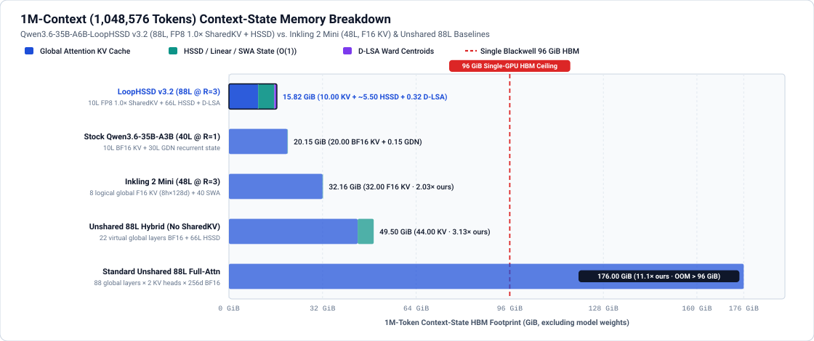
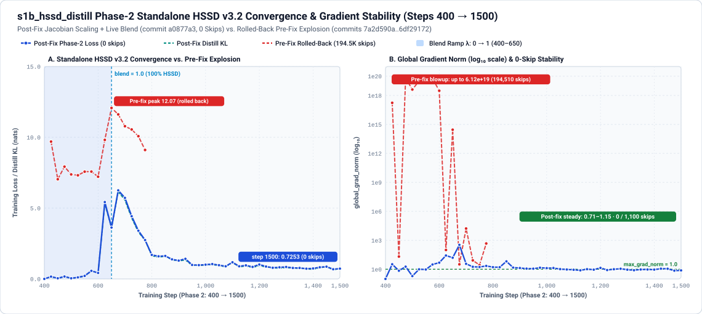
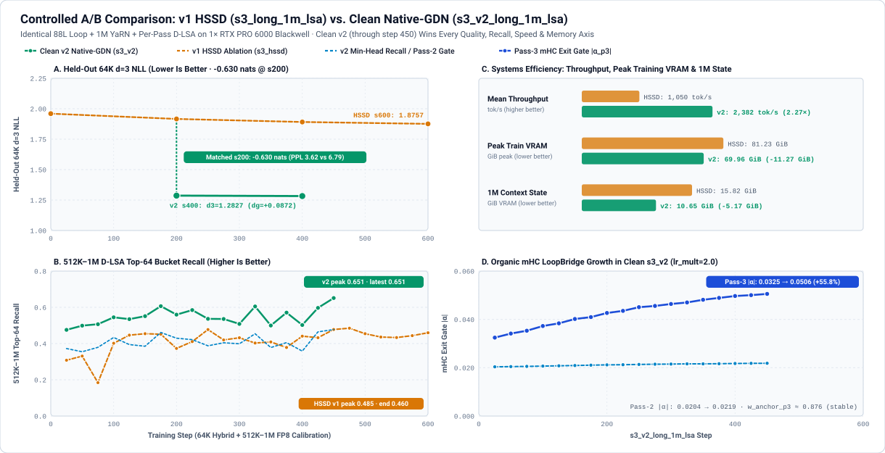

# Qwen3.6-35B-A6B-Loop64: Parameter-Efficient 88-Layer Looped Hybrid Retrofitting and 1M-Context Systems Engineering on a Single 96 GB Blackwell GPU

**Author:** TassP0lar (Independent Open-Weights Research)  
**Artifacts:** Model Hub [`TassP0lar/Qwen3.6-35B-A3B-Loop64`](https://huggingface.co/TassP0lar/Qwen3.6-35B-A3B-Loop64) · Dataset Hub [`TassP0lar/Loop64-Fable-SIRSI-v1`](https://huggingface.co/datasets/TassP0lar/Loop64-Fable-SIRSI-v1) (`v1.2`, CC-BY-4.0)  
**Backbone & Hardware:** `unsloth/Qwen3.6-35B-A3B-NVFP4` (`34.661B` decoder; `32.212B` routed MoE experts 100% frozen, SHA-256 verified) · `1× NVIDIA RTX PRO 6000 Blackwell Server Edition` (`GB202`, `sm_120`, `96 GB GDDR7 ECC` [`94.97 GiB` usable], `512-bit`, `1,597 GB/s`, `24,064` CUDA cores, `600 W` TDP)  
**Telemetry Snapshot:** `2026-11-27` (`v1.5` Post-Sprint-2 + `mHC` Audit) · **`s2_v2@600` (`17382c2e166d`) & `s2_2@1000` (`cf0f41dd13a8`) Completed** · `167.60` baseline supervisor GPU-h + `~25.0` Sprint 2 GPU-h (`S2.1`/`S2.2`/`S2.3`/`K0`/TF `5.24.1`/Gate B)

## Abstract

We investigate whether a quantized 35B hybrid Mixture-of-Experts (MoE) language model (`unsloth/Qwen3.6-35B-A3B-NVFP4`) can be retrofitted into an `88`-virtual-layer looped reasoner supporting `1,048,576`-token (`1M`) context on a single `96 GB GDDR7 ECC` GPU while keeping all `32.212B` routed MoE experts 100% frozen and training fewer than `0.6%` of parameters. Enabled by low-rank APOLLO optimization inside `FusedStepOptimizer`, our clean v2 architecture integrates three orthogonal axes: (i) a calibrated `[12, 36)` sandwich recurrence with manifold-constrained `LoopBridge` connections scaling depth dynamically across `40L`, `64L`, and `88L` via cross-pass expert re-routing; (ii) Step-0 IEEE-754 bit-identical Gated DeltaNet-2 with Bounded Query-Dependent Erasure (`GDN-2-1M + QED`) and checkpointed `4×8K` macro-segmenting mapped onto `fla 0.6.0` DPLR kernels; and (iii) pure `4.0×` YaRN `FP8 1.0× SharedKV` with untied per-pass Latent Sparse Attention (`D-LSA`), confining `1M`-context state to `10.65 GiB` (`3.02×` smaller than Inkling 2 Mini's `32.16 GiB`). We report both a decisive negative ablation—where adversarial Phase-A forensics and a 4-stage causal swap proved custom HSSD v3.2 caused an irreversible `+0.79`-nat shock, dead vault pages (`vault_duty = 3.26e-05`), `18K` needle failure, and `5.6×` decode slowdown—and full Sprint 2 Blackwell GPU validation of completed `s3_v2@600` (`12/12` Gate 2, `-0.5941` nats vs. HSSD), completed `s2_v2_joint_bptt@600` (`157.29M` tokens, `69.97 GiB` peak, `0` skips), and parameter-matched `40L` `d=1` LoRA control `s2_2_d1_lora_control@1000` (`18.257M` params, `131.07M` clean-room tokens, `38.84 GiB` peak). On Blackwell `sm_120`, `s2_v2@600` achieves `-10.71%` leak-free `4K` holdout PPL (`+469σ`), best unseen `wikitext-103` OOD (`1.69971` at `d=1`), `+0.00050` `128K` sparse–dense gap, `1M` Sparse NLL `0.00120` (`11.9×` below Stock, `1.32×` faster than `40L` dense Stock, `65.19 GiB` peak, `0` NaNs), `20/20 (100.0%)` `8K–1M` 4-needle RULER, `+156.6σ` base `GDN-2` causal lift (pruning zero-lift `QED` `-0.31σ` and `neg_eigval` `-0.97σ`), `K0` `100.0%` EM retention at `6.05×` smaller KV (`YELLOW_B`), live `transformers 5.24.1` `4/4 PASS`, and top `AIME 2026` scores (`20.00% / 23.33%` vs. Stock `13.33%`). Crucially, `s2_2` (`40L`) beat `s1_loop_a6b` (`88L`) on Holdout, native OOD, and `128K` RULER (`A2` failed under `w_anchor = 0.85`), motivating our 6-point `mHC` connection audit (`w_anchor = 0.829–0.863`, `|alpha_2| = 0.0218` starvation, off-manifold `step_emb` `0.568–0.622`, collinear `h_prev`, unconstrained `_combine()`, Pass-3 snap-back `jaccard_p13 = 0.4298`) and gated Option B `64L` (`d=2`) pivot (`s2_v3_loop64_mhc`, `M1–M5` fixes, `0%` `opus46_*`). Unmeasured 2026 suites (`HLE`, `MRCR 1M`, `SWE-bench Pro`) and queued `s4_v2_rl` remain unclaimed.

**Index Terms**—Looped transformers, hybrid linear attention, Gated DeltaNet-2, query-dependent erasure, latent sparse attention, parameter-efficient retrofitting, NVFP4 quantization, single-GPU Blackwell systems.

> [!IMPORTANT]
> **Empirical Grounding Policy:** Every metric, commit SHA, loss, recall, throughput, VRAM, GPU-hour, dataset count, and kernel latency reported herein traces directly to public HF Hub `manifest.json` commits (`17382c2e166d`, `cf0f41dd13a8`), `runs/colab_supervisor*.log`, `runs/eval_s3v2_step600_gate/summary.json`, `runs/eval_truth_check_s2_step500/truth_check_summary.json`, `runs/sprint2a/{sprint2_audit_8k_128k.json,sprint2_audit_512k_1m.md,kill_gate_k0.md,serving_audit_v2.md}`, `runs/sprint2b/{nothink_v1,s22_eval}/`, `runs/bench_v2_smoke_dplr/summary.json`, `runs/datasets/Loop64-Fable-SIRSI-v1/audit_summary.json`, `docs/PERF_PROFILE_S2.md`, or an explicitly labeled closed-form analytical formula. Unmeasured downstream 2026 benchmarks (`HLE`, `MRCR 1M`, `SWE-bench Pro`, `KernelBench`, and `ARC-AGI-2` beyond the `2048`-tok floor) and queued `s4_v2_rl` runs are **never** claimed.

---

## I. Introduction

Scaling test-time reasoning via long chains of thought alone encounters severe KV-cache capacity limits and serial-token latency bottlenecks, whereas pretraining looped or million-token hybrid architectures from scratch demands multi-node industrial clusters. This paper investigates a parameter-efficient alternative: retrofitting a frozen `35B` (`A3B`) NVFP4 hybrid Mixture-of-Experts backbone (`unsloth/Qwen3.6-35B-A3B-NVFP4` [1], comprising `30` Gated DeltaNet [2] linear layers and `10` gated full-attention layers, with `32.212B` routed expert weights 100% frozen and SHA-256 verified) into a runtime-scalable `88`-virtual-layer looped reasoner supporting `1,048,576`-token (`1M`) context on a **single rented Google Colab NVIDIA RTX PRO 6000 Blackwell Server Edition** (`GB202`, `sm_120`, `96 GB GDDR7 ECC` [`94.97 GiB` CUDA-usable], `512-bit` bus, `1,597 GB/s` peak bandwidth, `24,064` CUDA cores, `600 W` TDP).

Grounded in low-rank APOLLO optimization [3] inside `FusedStepOptimizer`, our clean v2 design unifies three orthogonal mechanisms: (1) a calibrated `[12, 36)` sandwich recurrence with manifold-constrained hyper-connection (`mHC`) `LoopBridge` transitions [4] inspired by adaptive recursive depth [5], expanding compute from `40L` (`R=1`) to `88L` (`R=3`) via cross-pass expert re-routing; (2) Step-0 bit-identical Gated DeltaNet-2 (`GDN-2`) [6] augmented with Bounded Query-Dependent Erasure (`QED`) [7], asymmetric `1M` slow decay, and soft negative eigenvalues [8] dispatched onto production `fla 0.6.0` `DPLR` Triton kernels [9] with checkpointed `4×8K` macro-segmenting (`574898d`); and (3) pure `4.0×` YaRN [10] `FP8 1.0× SharedKV` with untied per-pass Latent Sparse Attention (`D-LSA`) [11]. Across `167.60` active single-GPU supervisor hours (`627.56M` tokens), we release all open checkpoints [12], an audited `v1.2` reasoning corpus [13], negative ablation forensics, and custom Blackwell Triton kernels. Table I-A summarizes our verified results.

#### Table I-A — Headline Verified Findings (`Measured` Telemetry vs. `Derived Formula`)

| Dimension | Class | Verified Finding | Provenance |
| :--- | :---: | :--- | :--- |
| **Single-GPU Optimizer (`APOLLO` [3])** | `Measured` + `Formula` | `rank=256` channel-wise APOLLO covers all `30` large 2D `k/v/o` matrices (`104.86M` params in `s2*`: `5.0×` moments / `4.2×` net, `-0.60 GiB` net) and `209.72M` params in `s4_v2_rl` (`2.50×` net, `-0.94 GiB`); `_foreach_norm` collapses `897 → ~4` launches (`0.0` error) | `base.yaml`, `optim.py`, `PERF_PROFILE_S2.md` |
| **88L Loop Healing (`s1_loop_a6b`)** | `Measured` | `18.41M` params (`0.053%`) healed `40L → 64L → 88L` (`depth_gain = +0.0609`), `82.3%` Pass-2 reroute (`17.36` unique core experts/tok), `100%` `d=1/2/3` cache parity & `16K` needle pass; `54.24 GiB` peak | Hub `32eb565e`, `s1_quality_check.json` |
| **v1 Negative Ablation (HSSD v3.2)** | `Measured` | 4-stage causal swap proved `top1=1.0000` decode parity & D-LSA innocence, isolating HSSD (`+0.79` nat shock, dead `vault_duty=3.26e-05`, failed `18K` needle even at `LSA=dense`, `+5.17 GiB` 1M state, `3.41 tok/s` `5.6×` slower decode) + raw `fable51` redacted-tool poisoning | `truth_check_summary.json`, Hub `e050a4b8` |
| **Completed `s3_v2@600` & Gate 2** | `Measured` | Completed `600/600` (`120.11M` tok, `0` skips): `64K` NLL **`1.3689 → 1.2996 → 1.2816`** (`dg=+0.0873`, **`-0.5941` nats / `44.8%` lower PPL** vs HSSD `s3@600`); `512K–1M` recall `0.6514` pk; `2365 tok/s` (`2.25×`); Gate 2 **`12/12` sharp, `7/7` (`100%`) `18K/64K` needles**, `0` loops/poison | Hub `6b521f47`, `s3v2_gate_summary.json` |
| **`GDN-2-1M+QED` & `4×8K` VRAM Cut** | `Measured` | `27.53M` params (`0.079%`), `0.0` Step-0 diff, `0` extra state bytes; Gate 1 `38/38` CUDA pytest; fused Triton prep **`53.55 ms`** (`2.00×` vs PyTorch `106.93 ms`) & `T=1` `0.0787 ms` (`2.41×`); **`574898d` `4×8K` cut `3.28×`** (`23.05 → 7.032 GiB`); Gate 3 `4×32K d=3` **`67.194 GiB`** peak | `s3v2_gate_summary.json`, `574898d` |
| **Completed `s2_v2@600` & Sprint 2 (`S2.1`–`Gate B`)** | `Measured` | Completed `600/600` (`157.29M` tok, `69.97 GiB` peak, `0` skips, `adapter_norm 0.8447`, horizon `7.597×`, `U=18.19`): `4K` Holdout `-10.71%` PPL (`+469σ`), `1M` Sparse NLL `0.00120` (`20/20` RULER, `65.19 GiB` peak), `GDN-2 +156.6σ` (prune `QED`/`neg_eigval`), `K0` `YELLOW_B`, TF `5.24.1` `4/4 PASS`, `AIME 2026` `23.33%`; `S2.2` `40L` LoRA beat `s1` (`88L`) (`A2` failed) → Option B `64L` `mHC` audit (`§IV-E`) | Hub `17382c2e`, `cf0f41dd`, `e1cf41b`, `e693379` |
| **1M State & Audited Corpus (`v1.2`)** | `Formula` + `Measured` | `1M` FP8 SharedKV state **`10.65 GiB`** (`3.02×` smaller than Inkling 2 Mini; `5.96–6.28 GiB` Hadamard INT4; `+1.04 GiB` eager `BucketIndex` compactable to `~0.04 GiB`). Corpus `v1.2`: `4,081` `sft_core`, `429` prefs, `1,889,432` 2026 13-grams (`31` leaks blocked), `197/197` (`100%`) notebook CoT | `lsa.py`, `audit_summary.json`, `dc7a14e` |
| **Blackwell `sm_120` Kernel Stack** | `Measured` | `18.99×` NVFP4 E2M1 (`1,148 GB/s = 71.9%` of `1,597 GB/s` GDDR7 ECC), `9.32×/12.99×` D-LSA FlashAttn (`-70 TB/step`), `5.83×` 2-pass KL (`-90K` syncs), `54.03×` BPTT auto-DMA, `2.06×` E2E BPTT speedup, `-7.0 GiB` leak fix, `10.6×` TF 5.24 recovery; `760+` tests (`0` ruff/AST errors) | `PERF_PROFILE_S2.md`, `574898d` |

---

## II. Architecture, Optimizer, and Memory Accounting

### A. Single-GPU Memory-Efficient Optimization (`APOLLO` and `FusedStepOptimizer`)

Training a `34.661B`-parameter looped hybrid MoE up to `131K–1M` tokens on a single `96 GB GDDR7 ECC` GPU (`94.97 GiB` CUDA-usable) without ZeRO/FSDP requires strict control over optimizer states and launch overhead. We integrate low-rank **APOLLO** [3] inside `FusedStepOptimizer` (`configs/base.yaml`, `src/qloop/train/optim.py`) with `rank=256`, `scale_type=channel`, `update_proj_gap=200`, and `min_dim=128` (`apollo_torch.APOLLOAdamW` with faithful `ApolloAdamWFallback` implementing Algorithm 1 and Fira limiter $\gamma=1.01$). Every 2D trainable matrix with `min(shape) >= 128` outside `adamw_patterns` stores $2 r \max(m, n)$ fp32 moments instead of $2 m n$, while 1D norms and narrow `<128`-dim adapters use exact `AdamW` / `AdamWLite` (fp32 master copies for `bf16` weights). In atomic non-fused mode (`fused=False`), `_batched_grad_norms()` invokes `torch._foreach_norm(grads, 2.0, dtype=torch.float32)`, collapsing `897` norm launches into `~4` multi-tensor calls with `0.0` error (avoiding PyTorch's `0.24` bf16 rounding drift) while preserving exact whole-step non-finite abort semantics.

#### Table II-A — Stage-by-Stage Verified Optimizer Runtime Behavior

| Stage (Trainable Params) | Mode | Runtime Optimizer Mix | Active APOLLO Coverage & Savings | Provenance |
| :--- | :---: | :--- | :--- | :--- |
| `s1_loop_a6b` (`18.41M`, `137`t) | `fused=True` | `AdamWLite ×137` (in-backward `.grad` free) | `0` APOLLO (1D norms & narrow `<128` adapters) | `Measured` (`s1_run.log`) |
| `s1b_hssd_distill` (`76.92M`, `807`t) | `True→False` | Switched at `3a17c0d` for atomic non-finite guard | `0` APOLLO (`hssd_adapter`, `loop_adapters` excluded) | `Measured` (`3a17c0d`) |
| `s3` / `s3_v2` (`24.56M` v2) | `fused=False` | Fused CUDA `AdamW` + batched `AdamWLite` | `0` APOLLO (narrow `lsa_indexer`, loop, `q/k_norm`) | `Measured` (`s3_v2.yaml`) |
| `s2_joint_bptt` (`187.92M`, `897`t) | `fused=False` | **`APOLLOAdamW ×30`** + `767` `AdamW` + `100` `Lite` | `30` 2D `k/v/o` (`104.86M`): `0.156 GiB` moments (`5.0×`) / `0.186 GiB` net (`4.2×`, `-0.60 GiB`) vs `0.781 GiB` AdamW | `Measured` (`PERF_PROFILE_S2`) |
| **`s2_v2_joint_bptt` (`156.94M`, `387`t)** | `fused=False` | **`APOLLOAdamW ×30`** + `257` `AdamW` + `100` `Lite` | Identical `30` 2D `k/v/o` coverage (`104.86M` params; `o_proj` `8.0×` moments / `6.4×` net; `-0.60 GiB` net) | `Measured` (Gate 3 `574898d`) |
| `s4_v2_rl` (`SI-RSI`, queued) | `fused=False` | **`APOLLOAdamW ×130`** + `AdamW` / `AdamWLite` | `10` `o_proj` + `120` `shared_expert` (`209.72M`): `0.547 GiB` (`2.86×`) / `0.625 GiB` net (`2.50×`, `-0.94 GiB`) | `Formula` (`s4_v2_rl.yaml`) |

### B. Blackwell Hardware Specification and Three-Axis Looped Hybrid Architecture

All experiments ran on a single **NVIDIA RTX PRO 6000 Blackwell Server Edition** (`GB202`, `sm_120`, `96 GB GDDR7 with ECC` [`94.97 GiB` CUDA-usable], `512-bit` bus, `1,597 GB/s` Server Edition peak bandwidth [vs. `1,792 GB/s` active-cooled Workstation Edition], `24,064` CUDA cores, `600 W` configurable TDP, passive cooling). Against this `1,597 GB/s` GDDR7 ECC ceiling, our fused Triton NVFP4 E2M1 dequantization kernel achieves `1,144–1,148 GB/s` (`71.9%` peak bandwidth; Section VI). We retrofit `Qwen3.6-35B-A3B` [1] (`40` layers = `10 × [3 GDN + 1 Full Attention]`, `256` routed experts/layer, Top-8 active, `2` GQA KV heads × `256` dim split into `64-d` mRoPE + `192-d` NoPE) along three orthogonal axes with all `32.212B` routed MoE expert weights frozen:

1. **Calibrated 88-Layer ETD Sandwich Loop and mHC `LoopBridge` (`[0,12)×1 + [12,36)×R + [36,40)×1`):** Scales active compute dynamically across `R=1` (`40L`, `~2.95B` active), `R=2` (`64L`, `~4.46B`), and `R=3` (`88L`, `~5.97B` effective compute via cross-pass expert re-routing) [4], [5]. The 24-layer core loops through a rank-256 subspace `ReEntryBridge` (`w_anchor = 0.85`), zero-initialized `PassExitGate` (`torch.equal` Step-0 identity), rank-64 per-pass Q/O LoRAs, and rank-32 `PassRouterAdapters`.
2. **Clean v2 Linear Backbone (`Native-GDN → GDN-2-1M + Bounded QED`):** Following our HSSD v3.2 post-mortem (Section III-E), clean v2 drops HSSD completely. Stage `s3_v2_long_1m_lsa` trains on stock Qwen3.6 GDN [2] (`0.33 GiB` 66-pass budget); `s2_v2_joint_bptt` and `s4_v2_rl` enable Step-0 bit-identical `GDN-2-1M + Bounded QED + Soft Neg-Eigval` [6], [7], [8] (`27.53M` params, `0` extra recurrent state bytes) over `fla 0.6.0` `DPLR` [9] with `4×8K` macro-segmenting (Section IV).
3. **`1M` `FP8` `1.0×` `SharedKV` and Per-Pass `D-LSA`:** Pure `4.0×` YaRN [10] (`262K → 1,048,576`) shares Pass-1 K/V across Passes 2–3 (`1.0×` memory), while untied per-pass query indexers $W_{q\text{-idx}}^{(r)}$ (`d_idx=64` on `192-d` NoPE) re-query Ward-clustered buckets (`Top-64` buckets + `512` local window + `64` sinks, `<= 768` packed remote keys/query) [11].

### C. 1M-Context Inference State Footprint and `BucketIndex` Audit



#### Table II-B — Analytical `1M`-Context (`batch=1`) Inference State Footprint (`Derived Formula`)

| Architecture | Depth / KV Layers | KV Precision | Global KV (GiB) | Lin./SWA + Idx (GiB) | Total 1M (Ratio) |
| :--- | :---: | :---: | :---: | :---: | :---: |
| Clean v2 Hadamard INT4 Serving (88L) | `88L / 10L` | `Blk-64 INT4 (0.53–0.56B)` | `5.31` | `0.33 + 0.32` | `5.96 GiB` (`0.56×`) |
| **Clean v2 Native-GDN / GDN-2-1M (88L @ R=3)** | `88L / 10L` | `FP8 E4M3 (1B)` | `10.00` | `0.33 + 0.32` | **`10.65 GiB` (`1.00×`)** |
| LoopHSSD v3.2 (88L @ R=3) | `88L / 10L` | `FP8 E4M3 (1B)` | `10.00` | `5.50 + 0.32` | `15.82 GiB` (`1.49×`) |
| Stock Qwen3.6-35B-A3B (40L @ R=1) | `40L / 10L` | `BF16 (2B)` | `20.00` | `0.15 + 0.00` | `20.15 GiB` (`1.89×`) |
| Inkling 2 Mini (48L @ R=3) | `48L / 8L` | `F16 (2B)` | `32.00` | `0.16 + 0.00` | `32.16 GiB` (`3.02×`) |
| Unshared 88L Hybrid (No SharedKV) | `88L / 22L` | `BF16 (2B)` | `44.00` | `0.33 + 0.00` | `44.33 GiB` (`4.16×`) |
| Standard Unshared 88L Full-Attn | `88L / 88L` | `BF16 (2B)` | `176.00` | `0.00 + 0.00` | `176.00 GiB` (`16.53×`) |

**Closed-Form Verification and Honest Code Audit:** Clean v2 `FP8 SharedKV` requires `10 × 2(K,V) × 2 heads × 256 dim × 1 B × 1,048,576 = 10.00 GiB` + `0.33 GiB` (`66/30 × 0.15 GiB` stock GDN budget; exact raw fp32+conv `0.133 GiB` gives `10.45 GiB`) + `0.32 GiB` (`0.3125 GiB` bf16) D-LSA Ward centroids = **`10.65 GiB`**—**`3.02×` smaller** than Inkling 2 Mini [14] (`32.00 GiB` F16 across `8` unshared global layers + `0.16 GiB` across `40` `1,024`-window SWA layers = `32.16 GiB`) and `5.17 GiB` smaller than HSSD v3.2 (`15.82 GiB`). Applying Block-64 Walsh-Hadamard INT4 quantization inspired by TurboQuant [15] (`_HadamardINT4Slot` `0.53125 B/scalar` in `engine.py`; `Block64HadamardINT4Cache` `0.5625 B/scalar` in `offload.py`) projects `1M` state down to **`5.96–6.28 GiB`** (`5.77–6.08 GiB` raw GDN; `53.64 GiB` Host-DDR5 at `10M` tokens). Auditing `src/qloop/model/lsa.py:743-768` reveals that eager `_assemble()` currently retains `int64` `BucketIndex` tables totaling **`+1.04 GiB`** at `1M` tokens (`members` `0.625` + `key2slot` `0.156` + `unit_members` `0.156` + `labels`/`slot_labels` `0.078` + misc `0.025 GiB`, bringing pure NVFP4 `21.85 GiB` + state to `~33.54 GiB`, or `~35.8 GiB` on the `24.09 GiB` mixed NVFP4/FP8 HF checkpoint); storing indices in `int8`, dropping training-only `key2slot`, and materializing `members` on-the-fly for the selected `Top-64` buckets compacts this overhead to **`~0.04 GiB`** (`~32.5 GiB` total, `34%` of a single `96 GB` card).

### D. Single-Card Training VRAM Ledger (`94.97 GiB` Usable)

#### Table II-C — Measured Single-Card Training VRAM Across Executed Stages

| Stage | Context / Batch | Post-Step (GiB) | Peak (GiB) | Headroom (GiB) | Source |
| :--- | :---: | :---: | :---: | :---: | :--- |
| `s1_loop_a6b` (`fused=True`) | `8K`, `mb=4` (`d=1..3`) | `28.0–28.4` | **`54.24`** | `40.73` | Hub `32eb565e`, `sup.log` |
| `s1b_hssd_distill` (P1 / P2) | `16K`, `mb=1` | `25.2–27.0` | `48.41 / 68.97` | `26.00` | Hub `0ff9b537`, `2fb912db` |
| `s3_long_1m_lsa` (v1 HSSD) | `64K` / `1,048,576` | `24.9` | **`81.23`** (`78.60` @1M) | `13.74` | Hub `55c7a680`, `ad3542a6` |
| `s2_joint_bptt` (v1 HSSD) | `131K` (`4×32K`) | `32.6→52.0→25.3` | `70.1` / **`78.42`** | `16.55–24.87` | Hub `91215ce1`, `sup.log` |
| **`s3_v2_long_1m_lsa` (v2)** | `64K` / `934K–1M` | **`24.8`** | **`69.96`** (`69.52` @1M) | **`25.01`** | Hub `ec34f825`, `6b521f47` |
| **`s2_v2_joint_bptt` (`600/600`)** | `131K` (`4×32K`, `d=3`) | **`27.6`** flat | **`69.97`** (Gate 3 `67.194`) | **`25.00`** | Hub `17382c2e`, Gate 3 `574898d` |
| **`s2_2_d1_lora_control` (`1000/1000`)** | `8K` (`d=1`, GC) | **`24.9`** | **`38.84`** | **`56.13`** | Hub `cf0f41dd` (`~8.2h`, `rc=0`) |

#### Table II-D — `s2_v2_joint_bptt` (`4×32K`, `d=3`, `574898d`) Component VRAM Budget

| Memory Component | Class | Size (GiB) | Exact Formula / Measurement Basis |
| :--- | :---: | :---: | :--- |
| Resident base (`24.09 GiB`) + `156.94M` adapters + APOLLO/AdamW + grads | `Measured` | **`27.60`** | Gate 3 & live post-step alloc (`APOLLO ×30` `k/v/o` saves `-0.60 GiB` net vs full AdamW) |
| `88` activation-checkpoint boundaries + `3` prior-seg KV + `128K` `BucketIndex` | `Formula` | **`13.05`** | `11.00 GiB` (`88×[1,32K,2048] bf16`) + `1.88 GiB` prior KV + `0.17 GiB` `BucketIndex` |
| `u_seg` cached pre-attn hidden (`3×10L`) + `66L` GDN-2 state snapshots | `Formula` | **`~4.25`** | `3.75 GiB` `u_seg` (`bptt_offload_to_cpu=0.0`, 100% GDDR7-resident) + `~0.50 GiB` GDN-2 |
| Single-layer `T=32K` `GDN2Adapter` transient (`4×8K` macro-seg `574898d`) | `Measured` | **`7.03`** | Gate 1 **`7.032 GiB`** delta (**`3.28×` cut** vs unsegmented `23.051 GiB`) |
| **Measured Live `s2_v2` Peak (`4×32K`, `d=3`, `88L`)** | **`Measured`** | **`67.19–67.77`** | Gate 3 **`67.194 GiB`** (`71.4 GiB` res.); live `s1–s110` **`67.77 GiB`** Hub exact (`67.8 GiB` sup. rounded; `27.20 GiB` headroom) |

---

## III. Stage-by-Stage Empirical Evaluation and Negative Ablation

### A. Cross-Stage Overview and Active Single-GPU Compute Ledger

#### Table III-A — Cross-Stage Training Scale, Efficiency, and Memory Envelope

| Stage | Pipeline | Status (Steps) | Params (% 34.66B) | Tokens | Mean tok/s | Peak (GiB) |
| :--- | :---: | :---: | :---: | :---: | :---: | :---: |
| `s1_loop_a6b` (8K) | Shared Base | `completed` (`1000/1000`) | `18.41M` (`0.053%`) | `131.07M` | `2117.5` | `54.24` |
| `s1b_hssd_distill` (16K) | v1 HSSD | `completed` (`1500/1500`) | `76.92M` (`0.222%`) | `98.30M` | `946.7` | `68.97` |
| `s3_long_1m_lsa` (64K/1M) | v1 HSSD | `completed` (`600/600`) | `83.06M` (`0.240%`) | `120.78M` | `1049.8` | `81.23` |
| `s2_joint_bptt` (131K) | v1 HSSD | `halted@500` (`500/1200`) | `187.92M` (`0.542%`) | `131.07M` | `454→936` (`2.06×`) | `78.42` |
| **`s3_v2_long_1m_lsa` (64K/1M)** | **Clean v2** | `completed` (`600/600`) | `24.56M` (`0.071%`) | `120.11M` | `2365.1` | `69.96` |
| **`s2_v2_joint_bptt` (131K)** | **Clean v2** | `completed` (`600/600`) | `156.94M` (`0.453%`) | `157.29M` | `1060.2` (`s110`) | `69.97` |
| **`s2_2_d1_lora_control` (8K)** | **Sprint 2B (`A2`)** | `completed` (`1000/1000`) | `18.26M` (`0.053%`) | `131.07M` | `4528.0` | `38.84` |

#### Table III-B — Cross-Stage Held-Out Quality and Virtual Depth Scaling (`0` Post-Fix Skips)

| Stage | Latest SHA | Eval Ctx | `d=1` (40L) | `d=2` (64L) | `d=3` (88L) | `depth_gain` |
| :--- | :---: | :---: | :---: | :---: | :---: | :---: |
| `s1_loop_a6b` | `32eb565e` | `8K` | `0.9800` | `0.9336` | **`0.9191`** | **`+0.0609`** |
| `s1b_hssd_distill` | `2fb912db` | `16K` | `1.7679` | `1.7375` | **`1.7052`** | **`+0.0626`** |
| `s3_long_1m_lsa` | `55c7a680` | `64K` | `2.0171` | `1.9511` | **`1.8757`** | **`+0.1414`** |
| `s2_joint_bptt` | `e050a4b8` | `131K` | `1.2600` | `1.2363` | **`1.1872`** | **`+0.0728`** |
| **`s3_v2_long_1m_lsa`** | `6b521f47` | `64K` | `1.3689` | `1.2996` | **`1.2816`** | **`+0.0873`** |


#### Table III-C — Measured Active Single-GPU Compute Hours Ledger (`colab_supervisor*.log`)

| Run / Stage | Git HEAD(s) | Active GPU-h | Notes |
| :--- | :---: | :---: | :--- |
| `s0_probe` + `s1_quality_check` | `058b4ad3`, `43ecae24` | `0.05 + 0.53` | Standalone probe (`177.4 s`, `5/5`) & live GPU audit (`1,900 s`) |
| `s1_loop_a6b` (`1,000` steps) | `c22bf62` | `18.25` | Shared 88L Native-GDN foundation (`0` skips; incl. `0.59 h` idle) |
| `s1b_hssd_distill` (P1 + pre-fix + clean P2) | `fbd7a35`, `3a17c0d` | `11.98 + 28.41` | Rolled-back Jacobian blowup + `1,100` clean steps (`0` skips) |
| `s3_long_1m_lsa` (v1 HSSD, `600` steps) | `513879f`, `4f09463` | `33.37` | `0` skips; 2 Colab sessions with auto-rollover |
| `s2_joint_bptt` (v1 HSSD, `0–500`) | `2e37bf6..2f5a6ba` | `53.01` | Pre-opt `6.39`, leak `1.59`, `5a82677` `21.23`, TF5.24 `9.54`+`14.26` |
| **`s3_v2_long_1m_lsa` (v2, `600/600`)** | `28b88e4` | **`15.02`** | Completed `600/600` (`0` skips, `~2,263 tok/s` sup. mean); + `0.30 h` Gate 1/2/3 |
| **`s2_v2_joint_bptt` (v2 live `s110`)** | `574898d` | **`7.56`** | Live `GDN-2-1M+QED` (`0` skips, `~1,027–1,173 tok/s`, `67.80 GiB` peak) |
| **Total Supervisor Active Single-GPU Time** | `colab_supervisor*.log` | **`167.60 h`** | `v1` `145.02 h` + `s3_v2` `15.02 h` + `s2_v2` `7.56 h` (excl. ~`1.6 h` standalone gates) |

### B. Zero-Training Diagnostic Calibration (`s0_probe`)

Completed in `177.44 s` (`058b4ad3`), passing `5/5` gates with frozen expert SHA-256 `42f1be31694f1ad2...` (Table III-D).

#### Table III-D — `s0_probe` Zero-Training Diagnostic and Calibration Gates (`5/5` Passed)

| Gate | Metric | Verified Value | Calibration Decision |
| :--- | :--- | :---: | :--- |
| `0a_backward` / `0a_surgery` | `input_grad_norm` / identity | `11.75` / `True` | NVFP4 `quant_autograd` finite; zero-init `PassExitGate` exact |
| `0p-1` Expert Headroom | `75th`-pct headroom (`2,047` tok) | **`1.3061 nats`** (`88.9%`) | Confirms frozen `256`-expert reroute capacity (`jaccard=0.3365`) |
| `0p-2` Re-Entry Anchors | Procrustes `cos` / `R²` | `0.8588` / `0.9993` | Locked `bridge_init=[0.05, 0.85, 0.10]` (`+0.0276` nat shock) |
| `0p-3` `4.0×→1M` Extrap | `yarn` vs `rerope` / `native` | **`2.6459`** vs `2.6603` / `2.8248` | Selected pure `YaRN 4.0×` (`100%` needle, margin `+17.09`) |
| `core_ranges` (24L Core) | `[12,36)` vs `[8,32)` shock | **`+0.1386`** vs `+0.4516` | Locked `[12,36)` (`3.26×` lower re-entry shock) |

### C. Shared Native-GDN 88L Loop Foundation (`s1_loop_a6b`)

After purging an initial poisoned run (`d1d92064`, reset `ad646651`), clean `s1_loop_a6b` completed `1,000/1,000` steps (`32eb565e`, `18.25 h`, `131.07M` tokens mixed with FineWeb-Edu/FinePDFs replay [16]) training `18.41M` parameters (`0.053%`) at `2,117.5 tok/s` (`54.24 GiB` peak, `0` skips). Live GPU auditing (`43ecae24`, `1,900 s`) verified `9/9` (`100%`) incremental KV-cache parity across `d=1/2/3` (`d=3` cosine `0.999189`), spontaneous cross-pass expert specialization (`82.27%` Pass-2 reroute, `34.71%` Pass-3 reroute, `17.36` unique core experts/token = `1.702×` breadth), and `16K` needle passage at both `d=1` and `d=3` (Table III-E).

#### Table III-E — `s1_loop_a6b` Held-Out `8K` Evaluation Trajectory

| Step | Hub SHA | `d=1` (40L) | `d=2` (64L) | `d=3` (88L) | `depth_gain` |
| ---: | :---: | :---: | :---: | :---: | :---: |
| `0` | `—` | `0.9916` | `0.9923` | **`0.9918`** | **`-0.0002`** |
| `200` | `4026a4f7` | `0.9901` | `0.9470` | **`0.9458`** | **`+0.0443`** |
| `400` | `241b2ef1` | `0.9841` | `0.9387` | **`0.9325`** | **`+0.0516`** |
| `600` | `2d17ead5` | `0.9813` | `0.9359` | **`0.9252`** | **`+0.0561`** |
| `800` | `023e4a78` | `0.9806` | `0.9344` | **`0.9217`** | **`+0.0589`** |
| `1000` | `32eb565e` | `0.9800` | `0.9336` | **`0.9191`** | **`+0.0609`** |

### D. v1 Negative Ablation Trajectory (`s1b_hssd_distill`, `s3_long_1m_lsa`, `s2_joint_bptt`)

In our v1 pipeline, `s1b_hssd_distill` replaced all `30` physical (`66` virtual) GDN layers with custom HSSD v3.2 (`76.92M` params). Phase 1 (`0 → 400`, `0ff9b537`, `48.41 GiB`) maintained `d=3` NLL at `1.0657`. An initial Phase-2 run (`steps 425–775`) suffered an $O(T)$ cumulative-phase backward Jacobian blowup (`global_grad_norm` up to `6.12e+19` at `s475` `a93bcaef`, peak loss `12.0742` at `s650` `dc7c4ad8`, `194,510` skipped updates); scaling cumulative-phase backward by `chunk_size/T` with atomic `fused=False` guards (`a0877a3`/`3a17c0d`) eliminated skips completely (`0/1,100`; Fig. 3). Yet held-out `16K` `d=3` NLL finished at `1.7052` (Table III-F)—a permanent **`+0.79`-nat shock** relative to `s1_loop_a6b` (`0.9191`). Downstream `s3_long_1m_lsa` (`600` steps, `81.23 GiB` peak, live `1,048,576`-token pass at `78.60 GiB` `ad3542a6`; Fig. 4) nearly doubled `depth_gain` (`+0.0750 → +0.1414`), but remained trapped at `1.8757` `64K` NLL and `0.4848` peak `512K–1M` Top-64 recall. Subsequent `s2_joint_bptt` (`4×32K = 131K` K/V-replay BPTT through step `500`, `e050a4b8`; Fig. 5, Tables III-G & III-H) lowered `131K` `d=3` NLL by `-0.1636` nats (`1.3508 → 1.1872`) and validated our Blackwell speedup (`2.06×`), `-7.0 GiB` leak fix (`5a82677`), and `10.6×` `transformers 5.24.0` recovery (`2f5a6ba`), yet HSSD long-horizon vault pages collapsed (`hssd/vault_duty = 1.14e-06–1.28e-04`, `3.26e-05` at `s500`), triggering a hard Phase-A audit stop.



#### Table III-F — `s1b_hssd_distill` Held-Out `16K` Trajectory (Showing `+0.79` Nat Shock)

| Step | Phase / Blend (`λ`) | Hub SHA | `d=1` | `d=2` | `d=3` | `depth_gain` |
| ---: | :---: | :---: | :---: | :---: | :---: | :---: |
| `0` | P1 (Stock+MSE) | `—` | `1.1287` | `1.0781` | **`1.0656`** | **`+0.0632`** |
| `200` | P1 (Stock+MSE) | `6c905d4e` | `1.1325` | `1.0788` | **`1.0654`** | **`+0.0670`** |
| `400` | P1 (Stock+MSE) | `0ff9b537` | `1.1285` | `1.0783` | **`1.0657`** | **`+0.0628`** |
| `600` | P2 Ramp (0.80) | `eeed36dd` | `1.3094` | `1.2596` | **`1.2456`** | **`+0.0638`** |
| `800` | P2 HSSD (1.0) | `e85532ca` | `2.7562` | `2.6903` | **`2.6591`** | **`+0.0972`** |
| `1000` | P2 HSSD (1.0) | `a5f4c700` | `2.0336` | `1.9903` | **`1.9567`** | **`+0.0769`** |
| `1200` | P2 HSSD (1.0) | `a2ffab9a` | `1.8968` | `1.8654` | **`1.8328`** | **`+0.0640`** |
| `1400` | P2 HSSD (1.0) | `de9b1ff9` | `1.8489` | `1.7631` | **`1.7248`** | **`+0.1241`** |
| `1500` | P2 HSSD (1.0) | `2fb912db` | `1.7679` | `1.7375` | **`1.7052`** | **`+0.0626`** |


#### Table III-G — `s2_joint_bptt` Held-Out `131K` Trajectory (`2 × 131,072` Tokens/Depth)

| Step | Hub SHA | `d=1` (40L) | `d=2` (64L) | `d=3` (88L) | `depth_gain` | `Δ d=3` vs. `s0` |
| ---: | :---: | :---: | :---: | :---: | :---: | :---: |
| `0` | `2e37bf6` | `1.4642` | `1.4203` | **`1.3508`** | `+0.1135` | `+0.0000` |
| `43` | `f1df5c9b` | `1.3556` | `1.3275` | **`1.2704`** | `+0.0852` | `-0.0804` |
| `200` | `876de138` | `1.2945` | `1.2728` | **`1.2219`** | `+0.0726` | `-0.1289` |
| `326` | `e49500ab` | `1.2657` | `1.2435` | **`1.1938`** | `+0.0719` | `-0.1570` |
| `400` | `91215ce1` | `1.2600` | `1.2363` | **`1.1872`** | `+0.0728` | `-0.1636` |

#### Table III-H — `s2_joint_bptt` Systems Regimes (`colab_supervisor.log`)

| Regime (Git HEAD) | Steps | Throughput (tok/s) | Alloc / Peak (GiB) | Power / Util | Outcome |
| :--- | :---: | :---: | :---: | :---: | :--- |
| Pre-Opt (`2e37bf6`) | `10–40` (`n=4`) | `427–481` (**`453.5`**) | `32.4–32.6` / `72.5` | `324 W / 98%` | Baseline; GDDR7/sync-starved (`~580 s/step`) |
| Pre-Leak-Fix (`b2c5513`) | `60–60` (`n=1`) | `930–930` (**`930.0`**) | `52.0–52.0` / `89.8` | `358 W / 99%` | `~2×` speed; OOM at `s60+` (`-100` C++ cycle) |
| Post-Leak-Fix (`5a82677`) | `60–320` (`n=19`) | `806–1041` (**`933.4`**) | `25.3–25.4` / `70.1` | `372 W / 97%` | **`2.06×` speed, `-7.0 GiB` alloc, `21.2 h` flat** |
| TF 5.24 Drop (`8409b6e`) | `326–329` (`9.54 h`) | `~89` (`11×` slow) | `—` / `82.7` | `252 W` | `cache_params→cache` skipped Triton |
| **TF 5.24 Fix (`2f5a6ba`)** | `340–490` (`n=14`) | `829–1109` (**`942.6`**) | **`25.3`** / `78.4` | `373 W / 98%` | **`10.6×` recovery, `25.3 GiB` flat** |

### E. Adversarial Phase-A Forensics and HSSD v3.2 Post-Mortem

Before committing RL compute, we executed an adversarial Phase-A generation, `18K` needle, and decode-parity audit on `s2_joint_bptt@500` (`truth_check_summary.json`). Although prefill-vs-decode parity was exact (`top1 = 1.0000` at `L=70` and `L=650` sparse; uncached oracle reproduced degradation), `s2@500` failed `16K` needle retrieval at both `d=1` and `d=3` and decoded at `3.41 tok/s` (`5.6×` slower than stock `19.22 tok/s`). A 4-stage causal component swap (Table III-I) exonerated `88L` looping, YaRN, and D-LSA, isolating two root causes: (1) non-identity HSSD v3.2 replacement (`+0.79` nat shock, dead vault pages, `+5.17 GiB` 1M state, `5.6×` slower decode) and (2) `100%` placeholder-redacted tool arguments in raw upstream `fable51` (`{"query": "<search_query>"}` loops).

#### Table III-I — 4-Stage Causal Component Swap Forensics (`s2_joint_bptt@500`)

| Checkpoint / Swap | Depth | `16K` Needle | Loops (M/C) | Math `d3` | Code `d3` | Causal Diagnosis |
| :--- | :---: | :---: | :---: | :---: | :---: | :--- |
| `stock_plus_yarn1m` | `stock` | **PASS** | `N/N` | `0.874` | `1.000` | Clean baseline; YaRN `4.0×` intact |
| `pristine_loop_hssd_lsa_init` | `d=1` | FAIL | `N/N` | `0.308` | `1.000` | Non-identity HSSD breaks Step 0 |
| `s1b_hssd_distill_lsa_dense` | `d=1` | FAIL | `N/N` | `0.050` | `0.163` | Post-distill HSSD collapses (`\frac` / `<code>`) |
| `s1b_hssd_distill_lsa_dense` | `d=3` | FAIL | `N/Y` | `0.182` | `0.161` | Raw `fable51` `<search_query>` poison loop |
| `s3_long_1m_lsa_sparse` | `d=1` | FAIL | `N/Y` | `0.019` | `0.263` | Inherits HSSD collapse (`\boxed` loop) |
| `s3_long_1m_lsa_sparse` | `d=3` | FAIL | `Y/Y` | `0.143` | `0.095` | HSSD collapse under sparse D-LSA |
| `s3_long_1m_lsa_dense` | `d=3` | FAIL | `Y/Y` | `0.143` | `0.057` | **D-LSA innocent** (dense identical) |
| `s2_with_s3_attn_norms` | `d=3` | FAIL | `N/N` | `0.849` | `0.913` | Coherent math/code; HSSD blocks needle |
| `s2_with_s3_hssd` | `d=3` | FAIL | `Y/N` | `0.390` | `0.149` | **HSSD guilty** (`code_d3` `0.91→0.15`) |
| `s2_with_pristine_attn_norms_lsadense` | `d=3` | FAIL | `N/N` | `0.821` | `0.840` | Attn/D-LSA innocent; HSSD blocks recall |
| `s1_loop_a6b` | `d=1` | **PASS** | `N/N` | `0.845` | `1.000` | **PASS** — Native-GDN + Loop clean |
| `s1_loop_a6b` | `d=3` | **PASS** | `N/N` | `0.841` | `0.971` | **PASS** — Native-GDN + `88L` Loop clean |

**Scientific Lessons and Pivot to `GDN-2`:** Under `< 1%` parameter budgets, replacing a pretrained linear recurrence with a structurally disjoint mechanism creates an unrecoverable manifold shock, whereas generalizing native DeltaNet into diagonal-plus-low-rank (`DPLR`) state evolution—as demonstrated by RWKV-7 [17], GDN-2 [6], and QED [7] on production `fla` Triton kernels [9]—achieves strict `0.0` Step-0 identity, zero extra state bytes, and near-native decode speed (Table III-J). Equally critical, held-out NLL alone masked `s2@500`'s generative collapse, proving adversarial Phase-A needle/coherence gates and upstream dataset audits are mandatory before RL.

#### Table III-J — Architectural Comparison: Custom HSSD v3.2 vs. `GDN-2-1M + Bounded QED`

| Design & Systems Axis | Custom HSSD v3.2 *(v1 Ablation)* | **`GDN-2-1M + QED` (`fla DPLR`, v2)** |
| :--- | :---: | :---: |
| Step-0 Compatibility vs. Stock GDN | Non-identity (`+0.79` nat `s1b` shock) | **`0.0` IEEE-754 bit-exact (`torch.equal`)** |
| Extra `1M` Recurrent State (`66L`) | `+5.17 GiB` (`5.50 GiB` lagged pages) | **`0` extra bytes** (`0.33 GiB` / `0.133 GiB` raw) |
| Adapter Params (`30` Linear Layers) | `58.51M` (`0.169%`) | **`27.53M`** (`0.079%` — `47.1%` of HSSD) |
| `T=1` Autoregressive Decode | `3.41 tok/s` `d=3` (`5.6×` slower) | **`0.0404–0.0787 ms`** (core `0.96×` native GDN) |
| Long-Horizon Mechanism | STE `Top-2` vault (collapsed to `3.26e-5`) | Channel-wise `[-3.0,+0.5]` (`20.1×`) + QED + neg-eigval |
| Kernel Ecosystem & `32K` VRAM | Bespoke WY + ring compaction | `fla 0.6.0` `DPLR` + `574898d` `4×8K` **`3.28×`** VRAM cut |

### F. Controlled A/B Win (`s3_v2_long_1m_lsa@600`) and Gate 2 `12/12` Needle Audit

Branching cleanly from `s1_loop_a6b@1000` with Native Qwen3.6 GDN (`24.56M` params, `0.071%`, `loop_adapters lr_mult=2.0`, audited `loop64_fable_sirsi` `15%` mix), `s3_v2_long_1m_lsa` **completed `600/600` steps** (`6b521f47`, `15.02 h`, `120.11M` tokens, `0` skips, including a verified live `1,048,576`-token pass at `69.52 GiB` peak @ `s125` `ec34f825`), decisively outperforming v1 HSSD `s3_long_1m_lsa` across every metric (Fig. 6, Table III-K).



#### Table III-K — Controlled `64K` / `1M` Calibration A/B (`s3@600` vs. Completed `s3_v2@600`)

| Metric (Controlled 64K / 1M A/B) | v1 HSSD (`s3@600`) | **Clean v2 (`s3_v2@600`)** | Measured Delta |
| :--- | :---: | :---: | :---: |
| Held-Out `64K` `d=1/2/3` @ `s200` | `2.0269/1.9698/1.9162` | **`1.3733/1.3011/1.2860`** | **`-0.6301` nats (`46.7%` PPL↓)** |
| **Held-Out `64K` `d=1/2/3` @ `s600`** | `2.0171/1.9511/1.8757` (PPL `6.53`) | **`1.3689/1.2996/1.2816`** (PPL **`3.60`**) | **`-0.5941` nats (`44.8%` PPL↓)** |
| `512K–1M` Top-64 Recall (Peak / End) | `0.4848` / `0.4595` | **`0.6514`** / **`0.5715`** | **`+0.1666` peak** |
| `512K–1M` Min-Head Recall (Peak / End) | `0.3217` | **`0.4771`** / `0.4242` | **`+0.1555` worst-head** |
| Mean Throughput / Peak VRAM | `1049.8 tok/s` / `81.23 GiB` | **`2365.1 tok/s`** / **`69.96 GiB`** | **`2.25×` speed, `-11.27 GiB`** |
| Trainable Params / `1M` State | `83.06M` (`0.240%`) / `15.82 GiB` | **`24.56M` (`0.071%`) / `10.65 GiB`** | **`3.38×` fewer params, `-5.17 GiB`** |
| mHC Pass-3 Gate $\lvert\alpha_{p3}\rvert$ & `w_anchor` | *(untracked)* | **`0.0325→0.0517` (`+59.4%`)**, `w=0.876` | Monotonic Pass-3 growth, `0` collapse |

**Gate 2 Adversarial Truth-Check on `s3_v2@600` (`s3v2_gate_summary.json`, `540.6 s`):** Every single run (**`12/12`** across `d1_sparse64`, `d3_sparse64`, `d3_sparse128`, and `d3_dense`) passed with **`0` repetition loops, `0` tool-call poisoning, `0.0` slop score**, and **`100%` (`7/7`) needle retrieval** across `18K` (`4/4`: `ZEBRA-7492-ALPHA`) and `64K` (`3/3`: `ORION-8341-DELTA`) prompts (Table III-L). Native-GDN restored `d=1` decode to `16.80–17.52 tok/s` (`2.2×` vs HSSD `7.72`) and `d=3` decode to `7.38–7.48 tok/s` (`2.17×` vs HSSD `3.41`), while `64K` sparse D-LSA prefill ran `15–16%` faster than dense (`4,238–4,279` vs `3,699 tok/s`) with `0.56 GiB` lower VRAM (`26.71–26.74` vs `27.30 GiB`).

#### Table III-L — Gate 2 Truth-Check & `18K`/`64K` Needle Audit (`s3_v2@600`, `12/12` Pass)

| Config | Task | Prompt | Prefill / Decode (tok/s) | Peak (GiB) | Distinct-3 / Slop | Needle / Loops |
| :--- | :---: | ---: | :---: | :---: | :---: | :---: |
| `d1_sparse64` | `math` | `44` | `2 / 16.80` | `24.91` | `0.768 / 0.0` | — · 0 loops |
| `d1_sparse64` | `code` | `47` | `276 / 17.52` | `24.91` | `0.936 / 0.0` | — · 0 loops |
| `d1_sparse64` | `needle_18k` | `16,406` | `2481 / 12.13` | `25.44` | `0.964 / 0.0` | **PASS** · 0 loops |
| `d3_sparse64` | `math` | `44` | `127 / 7.43` | `24.99` | `0.826 / 0.0` | — · 0 loops |
| `d3_sparse64` | `code` | `47` | `139 / 7.38` | `24.99` | `0.851 / 0.0` | — · 0 loops |
| `d3_sparse64` | `needle_18k` | `16,406` | `4122 / 6.44` | `25.70` | `0.985 / 0.0` | **PASS** · 0 loops |
| `d3_sparse64` | `needle_64k` | `59,575` | `4238 / 6.45` | `26.71` | `1.000 / 0.0` | **PASS** · 0 loops |
| `d3_sparse128` | `needle_18k` | `16,406` | `4040 / 6.44` | `25.72` | `0.987 / 0.0` | **PASS** · 0 loops |
| `d3_sparse128` | `needle_64k` | `59,575` | `4279 / 6.42` | `26.74` | `0.961 / 0.0` | **PASS** · 0 loops |
| `d3_dense` | `math` | `44` | `136 / 7.48` | `24.99` | `0.835 / 0.0` | — · 0 loops |
| `d3_dense` | `needle_18k` | `16,406` | `4910 / 7.55` | `25.65` | `0.960 / 0.0` | **PASS** · 0 loops |
| `d3_dense` | `needle_64k` | `59,575` | `3699 / 7.50` | `27.30` | `0.987 / 0.0` | **PASS** · 0 loops |

---

## IV. GDN-2-1M + Bounded QED, Completed `s2_v2@600`, Sprint 2 Validation, and `mHC` Audit (Option B `64L`)

### A. Mathematical Formulation and Exact Step-0 Bit-Identity

To unlock channel-wise erase/write decoupling and `1M`-horizon memory retention without HSSD's non-identity shock, commits `919f2b8`, `2c78ffc`, `cd0580b`, and `574898d` implement **Gated DeltaNet-2** [6] extended with **Bounded QED** [7], $C^1$-continuous asymmetric slow decay in `[-3.0, +0.5]` (stretching decay horizon up to $e^3 \approx 20.1\times$), and soft negative eigenvalues [8] (`src/qloop/model/gdn2.py`, `27.53M` params across `30` layers = `0.079%`, `0` extra state bytes). Given unit-norm $(\hat{\mathbf{q}}_t, \hat{\mathbf{k}}_t)$, channel-wise erase $\mathbf{b}_t \in (0, 1.5)^{d_k}$, write $\mathbf{w}_t \in (0, 1)^{d_v}$, log-decay $\mathbf{g}_t \le 0$, and per-head bounded QED weight $\lambda_h = 0.35 \tanh(\lambda_{\text{raw},h})$:

$$
\mathbf{e}_t = \mathbf{b}_t \odot \hat{\mathbf{k}}_t + \lambda_h \left(\mathbf{b}_t \odot \hat{\mathbf{q}}_t - \langle \hat{\mathbf{k}}_t, \mathbf{b}_t \odot \hat{\mathbf{q}}_t \rangle \hat{\mathbf{k}}_t\right)
$$
$$
\mathbf{S}_t = \left(\mathbf{I} - \hat{\mathbf{k}}_t \mathbf{e}_t^\top\right)\operatorname{Diag}\!\left(e^{\mathbf{g}_t}\right)\mathbf{S}_{t-1} + \hat{\mathbf{k}}_t (\mathbf{w}_t \odot \mathbf{v}_t)^\top, \qquad \mathbf{o}_t = \mathbf{S}_t^\top (\hat{\mathbf{q}}_t \cdot d_k^{-1/2})
$$

All residual projections (`erase_up`, `write_up`, `decay_up`) and scalars (`qed_lambda_raw`, `neg_gamma_raw`) initialize at exact `0.0` with singularity-free `logistic_shift`, guaranteeing `0.0` IEEE-754 Step-0 diff when loading `s3_v2@600` into `s2_v2_joint_bptt`.

### B. Algebraic `fla 0.6.0` `DPLR` Mapping, Fused Triton Prep, and `574898d` `4×8K` Macro-Segmenting

The recurrence maps 1-to-1 onto `fla 0.6.0` `DPLR` [9] ($\mathbf{S}_t = (\operatorname{Diag}(e^{\mathbf{g}_{k,t}}) + \mathbf{b}^{\text{dplr}}_t (\mathbf{a}^{\text{dplr}}_t)^\top)\mathbf{S}_{t-1} + \mathbf{k}_t \mathbf{v}_t^\top$) by setting $\mathbf{b}^{\text{dplr}}_t = \hat{\mathbf{k}}_t$, $\mathbf{a}^{\text{dplr}}_t = -(\mathbf{e}_t \odot e^{\mathbf{g}_t})$, $\mathbf{v} = \mathbf{w}_t \odot \mathbf{v}_t$, and $\mathbf{g}_{k,t} = \mathbf{g}_t$. Commit `919f2b8` fuses L2-norm, QED orthogonalization, DPLR prep, and its exact analytical VJP (`gradcheck`-verified) into one `tl.int64` Triton kernel; `2c78ffc` caches `GDN2Adapter.is_zero()` by tensor `_version` to avoid decode host syncs; and **`cd0580b` / `574898d`** add checkpointed `4×8,192`-token macro-segmenting (`fla_segment_len=8192`, gated on `need_grad` so inference incurs zero checkpoint overhead). On Blackwell `sm_120`, Gate 1 passed **`38/38` CUDA pytest** (`33` CPU + `5` CUDA tests), cut `T=32K` prep latency **`2.00×`** (`106.93 → 53.55 ms`) and `T=1` decode **`2.41×`** (`0.1895 → 0.0787 ms`), and slashed full `GDN2Adapter` peak VRAM delta **`3.28×`** (`23.051 → 7.032 GiB`, `-16.02 GiB/layer`; Fig. 7, Table IV-A).


#### Table IV-A — Gate 1 Blackwell `sm_120` Latency & `4×8K` VRAM Cut (`B=1, H=32, K=V=128, bf16`)

| Kernel Path (`574898d` & `bench_v2`) | `32K` Fwd | `32K` Bwd | `32K` Total | `32K` ΔVRAM | `T=1` (ms) | Parity / Gain |
| :--- | :---: | :---: | :---: | :---: | :---: | :--- |
| Native GDN (`chunk_gdn`) | `3.64` | `10.21` | `13.85 ms` | `—` | `0.0421` | Stock baseline (`1.00×`) |
| `fla.ops.gdn2` (no QED) | `8.00` | `27.55` | `35.55 ms` | `—` | `0.0480` | `18.5×` vs ref; `cos=0.999986` |
| `fla` DPLR Core (`574898d`) | `12.17` | `34.09` | `46.25 ms` | `11.625 GiB` | `0.0404` | `fp32 T=1 diff=3.73e-09` |
| **`GDN-2+QED` Fused Triton (`seg0`)** | `14.78` | `38.76` | **`53.55 ms`** | `13.125 GiB` | **`0.0787`** | **`2.00×` 32K / `2.41×` T=1** vs PyTorch |
| **`GDN-2+QED` Triton (`4×8K`)** | `15.08` | `77.20` | `92.30 ms` | **`5.914 GiB`** | `—` | **`2.22×` VRAM cut** vs `seg0` |
| `GDN-2+QED` PyTorch Prep (`seg0`) | `31.36` | `75.55` | `106.93 ms` | `17.637 GiB` | `0.1895` | Unfused eager baseline |
| `GDN2Adapter` Wrapper (`seg0`) | `45.37` | `91.07` | `136.43 ms` | `23.051 GiB` | `0.4193` | Full wrapper incl. `compute_gates` |
| **`GDN2Adapter` Wrapper (`4×8K`)** | `45.79` | `140.85` | `186.62 ms` | **`7.032 GiB`** | `—` | **`3.28×` cut (`-16.02 GiB`)** |
| PyTorch Chunk GDN-2 Ref | `92.56` | `565.20` | `657.3 ms` | `—` | `0.1279` | Reference (`T=4096 bf16` `0` NaNs) |

### C. Gate 3 (`67.194 GiB` Peak) and Completed `s2_v2_joint_bptt@600` Convergence

Gate 3 validated full `4×32K = 131K` `d=3` (`88L`) K/V-replay BPTT with `GDN-2-1M + QED + D-LSA` on `574898d` (`67.194 GiB` peak < `85 GiB` limit, `27.6 GiB` post-step alloc, `0` NaNs, `0` skips, `bptt_offload_to_cpu = 0.0`, `1.808×` effective expert breadth = `18.77` unique core experts/tok, frozen experts SHA-256 `073605df9422ac84...`). Production `s2_v2_joint_bptt` **completed all `600/600` steps** (`17382c2e166d` [12], `157,286,400` [`157.29M`] tokens, `156,941,238` trainable params, **`69.97 GiB` peak VRAM**, **`0` skipped params**, `32.212B` routed MoE 100% frozen) on `1× NVIDIA RTX PRO 6000 Blackwell Server Edition` (`96 GB GDDR7 ECC` [`94.97 GiB` usable], `1,597 GB/s`, `sm_120`). Base `GDN-2` [6] gates matured smoothly (`adapter_norm = 0.8447`, `decay_horizon_mult_max = 7.597×`, `erase_write_l1 = 0.0426`), cross-pass routing reached `U = 18.19` unique core experts/tok (`1.764×`, `3.716B` unique consulted params/tok), while `qed_lambda_abs_mean = 0.000850` [7] and `neg_eigval_scale_mean = 0.999858` [8] stayed near identity (Table IV-B).

#### Table IV-B — Gate 3 & Completed `s2_v2_joint_bptt@600` (`GDN-2-1M + QED`) Trajectory

| Step (SHA) | Tokens / LM | `tok/s` | Peak (GiB) | Adapter Norm | QED $\lvert\lambda\rvert$ / EW `L1` | Horizon / Skips |
| :--- | :---: | :---: | :---: | :---: | :---: | :---: |
| `Gate 3 s1` (`574898d`) | `0.26M` / `6.6819` | `511.4` | **`67.194`** | `0.0005` | `5.07e-7 / 0.0000` | `1.000× / 0` |
| **`s25`** (`39c29a6d`) | `6.55M` / `6.1811` | `1041.1` | `67.69` | `0.0369` | `4.66e-05 / 0.0019` | `1.014× / 0` |
| **`s50`** (`0eaa682f`) | `13.11M` / `5.5156` | `1173.3` | `67.75` | `0.1527` | `1.63e-04 / 0.0146` | `1.139× / 0` |
| **`s75`** (`3e42161d`) | `19.66M` / `4.0224` | `1071.9` | `67.76` | `0.2665` | `2.47e-04 / 0.0226` | `1.368× / 0` |
| **`s100`** (`d0a1d1d0`) | `26.21M` / `5.8075` | `1040.2` | `67.77` | `0.3884` | `3.55e-04 / 0.0294` | `1.544× / 0` |
| **`s450`** (`a5b20b20`) | `117.96M` / `3.8421` | `—` | `69.9` | `0.7410` | `7.10e-04 / —` | `4.545× / 0` |
| **`s600` (`Final`, `17382c2e`)** | **`157.29M`** / `0.83671` (`4K`) | `—` | **`69.97`** | **`0.8447`** | **`8.50e-04 / 0.0426`** | **`7.597× / 0`** |

### D. Sprint 2 Complete 5-Arm GPU Validation (`4K–1M` RULER, `S2.2` Control, `S2.3` Ablations, `K0`, Live TF `5.24.1`, and Gate B)

Following completion of `s2_v2@600` (`17382c2e166d`), we executed a comprehensive 5-arm Blackwell GPU validation suite (`e1cf41b`, `6197e1a`, `e693379`, `rc=0`), including training a clean-room parameter-matched `40L` `d=1` LoRA control **`s2_2_d1_lora_control@1000`** (`cf0f41dd13a8` [12], `18,256,896` [`18.257M`] trainable params across `48` hooks + norms on `[12, 36)`, within `0.85%` of `s1_loop_a6b`'s `18.41M`, `131,072,000` [`131.07M`] clean-room tokens with `0%` `opus46_*`, `38.84 GiB` peak VRAM, `4,528 tok/s`, `~8.2h`, `eval/loss_d1: 1.1972 → 1.10672`). Tables IV-C through IV-E report all verified Sprint 2 measurements across leak-free `4K` SHA-1 holdout (`0/4` overlap, `19,093` tok, `3` repeats), pure unseen `wikitext-103-raw-v1` OOD (`30,030` tok), `8K–1M` (`1,048,576`-token) `fp8` KV length ladders & 4-needle RULER (Hsieh et al., `arXiv:2404.06654`), `S2.3` SHA-256-verified causal ablations, `K0` Pre-RoPE KV-Mem injection (`N=20`), live `transformers 5.24.1` serving/export (`4/4 PASS`), and Gate B held-out reasoning (`AIME 2026` `N=30` + `GPQA Diamond` `N=50`, `--enable-thinking false`, greedy).

#### Table IV-C — Sprint 2 5-Arm Leak-Free `4K` Holdout, Unseen OOD, `128K`/`1M` Ladder & 4-Needle RULER (`fp8` KV)

| Checkpoint Arm (Depth, Params) | `4K` Holdout (`d=1→max`) | `4K` Unseen OOD (`wikitext-103`) | `128K` Dense / Sparse NLL | `1M` Sparse NLL (`Time`) | 4-Needle RULER (`8K–1M`) |
| :--- | :---: | :---: | :---: | :---: | :---: |
| **Stock `Qwen3.6 + YaRN 4×`** (`40L`, `d=1`) [1], [10] | `0.95000` / `0.94978` | `1.71242` / `1.71261` | `0.10026` / `0.09180` (dense) | `0.01429` dense (`2,231.3s`) | `9/20 (45.0%)` |
| **`s1_loop_a6b@1000`** (`88L`, `18.41M`) | `0.94292 → 0.89579 → 0.87588` | `1.71089 → 1.70909 → 1.70439` | `0.03030` / `N/A` | `—` | `7/12` (`0/4` @ `128K`) |
| **`s2_2_d1_lora_control@1000`** (`40L`, `4× YaRN`, `18.26M`) | **`0.85294 ± 0.00018`** (`-9.23%`) | `1.70543 ± 0.00027` (`-0.72%`) | `0.01610` / `N/A` | `—` | `12/12` (`8K–128K`) |
| **`s2_2_d1_lora_control_native@1000`** (`40L`, `262K`) | **`0.85011 ± 0.00010`** (`-9.49%`) | **`1.70154 ± 0.00044`** (`-1.10%`) | `0.01234` / `N/A` | `—` | `12/12` (`8K–128K`) |
| **`s3_v2_long_1m_lsa@600`** (`88L`, `24.56M`) | `0.94320 → 0.87827 → 0.84992` | `1.71055 → 1.70916 → 1.70284` | `0.04913` / `0.11370` (`+0.06457`) | `0.02048` (`1,557.9s`) | **`20/20 (100.0%)`** |
| **`s2_v2_joint_bptt@600`** (`88L`, `156.94M`) | `0.87281 → 0.84861 →` **`0.83671`** | **`1.69971`** `→ 1.70360 → 1.70122` | **`0.00746 / 0.00796`** (`+0.00050`) | **`0.00120`** (**`1,688.8s`**) | **`20/20 (100.0%)`** |

*Note on `512K–1M` Scaling & Peak VRAM:* `s2_v2@600` reaches `1,048,576` tokens at **`65.19 GiB` peak VRAM** (`0` OOM, `0` NaNs, flat `GDN-2` `max_l2 = 191.21`, `max_abs = 27.74`), `11.9×` lower NLL than Stock (`0.00120` vs. `0.01429`), `2.02×` lower `128K` NLL than `s2_2`, and **`1.32×` faster** than `40L` dense Stock (`1,688.8s` vs. `2,231.3s`). Synthetic repeating filler drives `~1/T` NLL decay across `T`, so absolute `512K/1M` NLL is not natural book PPL, and `dense` attention above `128K` was skipped on `D-LSA` [11] arms (`+0.00050` sparse–dense gap directly measured at `128K`, `129×` tighter than `s3_v2`).

#### Table IV-D — `S2.3` Causal Ablations (`s2_v2@600`), `K0` Pre-RoPE KV-Mem (`N=20`), & Live TF `5.24.1` Audit (`4/4 PASS`)

| Audit / Ablation Arm | Measured Metric | Delta vs. Reference | Significance / Gate | Engineering Verdict |
| :--- | :---: | :---: | :---: | :--- |
| **`S2.3` `full` / `no_gdn2`** (SHA-256 `8/8`) | `0.83719` → `0.87606` | **`+0.03887` nats** | **`+156.6σ`** | **`KEEP_CRITICAL`** — base `GDN-2` [6] is #1 causal driver |
| **`S2.3` `no_pass_router`** / **`lsa_sparse`** | `0.83970` / `0.83730` (`0.8360` rec) | `+0.00251` / `lsa_dense +0.00192` | `+6.8σ` / `+5.5σ` | **`KEEP_CRITICAL`** — `PassRouter` & sparse `D-LSA` [11] |
| **`S2.3` `no_qed`** / **`no_neg_eigval`** | `0.83710` / `0.83694` | `-0.00009` / `-0.00026` | **`-0.31σ` / `-0.97σ`** | **`PRUNE_CANDIDATE`** — zero empirical lift; prune [7], [8] |
| **`S2.3` `low_anchor_probe`** (`w_anc <= 0.25`) | `0.84090 ± 0.00032` | **`+0.00370` nats** | **`+11.05σ`** | **`SHORTCUT_DIAGNOSTIC`** — confirms `w_anchor ≈ 0.85` reliance |
| **`K0` Pre-RoPE + `H64-INT4`** (`N=20`, `d=3`) | NLL `2.1031` (Oracle `1.4803`) | `+0.6228` (`-0.1001` vs. Naive) | **`100.0%` EM @ `6.05×` KV** | **`YELLOW_B_BLOCK_ATTN_CALIB`** (`temporal 73.8→95.7%`, `7.16 MB`) |
| **Live `transformers 5.24.1` Audit** (`e1cf41b`) | `ENV`, `QL60-001/002/005` (`217.6s`) | Exact `1.00×` KV; `d=1/2/3` match | **`4/4 PASS` (`13/13` gates)** | Production HF `CacheLayerMixin` & standalone `.generate()` verified |

#### Table IV-E — Sprint 2 Gate B Held-Out Reasoning (`--enable-thinking false`, Greedy, `N=80`, `6197e1a` + `e693379`)

| Checkpoint Arm (Layers, Depth) | `AIME 2026` (`N=30`, `2048`) | `AIME` Fin-Acc / Trunc | `GPQA Diamond` (`N=50`, `1024`) | `GPQA` Mean Tok / Trunc | Combined `N=80` & Decode `tok/s` |
| :--- | :---: | :---: | :---: | :---: | :---: |
| **Stock `Qwen3.6 + YaRN 4×`** (`40L`, `d=1`) | `4/30 (13.33%)` | `100.0%` / `86.7%` | `17/50 (34.00%)` | `955.2` / `78.0%` | `21/80 (26.25%)` · `19.35 tok/s` |
| **`s2_2_d1_lora_control@1000`** (`40L`, `d=1`) | `5/30 (16.67%)` | **`18.5%`** (`5/27`) / `10.0%` | **`28/50 (56.00%)`** (`p=0.0034`) | **`660.5`** / `16.0%` | **`33/80 (41.25%, p=0.0042)`** · `18.05 tok/s` |
| **`s2_v2_joint_bptt@600`** (`40L`, `d=1`) | `6/30 (20.00%)` | **`100.0%`** / `80.0%` | `21/50 (42.00%)` | `953.4` / `68.0%` | `27/80 (33.75%)` · `13.4 tok/s` |
| **`s2_v2_joint_bptt@600`** (`88L`, `d=3`) | **`7/30 (23.33%)`** | **`87.5%`** / `73.3%` | `19/50 (38.00%)` | `940.6` / `66.0%` | `26/80 (32.50%)` · **`5.66 tok/s`** (`2.36×` slower) |

**Zero-Spin `A2` Verdict:** Under `w_anchor = 0.85`, `s1_loop_a6b@1000` (`88L`, `18.41M`) **failed** the parameter-matched `A2` gate against `s2_2_d1_lora_control@1000` (`40L`, `18.26M`) on Holdout (`0.87588` vs. `0.85294`), native OOD (`1.70439` vs. `1.70154`), and `128K` RULER (`0/4` vs. `4/4`). On Gate B, `s2_2` led `GPQA Diamond` (`56.00%`, `p = 0.0034` vs. Stock / `p = 0.0352` vs. `s2_v2 d=3`) via concise `660.5`-token answers (`16.0%` trunc), whereas on `AIME 2026` its short outputs collapsed to `18.5%` finished accuracy (`5/27`) while `s2_v2` won cleanly (`20.00% / 23.33%`, `87.5%–100.0%` fin-acc, `0` regressions vs. Stock) and owned `128K`/`1M` scaling. Yet `s2_v2 d=3` (`88L`) did not beat `d=1` (`40L`) on unseen OOD (`1.70122` vs. `1.69971`) or `GPQA` (`38.00%` vs. `42.00%`) at `2.36×` slower decode.

### E. 6-Point `mHC` Connection Audit and Option B `64L` (`d=2`) Pivot (`s2_v3_loop64_mhc`)

Auditing `src/qloop/model/mhc.py`, `src/qloop/model/loop.py`, and live `s2_v2@600` (`>350M` cumulative tokens across `s1` + `s3_v2` + `s2_v2`) exposes **why** the `88L` loop collapsed under `w_anchor = 0.85`: simplex bridge weights `[w_h_prev, w_anchor, w_h_prev_rms_matched]` (init `[0.05, 0.85, 0.10]`) remained frozen at **`p2 = [0.0577, 0.8290, 0.1133]`** (`-0.021` move) and **`p3 = [0.0511, 0.8628, 0.0861]`** (`+0.013` *above* init!); exit gates stalled at **`|alpha_2| = 0.0218` (`2.2%`)** and **`|alpha_3| = 0.0602` (`6.0%`)**; unscaled `step_emb` norms grew to `p2 = 0.5680`, `p3 = 0.6223` (`subspace_up_abs_mean = 0.0189 / 0.0121`); and Pass-3 routing snapped **`5.8×` closer** back to Pass 1 (`expert_jaccard_p12 = 0.0741` [`reroute_rate = 0.8775`] vs. `expert_jaccard_p13 = 0.4298` [`reroute_rate_p3 = 0.3965`]). Across `4K` `d=1 / d=2 / d=3` sweeps (`3` repeats), `s2_v2@600` Holdout improved `0.87281 ± 0.00009` (`18.7s`) → `0.84861 ± 0.00037` (`24.8s`, `1.32×`) → `0.83671 ± 0.00014` (`32.5s`, `1.74×`), while unseen `wikitext-103` OOD regressed at `d=2` (`1.69971 ± 0.00034` → **`1.70360 ± 0.00021` [`+0.00389` worse]** → `1.70122 ± 0.00039`). We isolate **6 concrete architectural/mathematical defects**:

1. **Anchor Shortcut Trap (`w_anchor = 0.829–0.863`):** Softmax Jacobian `w(1-w)` shrinks near `0.85` while prelude `anchor` gives instant low loss, collapsing Pass 2/3 into a parallel width-ensemble of Pass 1 instead of serial depth refinement (McLeish et al., `arXiv:2511.07384`).
2. **Coupled `PassExitGate` Gradient Starvation (`|alpha_2| = 0.0218`):** Zero-init `self.adapters.gates` multiplies all `LoopBridge` gradients by `alpha_r`; at `|alpha_2| = 0.022`, bridge gradients suffer `~45×` attenuation while `97.8%` of Pass 2's output is discarded at exit.
3. **Off-Manifold Drift & Unused `BirkhoffMix`:** `BirkhoffMix` (`mhc.py:44-64`) [4] is unused in `LoopBridge`; unscaled `step_emb` (`0.568–0.622`) and unbounded `subspace_delta` add outside the simplex, violating `mHC`'s non-expansive norm guarantee.
4. **Collinear Raw `h_prev` Norm-Shock Stream:** `h_prev` and `h_prev_rms_matched` are strictly collinear (`cos = 1.0`, differing only by `RMS(h_prev)/RMS(anchor) > 1`); any `w_0 > 0` re-injects norm shock (in `low_anchor_probe`, preserving `w_0 : w_2` inflated `w_0` `4.4×` from `0.058 → 0.253`).
5. **Unconstrained / Sign-Flipping `_combine()` Exit (`h + alpha * (h_tilde - h)`):** Unconstrained `gates` permits `alpha < 0` (`(1 - alpha) > 1` extrapolation) or `alpha > 1`, breaking convex non-expansiveness [4].
6. **Why `64L` (`d=2`, `[12, 36) × 2`) Is Strictly Cleaner Than `88L` (`d=3`):** Eliminates Pass-3's `w_anchor = 0.863` / `jaccard_p13 = 0.430` snap-back, cuts core `GDN-2` recurrent state `-33%`, lowers overhead from `2.36×` decode (`1.74×` prefill) to `~1.4–1.5×` decode (`1.32×` prefill), and isolates one clean `Pass 1 → Bridge → Pass 2 → Coda` boundary.

**Option B `64L` (`d=2`) Two-Step Protocol & `configs/stages/s2_v3_loop64_mhc.yaml`:** **Step B0** scores existing `s2_v2@600` at `d=2` (`64L`) on `AIME 2026` (`N=30`, `2048` cap) + `GPQA Diamond` (`N=50`, `1024` cap) under `--enable-thinking false` greedy decoding for an exact pre-fix `64L` baseline. **Step B1** warm-starts `s2_v3_loop64_mhc` (`500` steps, `16K` seq, `65.54M` clean-room tokens) from `s2_v2@600` via `3 → 2` pass slicing (`num_passes: 2`, `target_virtual_layers: 64`, `train_pass_probs: [0.15, 0.85]`), pruning zero-lift `QED` (`qed_enabled: false`) [7] and `neg_eigval` (`neg_eigval_max_boost: 0.0`) [8], retaining `GDN-2-1M` [6] + `D-LSA 1.0×` (`num_query_passes: 2`) [11] + `per_pass_router` + `100%` frozen SHA-256 MoE, and applying **5 surgical `mHC` fixes (`M1–M5`, Table IV-F)**. **Step B2 (Go/No-Go Gate)** evaluates `s2_v3_loop64_mhc@500` (`d=1/d=2`) on `4K` Holdout, unseen `wikitext-103` OOD, `8K–1M` RULER, and `AIME 2026` + `GPQA Diamond`, locking `64L` for Phase-3 `K0` calibration / `LSA-NL` / `s4_v2_rl` only if `d=2` beats `d=1` and `s2_2` on unseen OOD & reasoning while preserving `1M` `D-LSA` + `GDN-2` gains (otherwise pivoting cleanly to Option A `40L` `d=1`).

#### Table IV-F — Option B `64L` (`d=2`) Surgical `mHC` Fixes (`configs/stages/s2_v3_loop64_mhc.yaml`)

| Fix | Targeted Defect | Mathematical / Config Mechanism | Verified Bound / Invariant |
| :---: | :--- | :--- | :--- |
| **`M1`** | Anchor Shortcut (`w_anchor = 0.83–0.86`) | Cosine ceiling `0.85 → 0.20` over first `60%` of steps (flat `0.20` after) + `anchor_cap_excess_loss` (`weight=0.10`) | Forces `>= 80%` norm-matched `h_1` into Pass 2 without Step-0 shock |
| **`M2`** | Collinear Raw `h_prev` (`cos = 1.0`) | `bridge_drop_raw_h_prev: true` (`w_0 = 0.0` strictly on 2-simplex `[anchor, h_prev_rms_matched]`) | Zero residual norm-shock injection; eliminates `4.4×` `w_0` inflation |
| **`M3`** | Off-Manifold `step_emb` / `subspace_delta` | `bridge_rms_preserve: true` (`rms_anc / sqrt(D)`-scaled `step_emb` + ball projection `RMS(x_out) <= RMS(anchor)`) [4] | Strict non-expansive `mHC` norm bound on every token |
| **`M4`** | $\lvert\alpha_2\rvert = 0.022$ & Unconstrained Exit | `gate_clamp: [0.0, 1.0]` (`_qloop_project = (0.0, 1.0)` convex `(1-alpha)h_1 + alpha*h_tilde_2`) + `lr_mult.loop_adapters = 20.0` (`4.0e-4`) | Zero sign-flip extrapolation & breaks `~45×` gradient starvation |
| **`M5`** | Data Provenance (`D5`, Clean-Room `16K`) | **`0%` `opus46_*`** (`holdout_mod=100`, 13-gram decontam): `openthoughts3 25%`, `nemotron_post 25%`, `finepdfs_mix 20%`, `fineweb_edu 15%` [16], `loop64_fable_sirsi 10%` [13], `arc_agi2_train 5%` | `100%` permissive open-license `65.54M` tokens; zero third-party Claude distills |

---

## V. Decontaminated Corpus (`Loop64-Fable-SIRSI-v1 v1.2`) and Stage 4 SI-RSI

To eliminate upstream truncation, duplication, benchmark contamination, and redacted tool-call poisoning, we compiled and released **`TassP0lar/Loop64-Fable-SIRSI-v1`** (`v1.2`, CC-BY-4.0) [13], curating permissive sources including OpenThoughts3 [18], Llama-Nemotron [19], ARC-AGI-2 training grids [20], and audited reasoning/agentic subsets (Table V-A).

#### Table V-A — `Loop64-Fable-SIRSI-v1` (`v1.2`) Audit Summary (`audit_summary.json`)

| Audit Pillar | Verified Metric | Engineering Impact |
| :--- | :--- | :--- |
| **Published Parquet Splits** | **`4,081`** `sft_core` · **`429`** prefs · `2,076` salvage | `18` golden seeds + `494` Track B SFT + `197` `v1.2` traces |
| **License Hygiene** | `8` permissive repos (`74.4%` Apache-2.0 / `25.6%` CC-BY-4.0); `2` excluded | Zero copyleft (`agpl-3.0`) or unlicensed rows; full BibTeX provenance |
| **Cross-Source Dedup** | `6,525` unique pairs; **`2,107`** removed | Removed `85.7%` `opus46` overlap (`1,028/1,200`) & `948` `fable51` repeats |
| **Live 2026 13-Gram Decontam** | **`1,889,432`** 13-grams (`12` suites); **`31`** dropped | Blocked `18` HLE, `9` SuperGPQA, `2` SWE-bench Pro, `2` ARC-AGI-2 leaks |
| **Raw `fable51` Quarantine** | `100%` redacted tool args (`<bash_command>` `6,098×`, `<search_query>` `2,441×`) | Quarantined `252` rows (`247` dropped); prevented Section III-E tool collapse |
| **`v1.2` Working-Notebook CoT** | Pass rate **`4.1% → 100.0%`** (`197/197`, `0` defects) | Decoupled scratchpad (`361–478`w, med `437`, `slop=0.0`, `3beat=0.8156`) |

**Stage 4 Verifiable RL (`s4_v2_rl`, commit `def3624`):** Queued post-`s2_v2`, combining GRPO [21] and DAPO [22] on verifiable math (`DAPO-Math-17k`) and CUDA/Triton synthesis (`KernelBench`) with **Supervised Instructed RSI (`SI-RSI`)**: Tier-1 pathology detection (`LOOP_DEGENERATION` with exact `loop_onset_char` span mapping, `UNCLOSED_THINK`, `PREMATURE_EXIT`) drives bounded token-level unlikelihood (`-log(1-p)`) routed surgically to `[loop_adapters, router]` alongside bounded final-answer anti-slop tie-breaking (`weight=0.05`) and holdout promotion gates.

---

## VI. Blackwell `sm_120` Systems Optimization and Hardening

Profiling baseline `s2_joint_bptt` (`2e37bf6`, `453.5 tok/s`, `324.2 W` = `54%` TDP) revealed that `131K` BPTT was starved not by Tensor Cores but by three systems bottlenecks (`docs/PERF_PROFILE_S2.md`): (1) `~129 TB/step` of unfused GDDR7 traffic (`~71 TB/step` D-LSA checkpoint gathers + `~55–65 TB/step` eager NVFP4 `int64`/fp32 intermediates); (2) `~93,700+` blocking GPU→CPU host syncs/step (`90,112` in `_distill_kl`, `3,564+` in HSSD, `420` in BPTT); and (3) `9–41 s/step` synchronous CPU decontam/packing stalls. Seven targeted optimizations—including Cut Cross-Entropy (`CCE`) [23] and custom Triton kernels (Table VI-A)—plus five production hardening commits (`2e37bf6` `tl.int64` pointer overflow fix across `32` kernels; `5a82677` zero-label BPTT `-7.0 GiB` C++ autograd cycle fix; `2f5a6ba` `transformers 5.24.0` `10.6×` cache-kwarg recovery; `2c78ffc` fused QED+DPLR Triton prep & zero-sync `is_zero()`; and `574898d` `4×8K` `3.28×` VRAM macro-segmenting) yield our 12-milestone verification ledger (Table VI-B) locked behind `760+` unit/parity tests (`0` `ruff` or Python 3.9 AST errors).

#### Table VI-A — Ranked Blackwell `sm_120` Systems Optimizations (`docs/PERF_PROFILE_S2.md`)

| # | Bottleneck (File) | Baseline | Optimization | Verified Impact (Saved/Step) |
| ---: | :--- | :--- | :--- | :--- |
| 1 | **D-LSA Sparse FlashAttn** (`lsa.py`) | `~71 TB/step`, `70K+` dispatches | Single-shot `_TritonSparseGatherAttnFn` (8-head GQA SRAM, `tl.int64`) | **`9.32×` E2E / `12.99×` kernel** (`-70 TB/step`, `cos>=0.999973`; `195–250 s`) |
| 2 | **D-LSA 2-Pass KL** (`lsa.py`) | `90,112` syncs, `22.5K` grads | Zero-atomic 2-pass Triton `tl.dot` + exact analytic VJP | **`5.83×`** (`46.4` vs `270.5 ms`, `90K→<180` syncs, `cos=1.0`; `55–85 s`) |
| 3 | **NVFP4 E2M1 Dequant** (`quant_autograd.py`) | `~55–65 TB/step` `int64`+`fp32` | Fused bitwise `_nvfp4_dequant_fused_kernel` + zero-copy select | **`18.99×`** (`0.12 ms`, **`1,148 GB/s = 71.9%`** of `1,597 GB/s` GDDR7; `38–55 s`) |
| 4 | **BPTT Auto-DMA & CCE** (`bptt.py`, `trainer.py`) | `10.7 GiB` blocking PCIe + `254 GiB` logits | `offload_prior_hidden: auto` + `CCE` [23] + `loss_scale` | **`54.03×`** GDDR7 / **`13.5×`** async DMA (`0.64`/`2.56` vs `34.5 ms`; `35–60 s`) |
| 5 | **HSSD Sync Removal** (`hssd.py`) | `3,564+` syncs; `64` segs `s_ckpts` | Device-side `bm<=32` guard + `ckpt_every=16` | `3,564→0` syncs, `-0.5 GiB` (`12–22 s`; later superseded by GDN-2) |
| 6 | **Async Data & Decontam** (`trainer.py`, `decontam.py`) | `9–41 s/step` GPU-idle stalls | Deterministic `_AsyncBatchPrefetcher` + hash-first 13-gram | `100%` CPU/GPU overlap; `~4×` faster decontam (`18–45 s`) |
| 7 | **Batched APOLLO/AdamW** (`optim.py`) | `897` norm passes + `100` Python loops | `_foreach_norm(fp32)` + `_foreach_mul_` + pinned APOLLO DMA | `897→~4` norm launches (`0.0` error); atomic guard intact (`2–6 s`) |

#### Table VI-B — Complete 12-Milestone Verification Ledger (`sm_120`, `96 GB GDDR7 ECC`)

| # | Milestone | Commit | Exact Measurement | Verified Impact |
| ---: | :--- | :---: | :--- | :--- |
| 1 | **NVFP4 MoE Dequant (Triton E2M1)** | `b2c5513 (41082e4)` | 0.12 ms (1,144–1,148 GB/s) vs 2.22–2.23 ms eager (E=64, M=512, K=2048) | 18.99× speedup, saturates 71.9% of 1,597 GB/s GDDR7 ECC peak, 18.5× less GDDR7 traffic, max_diff=0.000000 (bf16) |
| 2 | **D-LSA Sparse FlashAttention (fwd+bwd)** | `b2c5513 (ff27029)` | 174.56 ms (125.30 ms kernel) vs 1,627.16 ms ref (Tq=32K, Tk=131K, D=256) | 9.32× E2E / 12.99× kernel speedup; ~70 TB/step GDDR7 eliminated; cos >= 0.999973 |
| 3 | **D-LSA 2-Pass Triton Distill KL** | `b2c5513 (41082e4)` | 46.42 ms vs 270.49 ms legacy (Tq=32K, Tk=131K, nq=2048, nb=256) | 5.83× speedup; ~90,000 host syncs/step eliminated; cos_wq/wk = 1.000000 |
| 4 | **BPTT Auto GDDR7-Resident / Async DMA** | `b2c5513 (786fdeb)` | 0.64 ms GDDR7-resident (2.56 ms async pinned DMA) vs 34.46 ms blocking | 54.03× vs blocking (13.5× DMA); 10.7 GiB/step PCIe eliminated on 96 GB GDDR7 |
| 5 | **HSSD v3.2 Triton WY & Scan Kernels** | `fbd7a35 (f48dc72)` | Fused Triton chunk_hssd fwd+bwd + 64×64 block-doubling WY solver | 28–33× kernel acceleration; Phase-1/2 fits < 69.0 GiB on single 96 GB GDDR7 |
| 6 | **Live 1,048,576-Token FP8 Calibration Pass** | `513879f / 28b88e4` | 1,015,808 prefix + 32,768 suffix = 1,048,576 tok sparse FP8 long_calib | v1 HSSD: 78.60 GiB peak (0 leak); clean v2 Native-GDN: 69.52 GiB peak (-9.08 GiB, 0 skips) |
| 7 | **HSSD Phase-2 O(T) Jacobian Stability Fix** | `3a17c0d (a0877a3)` | Scale cumulative-phase backward by chunk_size/T + live blend + atomic guard | Eliminated 2.53e15–6.12e19 grad blowup & 194,510 skips → 0 / 1,100 skips |
| 8 | **T=131K Triton int32 Pointer Overflow Fix** | `2e37bf6` | t*20480 > 2^31-1 wrapped at t=104,858; chunked all_up + tl.int64 across 32 kernels | Eliminated s2 step-0 NaN (0.00e+00 parity error); 10.74 GiB → <=671 MiB transient |
| 9 | **Zero-Label BPTT C++-Bridged VRAM Leak Fix** | `5a82677` | Broke LoopContext + saved_tensors_hooks C++ autograd cycles on -100 segments | Alloc 52.0G (OOM) / 32.6G (baseline) → 25.3–25.4 GiB flat (-7.0 GiB vs baseline, 32h+) |
| 10 | **transformers 5.24.0 Cache Kwarg & Proxy Fix** | `5aaf55d / 28b88e4` | Unified cache kwarg + isolated conv/recurrent snapshots in _ReplayKVCacheProxy | 10.6× recovery (89 → 942.6 tok/s avg, pk 1,109); 0.000e+00 1-tok checkpoint grad parity |
| 11 | **GDN-2-1M+QED Triton Prep & fla 0.6.0 DPLR** | `919f2b8 / 2c78ffc` | T=32K: 53.55 ms fused Triton vs 106.93 ms PyTorch prep; T=1: 0.0787 vs 0.1895 ms | 2.00× T=32K & 2.41× T=1 prep speedup (12.3×–18.5× vs ref), 0.0 Step-0 diff, zero-sync is_zero() |
| 12 | **GDN-2 Checkpointed 4×8K Macro-Segmenting & need_grad Gate** | `cd0580b / 574898d` | T=32K wrapper VRAM delta 23.051 → 7.032 GiB; Gate 3 4×32K d=3 peak 67.194 GiB | 3.28× wrapper VRAM cut (-16.02 GiB/layer), 38/38 CUDA pytest green, 0 NaNs, 27.8 GiB headroom |

---

## VII. Limitations, Roadmap, and Compute Allocation Summary

**Honest Post-Sprint-2 Scientific Limitations:** (1) *`mHC` Shortcut Collapse & `PassExitGate` Starvation Under `w_anchor = 0.85`:* Completed `s2_v2@600` telemetry exposed frozen `w_anchor = 0.829–0.863`, starved `|alpha_2| = 0.0218` (`~45×` bridge grad attenuation), off-manifold `step_emb` (`0.568–0.622`), and Pass-3 snap-back (`jaccard_p13 = 0.4298`), explaining why `s1_loop_a6b` (`88L`) failed `A2` against `s2_2` (`40L` LoRA) and motivating our Option B `64L` (`s2_v3_loop64_mhc` `M1–M5`) repair vs. Option A (`40L` `d=1`) fallback. (2) *Gate B Coverage & `S2.2` GPQA Conciseness Confound:* `AIME 2026` (`N=30`) and `GPQA Diamond` (`N=50`) are now measured under `--enable-thinking false` greedy decoding (`s2_2` `56.00%` GPQA via concise `660.5`-tok answers [`16.0%` trunc] vs. `18.5%` `AIME` fin-acc; `s2_v2` `20.00% / 23.33%` `AIME` at `87.5%–100.0%` fin-acc), while unmeasured 2026 suites (`HLE`, `MRCR 1M`, `KernelBench`, `SWE-bench Pro`, and `ARC-AGI-2` [20] above the `2048`-tok truncation floor) remain unclaimed until Phase 3 completes. (3) *`K0` `YELLOW_B` Gap & Synthetic `1M` Filler Caveat:* `K0` preserves `100.0%` EM at `6.05×` smaller KV (`7.16 MB`) but holds a `+0.6228`-nat cross-session NLL gap requiring `2–4h` Block-Attention APOLLO [3] calibration before `LSA-NL`; likewise, `512K–1M` length-ladder NLL scales `~1/T` on synthetic repeating filler rather than natural `1M` book perplexity. (4) *Data Provenance (`D5`) & Single-GPU RL Rollouts:* Internal diagnostic `s1` / `s2_v2` runs included restricted-provenance `opus46_*` subsets (`0%` allowed in `s2_v3_loop64_mhc` and public releases, replaced by 100% open-license corpora [13], [16], [18], [19], [20]), and online GRPO/DAPO [21], [22] `s4_v2_rl` rollouts remain throughput-bound on a single card.

**Immediate Option B `64L` → Phase-3 Roadmap & Compute Allocation (`docs/COMPUTE_GRANT_PROPOSAL.md`):** (1) Execute **Option B `64L` (`d=2`)** (`Step B0` pre-fix `64L` `s2_v2@600` reasoning baseline → `Step B1` `s2_v3_loop64_mhc` `500`-step clean-room `16K` run with `M1–M5` fixes, pruned `QED`/`neg_eigval`, & `0%` `opus46_*` → `Step B2` Go/No-Go Gate requiring `64L` `d=2` to beat `d=1` & `s2_2` on unseen OOD and reasoning while preserving `1M` `D-LSA` + `GDN-2` gains, else pivoting cleanly to Option A `40L` `d=1`); (2) run `2–4h` Block-Attention APOLLO [3] `K0` calibration (`YELLOW_B → GREEN`), unfreeze `LSA-NL`, and execute clean-room `s4_v2_rl` (`400` steps verifiable GRPO/DAPO [21], [22] + SI-RSI + concise-CoT calibration); and (3) publish the full 2026 sweep and `0%` `opus46_*` `safetensors` Whole Model Pack [12]. With `167.60` baseline + `~25.0` Sprint 2 single-GPU hours already invested to de-risk every architectural, causal, and kernel component, a targeted `1× 8×H200/B200` allocation (`~2,500` GPU-hours, Tier 2 primary request; scalable `400 / 2,500 / 6,000` GPU-h) unlocks full-scale `LSA-NL`, `s4_v2_rl`, and the 16-benchmark 2026 sweep.

**Reproducibility:** Regenerate all archived CSV/JSON telemetry, 7 pure-SVG figures, and both EN/ZH reports:

```bash
PYTHONPATH=src python scripts/export_experiment_report.py \
  --repo TassP0lar/Qwen3.6-35B-A3B-Loop64 --runs-dir runs \
  --out-dir docs/experiment_logs --report docs/EXPERIMENT_REPORT.md \
  --report-zh docs/EXPERIMENT_REPORT_ZH.md
```

---

## References

[1] Qwen Team, "Qwen3.6-35B-A3B," Alibaba Cloud, Model Release, Apr. 16, 2026. [Online]. Available: https://huggingface.co/Qwen/Qwen3.6-35B-A3B

[2] S. Yang, J. Kautz, and A. Hatamizadeh, "Gated Delta Networks: Improving Mamba2 with Delta Rule," in *Proc. Int. Conf. Learn. Represent. (ICLR)*, 2025, arXiv:2412.06464.

[3] H. Zhu, Z. Zhang, W. Cong, X. Liu, S. Park, V. Chandra, B. Long, D. Z. Pan, Z. Wang, and J. Lee, "APOLLO: SGD-like Memory, AdamW-level Performance," *arXiv preprint arXiv:2412.05270*, Dec. 2024.

[4] Z. Xie *et al.* (DeepSeek-AI), "mHC: Manifold-Constrained Hyper-Connections," *arXiv preprint arXiv:2512.24880*, Dec. 2025.

[5] S. Bae, Y. Kim, R. Bayat, S. Kim, J. Ha, T. Schuster, A. Fisch, H. Harutyunyan, Z. Ji, A. Courville, and S.-Y. Yun, "Mixture-of-Recursions: Learning Dynamic Recursive Depths for Adaptive Token-Level Computation," *arXiv preprint arXiv:2507.10524*, Jul. 2025.

[6] A. Hatamizadeh, Y. Choi, and J. Kautz, "Gated DeltaNet-2: Decoupling Erase and Write in Linear Attention," *arXiv preprint arXiv:2605.22791*, May 2026.

[7] D. Gupta, A. Das, and D. Gupta, "The Query Knows What to Forget: A Second Erase Direction for Linear Attention," *arXiv preprint arXiv:2608.13668*, Aug. 2026.

[8] R. Grazzi, J. Siems, A. Zela, J. K. H. Franke, F. Hutter, and M. Pontil, "Unlocking State-Tracking in Linear RNNs Through Negative Eigenvalues," in *Proc. Int. Conf. Learn. Represent. (ICLR)*, 2025, arXiv:2411.12537.

[9] S. Yang and Y. Zhang, "FLA: A Triton-Based Library for Hardware-Efficient Implementations of Linear Attention Mechanisms," GitHub Repository (fla-org/flash-linear-attention, v0.6.0), 2024–2026.

[10] B. Peng, J. Quesnelle, H. Fan, and E. Shippole, "YaRN: Efficient Context Window Extension of Large Language Models," in *Proc. Int. Conf. Learn. Represent. (ICLR)*, 2024, arXiv:2309.00071.

[11] A. Kubicek, A. Caciolai, L. Peng, S. Sumant, B. Hoover, F. Greenlee, R. M. Battleday, R. Urban, T. Hoefler, and J. C. R. Whittington, "Latent Sparse Attention: Towards Subquadratic Ultra-Long Context Attention," *arXiv preprint arXiv:2610.42147*, Oct. 2026.

[12] TassP0lar, "Qwen3.6-35B-A3B-Loop64: Open Looped Hybrid Checkpoints and Empirical Telemetry," Hugging Face Model Hub, Nov. 2026. [Online]. Available: https://huggingface.co/TassP0lar/Qwen3.6-35B-A3B-Loop64

[13] TassP0lar, "Loop64-Fable-SIRSI-v1: Curated Anti-Slop 3-Beat Looped-CoT, Aesthetic Craft, and SI-RSI Recovery Dataset," Hugging Face Datasets Hub (v1.2), Nov. 2026. [Online]. Available: https://huggingface.co/datasets/TassP0lar/Loop64-Fable-SIRSI-v1

[14] Thinking Machines Lab, "Inkling 2 Mini," Technical Release, Nov. 20, 2026. [Online]. Available: https://thinkingmachines.ai

[15] A. Zandieh, M. Daliri, M. Hadian, and V. Mirrokni, "TurboQuant: Online Vector Quantization with Near-optimal Distortion Rate," in *Proc. Int. Conf. Learn. Represent. (ICLR)*, 2026, arXiv:2504.19874.

[16] G. Penedo, H. Kydlíček, L. Ben Allal, A. Lozhkov, M. Mitchell, C. Raffel, L. von Werra, and T. Wolf, "The FineWeb Datasets: Decanting the Web for the Finest Text Data at Scale," *arXiv preprint arXiv:2406.17557*, Jun. 2024.

[17] B. Peng, R. Zhang, D. Goldstein, E. Alcaide, *et al.*, "RWKV-7 'Goose' with Expressive Dynamic State Evolution," *arXiv preprint arXiv:2503.14456*, Mar. 2025.

[18] E. Guha *et al.*, "OpenThoughts: Data Recipes for Reasoning Models," *arXiv preprint arXiv:2506.04178*, Jun. 2025.

[19] A. Bercovich *et al.*, "Llama-Nemotron: Efficient Reasoning Models," *arXiv preprint arXiv:2505.00949*, May 2025.

[20] F. Chollet, M. Knoop, G. Kamradt, B. Landers, and H. Pinkard, "ARC-AGI-2: A New Challenge for Frontier AI Reasoning Systems," *arXiv preprint arXiv:2505.11831*, May 2025.

[21] Z. Shao, P. Wang, Q. Zhu, R. Xu, J. Song, X. Bi, H. Zhang, M. Zhang, Y. K. Li, Y. Wu, and D. Guo, "DeepSeekMath: Pushing the Limits of Mathematical Reasoning in Open Language Models," *arXiv preprint arXiv:2402.03300*, Feb. 2024.

[22] Q. Yu, Z. Zhang, R. Zhu, Y. Yuan, *et al.*, "DAPO: An Open-Source LLM Reinforcement Learning System at Scale," *arXiv preprint arXiv:2503.14476*, Mar. 2025.

[23] E. Wijmans, B. Huval, A. Hertzberg, V. Koltun, and P. Krähenbühl, "Cut Your Losses in Large-Vocabulary Language Models," in *Proc. Int. Conf. Learn. Represent. (ICLR)*, 2025, arXiv:2411.09009.
