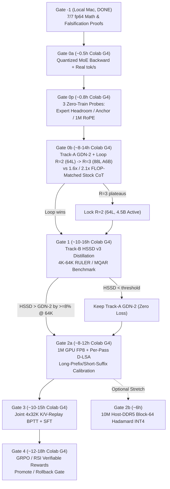

# Comprehensive Implementation & Staged Execution Plan (`Qwen3.6-35B-A6B-LoopHSSD` v3)

> **Target Workspace:** `/Users/tianrui6641/Qwen3.6-35B-A3B-Loop60` (`src/qloop/*`)
> **Target Hardware:** Single Google Colab **G4** Instance (`NVIDIA RTX PRO 6000 Blackwell Server Edition`, `96 GiB` GDDR7 ECC, `sm_120`, PCIe 5.0 x16, `~170–256 GiB` Host RAM, `230 GB` Local SSD, `24h` hard session limit)
> **Checkpoint & State Sync:** [`TassP0lar/Qwen3.6-35B-A3B-Loop64`](https://huggingface.co/TassP0lar/Qwen3.6-35B-A3B-Loop64) (commit-history state machine via `HF_TOKEN`, zero Google Drive dependency)
> **Companion Documents:** [Architecture Specification (v3)](ARCHITECTURE_SPEC.md) · [Formal Research Essay](RESEARCH_ESSAY.md) · [Baseline Repo Notes (CN)](ANALYSIS.md)

---

## 1. Codebase Readiness Audit: Implemented Foundation vs. `v3` Upgrade Tasks

A substantial portion of the training, looping, `GDN-2`, `D-LSA`, optimizer, evaluation, and Colab Hub-sync infrastructure is **already implemented and passing `278` unit tests** on `main`:

### 1.1 Already Implemented & Verified in `src/qloop/`

| Existing Module | Current Verified Capability | Test Coverage |
| :--- | :--- | :--- |
| [`src/qloop/model/loop.py`](../src/qloop/model/loop.py) & [`mhc.py`](../src/qloop/model/mhc.py) | `64L` ETD virtual-layer scheduler, Birkhoff simplex `LoopBridge`, zero-init `PassExitGate` (`torch.equal` at step 0), `PassRouterAdapters` (HF≥5 `TopKRouter` tuple-safe), recursive KV sharing (`kv_share=True`), causal MoR early-exit with linear-attention write masking | `tests/test_loop.py` |
| [`src/qloop/model/gdn2.py`](../src/qloop/model/gdn2.py) | **Track A Linear Upgrade:** NVIDIA Gated DeltaNet-2 decoupled channel-wise erase/write/decay (`chunk_gdn2` WY Tensor-Core solver + `recurrent_gdn2` `O(1)` decode + singularity-free `logistic_shift`) | `tests/test_gdn2.py` |
| [`src/qloop/model/lsa.py`](../src/qloop/model/lsa.py) | `192-d` NoPE key indexing, `4:1` unit pooling, batched GPU Ward clustering, flat & causal-tree bucket selection, KL distillation loss, YaRN `1M` scaling | `tests/test_lsa.py` |
| [`src/qloop/model/experts.py`](../src/qloop/model/experts.py) | Per-pass ESFT routing scanner + zero-init rank-64/full `HotExpertDeltas` over fused 3D `gate_up_proj` tensors | `tests/test_experts.py` |
| [`src/qloop/train/`](../src/qloop/train/) | Fused in-backward `APOLLO` / `AdamW` (`optim.py`), 248K-vocab chunked cross-entropy (`loss.py`), cumulative stage delta handoff (`stack.py`), `LMTrainer` (`trainer.py`), verifiable-reward `GRPOTrainer` (`rl.py`) | `tests/test_optim_loss.py`, `tests/test_trainer_e2e.py`, `tests/test_rl.py` |
| [`src/qloop/hub.py`](../src/qloop/hub.py) & [`colab.py`](../src/qloop/colab.py) | Atomic HF Hub commit sync (`manifest.json` + `~1–3 GB` delta bundles + `super_squash_history`), `230 GB` SSD guard, `/content/qloop_repo` namespace isolation | `tests/test_hub_sync.py`, `tests/test_colab_env.py` |
| [`tests/test_loop_hssd_v3_math.py`](../tests/test_loop_hssd_v3_math.py) | **`Gate -1` Zero-Weight Mathematical & Falsification Suite:** Double-precision verification of Theorems 1–3 and all `v1/v2` bug fixes (`A1–A3, B1–B5, C2, E2`) | **`7/7` Passed** |

### 1.2 Six Focused Engineering Work Packages (`M1–M6`) for Full `v3` Rollout

| Work Package | Target Files | Exact Scope & Deliverables |
| :--- | :--- | :--- |
| **`M1`: `A6B` Loop & Subspace Bridge Upgrade** | `src/qloop/model/mhc.py`, `src/qloop/model/loop.py`, `configs/stages/s1_*.yaml` | Set default `bridge_init = (0.85, 0.10, 0.05)` and `bridge_rank = 256` (`ReEntryBridge` nonlinear/linear subspace adapter, `Fix A3`); add per-pass rank-64 LoRA hooks on core `q_proj` / `o_proj` (`Fix A5`); support dynamic `R in {1, 2, 3}` (`40L / 64L / 88L` **`35B-A6B`** schedule) from a single `num_passes: 3` checkpoint; add SHA-256 frozen-MoE audit hook. |
| **`M2`: `Gate 0p` Zero-Training Diagnostic Probes** | `src/qloop/model/probes.py`, `src/qloop/cli.py` | Implement `probe --expert-headroom` (Top-8 perturbation oracle), `probe --reentry-sweep` (anchor weight + rank-256 Procrustes fit between $h_{31}$ and $h_7$), and `probe --pos-1m` (`384K / 512K / 1M` YaRN vs DCA/ReRoPE NIAH/perplexity shootout, `Fix C1`). |
| **`M3`: `HSSD v3` Linear-Attention Engine (Track B)** | `src/qloop/model/hssd.py` *(new)*, `src/qloop/train/distill.py` *(new)*, `tests/test_hssd.py` *(new)* | Implement `HSSDLayer` & `HSSDAdapter`: disjoint `k_far = max(0, n - 8)` `[513, 576]` SWA window (`Fix B1`), `PeakBoltzmannGate` (`Fix B5`), 2D phase counter-rotation compiled into real WY `chunk_kda` (Theorem 1), parallel chunk-start root-surprise $g_{\tau,h}(\bar{S}_{nC}^{(0)})$ with $s = g^2$ (`Fixes B3, B4`), tiered $M=8$ page router with cumulative write-mass budget loss (`Fix B2`), per-segment checkpointing (`Fix B6`), and Track-A $\to$ Track-B layer-wise + logit KL distillation trainer. |
| **`M4`: `1M` Per-Pass `D-LSA` & Prefix-Suffix Calibration** | `src/qloop/model/lsa.py`, `src/qloop/model/pos_rerope.py` *(new)*, `src/qloop/train/long_calib.py` *(new)* | Untie `W_q_idx` per recurrent pass $r \in \{1, 2, 3\}$ while keeping `W_k_idx` and Ward centroids shared (`1.0×` KV); add DCA/ReRoPE query-time rotary clamping option; implement **Long-Prefix (`512K–992K` `no_grad`) + Short-Suffix (`32K` `grad`)** read-side calibration loop (`Fix C1`). |
| **`M5`: `128K` K/V-Replayed Truncated BPTT** | `src/qloop/train/bptt.py` *(new)*, `tests/test_bptt.py` *(new)* | Implement `4 × 32K = 128K` streaming TBPTT carrying `(GDN-2 / HSSD)` recurrent states across segments **plus differentiable Top-$K_s$ K/V re-projection** on selected prior-segment sparse buckets so attention/indexer gradients flow cleanly across `32K` boundaries (`Fix E3`). |
| **`M6`: `10M` Block-64 Hadamard `INT4` Tiered Offload *(Stretch)*** | `src/qloop/model/offload.py` *(new)*, `tests/test_offload.py` *(new)* | Implement `walsh_hadamard_block(..., block_size=64)` (`Fix C2`), Group-64 `INT4` (`2,304 B` 4-token micro-page) pinned DDR5 allocator (`53.64 GiB` @ `10M`), and 3-layer speculative async `cudaMemcpyAsync` prefetch stream (`Gate 2b`). |

---

## 2. Detailed Module-by-Module Engineering Design (`M1–M6`)

### 2.1 `M1` — Upgrading `src/qloop/model/mhc.py` & `src/qloop/model/loop.py`

1. **`ReEntryBridge` (`src/qloop/model/mhc.py`):**
   - Update `LoopBridge.__init__` so when `rank > 0` (`default rank = 256`), it constructs per-pass `RMSNorm(hidden_size)`, `down = nn.Linear(hidden_size, rank, bias=False)` (orthogonal init), and `up = nn.Linear(rank, hidden_size, bias=False)` (initialized to $\mathcal{N}(0, 0.01^2)$ because step-0 exact identity is already guaranteed by `PassExitGate` $\boldsymbol{\alpha}_{\text{exit}}^{(r)} = \mathbf{0}$!).
   - Set `bridge_init = (0.85, 0.10, 0.05)` (`[prelude_anchor, rms_matched_prev, raw_prev]` — note index ordering in `mhc.py` will be explicitly named `(w_prev, w_anchor, w_rms) = (0.05, 0.85, 0.10)` and verified by unit test so `w_anchor = 0.85` is unambiguous!).
2. **Per-Pass Core Attention Q/O Specialization (`src/qloop/model/loop.py`):**
   - Add `PassAttnAdapters`: zero-initialized rank-64 LoRA modules attached to `q_proj` and `o_proj` on the 6 core full-attention layers `[11, 15, 19, 23, 27, 31]` for passes $r \in \{2, \dots, R\}$, while `k_proj` and `v_proj` remain hooked to `SharedKV` (`kv_share = True`).
3. **Unified `R=2` (`64L`) $\leftrightarrow$ `R=3` (`88L`, `35B-A6B`) Dynamic Depth Schedule:**
   - Instantiate `LoopSpec(prelude_end=8, core_end=32, num_passes=3, target_virtual_layers=88, train_pass_probs=[0.15, 0.50, 0.35])`.
   - During `Gate 0b` Phase 1, run `set_active_passes(2)` (`64L`, `~4.46B` active compute) to falsify the loop hypothesis rapidly; in `Gate 0b` Phase 2, unlock `set_active_passes(3)` (`88L`, **`~5.97B` active compute**) without rebuilding or discarding Phase-1 weights!
4. **Frozen-MoE SHA-256 Tripwire (`src/qloop/train/stack.py`):**
   - Record SHA-256 digests of sampled/strided bytes + exact norms/checksums across all 40 `experts` modules at model load and assert equality at every checkpoint save.

### 2.2 `M3` — Implementing `src/qloop/model/hssd.py` (`Track B` Linear Memory)

`HSSD` wraps or replaces the 30 `GatedDeltaNet` modules using the exact `introspect.py` hook architecture proven in `gdn2.py`:

```text
Input x_t [B, T, 2048]
  ├── Shared Base Projections (warm-started from Qwen3.6 GDN weights!):
  │     in_proj_qkvz -> conv1d (kernel=4, causal) -> SiLU -> (q, k, v, z)
  │     in_proj_ba   -> base (beta, g_decay)
  ├── Branch 1: Exact Disjoint Local Window (I_loc = [64*max(0, n-8)+1 .. t], len 513..576)
  │     chunked causal SDPA / FlexAttention -> (o_loc, lse_loc, max_loc)
  │     PeakBoltzmannGate(lse_loc, max_loc, N_t) -> p_hit in (0, 1)^{B x T x H_v}
  └── Branch 2: Far-Horizon Budgeted Multi-Page KDA (I_far = [1 .. 64*max(0, n-8)])
        1. Readout o_far from archived S_boundary[max(0, n-8)] across Top-2 read pages
        2. Phase angle theta_t -> cumulative counter-rotation R(-Theta_t) on (q, k)
        3. Parallel Chunk-Start Root-Surprise g_tau(k_hat, v, S_{nC}^{(0)}) in (0, 1) [s = g^2]
        4. Tiered M=8 Page Router (Top-2 active pages + Write-Mass Budget Loss B_m <= 0.4 d_k)
        5. Batched Tensor-Core WY `chunk_kda` (`fla` MIT kernel on CUDA; exact PyTorch WY fallback on CPU/Mac)
  └── Blend: o = RMSNorm_gated(p_hit * o_loc + (1 - p_hit) * o_far, z) -> out_proj
```

- **Step-0 Warm-Start Initialization:** `in_proj_qkvz`, `conv1d`, `in_proj_ba`, `A_log`, `dt_bias`, `norm`, and `out_proj` are copied **directly from Qwen3.6's pretrained GDN weights**; phase projector $W_\theta$ is zero-initialized ($\Theta_t = 0$); Page 0 inherits the pretrained GDN recurrence while Pages `1..7` initialize at tiered decay half-lives; `Gate 1` aligns the local/far blend via teacher-student KL distillation in `50M–100M` tokens instead of training from scratch!

### 2.3 `M5` — `128K` Truncated BPTT with Segment-Boundary K/V Gradient Replay (`Fix E3`)

Standard Truncated BPTT across `4 × 32K = 128K` segments detaches past full-attention KV caches, preventing `D-LSA` query/key indexers and per-pass Q/O adapters from receiving long-range retrieval gradients across segment boundaries. `src/qloop/train/bptt.py` resolves this cleanly in `< 2 GiB` extra VRAM:
1. Segment $s \in \{0, 1, 2, 3\}$ (`32,768` tokens) caches compressed CPU/HBM pre-attention hidden states $u_{\text{prior}} \in \mathbb{R}^{s \cdot 32768 \times 2048}$ (`bf16` = `64 MiB` per `32K` segment per full-attn layer $\implies$ **`1.92 GiB` across all 10 full-attn layers at `96K` prefix!**).
2. During Segment $s$'s forward/backward pass, `D-LSA` selects at most $K_{\text{sel}} \le 2{,}048$ prior-segment token indices per KV head.
3. Only those **`2,048` selected prior hidden states** (`6.25%` of a `32K` segment!) are re-projected through `k_proj`, `v_proj`, and `W_k_idx` **with `requires_grad = True`**, restoring exact cross-segment retrieval gradients at `< 6%` compute overhead!

---

## 3. Sequential Kill-Gate Execution Pipeline (`Gate -1` $\to$ `Gate 4`)

Every stage is governed by a quantitative **Go / No-Go Kill-Gate**. No multi-hour GPU run starts until its prerequisite gate passes; every gate has a pre-built zero-loss fallback so the project never dead-ends.



### Detailed Gate Specifications & Falsification Criteria

| Gate | Config / Command | Trainable Modules | Token / Time Budget (Single G4) | Go / No-Go Pass Criterion | Pre-Built Fallback if Falsified |
| :--- | :--- | :--- | :--- | :--- | :--- |
| **`Gate -1`** | `pytest tests/test_loop_hssd_v3_math.py` | Zero-weight `fp64` math suite | `3.3s` on Mac M1 (**PASSED**) | `7/7` invariants `< 1e-12` + all negative controls trip | Block code merge until fixed |
| **`Gate 0a`** | `qloop probe --backward` | None (hardware audit) | `~30 min` (`0` train tokens) | Measure exact `tok/s` & peak HBM across (1) `FP8` frozen MoE, (2) `NVFP4/INT4` frozen MoE, (3) `BF16` frozen MoE; verify finite `dL/dx` through all 40 layers + `torch.equal` step-0 identity | Select highest-throughput bit-clean base format (`FP8` `35 GiB` expected sweet spot if `NVFP4` lacks backward dequant kernel) |
| **`Gate 0p`** | `qloop probe --v3-suite` | None (`3` zero-training probes) | `~45 min` (`0` train tokens) | **0p-1:** Oracle Top-8 swap reduces hard-token NLL by `>= 0.08` nats.<br>**0p-2:** Rank-256 Procrustes alignment achieves cosine `> 0.90` on Layer-8 manifold.<br>**0p-3:** Winner of `YaRN (factor=4)` vs `DCA/ReRoPE` retains `>= 90%` 1M NIAH accuracy | Lock winning `bridge_init` and winning `1M` positional mode (`yarn` vs `rerope`) in `configs/base.yaml` |
| **`Gate 0b`** | `s1_loop_heal.yaml` (`Track A GDN-2` + Loop) | `ReEntryBridge`, `PassExitGate`, `PassRouterAdapters`, Per-pass Q/O LoRA, `GDN2Adapter` (`~49M` params) | **Phase 1 (`R=2`, `64L`):** `80M` tokens (`~7–11h`)<br>**Phase 2 (`R=3`, `88L A6B`):** `+50M` tokens (`~6–9h`) | `eval/depth_gain = NLL(R=1) - NLL(R=2) >= +0.04` nats on held-out math/code; **`R=2` beats `1.6×`-token CoT stock `40L`** on AIME + ARC-AGI-2 + multi-hop tracking (`Fixes A4, A6`); `R=3` beats `R=2` on hard reasoning | If `R=3 <= R=2` at matched FLOPs, lock `R=2` (`64L`). If `8..31` underperforms, run `probe --core-ranges` (`4..31` vs `12..35`) |
| **`Gate 1`** | `s1b_hssd_distill.yaml` | `HSSD` modules (`284.6M` params; MoE frozen; teacher = stock/GDN-2) | `80M–120M` tokens (`4K -> 32K` curriculum, `~10–16h`) | **Track B (`HSSD v3`)** achieves `PPL_32K <= 1.01 × Track A` AND **`>= +8%` absolute gain on `32K–64K` RULER Multi-Query Associative Recall / Variable Tracking** | Keep **Track A (`GDN-2`)** (`0%` perplexity degradation, already validated in `Gate 0b`)! |
| **`Gate 2a`** | `s3_long_1m_lsa.yaml` | `D-LSA` per-pass `W_q_idx^{(r)}`, `W_k_idx`, `QK-Norm`, attn gates, per-pass Q/O LoRA (`~22M` params) | `40M` tokens @ `64K–128K` + `2,000` steps **Long-Prefix (`512K–992K` `no_grad`) + `32K` `grad`** (`~8–12h`) | **`1M` RULER retrieval `>= 88%`**, `LongBench v2` score `>=` dense `262K` baseline, Pass-2 bucket selection differs from Pass-1 on `>= 25%` of reasoning queries | Increase `num_select` (`64 -> 128` buckets = `1,024` clustered keys + `1,024` local window) |
| **`Gate 2b`** *(Stretch)* | `s3b_offload_10m.yaml` | Host-DDR5 Block-64 Hadamard `INT4` cache (`0` new model weights; calibration only) | Systems benchmark + `10M` streaming NIAH (`~4–6h`) | Streaming `10M` prefill completes `< 53.64 GiB` Host RAM without OOM; decode latency overhead vs `1M` HBM `< 15%`; `10M` NIAH `>= 80%` | Ship `1M` GPU-resident Tier-1 as production default; keep `4M–10M` experimental flag |
| **`Gate 3`** | `s2_joint_bptt_sft.yaml` | All winning `v3` backbone adapters (`~312M`) + optional top `2.5%` `HotExpertDeltas` (`+96M`) | `100M` tokens (`32K` CoT SFT + `30M` tokens `4 × 32K = 128K` K/V-replay BPTT, `~12–16h`) | Monotonic improvement across `R=1 -> R=2 -> R=3` depth curve on **ARC-AGI-2**, **AIME 2026**, **GPQA-D**, **LiveCodeBench**, **LongBench v2**; SHA-256 base MoE check passes | Roll back `HotExpertDeltas` if general-domain MMLU/GPQA regresses `> 0.5%` |
| **`Gate 4`** | `s4_rl_grpo.yaml` | Narrowed to `PassRouterAdapters`, `ReEntryBridge`, `o_proj` LoRA, `2.5%` `HotExpertDeltas` | `600–1,200` GRPO steps (`G=8` rollouts, verifiable math/code/ARC/KernelBench L1–L2, `~12–18h`) | Verifiable reward improves + **automatic regression gate** confirms `0` drop `> 1%` on held-out AIME / LiveCodeBench / LongBench v2 | `GRPOTrainer` auto-rolls back any non-promoting checkpoint |

---

## 4. Calibrated Hardware, HBM, Disk (`230 GB`), & Wall-Clock Budgets (`Fix E1`)

### 4.1 Real `RTX PRO 6000 Blackwell (96 GiB)` HBM Memory Ledger

Unlike `v2` (which assumed NVFP4 training backward works out-of-the-box without fallback), `v3` explicitly budgets **all three precision modes** tested in `Gate 0a`:

| Memory Consumer (`32K` Seq, Micro-Batch `B=1`, Grad Checkpoint ON) | Mode 1: **Frozen `FP8` MoE** *(Recommended Primary)* | Mode 2: **Frozen `NVFP4 / INT4` MoE** *(Fastest if `Gate 0a` passes)* | Mode 3: **Full `BF16` Base** *(Guaranteed Fallback @ `8K–16K` or CPU-streamed)* |
| :--- | ---: | ---: | ---: |
| **Frozen Base Weights (`34.66B` text, ViT pruned)** | `35.8 GiB` (`FP8` experts + `BF16` norms/attn) | `19.6 GiB` (`4.5-bit` experts + `BF16` attn) | `69.3 GiB` (`BF16` all weights) |
| **Trainable `v3` Backbone Params (`312M` in `BF16` + `FP32` master)** | `1.8 GiB` | `1.8 GiB` | `1.8 GiB` |
| **Fused In-Backward `APOLLO` / `AdamW` States (`rank=1` on 2D)** | `1.4 GiB` | `1.4 GiB` | `1.4 GiB` |
| **Persistent Recurrent States (`HSSD M=8`, `R=3`) + `32K` KV (`BF16`)** | `1.2 GiB` (`0.53 + 0.63 GiB`) | `1.2 GiB` | `1.2 GiB` |
| **Checkpointed Activations + `chunk_kda` / CCE Workspace (`32K`)** | `18.5 GiB` | `18.5 GiB` | `11.5 GiB` *(at `16K` chunk)* |
| **CUDA Context, PyTorch Allocator Reserve & Fragmentation** | `5.0 GiB` | `5.0 GiB` | `5.0 GiB` |
| **Peak Training HBM Usage (out of `95.6 GiB` usable)** | **`63.7 GiB`** *(31.9 GiB headroom!)* | **`47.5 GiB`** *(48.1 GiB headroom!)* | **`90.2 GiB`** *(`16K` chunk; safe!)* |

- **Inference @ `1M` Context (`Mode 1 FP8` or `Mode 2 INT4`):** Base weights (`19.6–35.8 GiB`) + `v3` adapters (`0.6 GiB`) + **`1M` `FP8` KV Cache (`10.00 GiB`)** + `D-LSA` centroids (`0.32 GiB`) + `HSSD` states (`0.53 GiB`) + scratch (`4.0 GiB`) = **`35.1–51.3 GiB` total HBM**—leaving **44–60 GiB free** on a single Colab G4 card!

### 4.2 Realistic Throughput & Multi-Session Colab Wall-Clock Schedule (`Fix E1`)

On `RTX PRO 6000 Blackwell` (`sm_120`, `~500 TFLOPS` dense BF16 / `~1,000 TFLOPS` FP8, `1.8 TB/s` GDDR7), single-GPU Python/HF MoE training achieves `20%–32%` MFU (`~1,800–3,200 tok/s` at `R=2` `64L`; `~1,350–2,400 tok/s` at `R=3` `88L`). Every stage is budgeted honestly against **`2,200 tok/s` average** (`~7.9M tokens/hour`, `~170M tokens` per `21.5h` Colab session):

| Session | Pipeline Stages Executed | Tokens Processed | Expected Wall-Clock | Hugging Face Commit Artifact (`TassP0lar/Qwen3.6-35B-A3B-Loop64`) |
| :---: | :--- | ---: | ---: | :--- |
| **Session 1** | `Gate 0a` + `Gate 0p` + `Gate 0b` (`R=2` `64L` -> `R=3` `88L A6B`) | `130M` tokens | `~17.5 hours` | `stages/s0_probe/` + `stages/s1_loop_a6b/` (`~1.2 GB` delta) |
| **Session 2** | `Gate 1` (`Track B HSSD v3` KL Distillation `4K -> 32K`) | `100M` tokens | `~15.0 hours` | `stages/s1b_hssd/` (`~1.8 GB` delta) |
| **Session 3** | `Gate 2a` (`1M` `D-LSA` + Long-Prefix / Short-Suffix Calibration) + `Gate 2b` *(opt)* | `50M` train + `1M` prefix sweeps | `~14.0 hours` | `stages/s3_long_1m/` (`~1.9 GB` cumulative delta) |
| **Session 4** | `Gate 3` (`32K` SFT + `4×32K = 128K` K/V-Replay BPTT Merge) | `100M` tokens | `~16.5 hours` | `stages/s2_joint_bptt/` (`~2.4 GB` cumulative delta) |
| **Session 5** | `Gate 4` (`GRPO / RSI` Verifiable Rollouts) + **Full 16-Benchmark Eval Suite** | `~900` RL steps + Depth-Curve Eval | `~18.0 hours` | `stages/s4_rl/` + `eval/depth_curve_r1_r2_r3.json` + Model Card |
| **Total** | **End-to-End `Qwen3.6-35B-A6B-LoopHSSD` Evolution** | **`~380M` high-signal tokens + RL** | **`~81 GPU-hours` (`4–5` Colab G4 runs)** | Fully resumable via `Runtime -> Run all` in [`colab_train.ipynb`](../notebooks/colab_train.ipynb) |

### 4.3 `230 GB` Colab Local SSD Watermark Plan

| Path on Colab SSD (`230 GB` Limit) | Peak Footprint | Lifecycle Policy (`src/qloop/hub.py`) |
| :--- | ---: | :--- |
| OS + Python + CUDA 13 + PyTorch/FLA packages | `~32 GB` | Static (`--no-cache-dir` enforced during install) |
| `/content/hf_cache/hub` (`Qwen/Qwen3.6-35B-A3B` base shards) | `~70 GB` *(BF16)* or `~36 GB` *(FP8)* | Downloaded once per session; never duplicated into checkpoints |
| Streaming dataset buffer (`/content/hf_cache/datasets`) | `<= 12 GB` | Iterable streaming (`packing.py`); bounded parquet cache |
| Active stage checkpoint (`runs/<stage>/checkpoints/step_*`) | `~3.5 GB` | `keep_last: 1`; `optim.pt` pruned after stage promotion |
| HF Xet / upload staging (`/content/hf_cache/{xet,upload}`) | `<= 6 GB` | Purged immediately after every `HubSync.push_checkpoint()` |
| **Guaranteed Free Local SSD Headroom** | **`>= 106 GB` free** | Checked before every checkpoint write (`reclaim_disk()`) |

---

## 5. Clean-Room Open-Source Licensing & Dependency Policy

To ensure the resulting code and adapter weights in [`TassP0lar/Qwen3.6-35B-A3B-Loop64`](https://huggingface.co/TassP0lar/Qwen3.6-35B-A3B-Loop64) remain **100% Apache-2.0 / MIT clean**:
1. **Permissive Dependencies Only:** `Qwen/Qwen3.6-35B-A3B` (`Apache-2.0`), `pytorch` (`BSD-3`), `transformers` (`Apache-2.0`), `flash-linear-attention` (`fla`, **`MIT`** — provides `chunk_kda`, `chunk_gated_delta_rule`, `fused_recurrent_kda`), `triton` (`MIT`).
2. **Strict Non-Commercial (`NC`) Clean-Room Firewall:** Neither `NVlabs/GatedDeltaNet-2` (NVIDIA Source Code License-NC) nor `Sparse Delta Memory` (`CC-BY-NC-4.0`) code may ever be copied or vendored. Both `src/qloop/model/gdn2.py` and `src/qloop/model/hssd.py` are implemented strictly from first-principles mathematical equations in the published papers on top of PyTorch and MIT-licensed `fla` primitives.

---

## 6. Data Mixture & Frontier Depth-Curve Evaluation Protocol

### 6.1 Stage-Specific High-Signal Training Mixtures (`13-Gram` Decontaminated)

- **`Gate 0b` & `Gate 1` (Loop Healing & `HSSD v3` Distillation):** `OpenThoughts3-1.2M` (reasoning traces), `Nemotron-Post-Training-Dataset-v2` (math/code/STEM), `FineWeb-Edu` (`score >= 4` long documents), and `The Stack v2` / multi-file repository context packs (`4K -> 32K`).
- **`Gate 2a` (`1M` Long-Context Calibration & `D-LSA` Distillation):** Multi-file repository bundles, `ProLong` / `LongAlign` long-document synthesis, and synthetic multi-hop variable-binding / KV needle streams (`64K -> 1M` prefix, gradients on final `32K` suffix).
- **`Gate 3` & `Gate 4` (Joint `128K` BPTT SFT + Verifiable GRPO/RSI):** `DAPO-Math-17k` (exact integer/symbolic verification), `ARC-AGI-2` **1,000 training tasks only** (strictly isolated from the 120 public evaluation tasks), `LiveCodeBench` pre-cutoff unit-tested problems, and `KernelBench` **Levels 1–2 only** (`Levels 3–4` strictly held out for zero-shot RSI evaluation).

### 6.2 Mandatory Multi-Depth (`R=1` vs `R=2` vs `R=3`) Evaluation Matrix

Every promoted stage outputs `depth_curve` metrics across $R \in \{1, 2, 3\}$ (`40L / 64L / 88L`) plus FLOP-matched stock CoT baselines (`1.0×`, `1.6×`, `2.1×` token budgets):

1. **Latent Fluid Induction & Compositional Depth (Primary Loop Signal):** `ARC-AGI-2` (120 public eval tasks, `pass@2`), `AIME 2026`, `GPQA-Diamond`, `Humanity's Last Exam (HLE)`.
2. **Mid-Horizon (`4K–262K`) & Ultra-Long (`1M–10M`) Memory:** `LongBench v2` (`8K–2M` code/multi-doc reasoning), `RULER` (`32K / 128K / 1M` NIAH + Variable Tracking + Multi-Query Associative Recall).
3. **Code, GPU Kernel RSI, & Containerized World Modeling:** `KernelBench` (`L3–L4` held-out CUDA/Triton speedup), `LiveCodeBench`, `SWE-bench Pro` & `Terminal-Bench 2.0` (via Harbor `--env daytona`), `Qwen/AgentWorldBench` *(tracked in same contamination group as TB2)*, `τ-bench-LILT`, and `GAIA`.
