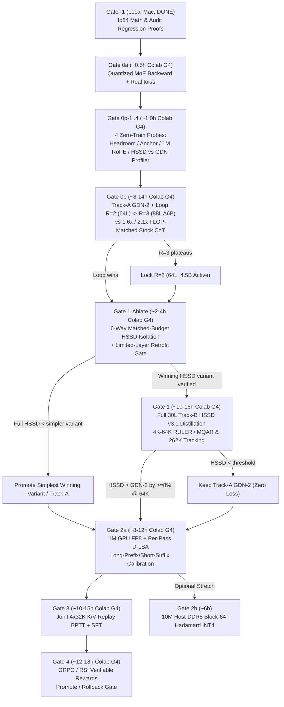

# Comprehensive Implementation & Staged Execution Plan (`Qwen3.6-35B-A6B-LoopHSSD` v3.2)

> **Target Workspace:** `<repo-root>` (`src/qloop/*`, repo-relative)
> **Target Hardware:** Single Google Colab **G4** Instance (`NVIDIA RTX PRO 6000 Blackwell Server Edition`, `96 GB GDDR7 ECC` [`94.97 GiB` usable], `1,597 GB/s`, `sm_120`, PCIe 5.0 x16, `~170–256 GiB` Host RAM, `230 GB` Local SSD, `24h` hard session limit)
> **Checkpoint & State Sync:** [`TassP0lar/Qwen3.6-35B-A3B-Loop64`](https://huggingface.co/TassP0lar/Qwen3.6-35B-A3B-Loop64) (commit-history state machine via `HF_TOKEN`, zero Google Drive dependency)
> **Companion Documents:** [Architecture Specification (v3.2)](ARCHITECTURE_SPEC.md) · [Formal Research Essay](RESEARCH_ESSAY.md) · [Baseline Repo Notes (CN)](ANALYSIS.md)

---

## 1. Codebase Readiness Audit: Implemented Foundation vs. `v3` Upgrade Tasks

A substantial portion of the training, looping, `GDN-2`, `D-LSA`, optimizer, evaluation, and Colab Hub-sync infrastructure is **already implemented and passing `278` unit tests** on `main`:

### 1.1 Already Implemented & Verified in `src/qloop/`

| Existing Module | Current Verified Capability | Test Coverage |
| :--- | :--- | :--- |
| [`src/qloop/model/loop.py`](../src/qloop/model/loop.py) & [`mhc.py`](../src/qloop/model/mhc.py) | `64L` ETD virtual-layer scheduler, Birkhoff simplex `LoopBridge`, zero-init `PassExitGate` (`torch.equal` at step 0), `PassRouterAdapters` (HF≥5 `TopKRouter` tuple-safe), recursive KV sharing (`kv_share=True`), causal MoR early-exit with linear-attention write masking | `tests/test_loop.py` |
| [`src/qloop/model/gdn2.py`](../src/qloop/model/gdn2.py) | **Track A Linear Upgrade:** NVIDIA Gated DeltaNet-2 decoupled channel-wise erase/write/decay (`chunk_gdn2` WY Tensor-Core solver + `recurrent_gdn2` `O(1)` decode + singularity-free `logistic_shift`) | `tests/test_gdn2.py` |
| [`src/qloop/model/lsa.py`](../src/qloop/model/lsa.py) | `192-d` NoPE key indexing, `4:1` unit pooling, batched GPU Ward clustering, flat & causal-tree bucket selection, KL distillation loss, YaRN `1M` scaling | `tests/test_lsa.py` |
| [`src/qloop/model/experts.py`](../src/qloop/model/experts.py) | Per-pass ESFT routing scanner + zero-init rank-64/full `HotExpertDeltas` over fused 3D `gate_up_proj` tensors | `tests/test_experts.py` |
| [`src/qloop/train/`](../src/qloop/train/) | Zero-host-sync fused in-backward `APOLLO` (`rank=256, channel`) / `AdamW` + `defer_micro_step()` (`optim.py`), 248K-vocab chunked CE (`loss.py`), zero-duplicate-VRAM `SharedBackboneTeacher` + online per-layer warm-up (`distill.py`), full 4-stage `LMTrainer` wiring (`trainer.py`), verifiable-reward `GRPOTrainer` (`rl.py`), startup TF32 (`utils/tf32.py`) | `tests/test_optim_loss.py`, `tests/test_trainer_e2e.py`, `tests/test_speed_and_stage_wiring.py`, `tests/test_rl.py` |
| [`src/qloop/hub.py`](../src/qloop/hub.py) & [`colab.py`](../src/qloop/colab.py) | Atomic HF Hub commit sync (`manifest.json` + `~1–3 GB` delta bundles + `super_squash_history`), `230 GB` SSD guard, `/content/qloop_repo` namespace isolation | `tests/test_hub_sync.py`, `tests/test_colab_env.py` |
| [`tests/test_loop_hssd_v3_math.py`](../tests/test_loop_hssd_v3_math.py) | **`Gate -1` Zero-Weight Mathematical & Falsification Suite:** Double-precision verification of Theorems 1–3 and all `v1/v2` bug fixes (`A1–A3, B1–B5, C2, E2`) | **`7/7` Passed** |

### 1.2 Six Focused Engineering Work Packages (`M1–M6`) for Full `v3` Rollout

| Work Package | Target Files | Exact Scope & Deliverables |
| :--- | :--- | :--- |
| **`M1`: `A6B` Loop & Subspace Bridge Upgrade** | `src/qloop/model/mhc.py`, `src/qloop/model/loop.py`, `configs/stages/s1_*.yaml` | Set default `bridge_init = (0.85, 0.10, 0.05)` and `bridge_rank = 256` (`ReEntryBridge` nonlinear/linear subspace adapter, `Fix A3`); add per-pass rank-64 LoRA hooks on core `q_proj` / `o_proj` (`Fix A5`); support dynamic `R in {1, 2, 3}` (`40L / 64L / 88L` **`35B-A6B`** schedule) from a single `num_passes: 3` checkpoint; add SHA-256 frozen-MoE audit hook. |
| **`M2`: `Gate 0p-1..4` Zero-Training Diagnostic Probes & Ablation Matrix** | `src/qloop/model/probes.py`, `src/qloop/colab.py`, `src/qloop/cli.py` | Implement `probe_expert_headroom` (`0p-1`), `probe_reentry_anchors` (`0p-2`), `probe_positional_extrapolation` (`0p-3`), **`profile_hssd_layer` (`0p-4`: single-layer Qwen-dim HSSD vs GDN prefill/decode/fwd+bwd throughput & `unique_storage_bytes()` audit)**, and `hssd_ablation_matrix` (`Gate 1-Ablate` 6-way mechanism isolation). |
| **`M3`: `HSSD v3.1` Linear-Attention Engine (Track B)** | `src/qloop/model/hssd.py`, `src/qloop/train/distill.py`, `tests/test_hssd*.py` | Implement `HSSDAdapter`, `HSSDCacheState`, & `HSSDHybridCache`: disjoint `k_far = max(0, n - 8)` `[513, 576]` SWA window (`Fix B1`), `PeakBoltzmannGate` (`Fix B5`), low-rank `theta_down`/`theta_up` (`~1.92M–1.95M`/layer) + `float64` `theta_cum` (`< 2e-6 rad` @ `1M`) + post-rotation scaled WY `chunk_hssd` (Theorem 1), linear-$\beta$ write scaling `_safe_sqrt(w_gate)`, multi-page routed chunk-start root-surprise (`surprise_mode="routed"` on `boundary_ring[-1]`), STE actual sparse Top-$k$ write-mass budget loss (`Audit 3C`), factored decay (`8 KiB/tok/layer`), `state_dtype="bfloat16"` (`81–89 MiB/layer`), `cu_seqlens` & 2D `attention_mask` logical-clock invariance, and `Stage S1b` KL + layer-MSE distillation trainer. |
| **`M4`: `1M` Per-Pass `D-LSA` & Prefix-Suffix Calibration** | `src/qloop/model/lsa.py`, `src/qloop/model/pos_rerope.py` *(new)*, `src/qloop/train/long_calib.py` *(new)* | Untie `W_q_idx` per recurrent pass $r \in \{1, 2, 3\}$ while keeping `W_k_idx` and Ward centroids shared (`1.0×` KV); add DCA/ReRoPE query-time rotary clamping option; implement **Long-Prefix (`512K–992K` `no_grad`) + Short-Suffix (`32K` `grad`)** read-side calibration loop (`Fix C1`). |
| **`M5`: `128K` K/V-Replayed Truncated BPTT** | `src/qloop/train/bptt.py` *(new)*, `tests/test_bptt.py` *(new)* | Implement `4 × 32K = 128K` streaming TBPTT carrying `(GDN-2 / HSSD)` recurrent states across segments **plus differentiable Top-$K_s$ K/V re-projection** on selected prior-segment sparse buckets so attention/indexer gradients flow cleanly across `32K` boundaries (`Fix E3`). |
| **`M6`: `10M` Block-64 Hadamard `INT4` Tiered Offload *(Stretch)*** | `src/qloop/model/offload.py` *(new)*, `tests/test_offload.py` *(new)* | Implement `walsh_hadamard_block(..., block_size=64)` (`Fix C2`), Group-64 `INT4` (`2,304 B` 4-token micro-page) pinned DDR5 allocator (`53.64 GiB` @ `10M`), and 3-layer speculative async `cudaMemcpyAsync` prefetch stream (`Gate 2b`). |

---

## 2. Detailed Module-by-Module Engineering Design (`M1–M6`)

### 2.1 `M1` — Upgrading `src/qloop/model/mhc.py` & `src/qloop/model/loop.py`

1. **`ReEntryBridge` (`src/qloop/model/mhc.py`):**
   - Update `LoopBridge.__init__` so when `rank > 0` (`default rank = 256`), it constructs per-pass `RMSNorm(hidden_size)`, `down = nn.Linear(hidden_size, rank, bias=False)` (orthogonal init), and `up = nn.Linear(rank, hidden_size, bias=False)` (initialized to $\mathcal{N}(0, 0.01^2)$ because step-0 exact identity is already guaranteed by `PassExitGate` $\boldsymbol{\alpha}_{\text{exit}}^{(r)} = \mathbf{0}$!).
   - Set `bridge_init = (0.85, 0.10, 0.05)` (`[prelude_anchor, rms_matched_prev, raw_prev]` — note index ordering in `mhc.py` will be explicitly named `(w_prev, w_anchor, w_rms) = (0.05, 0.85, 0.10)` and verified by unit test so `w_anchor = 0.85` is unambiguous!).
2. **Per-Pass Core Attention Q/O Specialization (`src/qloop/model/loop.py`):**
   - Add `PassAttnAdapters`: zero-initialized rank-64 LoRA modules attached to `q_proj` and `o_proj` on the 6 core full-attention layers `[11, 15, 19, 23, 27, 31]` for passes $r \in \{2, \dots, R\}$, while `k_proj` and `v_proj` remain hooked to `SharedKV` (`kv_share = True`).
3. **Unified `R=2` (`64L`) $\leftrightarrow$ `R=3` (`88L`, `35B-A6B`) Dynamic Depth Schedule:**
   - Instantiate `LoopSpec(prelude_end=8, core_end=32, num_passes=3, target_virtual_layers=88, train_pass_probs=[0.15, 0.50, 0.35])`.
   - During `Gate 0b` Phase 1, run `set_active_passes(2)` (`64L`, `~4.46B` active compute) to falsify the loop hypothesis rapidly; in `Gate 0b` Phase 2, unlock `set_active_passes(3)` (`88L`, **`~5.97B` active compute**) without rebuilding or discarding Phase-1 weights!
4. **Frozen-MoE SHA-256 Tripwire (`src/qloop/train/stack.py`):**
   - Record SHA-256 digests of sampled/strided bytes + exact norms/checksums across all 40 `experts` modules at model load and assert equality at every checkpoint save.

### 2.2 `M3` — Implementing `src/qloop/model/hssd.py` (`Track B` `HSSD v3.1` Linear Memory)

`HSSD v3.1` wraps the 30 `GatedDeltaNet` modules using the `introspect.py` hook architecture (`~1.92M–1.95M` adapter params/layer = `~57.5M–58.5M` across 30L with `theta_low_rank=True`):

```text
Input x_t [B, T, 2048] (factored decay: page_scale [M] x chan_pair [B, T, H_v, d_k/2] = 8 KiB/tok/layer)
  ├── Shared Base Projections (warm-started from Qwen3.6 GDN weights!):
  │     in_proj_qkvz -> conv1d (kernel=4, causal) -> SiLU -> (q, k, v, z)
  │     in_proj_ba   -> base (beta, g_decay)
  ├── Branch 1: Exact Disjoint Local Window (I_loc = [64*max(0, n-8)+1 .. t], len 513..576)
  │     chunked causal SDPA / 576-slot decode ring -> (o_loc, lse_loc, max_loc)
  │     PeakBoltzmannGate(lse_loc, max_loc, N_t) -> learned heuristic p_hit in (0, 1)^{B x T x H_v}
  └── Branch 2: Far-Horizon Budgeted Multi-Page KDA (I_far = [1 .. 64*max(0, n-8)])
        1. Readout o_far from archived boundary_ring[0] = S_boundary[max(0, n-8)] across Top-2 read pages
        2. Low-rank theta_down/theta_up -> fp64 cumulative Theta_t -> R(-Theta_t) on (q, k)
        3. Multi-Page Routed Chunk-Start Root-Surprise g_tau against Top-2 write pages of boundary_ring[-1]
        4. Post-rotation e_t = g_t * sqrt(b_t) * k_hat, linear-beta v_eff = g_t * sqrt(w_t) * v_t
        5. Tiered M=8 Router (Top-2 active pages + STE actual sparse write-mass budget loss u_tilde_m)
        6. Sync-free PyTorch WY chunk update (k=2 active-page decode; custom Triton/FLA fusion roadmap)
  └── Blend: o = RMSNorm_gated(p_hit * o_loc + (1 - p_hit) * o_far, z) -> out_proj
```

- **Non-Identity Warm-Start & Distillation Requirement:** Although `in_proj_qkvz`, `conv1d`, `in_proj_ba`, `A_log`, `dt_bias`, `norm`, and `out_proj` reuse Qwen3.6's pretrained GDN weights directly, `theta_up` / `erase_up` / `write_up` / `decay_up` / `swa_*_up` are zero-initialized, and $\sqrt{\mathbf{b}_t}\sqrt{\mathbf{w}_t} = \beta_{\text{base}}$ preserves linear-$\beta$ write scaling, **HSSD is NOT a step-0 functional identity** because it alters horizon partitioning, multi-page routing, surprise gating, and decay schedules relative to vanilla single-state GDN. Freezing Qwen's `32.338B` MoE experts preserves expert weights intact, while `Stage S1b` (`Gate 1`) layer-output MSE + chunked-vocab KL distillation is essential to align the representations entering those frozen experts.
- **Latency & Staged-Hypothesis Realism:** Python/PyTorch multi-page WY chunk execution incurs multi-kernel overhead relative to fused single-state GDN kernels (`Gate 0p-4` profiles exact prefill/decode/fwd+bwd ratios before training), and `64K` working memory, `262K` state tracking, `1M` retrieval+memory, and `10M` extensibility are treated as staged empirical hypotheses rather than pre-proven guarantees.

### 2.3 `M5` — `128K` Truncated BPTT with Segment-Boundary K/V Gradient Replay (`Fix E3`)

Standard Truncated BPTT across `4 × 32K = 128K` segments detaches past full-attention KV caches, preventing `D-LSA` query/key indexers and per-pass Q/O adapters from receiving long-range retrieval gradients across segment boundaries. `src/qloop/train/bptt.py` resolves this cleanly in `< 2 GiB` extra VRAM:
1. Segment $s \in \{0, 1, 2, 3\}$ (`32,768` tokens) caches compressed CPU/VRAM pre-attention hidden states $u_{\text{prior}} \in \mathbb{R}^{s \cdot 32768 \times 2048}$ (`bf16` = `64 MiB` per `32K` segment per full-attn layer $\implies$ **`1.92 GiB` across all 10 full-attn layers at `96K` prefix!**).
2. During Segment $s$'s forward/backward pass, `D-LSA` selects at most $K_{\text{sel}} \le 2{,}048$ prior-segment token indices per KV head.
3. Only those **`2,048` selected prior hidden states** (`6.25%` of a `32K` segment!) are re-projected through `k_proj`, `v_proj`, and `W_k_idx` **with `requires_grad = True`**, restoring exact cross-segment retrieval gradients at `< 6%` compute overhead!

---

## 3. Sequential Kill-Gate Execution Pipeline (`Gate -1` $\to$ `Gate 4`)

Every stage is governed by a quantitative **Go / No-Go Kill-Gate**. No multi-hour GPU run starts until its prerequisite gate passes; every gate has a pre-built zero-loss fallback so the project never dead-ends.



### 3.1 Detailed Gate Specifications & Falsification Criteria

| Gate | Config / Command | Trainable Modules | Token / Time Budget (Single G4) | Go / No-Go Pass Criterion | Pre-Built Fallback if Falsified |
| :--- | :--- | :--- | :--- | :--- | :--- |
| **`Gate -1`** | `pytest tests/test_loop_hssd_v3_math.py tests/test_hssd_audit_regressions.py` | Zero-weight `fp64` math & audit suite | `< 15s` on Mac/CPU (**PASSED**) | All `fp64` math, compact storage (`theta_cum` `float64`), factored decay, STE sparse budget, `cu_seqlens`, and padding invariants pass | Block code merge until fixed |
| **`Gate 0a`** | `qloop probe --backward` | None (hardware audit) | `~30 min` (`0` train tokens) | Measure exact `tok/s` & peak VRAM across (1) `FP8` frozen MoE, (2) `NVFP4/INT4` frozen MoE, (3) `BF16` frozen MoE; verify finite `dL/dx` through all 40 layers + `torch.equal` step-0 identity | Select highest-throughput bit-clean base format (`FP8` `35 GiB` expected sweet spot if `NVFP4` lacks backward dequant kernel) |
| **`Gate 0p-1..3`** | `qloop probe --structured` (`colab_probe.ipynb`) | None (`3` zero-training probes) | `~45 min` (`0` train tokens) | **0p-1:** Oracle Top-8 swap reduces hard-token NLL by `>= 0.08` nats.<br>**0p-2:** Rank-256 Procrustes alignment achieves cosine `> 0.90` on Layer-8 manifold.<br>**0p-3:** Winner of `YaRN (factor=4)` vs `DCA/ReRoPE` retains `>= 90%` 1M NIAH accuracy | Lock winning `bridge_init` and winning `1M` positional mode (`yarn` vs `rerope`) in stage overrides |
| **`Gate 0p-4`** | `profile_hssd_layer(...)` (`colab_probe.ipynb`) | Single Qwen-dim `HSSDAdapter` (`2048, H_v=32, d=128, M=8, W=8`) | `~10 min` (`0` train tokens) | Verify `adapter_params_per_layer ≈ 1.95M` (`~58.5M/30L`, `theta_low_rank=True`), `retained_cache.has_compact_storage == True` (`81–89 MiB/layer` in `state_dtype="bfloat16"` across prompt lengths), and measure prefill / streamed-prefill / `k=2` decode / fwd+bwd throughput vs single-state `GDN` baseline | If PyTorch 8-page WY fwd+bwd overhead exceeds `3.5×` GDN budget on G4, restrict HSSD retrofit to 1 layer per macro-block (`10` layers) or prioritize custom Triton WY fusion |
| **`Gate 0b`** | `s1_loop_a6b.yaml` (`Track A GDN-2` + Loop) | `ReEntryBridge`, `PassExitGate`, `PassRouterAdapters`, Per-pass Q/O LoRA, `GDN2Adapter` (`~49M` params) | **Phase 1 (`R=2`, `64L`):** `80M` tokens (`~7–11h`)<br>**Phase 2 (`R=3`, `88L A6B`):** `+50M` tokens (`~6–9h`) | `eval/depth_gain = NLL(R=1) - NLL(R=2) >= +0.04` nats on held-out math/code; **`R=2` beats `1.6×`-token CoT stock `40L`** on AIME + ARC-AGI-2 + multi-hop tracking (`Fixes A4, A6`); `R=3` beats `R=2` on hard reasoning | If `R=3 <= R=2` at matched FLOPs, lock `R=2` (`64L`). If `8..31` underperforms, run `probe --core-ranges` (`4..31` vs `12..35`) |
| **`Gate 1-Ablate`** | `hssd_ablation_matrix()` (`6`-way matched-budget sweep + `6L` 2-macro-block Qwen retrofit) | Controlled `1L–6L` linear-layer variants (`0` loop/LSA confounders) | `15M–25M` tokens (`~2–4h` on G4) | Isolate each HSSD mechanism across **6 matched-budget variants** (`§3.2`) on short-context LM, repeated-key updates, distractor resistance, state tracking, MQAR vs interfering writes, and code tasks; verify limited-layer (`6L`) retrofit distillation converges cleanly before 30-layer + loop + `D-LSA` training | Prune any sub-mechanism (`use_swa`, `use_phase`, `use_surprise`, or `M=8` pages) that fails to improve its target axis at matched compute/memory |
| **`Gate 1`** | `s1b_hssd_distill.yaml` | `HSSDAdapter` across 30L (`~58.5M` params, `write_mode=full, swa_recency_init=0.05, blend_init=0.0->1.0`; `SharedBackboneTeacher` `0.00 GiB` extra expert VRAM) | `98.3M` tokens (`400` steps online per-layer warm-up + `1,100` steps end-to-end KL, `micro_batch=2, grad_accum=2`, `~8–12h`) | **Track B (`HSSD v3.2`)** achieves `PPL_32K <= 1.01 × Track A` AND **`>= +8%` absolute gain on `32K–64K` RULER MQAR / Variable Tracking** (plus `262K` state-tracking probe) | Keep **Track A (`GDN-2`)** or simpler `Gate 1-Ablate` winner (`0%` perplexity degradation, already validated in `Gate 0b`)! |
| **`Gate 2a`** | `s3_long_1m_lsa.yaml` | `D-LSA` (`mode=hybrid, compact_active_slots=True, max_selected_keys=768`) per-pass `W_q_idx^{(r)}`, `W_k_idx`, `QK-Norm`, attn gates, per-pass Q/O LoRA (`~22M` params) | `600` total steps: `540` × `64K` hybrid steps + `60` scheduled **sparse-prefix (`512K–992K` `no_grad`) + chunked-CE `32K` `grad`** steps (`calib_every_steps=10`, `~8–12h`) | **`1M` RULER retrieval `>= 88%`**, `LongBench v2` score `>=` dense `262K` baseline, Pass-2 bucket selection differs from Pass-1 on `>= 25%` of reasoning queries | Increase `num_select` (`64 -> 128` buckets = `1,024` clustered keys + `1,024` local window) |
| **`Gate 2b`** *(Stretch)* | `s3b_offload_10m.yaml` | Host-DDR5 Block-64 Hadamard `INT4` cache (`0` new model weights; calibration only) | Systems benchmark + `10M` streaming NIAH (`~4–6h`) | Streaming `10M` prefill completes `< 53.64 GiB` Host RAM without OOM; decode latency overhead vs `1M` VRAM `< 15%`; `10M` NIAH `>= 80%` | Ship `1M` GPU-resident Tier-1 as production default; keep `4M–10M` experimental flag |
| **`Gate 3`** | `s2_joint_bptt.yaml` | All winning `v3.1` backbone adapters (`~85.8M`) + optional top `2.5%` `HotExpertDeltas` (`+96M`) | `100M` tokens (`32K` CoT SFT + `30M` tokens `4 × 32K = 128K` K/V-replay BPTT, `~12–16h`) | Monotonic improvement across `R=1 -> R=2 -> R=3` depth curve on **ARC-AGI-2**, **AIME 2026**, **GPQA-D**, **LiveCodeBench**, **LongBench v2**; SHA-256 base MoE check passes | Roll back `HotExpertDeltas` if general-domain MMLU/GPQA regresses `> 0.5%` |
| **`Gate 4`** | `s4_rl.yaml` | Narrowed to `PassRouterAdapters`, `ReEntryBridge`, `o_proj` LoRA, `2.5%` `HotExpertDeltas` | `600–1,200` GRPO steps (`G=8` rollouts, verifiable math/code/ARC/KernelBench L1–L2, `~12–18h`) | Verifiable reward improves + **automatic regression gate** confirms `0` drop `> 1%` on held-out AIME / LiveCodeBench / LongBench v2 | `GRPOTrainer` auto-rolls back any non-promoting checkpoint |

### 3.2 `Gate 0p-4` & `Gate 1-Ablate`: Single-Layer Profiler & 6-Way Matched-Budget Mechanism Isolation

To prevent confounding linear-memory changes with `R=3` looping and `D-LSA` sparse attention, `Gate 0p-4` first profiles a single Qwen-dimension `HSSDAdapter` (`hidden=2048, H_v=32, d_k=d_v=128, M=8, W=8, theta_low_rank=True, state_dtype="bfloat16"`) against baseline single-state `GDN`, and **`Gate 1-Ablate`** evaluates a **6-way matched-parameter / matched-compute ablation matrix** (`hssd_ablation_matrix()`, plus a limited-layer `6L` Qwen retrofit check) *before* launching full 30-layer + Loop + `D-LSA` training:

| Variant ID | Ablation Configuration | Active Mechanisms (`HSSDConfig` Toggles) | Primary Diagnostic Axis Isolated |
| :--- | :--- | :--- | :--- |
| **`1_original_gdn`** | **1. Original GDN** | `hssd.enabled=False` (stock single-state scalar GDN baseline) | Baseline short-context LM, washout rate, & fused kernel speed |
| **`2_gdn_plus_local_swa`** | **2. GDN + Local SWA** | `num_pages=1, k_pages=1, use_swa=True, use_phase=False, use_surprise=False` | Disjoint `[513, 576]` causal SWA + `PeakBoltzmannGate` local-hit recall |
| **`3_multipage_no_phase`** | **3. Multipage without Phase** | `num_pages=8, k_pages=2, use_swa=False, use_phase=False, use_surprise=False` | Tiered $M=8$ Top-$2$ page routing + STE sparse write-mass budget |
| **`4_surprise_controlled`** | **4. Surprise-Controlled Memory** | `num_pages=8, k_pages=2, use_swa=False, use_phase=False, use_surprise=True, surprise_mode="routed"` | Multi-page routed chunk-start root-surprise (`boundary_ring[-1]`) vs distractor/repeated writes |
| **`5_phase_enhanced`** | **5. Phase-Enhanced Recurrence** | `num_pages=1, k_pages=1, use_swa=False, use_phase=True, theta_low_rank=True, use_surprise=False` | Low-rank 2D phase rotation + over-relaxed $b_t \in (0, 2)$ parity/finite-state tracking |
| **`6_complete_hssd`** | **6. Complete HSSD (`v3.1`)** | `num_pages=8, k_pages=2, use_swa=True, use_phase=True, use_surprise=True, surprise_mode="routed", theta_low_rank=True, state_dtype="bfloat16"` | Full `HSSD v3.1` synergy across all 6 evaluation suites |

Every variant in `Gate 1-Ablate` is scored across six mandatory task suites: **(1) short-context LM perplexity**, **(2) repeated-key value updates** (overwriting stale bindings cleanly), **(3) high-volume distractor resistance**, **(4) parity / dihedral state tracking**, **(5) MQAR associative recall vs. interfering writes (`4K–64K`)**, and **(6) multi-file code variable/schema tracking**. Only sub-mechanisms demonstrating positive marginal lift advance to full 30-layer `Stage S1b` distillation.

---

## 4. Calibrated Hardware, GDDR7 VRAM, Disk (`230 GB`), & Wall-Clock Budgets (`Fix E1`)

### 4.1 Real `RTX PRO 6000 Blackwell Server Edition (96 GB GDDR7 ECC)` VRAM Memory Ledger

Unlike `v2` (which assumed NVFP4 training backward works out-of-the-box without fallback), `v3` explicitly budgets **all three precision modes** tested in `Gate 0a`:

| Memory Consumer (`32K` Seq, Micro-Batch `B=1`, Grad Checkpoint ON) | Mode 1: **Frozen `FP8` MoE** *(Recommended Primary)* | Mode 2: **Frozen `NVFP4 / INT4` MoE** *(Fastest if `Gate 0a` passes)* | Mode 3: **Full `BF16` Base** *(Guaranteed Fallback @ `8K–16K` or CPU-streamed)* |
| :--- | ---: | ---: | ---: |
| **Frozen Base Weights (`34.66B` text, ViT pruned)** | `35.8 GiB` (`FP8` experts + `BF16` norms/attn) | `19.6 GiB` (`4.5-bit` experts + `BF16` attn) | `69.3 GiB` (`BF16` all weights) |
| **Trainable `v3.1` Backbone Params (`~85.8M` in `BF16` + `FP32` master)** | `0.6 GiB` | `0.6 GiB` | `0.6 GiB` |
| **Fused In-Backward `APOLLO` / `AdamW` States (`rank=1` on 2D)** | `0.6 GiB` | `0.6 GiB` | `0.6 GiB` |
| **Retained `HSSD` Caches (`state_dtype="bfloat16"`, `66` slots @ `R=3` = `5.2–5.7 GiB`; `2.4–2.6 GiB` @ `R=1`) + `32K` KV (`BF16` `0.63 GiB`)** | `6.4 GiB` (`R=3`) / `3.2 GiB` (`R=1`) | `6.4 GiB` (`R=3`) | `4.8 GiB` (`R=2` @ `16K`) |
| **Checkpointed Activations (`8 KiB/tok/layer` factored decay) + WY / CCE Workspace (`32K`)** | `16.5 GiB` | `16.5 GiB` | `11.0 GiB` *(at `16K` chunk)* |
| **CUDA Context, PyTorch Allocator Reserve & Fragmentation** | `5.0 GiB` | `5.0 GiB` | `5.0 GiB` |
| **Peak Training VRAM Usage (out of `94.97 GiB` usable)** | **`64.9 GiB`** *(30.1 GiB headroom!)* | **`48.7 GiB`** *(46.3 GiB headroom!)* | **`91.3 GiB`** *(`16K` chunk; safe!)* |

- **Inference @ `1M` Context (`Mode 1 FP8` or `Mode 2 INT4`, `state_dtype="bfloat16"`):** Base weights (`19.6–35.8 GiB`) + `v3.1` adapters (`0.2 GiB`) + **`1M` `FP8` KV Cache (`10.00 GiB`)** + `D-LSA` centroids (`0.32 GiB`) + **`HSSD` Retained Decode Caches (`2.37–2.61 GiB` @ `R=1`, `3.80–4.17 GiB` @ `R=2`, `5.22–5.74 GiB` @ `R=3` in `bf16`)** + scratch (`4.0 GiB`) = **`36.5–55.9 GiB` total VRAM**—leaving **39–58 GiB free** on a single Colab G4 card!

### 4.2 Realistic Throughput & Multi-Session Colab Wall-Clock Schedule (`Fix E1`)

On `RTX PRO 6000 Blackwell Server Edition` (`sm_120`, `96 GB GDDR7 ECC`, `1,597 GB/s`), single-GPU Python/HF MoE training achieves `20%–32%` MFU (`~1,800–3,200 tok/s` at `R=2` `64L`; `~1,350–2,400 tok/s` at `R=3` `88L`). Every stage is budgeted honestly against **`2,200 tok/s` average** (`~7.9M tokens/hour`, `~170M tokens` per `21.5h` Colab session):

| Session | Pipeline Stages Executed | Tokens Processed | Expected Wall-Clock | Hugging Face Commit Artifact (`TassP0lar/Qwen3.6-35B-A3B-Loop64`) |
| :---: | :--- | ---: | ---: | :--- |
| **Session 1** | `Gate 0a` + `Gate 0p` + `Gate 0b` (`R=2` `64L` -> `R=3` `88L A6B`) | `130M` tokens | `~17.5 hours` | `stages/s0_probe/` + `stages/s1_loop_a6b/` (`~1.2 GB` delta) |
| **Session 2** | `Gate 1` (`Track B HSSD v3` KL Distillation `4K -> 32K`) | `100M` tokens | `~15.0 hours` | `stages/s1b_hssd/` (`~1.8 GB` delta) |
| **Session 3** | `Gate 2a` (`1M` `D-LSA` + Long-Prefix / Short-Suffix Calibration) + `Gate 2b` *(opt)* | `50M` train + `1M` prefix sweeps | `~14.0 hours` | `stages/s3_long_1m/` (`~1.9 GB` cumulative delta) |
| **Session 4** | `Gate 3` (`32K` SFT + `4×32K = 128K` K/V-Replay BPTT Merge) | `100M` tokens | `~16.5 hours` | `stages/s2_joint_bptt/` (`~2.4 GB` cumulative delta) |
| **Session 5** | `Gate 4` (`GRPO / RSI` Verifiable Rollouts) + **Full 16-Benchmark Eval Suite** | `~900` RL steps + Depth-Curve Eval | `~18.0 hours` | `stages/s4_rl/` + `eval/depth_curve_r1_r2_r3.json` + Model Card |
| **Total** | **End-to-End `Qwen3.6-35B-A6B-LoopHSSD` Evolution** | **`~380M` high-signal tokens + RL** | **`~81 GPU-hours` (`4–5` Colab G4 runs)** | Fully resumable via `Runtime -> Run all` in [`colab_train.ipynb`](../notebooks/colab_train.ipynb) |

### 4.3 `230 GB` Colab Local SSD Watermark Plan

| Path on Colab SSD (`230 GB` Limit) | Peak Footprint | Lifecycle Policy (`src/qloop/hub.py`) |
| :--- | ---: | :--- |
| OS + Python + CUDA 13 + PyTorch/FLA packages | `~32 GB` | Static (`--no-cache-dir` enforced during install) |
| `/content/hf_cache/hub` (`Qwen/Qwen3.6-35B-A3B` base shards) | `~70 GB` *(BF16)* or `~36 GB` *(FP8)* | Downloaded once per session; never duplicated into checkpoints |
| Streaming dataset buffer (`/content/hf_cache/datasets`) | `<= 12 GB` | Iterable streaming (`packing.py`); bounded parquet cache |
| Active stage checkpoint (`runs/<stage>/checkpoints/step_*`) | `~3.5 GB` | `keep_last: 1`; `optim.pt` pruned after stage promotion |
| HF Xet / upload staging (`/content/hf_cache/{xet,upload}`) | `<= 6 GB` | Purged immediately after every `HubSync.push_checkpoint()` |
| **Guaranteed Free Local SSD Headroom** | **`>= 106 GB` free** | Checked before every checkpoint write (`reclaim_disk()`) |

---

## 5. Clean-Room Open-Source Licensing & Dependency Policy

To ensure the resulting code and adapter weights in [`TassP0lar/Qwen3.6-35B-A3B-Loop64`](https://huggingface.co/TassP0lar/Qwen3.6-35B-A3B-Loop64) remain **100% Apache-2.0 / MIT clean**:
1. **Permissive Dependencies Only:** `Qwen/Qwen3.6-35B-A3B` (`Apache-2.0`), `pytorch` (`BSD-3`), `transformers` (`Apache-2.0`), `flash-linear-attention` (`fla`, **`MIT`** — provides `chunk_kda`, `chunk_gated_delta_rule`, `fused_recurrent_kda`), `triton` (`MIT`).
2. **Strict Non-Commercial (`NC`) Clean-Room Firewall:** Neither `NVlabs/GatedDeltaNet-2` (NVIDIA Source Code License-NC) nor `Sparse Delta Memory` (`CC-BY-NC-4.0`) code may ever be copied or vendored. Both `src/qloop/model/gdn2.py` and `src/qloop/model/hssd.py` are implemented strictly from first-principles mathematical equations in the published papers on top of PyTorch and MIT-licensed `fla` primitives.

---

## 6. Data Mixture & Frontier Depth-Curve Evaluation Protocol

### 6.1 Stage-Specific High-Signal Training Mixtures (`13-Gram` Decontaminated)

- **`Gate 0b` & `Gate 1` (Loop Healing & `HSSD v3` Distillation):** `OpenThoughts3-1.2M` (reasoning traces), `Nemotron-Post-Training-Dataset-v2` (math/code/STEM), `FineWeb-Edu` (`score >= 4` long documents), and `The Stack v2` / multi-file repository context packs (`4K -> 32K`).
- **`Gate 2a` (`1M` Long-Context Calibration & `D-LSA` Distillation):** Multi-file repository bundles, `ProLong` / `LongAlign` long-document synthesis, and synthetic multi-hop variable-binding / KV needle streams (`64K -> 1M` prefix, gradients on final `32K` suffix).
- **`Gate 3` & `Gate 4` (Joint `128K` BPTT SFT + Verifiable GRPO/RSI):** `DAPO-Math-17k` (exact integer/symbolic verification), `ARC-AGI-2` **1,000 training tasks only** (strictly isolated from the 120 public evaluation tasks), `LiveCodeBench` pre-cutoff unit-tested problems, and `KernelBench` **Levels 1–2 only** (`Levels 3–4` strictly held out for zero-shot RSI evaluation).

### 6.2 Mandatory Multi-Depth (`R=1` vs `R=2` vs `R=3`) Evaluation Matrix

Every promoted stage outputs `depth_curve` metrics across $R \in \{1, 2, 3\}$ (`40L / 64L / 88L`) plus FLOP-matched stock CoT baselines (`1.0×`, `1.6×`, `2.1×` token budgets):

1. **Latent Fluid Induction & Compositional Depth (Primary Loop Signal):** `ARC-AGI-2` (120 public eval tasks, `pass@2`), `AIME 2026`, `GPQA-Diamond`, `Humanity's Last Exam (HLE)`.
2. **Mid-Horizon (`4K–262K`) & Ultra-Long (`1M–10M`) Memory:** `LongBench v2` (`8K–2M` code/multi-doc reasoning), `RULER` (`32K / 128K / 1M` NIAH + Variable Tracking + Multi-Query Associative Recall).
3. **Code, GPU Kernel RSI, & Containerized World Modeling:** `KernelBench` (`L3–L4` held-out CUDA/Triton speedup), `LiveCodeBench`, `SWE-bench Pro` & `Terminal-Bench 2.0` (via Harbor `--env daytona`), `Qwen/AgentWorldBench` *(tracked in same contamination group as TB2)*, `τ-bench-LILT`, and `GAIA`.
