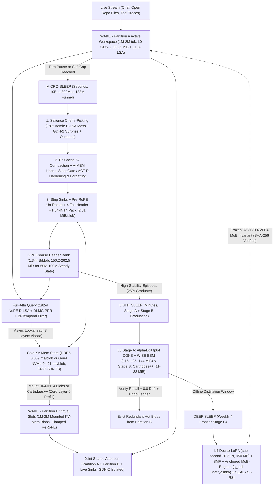

# Latent-Sparse Nested Learning (`LSA-NL`) v2.0: Split-Horizon Continuum Memory, Dynamic Recursive Compute, and Lossless Mid-Flight Drafting for Frozen Hybrid MoEs

> **Document Class:** Flagship Research Essay & Architectural Proposal (`v2.0`) · **Target Architecture:** `Qwen3.6-64L-CoMem` (`LSA-NL` Memory & Elastic-Compute Subsystem)  
> **Primary Backbone:** Frozen `Qwen3.6-35B-A3B-Loop64` (`d=2`, `64L`, `[0,12)×1 + [12,36)×2 + [36,40)×1`, `34.661B` total / `32.212B` frozen MoE, `2.448B` dense core, `4.916B` standard active → `3.45B ↔ 6.38B+` elastic active, `10` physical `kv_share=True` full-attention layers with `partial_rotary_factor=0.25` [`64`-d `3D mRoPE` + `192`-d NoPE], `48` virtual `GDN-2-1M + QED` linear states)  
> **Development Hardware:** `1× NVIDIA RTX PRO 6000 Blackwell Server Edition` (`GB202`, `sm_120`, **`96 GB GDDR7 ECC`** [`94.97 GiB` CUDA-usable], `512-bit`, **`1,597 GB/s`** peak bandwidth, `24,064` CUDA cores, `600 W` TDP) · **Consumer Deployment Targets:** `16 GB` (`RTX 4080 / 5070 Ti`), `24 GB` (`RTX 3090 / 4090`), and `32 GB` (`RTX 5090`) VRAM  
> **Companion Documents:** [Next-Gen Roadmap (`Qwen3.6-64L-CoMem`)](ROADMAP_NEXTGEN_LOOP64_COMEM.md) · [Compute Grant Proposal (v2.0)](COMPUTE_GRANT_PROPOSAL.md) · [Empirical Report (EN)](EXPERIMENT_REPORT.md) · [Empirical Report (ZH)](EXPERIMENT_REPORT_ZH.md) · [SI-RSI Roadmap](RSI_ROADMAP.md)

> [!IMPORTANT]
> **Epistemic Grounding & Zero-Fabrication Contract:** Every quantitative statement in this proposal is explicitly tagged as **`Measured`** (directly verified from repository logs, unit tests, or public Hub commits), **`Derived Formula`** (exact closed-form byte, latency, or parameter accounting from `src/qloop/` constants), **`Published (External)`** (cited primary-source specification or result), **`Estimated`** (engineering projection from measured single-card throughput), or **`Proposed / Kill-Gate`** (falsifiable hypothesis gated by explicit pass/fail criteria before engineering commitment). **Zero unmeasured benchmark results are claimed.**

---

## Abstract

Long-horizon reasoning agents require both high-fidelity working memory over active tool traces and durable episodic recall across months of sessions, repositories, and revised facts. Current approaches fall into two unsatisfactory extremes: stretching a single flat KV cache toward an unrealistic `10M`-token contiguous chat window—which overflows single-GPU memory and drowns linear-attention recurrent states in archival noise—or training pure parametric test-time neural memories (such as *Titans* [1] and *Nested Learning / HOPE* [2]) from scratch, which cannot be grafted non-destructively onto frozen `35B+` Mixture-of-Experts (MoE) weights and suffer capacity-limited proactive interference [3] on verbatim identifiers and code.

We propose **Latent-Sparse Nested Learning (`LSA-NL`, v2.0)**, a non-destructive **5-Frequency Continuum Memory System (`L0 → L4`)** and **3-Axis Dynamic Elastic Compute** architecture engineered around a frozen `64`-layer looped hybrid MoE (`Qwen3.6-35B-A3B-Loop64` [4]) on a single **`96 GB GDDR7 ECC`** Blackwell GPU (`1,597 GB/s`), with explicit consumer deployment profiles fitting inside **`<= 24 GB VRAM`** (`17.66–18.93 GiB` on `RTX 3090/4090`, `10.89 GiB` on `16 GB` `4080/5070 Ti`, and `26.98 GiB` on `32 GB` `5090`). Instead of a flat `10M` window, `LSA-NL` establishes a **realistic `3M–4M` Split-Horizon Logical Context** backed by **`100M+` cold consolidated tokens on Host DDR5 / NVMe SSD**—and a **4-stage lifelong forgetting, hardening, and KV-to-Engram graduation funnel** that compresses `10 billion` raw lifelong tokens (`57.60 TB` raw SSD) into a bounded `60M`-token steady-state archive (`345.6 GB` NVMe SSD + `150.2 MiB` GPU headers):
1. **Partition A (`1M–2M` Adjustable Live Active Workspace):** Live dialogue, active repository buffers, and current tool traces. Online delta-rule linear attention (`GDN-2-1M + Bounded QED + Soft Neg-Eigval` [5], [6], [7], `48` virtual states = `98.25 MiB`) runs *exclusively* on Partition A, guaranteeing that cold archival memories never pollute the coherent recurrent stream.
2. **Partition B (`1M–2M` GPU-Mounted Consolidated KV-Mem Blob Bank + `100M+` Cold SSD Archive):** Past sessions and learned codebases are consolidated into sink-stripped, Pre-RoPE **`512`-token KV-Mem Blobs** (`2.8125 MiB/blob` in Block-64 Hadamard INT4), indexed by `1,344 B` GPU-resident coarse headers (`250.00 MiB` centroids + `12.50 MiB` bi-temporal/graph metadata = `262.50 MiB` for `100 Mi-tokens` / `604.0 GB` SSD). Retrieved blobs prefetch asynchronously (`0.059 ms/blob` DDR5, `0.421 ms/blob` Gen4 NVMe) and inject directly into sparse attention—eliminating Layer-0 text re-prefill and context-stuffing.

We rigorously decompose cross-session KV-blob splicing error into **Geometric Error ($G$)** and **Dynamic / Sink Error ($D$)**, prove why `Qwen3.6`'s `partial_rotary_factor = 0.25` (`192/256` NoPE dims) and orthogonal `H_64` block isolation neutralize $G$ exactly, present a four-layer defense against $D$, formalize the **Wake → Micro-Sleep → Light Sleep → Deep Sleep** consolidation lifecycle alongside **six surgical upgrades over Original LSA** [8], and move beyond static looped models (*Inkling 2 Mini* [9]) via **3-Axis Dynamic Elastic Compute (`MoR` [10] + Dynamic Active Parameters)**, honest **first-principles Prefill vs. Decode acceleration** (`MoR` Pass-2 token skipping + zero-extra-model Pass-1-Guided Saliency Prefill cutting `64L` prefill GEMMs **`1.23×–1.39×`** to `1.15×–1.30×` of `40L`, while Partition-B KV-Mem Blobs eliminate re-prefill altogether), and **lossless Engram-coupled `L35` Mid-Flight Self-Speculative Drafting (`EAGLE-3` [11] + `LoopSpec` [12] + `TreeWY` [13] + `SAM-Decoding`)** delivering **`1.58×–1.76×` lossless bare-`64L` decode speedup (`1.07×–1.19×` faster than raw `40L`)** and **`1.73×–2.28×` speedup on `64L + Full MoE-Engram (5.86B active)`**—so even the full `5.86B`-active model decodes losslessly faster (`1.02×–1.35×`) than an unlooped `40L (3.45B)` model under honest MoE Zipfian coupon-collector bandwidth math. We conclude with immediate zero-training **Kill-Gates (`K0–K4`)** and a long-term Phase-5 appendix extending `192`-D NoPE blobs natively to `Qwen3.6`'s built-in VLM tower.

---

## §1. Thesis & Positioning: Why *Latent-Sparse Nested Learning (`LSA-NL`)* Instead of Pure *Titans / HOPE* or Raw `10M` Context

### 1.1 The Two Structural Failures of Existing Ultra-Long Memory Paradigms

Building a persistent coding and research agent on a single `96 GB GDDR7 ECC` GPU exposes a sharp architectural dilemma. Two competing paradigms dominate current literature, and each fails a non-negotiable engineering constraint when applied to a frozen `34.661B` hybrid MoE backbone:

1. **Failure Mode 1 — The Raw `10M` Contiguous Context Fallacy:** Treating weeks of past sessions, repository snapshots, and API manuals as a single flat autoregressive prefix conflates *active working memory* with *archival episodic memory*. Even with `10` physical `kv_share=True` full-attention layers, a `10M`-token `FP8` cache consumes `100.00 GiB`—exceeding `94.97 GiB` usable GDDR7 before loading a single weight. More subtly, on a hybrid linear-attention backbone (`30` physical / `48` virtual `GDN-2` layers), streaming millions of heterogeneous archival tokens sequentially through fixed-size recurrent state matrices $S_t \in \mathbb{R}^{d_k \times d_v}$ subjects the online delta rule to relentless overwrite churn, erasing the short-horizon syntactic and reasoning trace that linear attention is best suited to maintain.
2. **Failure Mode 2 — The Two Walls of Pure Parametric Neural Memory (*Titans* & *Nested Learning / HOPE*):**
   Google's *Titans* [1] (`arXiv:2501.00663`) and *Nested Learning / HOPE* [2] (`arXiv:2512.24695`, NeurIPS 2025) contribute a profound theoretical unification: **the Continuum Memory System (CMS)**. Nested Learning demonstrates that neural architectures and gradient-based optimizers are instances of the same mathematical primitive—nested, multi-frequency associative memories $\mathcal{M}^{(f_k)}$ that compress distinct context flows at ordered update frequencies $f_0 > f_1 > \dots > f_K$. We adopt the CMS paradigm wholeheartedly, while confronting the **two hard walls** that prevent deploying pure *HOPE*-style neural memory when retrofitting a frozen `35B+` MoE (`Qwen3.6-35B-A3B` [4]):
   - **Wall A — The Pretraining-from-Scratch Requirement:** HOPE's self-modifying test-time meta-optimizers and deep momentum memory modules co-evolve their inner update rules alongside outer token representations from random initialization. Grafting unconstrained self-modifying inner-loop gradient updates onto a frozen `32.212B` NVFP4 MoE fractures the pretrained residual manifold—a failure mode we empirically observed during our v1 HSSD v3.2 ablation (`+0.79`-nat shock and dead vault pages whenever non-identity recurrent dynamics perturb frozen downstream layers; see [Empirical Report](EXPERIMENT_REPORT.md)).
   - **Wall B — Finite-Capacity Saturation and Proactive Interference:** Any purely parametric test-time neural memory compresses an unbounded token stream $N \to \infty$ into a fixed parameter vector $\theta_{\text{mem}} \in \mathbb{R}^{P}$. Beyond the associative capacity limit $N \gtrsim O(P)$, overlapping key-value writes induce **proactive interference** [3] (`SleepGate`, `arXiv:2603.14517`): old associations bleed into newly updated bindings, silently corrupting verbatim identifiers (UUIDs, git SHAs, exact function signatures, line numbers, numeric constants). Software-engineering and scientific agents cannot tolerate lossy neural approximations of a file path or API contract retrieved from three weeks ago.

### 1.2 Split-Horizon Logical Context: Decoupling Coherent Working Streams from Archival KV Blobs

`LSA-NL` resolves both failure modes by replacing a flat `10M` stream with a **Split-Horizon `3M–4M` Logical Context** backed by an unbounded (`100M+`-token) cold archive on Host DDR5 / NVMe SSD:

- **Partition A — Adjustable Live Active Workspace (`1M–2M` tokens):** Holds the live session transcript, open source files, and active tool traces as a causally coherent stream. **`GDN-2-1M + Bounded QED + Soft Neg-Eigval`** [5], [6], [7] (`48` virtual states = `98.25 MiB` exact in `64L`, [`src/qloop/model/gdn2.py`](../src/qloop/model/gdn2.py)) operates **strictly inside Partition A**—never ingesting cold archival KV blobs—paired with exact `D-LSA` [8] (`192`-D NoPE Ward clustering, [`src/qloop/model/lsa.py`](../src/qloop/model/lsa.py)).
- **Partition B — Consolidated KV-Mem Blob Bank (`1M–2M` GPU-mounted virtual slots, backed by `100M+` cold tokens on DDR5 / NVMe SSD):** Past sessions, indexed codebases, verified facts, and completed agent trajectories are consolidated into compact **`512`-token KV-Mem Blobs**. Each blob retains a tiny **`1,344 B` GPU-resident coarse semantic header** (compressed `10L × 64-d fp16` NoPE centroid, keywords/abstraction pointer, and bi-temporal graph metadata), while cold K/V payloads reside on Host DDR5 or NVMe SSD in **Block-64 Hadamard INT4** (`Block64HadamardINT4Cache` in [`src/qloop/model/offload.py`](../src/qloop/model/offload.py), grounded in `TurboQuant` [14]). At query time, `D-LSA` + `DynamicLatentMemoryGraph` (`DLMG`) Personalized PageRank routes to the top-$B$ relevant blobs, prefetches them asynchronously from DDR5/SSD, mounts them into Partition B's virtual KV slots, and injects them directly into full attention—achieving **zero Layer-0 text re-prefill, zero text context-stuffing, and verbatim non-parametric fidelity**.

### 1.3 Realizing a Non-Destructive 5-Frequency Continuum Memory System (`L0 → L4`)

Formally, `LSA-NL` instantiates a five-level Continuum Memory System $\mathcal{C}_{\text{LSA-NL}} = (\mathcal{M}_0, \mathcal{M}_1, \mathcal{M}_2, \mathcal{M}_3, \mathcal{M}_4)$ spanning six orders of magnitude in update frequency—strictly preserving Step-0 IEEE-754 identity (`max_abs_diff == 0.0`) and keeping all `32.212B` frozen NVFP4 MoE experts immutable (SHA-256 verified):

- **L0 (`f = 1 / tok`, Online Active Stream):** `GDN-2-1M + Bounded QED + Soft Neg-Eigval` [5], [6], [7] (`48` virtual linear states = `98.25 MiB` fixed VRAM, `27.53M` adapter params). Solves an online rank-1 L2 regression delta rule with decoupled channel-wise erase/write/decay and query-directed orthogonal erasure, confined exclusively to Partition A:
  $$S_t = \big(I - \hat{k}_t e_t^{\top}\big)\operatorname{Diag}\!\big(\exp(g_t)\big) S_{t-1} + \hat{k}_t (w_t \odot v_t)^{\top}, \qquad e_t = b_t \odot \hat{k}_t + \lambda_h \big(b_t \odot \hat{q}_t - \langle \hat{k}_t, b_t \odot \hat{q}_t \rangle \hat{k}_t\big).$$
- **L1 (`f = 1 / 512 tok`, Active Working Context):** Partition A `D-LSA` [8] (`1M–2M` adjustable active horizon across `10` physical `kv_share=True` layers). Every `512`-token block commits `4:1`-pooled `192`-D NoPE Ward clusters into `BucketIndex`, combining exact local window (`512` tok) + live session sinks (`64` tok) + `Top-64` sparse Ward buckets (`<= 768` packed remote keys/query).
- **L2 (`f = 1 / session` or Micro-Sleep, Consolidated Non-Parametric Episodic Memory):** Partition B **Consolidated KV-Mem Blob Bank** (`1M–2M` GPU-mounted virtual slots, `100M+` cold SSD tokens, pruned from `10B`-token lifetimes via §4.5's 4-stage funnel). Integrates episodic KV clustering/eviction (`EpiCache` [15]), proactive-interference conflict gating (`SleepGate` [3]), shadow/speculative/query-aware paged KV offloading (`ShadowKV` [16], `InfiniGen` [17], `Quest` [18]), and `Spark-X2.6-Recursion` [19]'s `DynamicLatentMemoryGraph` (`HippoRAG 2` Personalized PageRank [20] + `A-MEM` reciprocal semantic links [21] + `Zep / Graphiti` bi-temporal validity intervals [22]).
- **L3 (`f = 1 / task`, Light Sleep — Horizontal KV → Vertical Null-Space Weight & Cartridge Compilation):** `Spark-X2.6-Recursion` [19]'s `EpisodicSideMemory` (`AlphaEdit` Float64 DGKS null-space ridge projection [23] + `WISE` activation scope gate [24], `144 MiB/shard`, attached at the `6` core full-attention boundaries `L15, L19, L23, L27, L31, L35`, **explicitly skipping Coda `L39`** per verified `S2` calibration rule), complemented by modular `2K–4K` `H64-INT4` **KV Cartridges** (`Cartridges` / `Cartridges++` / `Cartridges at Scale` [25], [26], [27]). Compiles high-recurrence KV-Mem Blobs from horizontal $O(N)$ KV lookup into $O(1)$ vertical null-space residual projections satisfying $\Delta W K_0 = 0$ (exact `0.0` general-text drift) with an exact transactional undo ledger.
- **L4 (`f = 1 / week`, Deep Sleep — Sparse Long-Term Parametric, Hypernetwork & Skill Consolidation):** Native `2048`-D Anchored `MoE-Engram` (`DeepSeek Engram` signed-sqrt RMSNorm QK gating [28] + `SMF` TF-IDF/surprise-weighted sparse memory finetuning [29] + **`s_null` Matryoshka Slicing** [null-sink sigmoid routing + nested capacity slicing + `p=0.15` module dropout]), single-forward-pass **`Doc-to-LoRA`** [30] KV-to-Engram compilation + **`SEAL`** [31] self-edits, paired with Tier-1 adaptive native `top_k` (`8 → 10..16`, `0` extra VRAM), `MoR` dynamic depth [10], and `SI-RSI` (`s4_v2_rl`) verifiable RL on `64L` (`3.45B ↔ 6.38B+` elastic active), riding strictly atop the frozen `32.212B` `Qwen3.6` MoE prior.

Each adjacent boundary $\Phi_{k \to k+1}: \mathcal{M}_k \to \mathcal{M}_{k+1}$ implements an explicit frequency-matched consolidation operator—turning high-frequency context flows into lower-frequency, higher-leverage representations without ever mutating the immutable `32.212B` MoE prior (`L0/L1 → L2` via Micro-Sleep KV-blob packing; `L2 → L3` via Light Sleep `AlphaEdit` null-space compilation & `Cartridges++`; `L3 → L4` via Deep Sleep `Doc-to-LoRA` / `SMF` / `MoE-Engram` + `SI-RSI`).

#### Table 1.1 — Architectural Positioning: `LSA-NL` vs. *Titans / HOPE* and Raw `10M` Contiguous Context

| Dimension | Raw `10M` Contiguous Window | Pure *Titans* [1] / *HOPE* [2] | **`LSA-NL` v2.0 (`Qwen3.6-64L-CoMem`)** |
| :--- | :--- | :--- | :--- |
| **Memory Representation** | Flat monolithic KV stream (`10M` raw tokens) | Fixed-size parametric neural memory MLPs + self-modifying optimizers | **5-Frequency Hybrid CMS (`L0 → L4`):** Split-Horizon `3M–4M` KV (`100M+` cold SSD, `10B`-tok funnel) + `GDN-2` + `ESM` / `Cartridges++` + `MoE-Engram` |
| **Frozen `35B` MoE Retrofitting** | Possible, but `100 GiB` FP8 KV **OOMs `96 GB` GPU** | **Infeasible without pretraining** (self-modifying rules break frozen residual manifold) | **100% Non-Destructive** (`0.0` Step-0 identity; `32.212B` NVFP4 MoE cryptographically frozen) |
| **Recurrent State Integrity (`GDN-2`)** | Polluted by millions of archival/cold tokens | Shared parametric capacity suffers overwrite churn | **Strictly Isolated to Partition A** (`98.25 MiB` `GDN-2` never sees cold Partition-B blobs) |
| **Verbatim Code / Identifier Recall** | Exact if in window, prohibitive KV/compute cost | Degrades under capacity saturation & **proactive interference** [3] | **Lossless Non-Parametric (`L1`/`L2`)** + Bi-Temporal `[t_valid, t_invalid)` conflict masking [3], [22] |
| **Cross-Session Reuse Latency** | Full Layer-0 re-prefill on every new session | Single forward pass, but lossy on cold sessions | **Zero Layer-0 Re-Prefill:** Direct Pre-RoPE `H64-INT4` KV-blob mount (`0.059–0.421 ms/blob`) |
| **Hardware Accessibility & Throughput** | Requires multi-GPU cluster; linear decode slowdown | Scratch pretraining only; fixed compute | **`96 GB` Server (`4M` Split) down to `<= 24 GB` Consumer (`17.66–18.93 GiB`)** + **`1.23×–1.39×` `MoR` prefill speedup** + **`1.58×–2.28×` lossless `L35` Engram-coupled decode** (`64L+Engram` faster than `40L`!) |

---

## §2. Exact Split-Horizon Memory, Bandwidth, SSD Tiering & Consumer `<= 24 GB` Deployment Math

Every byte and latency figure in this section is a **`Derived Formula`** directly anchored to `Qwen3.6-35B-A3B`'s exact physical KV geometry (`L_phys = 10` physical full-attention layers via `kv_share=True`, `H_kv = 2` GQA KV heads, `D = 256` head dim) and our implemented quantization primitives in [`src/qloop/model/offload.py`](../src/qloop/model/offload.py) (`FP8KVCacheQuantizer`, `Block64HadamardINT4Cache`) and [`src/qloop/model/lsa.py`](../src/qloop/model/lsa.py) (`LSAConfig`, `block_size = 512`). Throughout, `1M` denotes $2^{20} = 1{,}048{,}576$ tokens (consistent with `FP8KVCacheQuantizer.tier1_1m_ledger_bytes` in `offload.py:616-623`) and `GiB`/`MiB` denote binary units ($2^{30}, 2^{20}$), while SSD/PCIe bandwidth and capacity also state decimal `GB`/`GB/s` ($10^9$) explicitly.

### 2.1 Closed-Form KV-Mem Blob & GPU Header Accounting (`Derived Formula`)

A canonical **KV-Mem Blob** encapsulates $B_{\text{tok}} = 512$ tokens (`128` four-token micro-pages of `2,304 B` per layer in `Block64HadamardINT4Cache`, `offload.py:121-122`) across all $L_{\text{phys}} = 10$ physical `kv_share` layers:

$$N_{\text{scalars}}^{\text{blob}} = L_{\text{phys}} \cdot 2_{(K,V)} \cdot H_{\text{kv}} \cdot D \cdot B_{\text{tok}} = 10 \times 2 \times 2 \times 256 \times 512 = 5{,}242{,}880\ \text{scalars}.$$

1. **FP8 E4M3 Payload (`1.00 B/scalar`, `FP8KVCacheQuantizer`):**
   $$S_{\text{blob}}^{\text{FP8}} = 5{,}242{,}880\ \text{B} = \mathbf{5.00\ \text{MiB}}\quad (512.0\ \text{KiB/layer}).$$
2. **Block-64 Hadamard INT4 Payload (`36 B / 64 scalars = 0.5625 B/scalar`, `Block64HadamardINT4Cache` [14]):**
   Each 64-scalar group packs `32 B` of unsigned 4-bit nibbles + `2 B` `fp16` scale + `2 B` `fp16` min (`GROUP_PACKED_BYTES = 36`, `offload.py:29`):
   $$S_{\text{blob}}^{\text{H64}} = 5{,}242{,}880 \times \frac{36}{64} = 2{,}949{,}120\ \text{B} = \mathbf{2.8125\ \text{MiB}}\ \ (\approx \mathbf{2.81\ \text{MiB}},\ 288.0\ \text{KiB/layer} = 128 \times 2{,}304\ \text{B}).$$
3. **GPU-Resident Coarse Semantic Header (`1,344 B` / blob):**
   Each cold blob leaves a compact routing descriptor pinned in GDDR7 VRAM:
   $$S_{\text{hdr}} = \underbrace{L_{\text{phys}} \cdot d_{\text{idx}} \cdot 2\ \text{B}}_{10 \times 64 \times 2 = 1{,}280\ \text{B}\ (\text{fp16 } 10\text{L NoPE centroids})} + \underbrace{64\ \text{B}}_{\substack{\text{bi-temporal } [t_{\text{valid}}, t_{\text{invalid}}),\ \text{salience}, \\ \text{DLMG CSR ptr},\ 4\text{-tok header IDs},\ \text{SSD LBA}}} = \mathbf{1{,}344\ \text{B}}.$$

### 2.2 Streaming Fetch Latency & `async_lookahead` Overlap (`Derived Formula`)

Streaming one complete `10`-layer `H64-INT4` blob (`2,949,120 B`) from tiered host storage obeys exact bandwidth bounds:

- **PCIe Gen4 ×4 NVMe SSD (`7.0 GB/s` sequential read):**
  $$t_{\text{NVMe}}^{\text{blob}} = \frac{2{,}949{,}120\ \text{B}}{7.0 \times 10^9\ \text{B/s}} = \mathbf{0.421\ \text{ms/blob}}\quad (\mathbf{0.0421\ \text{ms/layer}}).$$
- **Pinned Host DDR5 DMA (`50.0 GB/s` sustained PCIe Gen5 ×16 / DDR5 bandwidth):**
  $$t_{\text{DDR5}}^{\text{blob}} = \frac{2{,}949{,}120\ \text{B}}{50.0 \times 10^9\ \text{B/s}} = \mathbf{0.059\ \text{ms/blob}}\quad (\mathbf{0.0059\ \text{ms/layer}}).$$

**Why Latency Hides Cleanly Behind `3` Interleaved `GDN-2 + MoE` Layers (`async_lookahead`):**
In `Qwen3.6-35B-A3B`, physical full-attention layers occur every `4`th layer (`L3, L7, L11, L15, L19, L23, L27, L31, L35, L39`), separated by `3` consecutive `GDN-2 + MoE` layers. Using `Block64HadamardINT4Cache.prefetch_micro_pages(layer_idx, page_indices, target_device=None)` (`offload.py:321-355`, with `prefetch_layers_ahead=3` configured via `Block64HadamardINT4Cache.__init__` at `offload.py:137`) extended to an async `io_uring`/GPUDirect/pinned-host staging queue:
1. Full-attention layer $\ell$ (or early query lookahead at layer $\ell - 3$) issues the next layer's `288 KiB/blob` slice while `3` full `GDN-2 + MoE` layers execute (`~180M` active NVFP4 weights + Triton `fla` DPLR scans).
2. Crucially, **cold-blob fetch latency is paid ONLY on cold-miss mount events**—not on every generated decode token! Once a retrieved set of $B$ blobs (e.g., $B = 16$ blobs = `8,192` tokens = `45.0 MiB` H64-INT4, taking `0.94 ms` from DDR5 or `6.74 ms` from NVMe total across all 10 layers) is mounted into Partition B's GPU-resident virtual slots (`1M–2M` capacity), all subsequent tokens in the multi-hundred-token reasoning turn attend to those mounted blobs directly at **`1,597 GB/s` GDDR7 ECC** bandwidth with zero PCIe/SSD traffic.

### 2.3 `100M`-Token Cold NVMe Archive Scaling (`Derived Formula`)

Scaling the cold archive to **`100 Mi-tokens`** ($100 \times 2^{20} = 104{,}857{,}600$ consolidated tokens = **`204,800 × 512`-token blobs**):
- **Cold NVMe SSD Footprint:** $204{,}800 \times 2{,}949{,}120\ \text{B} = 603{,}979{,}776{,}000\ \text{B} = \mathbf{604.0\ \text{GB}}$ decimal (`562.50 GiB` binary)—easily fitting on a single consumer/server `1–2 TB` NVMe SSD! *(For decimal `100,000,000` tokens = `195,313` blobs: `576.0 GB` / `536.44 GiB` SSD.)*
- **GPU-Resident Coarse Header Bank:**
  - `10L × 64-d fp16` semantic centroids: $204{,}800 \times 1{,}280\ \text{B} = 262{,}144{,}000\ \text{B} = \mathbf{250.00\ \text{MiB}}$ (**`0.244 GiB`**) exact!
  - `64 B/blob` bi-temporal + `DLMG` graph metadata: $204{,}800 \times 64\ \text{B} = \mathbf{12.50\ \text{MiB}}$ (`0.012 GiB`).
  - **Combined GPU Catalog for `100 Mi-tokens`:** **`262.50 MiB` (`0.256 GiB`)** total (`250.34 MiB` / `0.244 GiB` for decimal `100M` tokens = `195,313` blobs)—less than **`0.27%`** of our `94.97 GiB` CUDA-usable GDDR7 ECC!
- **Exhaustive `100M`-Token GPU Header Routing Latency (`Derived Formula`):** Scoring a query against *all* `204,800` coarse `64`-D `fp16` headers at one physical full-attention layer reads exactly $204{,}800 \times 64 \times 2\ \text{B} = \mathbf{25.00\ \text{MiB}}$ (`26.21 MB`) from GDDR7 ECC—taking **`0.0164 ms/layer`** at `1,597 GB/s` peak (`0.0234 ms/layer` at `70%` realized bandwidth, or **`~0.23 ms` total across all `10` layers**), even before applying two-level tree routing (`search="tree"` in `src/qloop/model/lsa.py`).

### 2.4 Realistic Single-Server-GPU Operating Envelopes (`1× 96 GB GDDR7 ECC`, `94.97 GiB` Usable)

Using pure NVFP4 base weights (`21.85 GiB` `Measured`; add `+2.24 GiB` for the `24.09 GiB` mixed NVFP4/FP8 HF checkpoint), exact `48`-state `64L` `GDN-2` recurrent state (`98.25 MiB = 0.096 GiB`, rounded to `0.10 GiB` in table sums), and `0.3525 GiB / 1M` Partition-A routing metadata (`0.3125 GiB` `bf16` Ward centroids + `~0.04 GiB` compacted `int8` `BucketIndex` after fixing `lsa.py:728-768`) plus `0.0051–0.2563 GiB` GPU coarse headers (`4,096` mounted standalone blobs up to `204,800` `100 Mi-tok` SSD blobs), Table 2.1 details our three target server operating envelopes alongside raw `10M` and `Inkling 2 Mini` [9] reference points.

#### Table 2.1 — Exact Single-GPU GDDR7 ECC Memory Ledger Across Server Operating Envelopes (`Derived Formula` + `Measured` Weights)

| Operating Envelope (`64L d=2`, `batch=1`) | Partition A (Active KV) | Partition B (Mounted KV) | Total KV (GiB) | NVFP4 Wts + `GDN-2` (GiB) | Compact Index + GPU Headers (GiB) | **Total GDDR7 (GiB)** | **Free on `94.97 GiB`** | Cold Archive (SSD) |
| :--- | :---: | :---: | :---: | :---: | :---: | :---: | :---: | :---: |
| **Env. A — `3M` Precision Split** (`1M` FP8 + `2M` H64-INT4) | `10.00` (FP8) | `11.25` (H64) | **`21.25`** | `21.85 + 0.10` | `0.36–0.61` *(`0.3525` + hdrs)* | **`43.55–43.81`** *(`~43.6–43.8`)* | **`~51.2–51.4 GiB`** *(`51.16–51.42`)* | Optional `100M` (`604 GB`) |
| **Env. B — `4M` Max Logical Split** (`2M` H64 + `2M` H64) | `11.25` (H64) | `11.25` (H64) | **`22.50`** | `21.85 + 0.10` | `0.71–0.96` *(`0.7050` + hdrs)* | **`45.16–45.41`** *(`~45.2–45.4`)* | **`~49.6–49.8 GiB`** *(`49.56–49.81`)* | Optional `100M` (`604 GB`) |
| **Env. C — `2M` Hot + `100 Mi-tok` Cold SSD** (`1M` H64 + `1M` H64) | `5.625` (H64) | `5.625` (H64) | **`11.25`** | `21.85 + 0.10` | `0.61` *(`0.3525 + 0.2563`)* | **`33.81`** *(`~33.8`)* | **`~61.2 GiB`** *(`61.16`)* | **`100M` (`604.0 GB`)** |
| *Contrast: Raw `10M` Contiguous FP8 (`10L`)* | `100.00` (FP8) | — | `100.00` | `21.85 + 0.10` | `~3.53` | **`125.5` (OOM)** | `-30.5 GiB` | None |
| *Contrast: `Inkling 2 Mini` (`1M` F16, `Published` [9])* | `32.00` (F16) | — | `32.00` | `~18.6` (`~20 GB`) + `0.16` SWA | `0.00` | `~50.8` *(at `1M` only)* | `~44.2 GiB` | None reported |

> [!TIP]
> **Headroom for Full 5-Level Stack:** Even under the `4M` Split-Horizon envelope (`45.16–45.41 GiB` total), **`~49.6–49.8 GiB` of GDDR7 ECC remains completely free**—amply accommodating `EpisodicSideMemory` (`0.141 GiB/shard`), `AnchoredMoEEngram` (`0.65–0.99 GiB` NVFP4), `DLMG` sparse adjacency tables, CUDA graphs, and multi-agent request batching on a single server card.

### 2.5 Consumer `<= 24 GB VRAM` Deployment Profiles (`RTX 3090 / 4090`, `16 GB` `4080 / 5070 Ti`, `32 GB` `5090`)

A defining strength of `LSA-NL` over flat-context models is that **the identical trained `Qwen3.6-64L-CoMem` checkpoint deploys seamlessly onto commodity `16–32 GB` consumer GPUs** while retaining full `256K–1M` active context and the entire `100M`-token NVMe SSD lifelong archive.

**Structural Decomposition (`Derived Formula`):**
In `Qwen3.6-35B-A3B` (`34.661B` text parameters), **`32.212B` (`92.93%`)** resides in the `256` routed MoE experts (`8/256 = 3.125%` active per token; `16.875 GiB` total in `NVFP4` at `0.5625 B/param`, or `0.06592 GiB/expert` summed across all `40` layers). By contrast, the **entire always-active dense core** totals only **`2.448B` parameters (`2.42 GiB` in FP8/Q8 incl. norms and scales)**:
- Untied `embed_tokens` + `lm_head`: `1.017B`
- `30` Gated DeltaNet (`GDN-2`) linear-attention mixers: `1.011B`
- `10` Gated Full-Attention (GQA) mixers: `0.273B`
- `40` shared MoE experts: `0.126B`
- `40` MoE routers: `0.021B`

Because routed MoE accesses follow a steep **Zipfian popularity distribution** across coding and dialogue workloads, keeping the entire `2.42 GiB` dense core plus the hottest `80–160/256` NVFP4 experts permanently in GPU VRAM—while executing only cold-tail routed experts directly on host CPU DDR5 via **`KTransformers`** [32] (`kvcache-ai/ktransformers`, SOSP 2025 Expert Deferral + Intel AMX/AVX-512 hybrid kernels), **`MoE-Lightning`** [33] (`arXiv:2411.11217`, ASPLOS 2025 `CGOPipe` + Hierarchical Roofline Model `HRM`), and **`Fiddler`** [34] (`arXiv:2402.07033`, ICLR 2025 activation-transfer CPU-GPU orchestration)—eliminates catastrophic PCIe expert weight-swapping stalls.

Every profile in Table 2.2 includes identical **fixed runtime overhead (`1.706 GiB`)**: `0.10 GiB` loop/GDN-2/LSA adapters + `0.096 GiB` (`98.25 MiB`) `48L` `GDN-2` recurrent state + `0.35 GiB` (`64K`-token) hot Partition-B blob LRU + `0.26 GiB` (`262.5 MiB`) `100 Mi-token` SSD coarse headers + `0.90 GiB` CUDA scratch/activations, plus proportional compact `D-LSA` Partition-A index (`0.088 / 0.176 / 0.353 GiB` for `256K / 512K / 1M` active KV). *(Dense-quantized `Q4_K_M` "Profile B" is omitted as strictly dominated in quality-per-GiB by lossless NVFP4 Zipfian Split Profile C.)*

#### Table 2.2 — Consumer GPU (`16 GB / 24 GB / 32 GB VRAM`) Deployment Profiles (`Derived Formula`)

| Deployment Profile & Target GPU | Dense Core (FP8/Q8) | GPU Routed MoE (`Hot/256`) | Active `H64-INT4` KV + Compact Idx | Fixed Runtime (`Adp+GDN2+LRU+100M Hdr+Scr`) | **Total GPU VRAM (GiB)** | **Host DDR5 Cold MoE (GiB)** | Cold Archive (SSD) |
| :--- | :---: | :---: | :---: | :---: | :---: | :---: | :---: |
| **`24 GB` Profile A (`RTX 3090 / 4090`)** — All-GPU `IQ3_XXS` (`~3.15 bpw`) + `512K` KV | `2.42` | `11.81` (`256/256` `IQ3_XXS`) | `2.813 + 0.176` (`512K`) | `1.706` | **`18.93 GiB`** | **`0.00 GiB`** | `100M` (`604 GB`) |
| **`24 GB` Profile C (`RTX 3090 / 4090`)** — Lossless NVFP4 Zipfian Split (`160/256` Hot) + `512K` KV | `2.42` | `10.55` (`160/256` NVFP4) | `2.813 + 0.176` (`512K`) | `1.706` | **`17.66 GiB`** | **`6.33 GiB`** (`96/256`) | `100M` (`604 GB`) |
| **`24 GB` Profile D (`RTX 3090 / 4090`)** — Lossless NVFP4 Split (`128/256` Hot) + **Full `1M` KV** | `2.42` | `8.44` (`128/256` NVFP4) | `5.625 + 0.353` (**`1M`**) | `1.706` | **`18.54 GiB`** | **`8.44 GiB`** (`128/256`) | `100M` (`604 GB`) |
| **`16 GB` Profile E (`RTX 4080 / 5070 Ti`)** — Lossless NVFP4 Split (`80/256` Hot) + `256K` KV | `2.42` | `5.27` (`80/256` NVFP4) | `1.406 + 0.088` (`256K`) | `1.706` | **`10.89 GiB`** | **`11.60 GiB`** (`176/256`) | `100M` (`604 GB`) |
| **`32 GB` Profile F (`RTX 5090`)** — All-GPU Lossless NVFP4 (`256/256` Hot) + **Full `1M` KV** | `2.42` | `16.88` (`256/256` NVFP4) | `5.625 + 0.353` (**`1M`**) | `1.706` | **`26.98 GiB`** | **`0.00 GiB`** | `100M` (`604 GB`) |

Every consumer profile preserves **`>= 5.0 GiB`** of OS/display/CUDA-graph safety margin (`5.07–6.34 GiB` free on `24 GB`, `5.11 GiB` free on `16 GB`, `5.02 GiB` free on `32 GB`), while delivering full `64L` reasoning, exact `GDN-2-1M + QED` Partition-A streaming, and sub-millisecond `100M`-token SSD header routing.

---

## §3. The Hard Problem of Cross-Session KV-Blob Injection: Geometric Error ($G$) vs. Dynamic Error ($D$)

Injecting precomputed KV-Mem Blobs from past sessions directly into live attention without Layer-0 text re-prefill is the single highest-leverage mechanism in `LSA-NL`—and the exact place where sloppy designs fail. We refuse to hand-wave cross-session KV splicing. Drawing directly on the empirical and theoretical literature on non-prefix KV reuse—**`CacheBlend`** [35] (`arXiv:2405.16444`, EuroSys 2025), **`EPIC`** [36] (`arXiv:2410.15332`, ICML 2025), **`TurboRAG`** [37] (`arXiv:2410.07590`, EMNLP 2025), and **`Block-Attention`** [38] (`arXiv:2409.15355`, ICLR 2025)—we decompose spliced-KV fidelity loss into two orthogonal error terms and solve each explicitly.

### 3.1 Exact Error Decomposition: Geometric ($G$) vs. Dynamic / Sink ($D$)

Consider a `512`-token blob $\mathcal{B}_m$ originally prefilled during past session $s$ at absolute positions $P_s = [p_s, p_s + 512)$ behind past prefix $X_s$, yielding layer-$\ell$ cached tensors $(K_m^{(s)}, V_m^{(s)})$. When mounted later into live session $u$ behind an unrelated active Partition-A context $X_u$ (length $T_A$), a live query $q_t^{(u)}$ attends jointly over $(K_A, V_A) \cup \{(K_m, V_m)\}$. Let $o_t^*$ denote the full contiguous re-prefill oracle output obtained by concatenating the raw text of $\mathcal{B}_m$ ahead of $X_u$ and running all layers from Layer 0, and let $\tilde{o}_t$ denote the spliced Partition-B output. The total attention discrepancy splits cleanly:

$$\|\tilde{o}_t - o_t^*\|_2 \;\le\; \underbrace{\mathcal{E}_{\text{geom}}\!\left(\Delta\theta_{\text{RoPE}}(t, P_s)\right)}_{\text{Geometric / Positional Error } (G)} \;+\; \underbrace{\mathcal{E}_{\text{dyn}}\!\left(\Delta K_m^{(u|s)},\, \Delta V_m^{(u|s)},\, \Delta s_{\text{sink}}\right)}_{\text{Dynamic Cross-Attention \& Sink Error } (D)}.$$

- **Geometric Error ($G$):** Standard RoPE caches store post-rotation keys $K_{\text{rot}}^{(s)} = R(P_s \omega) K_{\text{rot}}^{\text{pre}}$. Splicing $\mathcal{B}_m$ into session $u$ produces nonsensical or out-of-distribution relative angles $(t - p_s)\omega$—including negative relative offsets if $p_s > t$ or frequencies far beyond the pretrained `max_position_embeddings` arc—collapsing rotary attention logits even when token semantics are identical.
- **Dynamic / Sink Error ($D$):** Even if positional phases are perfectly repaired ($G = 0$), two residual discrepancies remain across layers $\ell \ge 1$:
  1. *Spurious Internal Attention Sinks (`EPIC` [36]):* Autoregressive Transformers dump large softmax mass onto the first `1–4` sequence tokens (attention sinks). If a cached blob preserves its original session's `[0:4)` tokens, splicing introduces anomalous mid-context high-norm attractors that steal probability mass from both the live session's sinks and target answer tokens.
  2. *Missing Cross-Context Layer Conditioning (`CacheBlend` [35], `Block-Attention` [38]):* Inside layers $\ell \ge 1$, the hidden states generating $(K_m^{(s)}, V_m^{(s)})$ attended to old prefix $X_s$ rather than live prefix $X_u$. Tokens with strong cross-document dependencies (e.g., anaphora, shadowed identifiers, or cross-file type references) exhibit non-zero key/value deviation $(\Delta K_m, \Delta V_m)$ relative to contiguous re-prefill.

### 3.2 Why `Qwen3.6-35B-A3B` Is Uniquely Privileged for Eliminating Geometric Error ($G$)

Standard full-RoPE models (`partial_rotary_factor = 1.0`, e.g., Llama-3) apply rotary phase across 100% of every key vector, making position-independent KV reuse fragile. **`Qwen3.6-35B-A3B` [4] possesses three structural properties that already align with our codebase (`src/qloop/model/`) to crush Geometric Error ($G$) cleanly:**

1. **`75%` Native Position-Free NoPE Key Subspace (`192/256` dims):** `Qwen3.6` enforces `partial_rotary_factor = 0.25` (`head_dim = 256`, `rotary_dim = 64`), partitioning every key and query vector into:
   $$k = \big[\,\underbrace{k_{\text{rot}} \in \mathbb{R}^{64}}_{\text{mRoPE } [0:64)},\;\; \underbrace{k_{\text{nope}} \in \mathbb{R}^{192}}_{\text{Position-Free NoPE } [64:256)}\,\big].$$
   Three-quarters of every attention dot product $\langle q_{\text{nope}}, k_{\text{nope}} \rangle$ is **strictly position-invariant by architecture**. Moreover, `D-LSA` (`index_on="nope"`, [`src/qloop/model/lsa.py:154`](../src/qloop/model/lsa.py#L154)) computes `64`-D latent projections and Ward centroids *exclusively* on `[64:256)`—meaning **a blob's `D-LSA` routing centroids are bit-for-bit invariant to which session or virtual Partition-B slot it occupies!**
2. **Exact Block-64 Orthogonal Separation Inside `H_64` Compression:** Our `walsh_hadamard_block(x, block_size=64)` ([`src/qloop/model/offload.py:32-56`](../src/qloop/model/offload.py#L32-L56)) applies block-diagonal $I_4 \otimes H_{64}$. Group 0 transforms *only* `[0:64)` (mRoPE), while Groups 1–3 transform *only* `[64:256)` (NoPE), guaranteeing zero cross-subspace leakage (`Fix C2`, `< 1e-12` commutativity error in `fp64`).
3. **Pre-RoPE Archival Storage + Virtual Partition-B Clamped ReRoPE ([`src/qloop/model/pos_rerope.py`](../src/qloop/model/pos_rerope.py)):**
   - During Micro-Sleep consolidation, we **un-rotate** only the `64`-d rotary slice by the inverse per-token rotation $R(-(p_s + j)\omega) = R((p_s + j)\omega)^{\top}$ via `apply_partial_rope_k(k, -k_positions)` (`pos_rerope.py:166-195`):
     $$k_j^{\text{pre}} = \big[R(-(p_s + j)\omega)\, k_{\text{rot}}^{(s)}(j),\;\; k_{\text{nope}}^{(s)}(j)\big], \qquad j \in \{0, \dots, 511\},$$
     and store $(k^{\text{pre}}, v)$ packed in `H_64` INT4.
   - At Partition-B mount time, blob $m$ receives a clean **virtual Partition-B slot position** $p_{\text{virt}}(m, j) = P_{\text{partB}}(m) + j$, preserving exact intra-blob syntax distances $(j_1 - j_2)$ while mapping cross-partition query-to-blob distance $\Delta = t - p_{\text{virt}}$ through our smooth $C^1$ **`clamped_relative_distance`** (`pos_rerope.py:89-124`, `linear_ceil = 131,072`, `log_scale = 32,768`, `max_pos = 240,000`—strictly inside `Qwen3.6`'s pretrained `262,144` arc!):
     $$\Delta_{\text{eff}}(\Delta) = \begin{cases} \Delta, & 0 \le \Delta \le L_c, \\ \min\!\left(L_{\max},\; L_c + S_c \ln\!\left(1 + \dfrac{\Delta - L_c}{S_c}\right)\right), & \Delta > L_c. \end{cases}$$
   - **Group-0 Isolation & Exact `H_64` Commutativity:** Because $H_{\text{blk}} = \operatorname{diag}(H_{64}, H_{64}, H_{64}, H_{64})$ is block-diagonal self-adjoint orthogonal ($H_{64}^{\top} = H_{64}$, $H_{64}^2 = I_{64}$) and partial RoPE $R_{\text{part}}(\theta) = \operatorname{diag}(R_{64}(\theta), I_{192})$ acts strictly on Group 0, un-rotating by the blob base offset $p_s$ (storing local intra-blob phase $R(j\omega) k_{\text{rot}}^{\text{pre}}$ or pure Pre-RoPE $k^{\text{pre}}$) means **ONLY Group 0 (`64/256 = 25%` of `K`) ever undergoes mount-time ReRoPE phase alignment**, while **`Groups 1..3` (`192` NoPE dims = `75%` of `K`) remain permanently in `H_64` space** and are scored directly via $\langle H_{64} q_{\text{nope}}, H_{64} k_{\text{nope}} \rangle = \langle q_{\text{nope}}, k_{\text{nope}} \rangle$ (`gather_kv_and_reconstruct_v`, `offload.py:445-514`) with zero inverse transform on keys!
   - Query-side differential rotation (`apply_partial_rerope_q`, `pos_rerope.py:198-261`) leaves all `192` NoPE dims untouched (`torch.equal`) while placing the `64` rotary dims cleanly inside the pretrained long-range band—**eliminating Geometric Error ($G$) cleanly.**

### 3.3 Explicit Four-Layer Defense Against Dynamic & Sink Error ($D$)

Rather than assuming $D \approx 0$, `LSA-NL` stacks four progressive defenses ordered from zero-cost to bounded-cost:

1. **Defense 1 — Original-Session Sink Stripping (`EPIC` LegoLink Rule [36]):** Before sealing any KV-Mem Blob, strip the original session's initial `[0:4)` attention-sink tokens (and system-prompt anchor span). When mounted into Partition B, softmax normalizes cleanly against the **live session's** Partition-A sinks (`sinks = 64` in `LSAConfig`), eliminating mid-context sink competition.
2. **Defense 2 — Self-Contained `4`-Token Boundary & Abstraction Header + Bi-Temporal Conflict Masking (`TurboRAG` [37] + `Zep/Graphiti` [22] + `SleepGate` [3]):** Consolidate blobs along natural semantic boundaries (file/function/turn splits) rather than blind fixed cuts, prefixed with a compact `4`-token **Boundary & Abstraction Header** (canonical entity/file/symbol identifier + boundary delimiter) so keys/values inside the blob are self-anchored without requiring the old prefix $X_s$. Every blob header carries bi-temporal validity `[t_valid, t_invalid)` [22] maintained by a `SleepGate` [3] conflict tagger so superseded code edits or retracted facts are masked out *before* attention softmax—neutralizing proactive interference directly.
3. **Defense 3 — Selective High-Variance Token Refresh (`CacheBlend` [35] Escalation):** When a query performs dense multi-hop synthesis across multiple Partition-B blobs, measure first-global-layer key/value deviation (HKVD) on blob boundary/anchor tokens and selectively refresh ONLY the top **`5%–10%`** highest-variance tokens across downstream layers (`CacheBlend` [35])—recovering cross-blob conditioning at `~10×–18×` lower compute than Layer-0 text re-prefill.
4. **Defense 4 — Bounded `Block-Attention` Spliced-KV Adapter Calibration (`~2–4 h` Single GPU, Contingency Only [38]):** *If and only if* our zero-training Kill-Gate `K0` (§5.1) reveals non-trivial Dynamic Error ($D$) that Defenses 1–3 cannot keep within `>= 92%` of the contiguous oracle, we run a targeted `2–4 h` single-card calibration following **`Block-Attention`** [38]: training **ONLY** `D-LSA` indexers + global `q/k/v/o` adapters via **APOLLO** [39] on spliced multi-document mixtures while keeping all `32.212B` MoE experts **100% frozen** (SHA-256 verified) and `GDN-2` weights untouched.

---

## §4. Consolidation Lifecycle, `10B`-Token Funnel, Original-LSA Audit & 3-Axis Elastic Compute

Borrowing the biological division of labor formalized across *Sleep-time Compute* [40] (`arXiv:2504.13171`), *EpiCache* [15], *SleepGate* [3], and *Nested Learning* [2], `LSA-NL` orchestrates memory across **four asynchronous lifecycle phases** running over the identical frozen `Qwen3.6-64L` weights.

### 4.1 Phase I — Wake (Online Serving, Millisecond Scale)
- **Active Stream Processing (`L0` + `L1`):** Incoming user tokens, file edits, and tool responses flow sequentially through Partition A (`GDN-2-1M + QED` `98.25 MiB` recurrent state + `D-LSA` `512`-token Ward blocks). Cold Partition-B blobs are **never** fed into `GDN-2`, preserving clean delta-rule tracking over active syntax and reasoning chains.
- **Asynchronous Split-Horizon Retrieval (`L2`):** At each physical full-attention layer, untied per-pass `D-LSA` query indexers score (i) Partition-A Ward centroids and (ii) the GPU-resident coarse blob header catalog (`150.2–262.5 MiB` for `60M–100M` consolidated tokens). Top-$k$ coarse seeds expand `1–2` hops across `DLMG` via `HippoRAG 2` Personalized PageRank [20], prune any blobs with $t_{\text{invalid}} \le t_{\text{now}}$ (`Zep/Graphiti` [22]), and asynchronously prefetch cache-miss blobs (`async_lookahead`, 3 layers ahead) from Host DDR5 (`0.059 ms/blob`) or NVMe SSD (`0.421 ms/blob`) into Partition B's GPU ring buffer. Joint sparse attention then attends over Partition A + Partition B + live sinks using clamped ReRoPE (`pos_rerope.py`)—with zero Layer-0 text re-prefill.

### 4.2 Phase II — Micro-Sleep (Seconds, Turn Pause / Budget Pressure)
Grounded in *Sleep-time Compute* [40] (shifting memory organization into idle time between turns), *EpiCache* [15], and *SleepGate* [3]:
1. **Multi-Signal Salience Cherry-Picking:** Score outgoing Partition-A `512`-token blocks by combining cumulative `D-LSA` attention mass (`EpiCache` [15]), `GDN-2+QED` erase/write surprise energy, and downstream task outcome (passing tests, confirmed fixes, user decisions). Evict transient tool-log boilerplate outright instead of polluting the cold store.
2. **Semantic Episode Clustering & Proactive-Interference Resolution:** Cluster retained blocks into topic/file episodes (`EpiCache` [15]), wire reciprocal `A-MEM` semantic edges [21] in `DLMG`, and run `SleepGate` [3] conflict detection against existing GPU headers. Whenever a newly edited function or corrected fact supersedes an older blob, stamp `t_invalid = t_now` on the older blob's `64 B` metadata tail so subsequent queries automatically resolve to the latest truth without deleting audit history.
3. **Pre-RoPE `H64-INT4` Sealing & Tier Spill:** Strip `[0:4)` sinks (`EPIC` [36]), un-rotate `[0:64)` rotary slices (`apply_partial_rope_k(k, -p)`), attach the `4`-token Boundary & Abstraction Header (`TurboRAG` [37]), pack via `walsh_hadamard_block` + `pack_group64_int4` (`2.8125 MiB/blob`), spill cold payloads asynchronously to Host DDR5 / NVMe SSD, and commit the `1,344 B` coarse header into the GPU catalog.

### 4.3 Phase III — Light Sleep (Minutes, Task / Repository Completion)
When `DLMG` access counters show that specific KV-Mem Blobs (e.g., core repository invariants, recurring MCP tool schemas, persistent user preferences) are repeatedly mounted across $\ge K_{\text{grad}}$ independent sessions, Light Sleep **graduates them from horizontal raw KV memory (`L2`) into vertical weight memory or ultra-compact KV packs (`L3`)**:
- Compute closed-form residual updates into `Spark-X2.6-Recursion` [19]'s **`EpisodicSideMemory`** (`144 MiB/shard`, attached at the `6` core boundaries `L15, L19, L23, L27, L31, L35`, **strictly skipping Coda `L39`** per the verified `S2` rule) via Float64 DGKS **`AlphaEdit`** null-space ridge projection [23] ($\Delta W K_0 = 0$) guarded by **`WISE`** scope gates [24], or compress multi-file `100K`-token clusters into modular `2K–4K` `H64-INT4` **KV Cartridges** (`Cartridges++` [26]).
- Run an automated post-consolidation verification check: confirm recall on the graduated fact/schema, confirm `0.000` general-text locality drift on held-out calibration text, commit the delta into the transactional **undo ledger** (allowing exact millisecond rollback if a project is archived or a fact is retracted), and free the now-redundant hot KV slots in Partition B.

### 4.4 Phase IV — Deep Sleep (Offline, Periodic Consolidation)
Across weeks of accumulated experience, Deep Sleep consolidates durable domain skills and high-frequency factual priors into **`L4`** without touching the frozen `32.212B` NVFP4 MoE backbone:
- **Sparse Parametric Memory Consolidation:** Apply **`SMF`** [29] (TF-IDF / surprise-weighted sparse slot selection preventing catastrophic forgetting) to update native `2048`-D **Anchored `MoE-Engram`** (`L15..L35`, `12` virtual visits in `64L`) protected by all 5 verified shields (`gamma = 0` Step-0 identity, `min_active_pos` prefix suppression, `DeepSeek Engram` signed-sqrt RMSNorm QK gating [28], `WISE` scope + `<= 3%` relative norm cap, and independent sigmoid routing with **`s_null` Matryoshka Slicing** [null-sink competition + nested capacity slicing + `p = 0.15` module dropout] guaranteeing `CE_off <= 0.005` nats).
- **Verifiable Skill Scaling (`SI-RSI`) & Self-Edit Consolidation:** Execute `s4_v2_rl` (GRPO/DAPO + surgical `[loop_adapters, router]` unlikelihood) focused on `64L (d=2)` alongside Tier-1 adaptive native `top_k` (`8 → 10..16`), `MoR` dynamic depth routing, and frontier **`SEAL`** [31] / **`Doc-to-LoRA`** [30] consolidation, verified against 13-gram-decontaminated coding, math, and clean MCP benchmarks.

### 4.5 Scaling to `10 Billion` Lifelong Tokens: Cherry-Picking, Hardening, Active Forgetting & 3-Stage KV-Blob → Knowledge Engram Distillation

A persistent personal or laboratory agent running continuously across years of software repositories, papers, and terminal logs will process on the order of **`10 billion` (`10B`) lifelong tokens**. Naive append-only archival is mathematically impossible on single-node hardware (**`Derived Formula`**):
- Storing `10,000,000,000` raw tokens as `512`-token `H64-INT4` blobs yields **`19,531,250` blobs**.
- **Raw Cold NVMe SSD Footprint:** $19{,}531{,}250 \times 2{,}949{,}120\ \text{B} = \mathbf{57.60\ \text{TB}}$ decimal (**`52.39 TiB`** binary).
- **Raw GPU Coarse Header Bank:** $19{,}531{,}250 \times 1{,}344\ \text{B} = \mathbf{24.45\ \text{GiB}}$—exhausting an entire consumer `24 GB` GPU on routing descriptors alone!

Lifelong scaling therefore demands an explicit **4-Stage Memory Compression, Hardening, and Active Forgetting Funnel** (`10B → 800M → 133M → 80M → 60M` steady-state), reducing `57.60 TB` down to **`345.6 GB` NVMe SSD (`321.87 GiB`) and `150.2 MiB` GPU headers** (`< 0.16%` of `94.97 GiB` server VRAM and `< 0.65%` of `24 GB` consumer VRAM):

1. **Stage 1 — Salience Cherry-Picking (`10B → 800M` tokens, `~8%` admission):** During Micro-Sleep, each `512`-token Partition-A block is scored by a zero-backprop salience functional combining (i) cumulative `D-LSA` attention mass received from downstream tokens, (ii) `GDN-2+QED` surprise/erase energy, and (iii) verified task outcome (passing unit tests, resolved diffs, explicit user pins). Approximately `92%` of raw lifetime tokens (transient stdout, failed compilation retries, redundant file scrolls) are evicted immediately without ever touching SSD.
2. **Stage 2 — `EpiCache` Semantic Cluster Compaction (`800M → 133M` tokens, `~6×` deduplication):** Admitted blobs are clustered inside `Qwen3.6`'s position-invariant `192`-D NoPE subspace (`EpiCache` [15]), collapsing repeated file reads, overlapping commit diffs, and near-duplicate tool traces into canonical episode centroids.
3. **Stage 3 — `SleepGate` + Ebbinghaus ACT-R Hardening & Active Forgetting (`133M → 80M` tokens, `~40%` pruned):** Every archived blob $b$ carries a scalar memory stability $S_b > 0$ and elapsed idle interval $\Delta t = t_{\text{now}} - t_{\text{last\_hit}}$, governed by the Ebbinghaus / ACT-R retention law:
   $$R_b(t) = \exp\!\left(-\frac{\Delta t}{S_b}\right).$$
   - *Spaced-Repetition Hardening:* Whenever blob $b$ is retrieved into Partition B and contributes above-threshold attention mass to a verified answer, its stability doubles ($S_b \leftarrow 2 S_b$) and $\Delta t \leftarrow 0$, exponentially pinning high-utility codebase invariants and scientific definitions.
   - *Active Forgetting & Bi-Temporal Supersession:* Conflicting facts or edited files trigger `SleepGate` [3] + `Zep/Graphiti` [22] `[t_valid, t_invalid)` tombstones, while unreferenced low-$R_b(t)$ blobs decay below eviction threshold and are garbage-collected (`~40%` steady-state pruning).
4. **Stage 4 — 3-Stage Direct KV-Blob → Plug-In Knowledge Engram Graduation (`80M → 60M` steady-state, `~25%` hottest clusters graduate with `0` backbone retraining!):**
   High-stability clusters ($S_b \ge S_{\text{grad}}$) graduate vertically out of raw KV blobs through three progressive mechanisms that **never mutate the frozen `32.212B` MoE backbone**:
   - **Stage A (*Zero Backprop — Ready Today*):** `Spark-X2.6` [19] `LRCD` + **`AlphaEdit`** [23] (`arXiv:2410.02355`) Float64 DGKS closed-form null-space ridge write into a `144 MiB` **`WISE`**-gated [24] `EpisodicSideMemory` (`ESM`) shard at `L15..L35` (`0.000` general-text locality drift, exact undo ledger).
   - **Stage B (*Modular Compressed KV Packs*):** **`Cartridges`** [25] (`arXiv:2506.06266`), **`Cartridges++`** [26] (`arXiv:2609.35621`, eliminating off-context derailment via routing and data-mixing), and **`Cartridges at Scale`** [27] (`arXiv:2606.04557`, modular multi-document distractor mixing and budget management) distill `100K`-token repo/document clusters into compact `2K–4K` synthetic `H64-INT4` **KV Cartridges** (`4–8` blobs = **`11.25–22.50 MiB`**, **`~25×–50×` / `~38×` typical compression**) that plug straight back into Partition B via `D-LSA` with zero architecture changes.
   - **Stage C (*Grant-Funded Frontier — Single-Forward-Pass Hypernetwork & Self-Edit Consolidation*):** **`Doc-to-LoRA`** (Sakana AI, [30], `arXiv:2602.15902`, ICML 2026) meta-trains a lightweight hypernetwork that compiles a hot KV-Mem Blob cluster into a plug-in knowledge LoRA/Engram adapter in a **single sub-second (`~0.21 s`) forward pass** with **`<50 MB` adapter memory** (zero per-document SGD!), paired with weekly **`SMF`** [29] (`arXiv:2510.15103`) sparse parametric consolidation into `AnchoredMoEEngram` and **`SEAL`** [31] (`arXiv:2506.10943`) RL-generated self-edit directives.

#### Table 4.1 — `10 Billion` Lifelong Token Compression & Graduation Funnel (`Derived Formula`)

| Funnel Stage | Mechanism | Retention / Factor | Cumulative Tokens | `512`-Tok Blobs | Cold NVMe SSD | GPU Coarse Headers (`1,344 B`) |
| :--- | :--- | :---: | :---: | :---: | :---: | :---: |
| **Raw Lifetime Stream** | Unfiltered append-only `H64-INT4` KV archive | `100%` *(infeasible)* | `10,000,000,000` (`10B`) | `19,531,250` | **`57.60 TB`** (`52.39 TiB`) | **`24.45 GiB`** *(OOMs `24 GB` GPU)* |
| **Stage 1: Cherry-Picking** | Micro-Sleep salience (`D-LSA` mass + `GDN-2` surprise + outcome) | `~8%` admit | `800,000,000` (`800M`) | `1,562,500` | `4.61 TB` (`4.19 TiB`) | `1.96 GiB` |
| **Stage 2: Compaction** | `EpiCache` [15] `192`-D NoPE semantic cluster dedup | `~6×` dedup | `133,333,333` (`133M`) | `260,417` | `768.0 GB` (`715.26 GiB`) | `333.8 MiB` |
| **Stage 3: Hardening & Forgetting** | `SleepGate` [3] tombstones + ACT-R $R_b(t)=e^{-\Delta t/S_b}$ (`S_b ← 2S_b`) | `~40%` pruned | `80,000,000` (`80M`) | `156,250` | `460.8 GB` (`429.15 GiB`) | `200.3 MiB` |
| **Stage 4: Engram Graduation** | `25%` hottest clusters → Stage A `ESM` / Stage B `Cartridges++` / Stage C `Doc-to-LoRA` | `~25%` graduated | **`60,000,000` (`60M`)** | **`117,188`** | **`345.6 GB`** (`321.87 GiB`) | **`150.2 MiB`** (`0.147 GiB`) |

### 4.6 Cross-Reference Against Original `Latent Sparse Attention` (`arXiv:2610.42147`)

`LSA-NL` builds directly upon the algorithmic foundation of Original **Latent Sparse Attention (`LSA`)** [8] (`arXiv:2610.42147`, reference repo `Prefrontal-AI/latent-sparse-attention`). Four properties of Original LSA make it the exact right bedrock for `Qwen3.6-35B-A3B`:
1. Its **`RotaryLayout("prefix", 64)`** partitioning matches `Qwen3.6`'s native `partial_rotary_factor = 0.25` (`64`-d mRoPE + `192`-d NoPE) without architectural surgery;
2. Its **unit-row causal clustering contract** guarantees strict causality across block boundaries;
3. Its **recursive `node_buckets` tree hierarchy** (`hierarchy.py`) achieves subquadratic $O(\log N)$ top-down bucket retrieval; and
4. Its **"attention kernel unchanged"** design preserves exact hardware-optimized FlashAttention kernels on gathered sparse keys.

Crucially, auditing Original LSA against our `src/qloop/model/lsa.py` and lifelong agent requirements exposes **six surgical upgrades** that define `LSA-NL` beyond stock LSA (Table 4.2):

#### Table 4.2 — Six Surgical Refinements of `LSA-NL` Over Original `Latent Sparse Attention` [8]

| # | Dimension | Original LSA (`Prefrontal-AI/latent-sparse-attention` [8]) | **`LSA-NL` v2.0 Upgrade & Exact Repo Touchpoint** |
| :-: | :--- | :--- | :--- |
| **1** | **Distillation Loss & Temperature Calibration** | `src/lsa/training/distillation/losses.py`: **per-key forward KL** over selected leaves plus an explicit **truncated-depth "rest bucket"** absorbing unvisited tail probability mass + post-hoc **`calibrate_tau`** | Upgrades our current bucket-mass KL `_distill_kl()` ([`src/qloop/model/lsa.py:1231-1268`](../src/qloop/model/lsa.py#L1231-L1268)) to **per-key forward KL + truncated-depth rest bucket + `calibrate_tau`** in Phase 2A to close the `512K–1M` head-recall gap (`0.5715` → target `> 0.75`). |
| **2** | **Index Mutability & Lifecycle** | Immutable chronological append-only cluster tree (`hierarchy.py`); no forgetting or fact revision | **Mutable `DynamicLatentMemoryGraph` (`DLMG`)** adding `A-MEM` [21] cross-session semantic edges, `HippoRAG 2` PPR [20], ACT-R stability $S_b$ hardening, and `SleepGate` [3] `[t_valid, t_invalid)` tombstones. |
| **3** | **Cross-Session Positional Geometry** | Assumes single contiguous session with monotonic RoPE coordinates | **Pre-RoPE `H64-INT4` + `[0:4)` Sink-Strip (`EPIC` [36]) + Clamped ReRoPE** ([`pos_rerope.py`](../src/qloop/model/pos_rerope.py), [`offload.py`](../src/qloop/model/offload.py)) isolating `[0:64)` mRoPE from `192`-D NoPE for zero-re-prefill cross-session mounting. |
| **4** | **Memory Tiering & Index Footprint** | Full GPU-resident KV + eager `int64` index tables (`+1.04 GiB` at `1M` in `lsa.py:728-768`) | **GPU-Header / SSD-Payload Tiering (`<= 24 GB` compatible)** (`1,344 B` GPU headers + `2.8125 MiB` DDR5/NVMe blobs) + **`int8` `BucketIndex` compaction (`-1.0 GiB` VRAM reclaimed)**. |
| **5** | **Looped Multi-Hop Query Routing** | Single query projection `W_q` per physical full-attention layer | **Untied per-pass `W_q^{(p)}`** (`num_query_passes = 2` for `64L`, up to `3` for `88L`, already implemented in [`src/qloop/model/lsa.py:175,376-384`](../src/qloop/model/lsa.py#L175)) enabling distinct 2nd-hop sparse retrieval over `1.0×` `kv_share=True` KV. |
| **6** | **Horizontal-to-Vertical Memory Graduation** | Purely horizontal sparse attention (KV grows monotonically) | **3-Stage Vertical KV-Blob → Knowledge Engram Graduation** (`L2 → L3 → L4`: `AlphaEdit`/`WISE` `ESM` → `Cartridges++` → `Doc-to-LoRA` / `SMF` `AnchoredMoEEngram`). |

### 4.7 Beyond `Inkling 2 Mini`: 3-Axis Dynamic Elastic Compute (`MoR`) & Lossless Mid-Flight Self-Speculative Drafting (`L35` `EAGLE-3` + `LoopSpec` + `TreeWY`)

Our architectural objective is **explicitly NOT to clone `Inkling 2 Mini`** [9]—which is a *static* `48L` (`24L`, middle `12` looped `3×`) model paired with a flat `32.16 GiB` F16 KV cache that spends identical depth and active parameters on trivial boilerplate tokens and hard reasoning branches alike. `Qwen3.6-64L-CoMem` (`LSA-NL` v2.0) moves decisively beyond static looped MoEs along **three composable elastic compute axes**:

1. **Axis 1 — Dynamic Token-Level Recursive Depth (`MoR` [10] & `Recurrent Depth` [41]):**
   Grounded in *Mixture-of-Recursions* (`MoR`, `arXiv:2507.10524` [10]) and *Recurrent Depth* (`arXiv:2502.05171` [41]), token-level depth routing is **already scaffolded in our codebase** at [`src/qloop/model/loop.py:19-20, 94-96, 548-554, 771-786`](../src/qloop/model/loop.py) (`mor=True`, causal token-choice `mor_router`, and `GDN-2` write-masking hooks so early-exited tokens neither write Pass-2/Pass-3 recurrent states nor enter Pass-2 short-conv windows, keeping train/decode semantics bit-identical!). At inference time:
   - **Easy / boilerplate tokens** exit cleanly after Pass 1 at **`40L` (`3.454B` active)**;
   - **Standard reasoning tokens** execute the calibrated **`64L` (`4.916B` active)** circuit;
   - **Top `5%–10%` hard branch / proof / debugging tokens** burst dynamically to **`88L` (`6.378B` active)** with zero extra weights.
2. **Axis 2 — Dynamic Active Parameters (`3.45B ↔ 6.38B+`):**
   Composes `MoR` depth (`40L / 64L / 88L`) orthogonally with **Tier-1 entropy-adaptive native `top_k`** (`8 ↔ 12–16`, `+0.30B..+1.21B` active at `0` extra weight VRAM) and **Tier-3C elastic `AnchoredMoEEngram`** (`s_null` Matryoshka capacity slicing + `WISE` scope gate), allocating compute strictly where predictive entropy demands it.
3. **Axis 3 — Lossless Mid-Flight Self-Speculative Drafting (Solving the Looped-MoE Decode Bottleneck!):**
   A naive criticism of `64L` looped MoEs is their `1.475×` per-token memory-bandwidth cost over `40L`. Grounded in **`LayerSkip`** [42] (`arXiv:2404.16710`, ACL 2024), **`Kangaroo`** [43] (`arXiv:2404.18911`, NeurIPS 2024), **`EAGLE-3`** [11] (`arXiv:2503.01840`), **`LoopSpec`** [12] (`arXiv:2609.17184`, pipelined self-speculative decoding for looped transformers), and **`TreeWY`** [13] (`arXiv:2608.20961`, tree-structured WY transform solving Gated DeltaNet speculative verification and exact state rollback in **one triangular solve** using **`O(1)` 1-state-block per layer regardless of draft tree width — `2–3×` lower peak state memory vs. naive state snapshotting**!), we perform an **honest MoE Zipfian coupon-collector bandwidth analysis** comparing two self-speculative designs.

#### Honest MoE Zipfian Coupon-Collector Bandwidth Math (`Derived Formula`)

Unlike dense Transformers—where parallel verification of $K = \gamma + 1$ draft tokens reads model weights *once*—a `256`-expert MoE (`k = 8` active/token) must load the **union** of distinct routed experts activated across all $K$ verified tokens.
- **Single-Token Weight Traffic (`NVFP4 + FP8`):**
  - `40L` baseline = **`2.441 GB` (`1.000×`)**: `0.509 GB` FP8 `lm_head` + `1.258 GB` `40L` dense mixers/shared/routers (`0.03145 GB/L`) + `0.674 GB` `40L` routed MoE (`0.01685 GB/L`, NVFP4 weights + FP16 block scales/gather).
  - `64L` target = **`3.600 GB` (`1.475×`)**: adds `24` core layers (`+0.755 GB` dense + `+0.404 GB` routed MoE = `+1.159 GB`; total `64L` dense+head = `2.522 GB`, `64L` routed MoE = `1.078 GB`).
- **MoE Union Penalty ($u_{\text{MoE}}$):** Under i.i.d. uniform routing across `256` experts, $u_{\text{iid}}(K) = \frac{256}{8}\big(1 - (1 - 8/256)^K\big) \in \{3.82\times, 4.70\times, 5.55\times\}$ for $K = \gamma + 1 \in \{4, 5, 6\}$. Applying a realistic **Zipfian marginal-union factor of `0.65×`** (accounting for expert co-occurrence across adjacent tokens in code/math):
  $$u_{\text{MoE}}(K) = 1 + 0.65\big(u_{\text{iid}}(K) - 1\big) \;\in\; \{\mathbf{2.83\times}\ (K=4),\;\mathbf{3.40\times}\ (K=5),\;\mathbf{3.96\times}\ (K=6)\}.$$
- **Expected Accepted Tokens & Net Speedup:** For draft acceptance rate $\alpha$ and draft horizon $\gamma$, $\mathbb{E}[\text{acc}] = \frac{1 - \alpha^{\gamma+1}}{1 - \alpha}$, giving effective speedup $\text{Speedup}_{\text{vs }64\text{L}} = \frac{\mathbb{E}[\text{acc}] \cdot 3.600}{C_{\text{cycle}}(\gamma)}$ and $\text{Speedup}_{\text{vs }40\text{L}} = \text{Speedup}_{\text{vs }64\text{L}} / 1.475$:
  - **Option A (*Zero-Weight Full `40L` Pass-1 Draft → Parallel Pass-2+Coda Verify*):** Drafts $\gamma$ tokens using full `40L` (`2.441 GB/step`), then batch-verifies `24L` Pass-2 + `4L` Coda (`0.881 + u_MoE · 0.472 GB`; adding a second `0.509 GB` `lm_head` read lowers speedup a further `~5%`). Because `40L` drafting already pays `67.8%` of `64L` cost *before* paying the `u_MoE` union penalty, Option A yields only **`1.03×–1.30×` vs `64L` (`0.70×–0.88×` vs `40L`)** (or `1.04×–1.31×` / `0.71×–0.89×` under pure `0.5625 B/p` NVFP4 MoE).
  - **Option B (*True Mid-Flight `L35` `EAGLE-3` 1-Layer Head `~35M` + `lm_head` = `0.23×` of `40L` [`0.561 GB`/step] → Parallel `64L` Verify + `TreeWY` GDN-2 + `kv_share` `O(1)` Rollback*):** Taps fused mid-flight features at `L35` (end of Core Pass 1/2), autoregressively drafts $\gamma$ tokens inside `0.561 GB/step` (`0.509 GB` `lm_head` + `0.052 GB` `35M` 1-layer head—zero MoE traffic during drafting!), and batch-verifies all $K = \gamma + 1$ tokens in one parallel pass (`2.522 + u_MoE · 1.078 GB`) using `TreeWY` [13] for exact `GDN-2` rollback (`O(1)` 1-state-block/layer regardless of tree width, `2–3×` lower peak state memory) and `kv_share=True` for `O(1)` KV pointer truncation across just `10` physical KV layers!
  - **Option B+ (*Optional `32K` Frequency-Shortlist `lm_head` Draft Head = `0.119 GB`/step*):** Restricting the draft head's projection to the top `32,768` frequent tokens (`0.067 GB` + `0.052 GB` = `0.119 GB`, verified losslessly against full `248,320`-vocab `64L` logits!) drives lossless `64L` decode toward **`~2.00×–2.28×` vs `64L`**.

#### Table 4.3 — Honest MoE Zipfian Bandwidth Speedup: Option A (`40L` Draft) vs. Option B (`L35` `EAGLE-3` + `TreeWY`) (`Derived Formula`)

| Regime ($\alpha$, $\gamma$) | $K = \gamma+1$ | $\mathbb{E}[\text{acc}]$ | $u_{\text{MoE}}(K)$ | **Option A (`40L` Draft → Pass-2+Coda)** *(vs `64L` / vs `40L`)* | **Option B (`L35` `EAGLE-3` `0.23×` + `TreeWY`)** *(vs `64L` / vs `40L`)* | **Option B+ (`32K` Shortlist Draft)** *(vs `64L` / vs `40L`)* |
| :---: | :---: | :---: | :---: | :---: | :---: | :---: |
| $\alpha = 0.75,\ \gamma = 3$ | `4` | `2.73` | `2.83×` | `1.03×` / `0.70×` *(or `1.04×`/`0.71×` pure NVFP4)* | `1.36×` / `0.92×` | **`1.66×`** / **`1.13×`** |
| $\alpha = 0.85,\ \gamma = 3$ | `4` | `3.19` | `2.83×` | `1.20×` / `0.82×` | **`1.58×`** / **`1.07×`** *(faster than `40L`!)* | **`1.93×`** / **`1.31×`** |
| $\alpha = 0.85,\ \gamma = 4$ | `5` | `3.71` | `3.40×` | `1.09×` / `0.74×` | **`1.58×`** / **`1.07×`** *(faster than `40L`!)* | **`2.00×`** / **`1.36×`** |
| $\alpha = 0.90,\ \gamma = 3$ | `4` | `3.44` | `2.83×` | `1.30×` / `0.88×` *(or `1.31×`/`0.89×` pure NVFP4)* | **`1.71×`** / **`1.16×`** | **`2.09×`** / **`1.42×`** |
| $\alpha = 0.90,\ \gamma = 4$ | `5` | `4.10` | `3.40×` | `1.20×` / `0.82×` | **`1.75×`** / **`1.18×`** *(100% lossless `64L`!)* | **`2.21×`** / **`1.50×`** |
| $\alpha = 0.90,\ \gamma = 5$ | `6` | `4.69` | `3.96×` | `1.13×` / `0.76×` | **`1.76×`** / **`1.19×`** *(100% lossless `64L`!)* | **`2.28×`** / **`1.55×`** |

> [!IMPORTANT]
> **Why Option B Changes the Economics of Looped MoEs:** With `~35M` extra draft parameters (`< 0.1%` of `34.661B`), Option B delivers **`1.58×` vs `64L` (`1.07×` faster than raw `40L`!)** at `α = 0.85, γ = 3–4` and **`1.75×–1.76×` vs `64L` (`1.18×–1.19×` faster than raw `40L`!)** at `α = 0.90, γ = 4–5` (**`1.58×–1.76×` vs `64L` / `1.07×–1.19×` faster than `40L`** across `α = 0.85–0.90, γ = 3–5`)—preserving the **exact 100% lossless `64L` output distribution**!

**Seamless Composition of Mode 1 (Lossless `L35` Mid-Flight Drafting) + Mode 2 (`MoR` Dynamic Depth):**
In unified inference (`LoopSpec` [12] + `MoR` [10] + `TreeWY` [13]), the `L35` `EAGLE-3` drafter proposes $\gamma$ tokens at `0.23×` step cost; the verification batch first traverses `Prelude [0,12) + Core Pass 1 [12,36)` together, where the causal `mor_router` (`src/qloop/model/loop.py:548-554`) immediately exits easy tokens at `40L` (with `GDN-2` write-masking preventing Pass-2 state pollution), while **only the remaining hard tokens** enter batched `Core Pass 2 + Coda` verification under `TreeWY` and `kv_share=True` `O(1)` rollback. Easy spans get `40L`-cost fast-path throughput; hard reasoning spans get `64L`/`88L` depth at faster-than-`40L` lossless speculative wall-clock speed.

#### 4.7.1 Prefill vs. Decode Throughput in Looped Hybrid MoEs (Honest First-Principles Analysis)

A rigorous systems analysis must explicitly separate **Decode** from **Prefill**:
- **Decode (`T = 1`, memory-bandwidth bound):** Each generated token reads `2.441–4.131 GB` of weights from GDDR7 ECC (`1,597 GB/s`) at low arithmetic intensity, so speculative drafting (`Option B / B+`) amortizes read-once dense weights across $K = \gamma + 1$ verified tokens and accelerates decode directly.
- **Prefill (`T >> 1`, compute / GEMM bound):** All $T$ prompt tokens are **already known in parallel**; therefore **speculative drafting does NOT directly accelerate prefill!** Instead, every token traversing Pass 2 adds real Tensor Core GEMM FLOPs (`2` FLOPs per active GEMM weight parameter per token).

**Exact `Qwen3.6-64L` Prefill GEMM Accounting (`Derived Formula`):**
Excluding the $O(1)$ `embed_tokens` table lookup (`0.509B`) and last-token-only `lm_head` projection (`0.509B`), exact per-token active GEMM weights during prefill are:
- **`40L` baseline prefill:** **`2.436B`** GEMM params/token (`1.000×`).
- **Pass-2 core `[12,36)` with `kv_share=True`:** Adding `24` core layers normally costs `1.462B` params/token, but `kv_share=True` skips `k_proj` and `v_proj` on all `6` core GQA layers (`6 × 2 × (2 × 256) × 2048 = 0.0126B` saved), leaving **`+1.449B`** GEMM params/token → **full `64L` prefill = `3.885B` GEMM params/token (`1.595×` of `40L`)**.

To eliminate this `1.595×` prefill penalty cleanly without touching frozen weights, `LSA-NL` combines **three orthogonal prefill acceleration mechanisms**:

1. **Mechanism 1 — `MoR` [10] + `Mixture-of-Depths` [44] (`arXiv:2404.02258`) Capacity-Factor Pass-2 Token Skipping with `GDN-2` Write-Masking:**
   Rather than running all $T$ prompt tokens blindly through Core Pass 2, a capacity-factor router (already scaffolded with `GDN-2` write-masking in [`src/qloop/model/loop.py:548-554, 771-786`](../src/qloop/model/loop.py)) keeps only the top $c_{\text{P2}} \in \{50\%, 35\%, 25\%\}$ highest-salience prompt tokens for Pass 2, while low-salience boilerplate tokens bypass Pass 2 via the identity residual and are strictly masked out of Pass-2 `GDN-2` state writes and short-conv windows. Per-token prefill GEMMs drop linearly:
   $$P_{\text{prefill}}(c_{\text{P2}}) = 2.436\text{B} + c_{\text{P2}} \cdot 1.449\text{B} \;\in\; \{\mathbf{3.160\text{B}}\ (50\%),\; \mathbf{2.943\text{B}}\ (35\%),\; \mathbf{2.798\text{B}}\ (25\%)\},$$
   delivering **`1.23× / 1.32× / 1.39×` faster prefill than full `64L`**—bringing `64L` prefill down to **`1.30× / 1.21× / 1.15×` of unlooped `40L`!**
2. **Mechanism 2 — Zero-Extra-Model Pass-1-Guided Saliency Prefill (`Speculative Prefill` [45] `arXiv:2502.02789` [ICML 2025] & `Cross-Family Speculative Prefill` [46] `arXiv:2603.02631`) + `D-LSA` [8]:**
   Conventional *Speculative Prefill* [45] and *Cross-Family Speculative Prefill* [46] run a separate lightweight draft model to estimate prompt token importance and prune low-salience spans before heavy prefill. Because our looped `64L` architecture **already executes Pass 1 (`40L`) natively**, it requires **zero auxiliary draft model**: Pass-1 full-attention mass and local logit-entropy scores directly identify which prompt tokens warrant Pass-2 deep refinement, while **`D-LSA`** [8] (`Published (External)`: **`22.7×`** over sparse attention and **`72.4×`** over full attention per attention layer at `10M` tokens) keeps quadratic attention latency negligible across long active prompts.
3. **Mechanism 3 — `LSA-NL` Partition-B Consolidated KV-Mem Blobs (Zero Re-Prefill on Returning Sessions):**
   For returning sessions, indexed repositories, and long-horizon agent workflows, Partition B eliminates $O(T)$ Layer-0 prefill entirely by mounting Pre-RoPE `H64-INT4` KV-Mem Blobs directly at **`0.059 ms/blob`** (Host DDR5) or **`0.421 ms/blob`** (Gen4 NVMe SSD) (§2.2)—making cold-context TTFT orders of magnitude faster than any text re-prefill.

#### Table 4.4 — `Qwen3.6-64L` Prefill GEMM & TTFT Acceleration Ledger (`Derived Formula`)

| Prefill Regime (`Qwen3.6-35B-A3B`) | Pass-2 Token Capacity $c_{\text{P2}}$ | Active GEMM Params / Tok | Speedup vs. Full `64L` | Cost Relative to `40L` | Attention / Re-Prefill Mechanism |
| :--- | :---: | :---: | :---: | :---: | :--- |
| **Unlooped `40L` Baseline** | `0%` *(no Pass 2)* | `2.436B` | `1.595×` | `1.00×` | `D-LSA` [8] (`22.7×–72.4×` / attn layer @ `10M`) |
| **Full `64L` Prefill (`kv_share=True`)** | `100%` | `3.885B` *(+`1.449B` P2)* | `1.00×` | `1.595×` | Skips `k_proj/v_proj` on `6` GQA layers (`-0.0126B`) |
| **`MoR` + `MoD` [44] Pass-1-Guided (`50%`)** | **`50%`** | **`3.160B`** | **`1.23×`** | **`1.30×`** | Pass-1 saliency [45], [46] + `GDN-2` write-mask |
| **`MoR` + `MoD` [44] Pass-1-Guided (`35%`)** | **`35%`** | **`2.943B`** | **`1.32×`** | **`1.21×`** | Pass-1 saliency [45], [46] + `GDN-2` write-mask |
| **`MoR` + `MoD` [44] Pass-1-Guided (`25%`)** | **`25%`** | **`2.798B`** | **`1.39×`** | **`1.15×`** | Pass-1 saliency [45], [46] + `GDN-2` write-mask |
| **Returning Sessions (Partition-B Mount)** | *Bypassed* | **`0` Layer-0 GEMMs** | **Eliminates $O(T)$ re-prefill** | **`0.059–0.421 ms/blob`** | Direct Pre-RoPE `H64-INT4` DDR5 / NVMe mount |

#### 4.7.2 Deep Cross-Reference of Option B/B+ (`EAGLE-3` + `LoopSpec` + `SAM-Decoding` + `TreeWY`) & Three-Way Integration with `Mixture-of-Engram` (`5.86B` Active)

To maximize draft acceptance $\alpha$ on real repository-scale coding and reasoning workloads—and verify that adding our full `L4` **`Mixture-of-Engram` (`ZipfianTieredMoEEngram` + `ESM`, `+0.94B` active → `5.86B` total active)** never degrades decode speed—we cross-reference the exact architectural mechanisms of four complementary speculative engines and bind them directly to `Mixture-of-Engram`:

- **`EAGLE-3` (`arXiv:2503.01840` [11], NeurIPS 2025) Exact Innovations Mapped onto `Qwen3.6-64L`:**
  1. **Multi-Layer Feature Fusion:** Instead of reading only top-layer features, our 1-layer `~35M` draft head fuses low-, mid-, and high-level representations **$[h_{L11}, h_{L23}, h_{L35}]$** tapped directly from Prelude exit (`L11`), mid-core (`L23`), and Pass-1 exit (`L35`).
  2. **Direct Token Prediction + Training-Time Test (TTT):** Replaces fragile feature-regression constraints with direct next-token prediction trained via multi-step unrolled TTT across **`~100M–120M` target-model tokens (`~532K` on-policy trajectories)**, eliminating training-inference exposure bias so acceptance scales cleanly with data.
  3. **`32K` Draft Vocabulary Shortlist (`Option B+`):** Projects draft logits over the top `32,768` frequent tokens—cutting per-step draft traffic from **`0.55 GB`** (`0.509 GB` FP8 full-vocab `lm_head` + `~0.041 GB` 1-layer draft head; `0.561 GB` with `0.052 GB` head in Table 4.3) down to **`0.195 GB` in conservative BF16** (`32,768 × 2048 × 2 B = 0.134 GB` + `~0.061 GB` draft block, or `0.119 GB` in FP8 as in Table 4.3)—while verification remains **100% lossless** against the full `248,320`-vocab `64L` target distribution.
- **`LoopSpec` (`arXiv:2609.17184` [12]):** Adds a gated **Selective Second Proposal** fallback from deeper loop states whenever the first early-state proposal faces rejection (`Published (External)`: up to **`6.83×`** speedup on dense looped models, strictly lossless under both greedy and sampling decoding).
- **`SAM-Decoding` (`arXiv:2411.10666` [47], ACL 2025):** Maintains an **$O(1)$ Suffix Automaton** over the live prompt, open codebase buffers, and tool traces to propose verbatim multi-token continuations (identifiers, imports, diffs, JSON keys) at **zero neural weight traffic**, dynamically hybridizing with `EAGLE-3` whenever exact suffix matches occur.
- **`TreeWY` (`arXiv:2608.20961` [13]):** Verifies arbitrary speculative trees through all `48` virtual `GDN-2` layers in one triangular WY solve with **`O(1)` 1-state-block/layer** (`2–3×` lower peak state memory vs. naive state snapshotting).

**Three-Way Synergy with `Mixture-of-Engram` (`ZipfianTieredMoEEngram` + `ESM`):**
1. **Synergy 1 — *Engram-Conditioned Drafting (Higher $\alpha$ at ~Zero Cost):*** During each autoregressive draft step, we look up $O(1)$ Tier-1A/1B causal N-gram Engram embeddings (**`<0.02 ms`**, **`~0.002 GB`**) plus `SAM-Decoding` [47] suffix cues and feed them directly into the fused `L35` `EAGLE-3` input **$[h_{L11}, h_{L23}, h_{L35}, e_{\text{ngram}}]$**, lifting acceptance $\alpha$ on repository-specific symbols and memorized schemas (`0.85 → 0.90–0.92`) while **skipping all heavy routed `MoE-Engram` SwiGLU weight reads during drafting!**
2. **Synergy 2 — *Speculative Batch Lookahead Prefetching:*** The $\gamma = 4\text{–}5$ drafted tokens together with their projected `192`-D latent queries expose a coalesced multi-token lookahead window to Host DDR5 and NVMe `io_uring` **before Pass-2 verification starts**, cleanly overlapping and hiding Tier-1B DDR5 (`0.059 ms/blob`) and Partition-B NVMe SSD (`0.421 ms/blob`) DMA transfers behind drafting and Pass 1.
3. **Synergy 3 — *Stateless Verification & Fast Zipfian Amortization of `+0.94B` `MoE-Engram` (`5.86B` Total Active):*** Both `MoE-Engram` and `ESM` are **stateless point-wise residuals** across the verification batch—only the Tier-1 causal `conv1d(k=4)` maintains a rolling `3`-token **`12 KiB/anchor`** state buffer (`3 × 2048 × 2 B`) sliced back in **`O(1)`** on rejection (while `GDN-2` rolls back via `TreeWY` in `O(1)` 1-state-block/layer!). Crucially, because `MoE-Engram` operates over a much smaller expert pool **`E = 32, K = 7`** (vs. backbone `E = 256, K = 8`), its Zipfian expert union saturates significantly faster:
   $$u_{\text{Eng}}(K) = 1 + 0.65\!\left(\frac{32}{7}\!\left(1 - \left(1 - \frac{7}{32}\right)^K\right) - 1\right) \;\in\; \{\mathbf{2.21\times}\ (\gamma=3),\;\mathbf{2.46\times}\ (\gamma=4),\;\mathbf{2.65\times}\ (\gamma=5)\},$$
   and its **`0.085 GB`** shared Engram experts (`12` visits × `1` shared SwiGLU, `0.151B` NVFP4) are read **ONCE** across all $K = \gamma + 1$ verified tokens!

**Exact `64L + Full Spark-X MoE-Engram (5.86B Active)` Bandwidth Decomposition (`Derived Formula`):**
Adding full `MoE-Engram` (`+0.944B` active = `0.151B` shared [`0.085 GB`] + `0.793B` routed `7/32` [`0.446 GB`]) raises single-token weight traffic from `2.441 GB` (`40L`) and `3.600 GB` (bare `64L`) to **`4.131 GB` (`1.692×` of `40L`)**—decomposing into `2.647 GB` read-ONCE (`2.562 GB` `64L` dense/`lm_head` incl. shared experts & routers + `0.085 GB` shared Engram) + `1.038 GB` `64L` routed MoE (`1.611B` routed params [`64 × 8 × 3 × 512 × 2048`] under our Unsloth mixed checkpoint: `52` NVFP4 visits × `0.5625 B/p` + `12` FP8 visits × `1.0 B/p` = `1.0381 GB`, summing with `2.562 GB` dense/`lm_head` to `3.600 GB` and reconciling the `±0.040 GB` split vs. §4.7's `2.522 + 1.078 GB` uniform `0.01685 GB/L` approximation; scaled by `u_MoE = 2.83×/3.40×/3.96×`) + `0.446 GB` routed `MoE-Engram` (scaled by `u_Eng = 2.21×/2.46×/2.65×`). Table 4.5 evaluates both **Option B (`FP8 Full lm_head`, `0.55 GB`/draft step)** and **Option B+ (`conservative BF16 32K Shortlist`, `0.195 GB`/draft step; `0.119 GB` in FP8)** across realistic Engram/`SAM`-boosted acceptance rates $\alpha \in \{0.85, 0.90, 0.92\}$.

#### Table 4.5 — Lossless Speculative Decode on `64L + Full Spark-X MoE-Engram (5.86B Active, 4.131 GB/tok)` (`Derived Formula`)

| Regime ($\alpha$, $\gamma$) | $\mathbb{E}[\text{acc}]$ | $u_{\text{MoE}}$ / $u_{\text{Eng}}$ | **Option B (`0.55 GB` Draft)** *(Eff. `GB/tok`)* | **Option B Speedup** *(vs `64L+Eng` / bare `64L` / `40L`)* | **Option B+ (`0.195 GB`, `32K`)** *(Eff. `GB/tok`)* | **Option B+ Speedup** *(vs `64L+Eng` / bare `64L` / `40L`)* |
| :---: | :---: | :---: | :---: | :---: | :---: | :---: |
| $\alpha = 0.85,\ \gamma = 3$ | `3.19` | `2.83×` / `2.21×` | `2.580 GB` | `1.60×` / `1.40×` / `0.95×` | `2.246 GB` | **`1.84×`** / **`1.60×`** / **`1.09×`** *(faster than `40L`!)* |
| $\alpha = 0.85,\ \gamma = 4$ | `3.71` | `3.40×` / `2.46×` | `2.555 GB` | `1.62×` / `1.41×` / `0.96×` | `2.172 GB` | **`1.90×`** / **`1.66×`** / **`1.12×`** *(faster than `40L`!)* |
| $\alpha = 0.85,\ \gamma = 5$ | `4.15` | `3.96×` / `2.65×` | `2.573 GB` | `1.61×` / `1.40×` / `0.95×` | `2.146 GB` | **`1.93×`** / **`1.68×`** / **`1.14×`** *(faster than `40L`!)* |
| $\alpha = 0.90,\ \gamma = 3$ | `3.44` | `2.83×` / `2.21×` | `2.391 GB` | **`1.73×`** / **`1.51×`** / **`1.02×`** | `2.081 GB` | **`1.98×`** / **`1.73×`** / **`1.17×`** |
| $\alpha = 0.90,\ \gamma = 4$ | `4.10` | `3.40×` / `2.46×` | `2.314 GB` | **`1.79×`** / **`1.56×`** / **`1.05×`** | `1.967 GB` | **`2.10×`** / **`1.83×`** / **`1.24×`** *(faster than `40L`!)* |
| $\alpha = 0.90,\ \gamma = 5$ | `4.69` | `3.96×` / `2.65×` | `2.280 GB` | **`1.81×`** / **`1.58×`** / **`1.07×`** | `1.902 GB` | **`2.17×`** / **`1.89×`** / **`1.28×`** *(faster than `40L`!)* |
| $\alpha = 0.92,\ \gamma = 4$ | `4.26` | `3.40×` / `2.46×` | `2.223 GB` | **`1.86×`** / **`1.62×`** / **`1.10×`** | `1.890 GB` | **`2.19×`** / **`1.90×`** / **`1.29×`** *(faster than `40L`!)* |
| $\alpha = 0.92,\ \gamma = 5$ | `4.92` | `3.96×` / `2.65×` | `2.172 GB` | **`1.90×`** / **`1.66×`** / **`1.12×`** | `1.811 GB` | **`2.28×`** / **`1.99×`** / **`1.35×`** *(faster than `40L`!)* |

> [!TIP]
> **Headline Systems Takeaway:** Under Engram-conditioned `L35` `EAGLE-3` ($[h_{L11}, h_{L23}, h_{L35}, e_{\text{ngram}}]$) + `SAM-Decoding` + `LoopSpec` + `TreeWY`, **a `64L + 5.86B`-active `MoE-Engram` model runs LOSSLESSLY faster in decode than an unlooped `40L (3.45B)` model!** Option B achieves **`1.73×–1.90×` vs `64L+Engram` (`1.02×–1.12×` faster than `40L`)** at `α = 0.90–0.92`, while Option B+ (`32K` shortlist) already beats `40L` at `α = 0.85` (**`1.84×–1.93×` vs `64L+Engram`, `1.09×–1.14×` faster than `40L`**) and reaches **`2.10×–2.28×` vs `64L+Engram` (`1.24×–1.35×` faster than `40L`)** at `α = 0.90–0.92, γ = 4–5` (`1.98×` / `1.17×` at `α = 0.90, γ = 3`)—with `100%` exact `64L + MoE-Engram` output parity.

---

## §5. Empirical Falsification Protocol, Kill-Gates (`K0–K4`) & Long-Term Multimodal Appendix

Research proposals without falsification gates risk months of sunk systems engineering on an invalid assumption. The single load-bearing hypothesis of `LSA-NL` is whether **Pre-RoPE, sink-stripped `H64-INT4` KV-Mem Blobs from prior sessions can be injected into Partition B on `Qwen3.6-64L` with high fidelity and zero (or minimal) retraining**. We test this **first**—immediately upon `s2_v2_joint_bptt@600` completion, before building `KVMemBlobStore` or `DLMG`.

### 5.1 Immediate Zero-Training Kill-Gate `K0` (`30 min` Single-GPU, ZERO Retraining)

- **Checkpoint & Hardware:** Promoted `s2_v2_joint_bptt@600` checkpoint (`64L d=2`, `GDN-2-1M + QED` + `D-LSA`), evaluated on `1× NVIDIA RTX PRO 6000 Blackwell Server Edition (96 GB GDDR7 ECC, 1,597 GB/s)` in **`~30` wall-minutes** with **zero gradient updates**.
- **Evaluation Suite:** Multi-hop needle-in-a-haystack and real multi-file codebase QA (synthesizing definitions, callers, and config values spread across `2–4` independent historical sessions) swept across total effective context horizons of **`18K`, `64K`, `256K`, and `1M` tokens**.
- **Four Strictly Paired Experimental Arms:**
  1. **Arm (a) — Contiguous Prefill Oracle (`100%` Reference):** Concatenates all historical sessions and live prompt into one continuous Layer-0 prefill (`D-LSA` sparse/dense).
  2. **Arm (b) — Naive Spliced KV *(Negative Control — Expected Failure)*:** Prefills each session independently and concatenates raw post-RoPE KV tensors directly (no Pre-RoPE un-rotation, no sink stripping). Measures raw $G + D$ failure severity.
  3. **Arm (c) — Training-Free `LSA-NL` Partition-B Injection:** Prefills historical sessions independently, strips `[0:4)` sinks (`EPIC` [36]), un-rotates `[0:64)` rotary slices (`apply_partial_rope_k(k, -p)`), attaches `4`-token boundary headers, packs via `Block64HadamardINT4Cache`, mounts into Partition B with clamped ReRoPE (`pos_rerope.py`) + `D-LSA` NoPE routing, and isolates `GDN-2` strictly to live Partition A.
  4. **Arm (d) — Arm (c) + `5%` `CacheBlend` Selective Refresh [35]:** Recomputes only the top-`5%` highest-HKVD tokens per mounted blob to measure exact Dynamic Error ($D$) recoverability.

#### Table 5.1 — `Kill-Gate K0` Quantitative Decision Tree (`Proposed / Kill-Gate`)

| Observed Outcome on `18K / 64K / 256K / 1M` Multi-Hop QA | Diagnosis | Mandatory Engineering Decision |
| :--- | :--- | :--- |
| **`Arm (c) >= 92%` of Oracle `Arm (a)`** AND NLL gap `<= 0.05` nats | `Qwen3.6` `192`-d NoPE + Pre-RoPE + sink-strip neutralize both $G$ and $D$ natively | **GREEN — Training-Free Deployment:** Ship zero-retrain `KVMemBlobStore` + `DLMG` directly (Phase 2B); zero calibration GPU-h needed. |
| **`75% <= Arm (c) < 92%`** AND **`Arm (d) >= 92%`** of Oracle | $G \approx 0$, moderate cross-blob Dynamic Error $D$ isolated to boundary/entity tokens | **YELLOW-A — Selective Refresh:** Enable `5%` `CacheBlend` [35] selective token refresh on multi-hop Partition-B mounts (`~10×–18×` faster than Layer-0 re-prefill). |
| **`75% <= Arm (c) < 92%`** AND **`Arm (d) < 92%`** of Oracle | Non-trivial layer-conditioning mismatch $D$ under stock frozen attention projections | **YELLOW-B — Lightweight `Block-Attention` [38] Calibration:** Run `2–4 h` single-GPU APOLLO [39] calibration training *only* `D-LSA` indexers + global `q/k/v/o` adapters (`32.212B` MoE 100% frozen); re-run `K0` (must reach `>= 90%`). |
| **`Arm (c) < 75%`** AND (`Arm (d) < 85%` OR post-calib `< 90%`) | Cross-session KV splicing is fundamentally misaligned with looped `64L` dynamics | **RED — Clean Pivot:** Abort direct KV-blob splicing; pivot Partition B to **`L3` `EpisodicSideMemory` vertical compilation + compact text-abstraction header re-prefill**. |

### 5.2 Secondary Systems, Memory & Elastic-Compute Kill-Gates (`K1–K4`)

- **`K1` (Memory, LSA Per-Key KL & Async Prefetch Overhead):** Upgraded per-key rest-bucket KL + `calibrate_tau` lifts `512K–1M` `D-LSA` head recall from `0.5715` to `> 0.75`; compacted `int8` `BucketIndex` (`src/qloop/model/lsa.py:728-768`) `<= 0.06 GiB` at `1M` tokens (`-1.0 GiB` reclaimed); `204,800` coarse headers `<= 270 MiB` GPU; `async_lookahead` mounting of `B = 8` DDR5 blobs adds `< 1.5 ms` total mount overhead and `< 2%` steady-state decode latency impact; consumer `24 GB` Profile C/D verifies peak VRAM `<= 19.0 GiB`.
- **`K2` (Proactive Interference, Multi-Hop Fidelity & `10B`-Funnel Hygiene):** On a controlled contradictory-update suite (mutating code symbols, config parameters, and factual bindings across `5–20` sessions), `DLMG` (`HippoRAG 2` PPR [20]) + `SleepGate` [3] bi-temporal masking (`[t_valid, t_invalid)` [22]) + ACT-R hardening outperforms both flat `D-LSA` and naive text RAG by `>= +15` absolute accuracy points on latest-state retrieval and `>= +10` points on 2-hop cross-session queries while holding `10B`-simulated archive growth bounded within `<= 400 GB` SSD.
- **`K3` (`L3` Graduation & `L4` Engram Invariants):** `EpisodicSideMemory` (`L15..L35`, skip `L39`) demonstrates exact `0.000` held-out general-text locality drift and `100%` bit-exact undo rollback; `Cartridges++` [26] `2K–4K` KV packs show `<= 0.02` nat off-context derailment; `AnchoredMoEEngram` verifies Step-0 `max_abs_diff == 0.0`, `CE_off <= 0.005` nats under `p = 0.15` Matryoshka dropout, and frozen-MoE SHA-256 invariance.
- **`K4` (`MoR` Prefill Acceleration & Engram-Coupled Lossless `L35` Mid-Flight Verification):**
  - *Prefill (`MoR` + `MoD` [44] + Pass-1 Saliency [45], [46]):* Capacity-factor Pass-2 token skipping ($c_{\text{P2}} \in [0.25, 0.50]$) with `GDN-2` write-masking delivers **`>= 1.20×` measured `64L` prefill speedup** on `8K–256K` prompts with `<= 0.015` nat prompt-NLL delta and `>= 98%` needle parity vs. full `64L` prefill; `MoR` decode early exit cuts average active depth by `>= 20%` with `<= 0.01` nat NLL regression.
  - *Lossless Decode (`L35` `EAGLE-3` [11] + `LoopSpec` [12] + `SAM-Decoding` [47] + `TreeWY` [13] + `MoE-Engram`):* `TreeWY` GDN-2 verification matches sequential `recurrent_gdn2` to `<= 1e-9` in `fp64`, and Tier-1 `conv1d(k=4)` (`12 KiB/anchor`) rollback is bit-exact (`0.0` diff); fused $[h_{L11}, h_{L23}, h_{L35}, e_{\text{ngram}}]$ + `SAM-Decoding` achieves `α >= 0.85` (`>= 0.90` on repo code), **`100%` bit-exact greedy parity** vs. unspeculated `64L` and `64L+MoE-Engram`, and **`>= 1.45×` measured wall-clock speedup over bare `64L` (`>= 1.60×` over `64L+MoE-Engram`, surpassing raw `40L` decode tok/s under Option B+)** on Blackwell `sm_120`.

### 5.3 Controlled Ablation Matrix for Flagship `LSA-NL` Paper (`NL-0` to `NL-7`)

Every `NL-*` row executes on the **exact same frozen `unsloth/Qwen3.6-35B-A3B-NVFP4` checkpoint** (identical SHA-256 expert digest, identical 13-gram-decontaminated 2026 evaluation splits), toggling one memory frequency or compute axis at a time and reporting measured TTFT, decode tok/s, GDDR7 peak VRAM, multi-session proactive-interference accuracy, `1M–100M` archival recall, and coding/math/MCP task scores alongside published `Inkling 2 Mini` [9] reference figures.

#### Table 5.2 — Controlled `LSA-NL` v2.0 Research Paper Ablation Matrix (`Proposed / Kill-Gate`)

| Config ID | Backbone & `L0` (`GDN-2+QED`) | `L1` / `L2` Context Architecture | `DLMG` + `SleepGate` + Funnel | `L3` `ESM` / `Cartridges++` | `L4` & 3-Axis Elastic Compute | `s4_v2_rl` (`64L`) | Primary Scientific Hypothesis Tested |
| :---: | :---: | :--- | :---: | :---: | :---: | :---: | :--- |
| **Ref** | `Inkling 2 Mini` (`48L`, `Published` [9]) | `1M` F16 (`32.16 GiB`) | OFF | OFF | Static `~5.4B` | Vendor RL | External published SOTA single-card efficiency/capability reference |
| **NL-0** | Stock `Qwen3.6` (`40L`, Native GDN) | Naive Text RAG (Layer-0 Re-Prefill) | OFF | OFF | Static `k=8` (`~3B`) | OFF | Standard RAG TTFT, context-stuffing cost, and proactive-interference baseline |
| **NL-1** | `64L (d=2)` + **`L0` `GDN-2+QED`** | Flat `L1` `D-LSA` (`1M`, per-key KL) | OFF | OFF | Static `k=8` (`4.92B`) | OFF | Clean `s2_v2@600` + per-key rest-bucket KL baseline (no split horizon) |
| **NL-2** | `64L (d=2)` + `L0` (Part. A Only) | **Split-Horizon (`3M–4M` Pre-RoPE Blobs)** | OFF | OFF | Static `k=8` (`4.92B`) | OFF | Pure causal value of Pre-RoPE KV-blob injection & `GDN-2` isolation (TTFT vs. `NL-0`, fidelity vs. `NL-1`) |
| **NL-3** | `64L (d=2)` + `L0` (Part. A Only) | Split-Horizon + `100M` Cold SSD | **ON (Micro-Sleep + ACT-R)** | OFF | Static `k=8` (`4.92B`) | OFF | Multi-hop `PPR`/`A-MEM` recall & `SleepGate` proactive-interference resolution across `100M` / `10B`-funnel archive |
| **NL-4** | `64L (d=2)` + `L0` (Part. A Only) | Split-Horizon + `100M` Cold SSD | ON | **ON (Light Sleep)** | Static `k=8` (`4.92B`) | OFF | Horizontal KV → vertical `AlphaEdit`/`WISE` (`0.0` drift) & `Cartridges++` (`~38×` pack) graduation |
| **NL-5** | `64L (d=2)` + `L0` (Part. A Only) | Split-Horizon + `100M` Cold SSD | ON | ON | **`MoR`/`MoD` Prefill + Engram-Coupled `L35` `EAGLE-3`/`SAM`+`TreeWY` + `SMF`** | OFF | `1.23×–1.39×` `MoR` prefill speedup, 3-axis elastic (`3.45B↔6.38B+`), lossless `1.73×–2.28×` `64L+Engram` decode (`> 40L`), & 5-shield `Engram` ablation |
| **NL-6** | `64L` (`40/64/88L` `MoR`) + `L0` | **Full `LSA-NL` (`3M–4M` / `100M` SSD)** | **ON** | **ON** | **Full Elastic + `MoR` Prefill + Engram-`L35`/`SAM`+`TreeWY`** | **ON (`SI-RSI`)** | **Flagship `Qwen3.6-64L-CoMem` (`LSA-NL` v2.0)** — full 5-frequency CMS + end-to-end prefill/decode acceleration + verifiable coding/math/MCP RL |
| **NL-7** | `NL-6` on Consumer `<= 24 GB` | `512K–1M` `H64-INT4` + `100M` SSD | ON | ON | Zipfian NVFP4 Split (`128–160/256`) | ON (`SI-RSI`) | Consumer `RTX 3090/4090` (`17.66–18.93 GiB`) & `RTX 4080` (`10.89 GiB`) quality & throughput parity |

### 5.4 Long-Term Phase-5 Appendix: Native Multimodal KV-Mem Blobs (`Qwen3.6` Built-In VLM Tower)

> [!NOTE]
> **Strict Scope Discipline (`Proposed / Long-Term Phase 5`):** All Phases `0–4` (`NL-0..NL-7` and Kill-Gates `K0–K4`) remain **100% text-and-code focused** to prevent scope creep. Phase 5 activates **strictly after** text/code `64L` + `LSA-NL` are empirically validated and targets Paper 3.

**Why Multimodal Lifelong Memory Requires Zero Architectural Redesign on `Qwen3.6-35B-A3B`:**
Unlike text-only decoders that require bolted-on vision adapters, `Qwen/Qwen3.6-35B-A3B` [4] is **already natively `image-text-to-text`**, shipping an integrated Vision Transformer (ViT) tower feeding directly into the shared `2048`-D text decoder under **`3D mRoPE` (`mrope_section = [11, 11, 10]`, `32` rotary pairs = `64` rotary dims, `partial_rotary_factor = 0.25`)**. Because `3D mRoPE` occupies strictly `[0:64)` while `[64:256)` remains **`192`-D position-free NoPE**, visual tokens from UI screenshots, multi-page scientific PDFs, IDE captures, and streaming video frames **automatically produce the exact same `192`-D NoPE semantic keys and `Block64HadamardINT4Cache` `512`-token KV-Mem Blobs as text and code!**

Grounded in three complementary multimodal memory systems:
- **`ReKV`** [48] (`arXiv:2503.00540`, ICLR 2025): demonstrates training-free on-demand streaming video KV-cache offloading to host RAM/disk and query-driven retrieval—directly validating our Partition-B paged `H64-INT4` blob architecture on visual streams;
- **`M3-Agent`** [49] (`arXiv:2508.09736`): constructs entity-centric episodic and semantic multimodal long-term memory graphs over real-time visual/audio streams—mapping cleanly onto our `DynamicLatentMemoryGraph` (`DLMG`) + bi-temporal `SleepGate` metadata;
- **`M+`** [50] (`arXiv:2502.00592`, ICML 2025): scales long-term latent memory with a co-trained retriever past `160K+` tokens under bounded GPU memory.

In Phase 5, preserving `Qwen3.6`'s stock `embed_tokens` and `3D mRoPE` geometry across Phases `0–4` lets us re-enable the native ViT tower without re-aligning text weights—storing visual screenshots, figures, and video clips as unified Pre-`3D-mRoPE` `H64-INT4` KV-Mem Blobs inside the exact same `100M`-token NVMe archive and `DLMG` graph, directly targeting multimodal agent benchmarks (`ScreenSpot Pro`, `OmniDocBench`, and streaming long-video QA).

---

## References

[1] A. Behrouz, P. Zhong, and V. Mirrokni, "Titans: Learning to Memorize at Test Time," *arXiv preprint arXiv:2501.00663*, Jan. 2025.

[2] A. Behrouz, M. Razaviyayn, P. Zhong, and V. Mirrokni, "Nested Learning: The Illusion of Deep Learning Architectures," in *Adv. Neural Inf. Process. Syst. (NeurIPS)*, 2025, arXiv:2512.24695.

[3] Y. Xie, "Learning to Forget: Sleep-Inspired Memory Consolidation for Resolving Proactive Interference in Large Language Models (SleepGate)," *arXiv preprint arXiv:2603.14517*, Mar. 2026.

[4] Qwen Team, "Qwen3.6-35B-A3B," Alibaba Cloud, Model Release, Apr. 16, 2026. [Online]. Available: https://huggingface.co/Qwen/Qwen3.6-35B-A3B

[5] A. Hatamizadeh, Y. Choi, and J. Kautz, "Gated DeltaNet-2: Decoupling Erase and Write in Linear Attention," *arXiv preprint arXiv:2605.22791*, May 2026.

[6] D. Gupta, A. Das, and D. Gupta, "The Query Knows What to Forget: A Second Erase Direction for Linear Attention," *arXiv preprint arXiv:2608.13668*, Aug. 2026.

[7] R. Grazzi, J. Siems, A. Zela, J. K. H. Franke, F. Hutter, and M. Pontil, "Unlocking State-Tracking in Linear RNNs Through Negative Eigenvalues," in *Proc. Int. Conf. Learn. Represent. (ICLR)*, 2025, arXiv:2411.12537.

[8] A. Kubicek, A. Caciolai, L. Peng, S. Sumant, B. Hoover, F. Greenlee, R. M. Battleday, R. Urban, T. Hoefler, and J. C. R. Whittington, "Latent Sparse Attention: Towards Subquadratic Ultra-Long Context Attention," *arXiv preprint arXiv:2610.42147*, Oct. 2026.

[9] Thinking Machines Lab, "Inkling 2 Mini," Technical Release, Nov. 20, 2026. [Online]. Available: https://thinkingmachines.ai

[10] S. Bae, Y. Kim, R. Bayat, S. Kim, J. Ha, T. Schuster, A. Fisch, H. Harutyunyan, Z. Ji, A. Courville, and S.-Y. Yun, "Mixture-of-Recursions: Learning Dynamic Recursive Depths for Adaptive Token-Level Computation," *arXiv preprint arXiv:2507.10524*, Jul. 2025.

[11] Y. Li, F. Wei, C. Zhang, and H. Zhang, "EAGLE-3: Scaling up Inference Acceleration of Large Language Models via Training-Time Test," in *Adv. Neural Inf. Process. Syst. (NeurIPS)*, 2025, arXiv:2503.01840.

[12] S. Cho, L. Cui, S. Kim, D. Han, and I. Han, "LoopSpec: Pipelined Self-Speculative Decoding for Looped Transformers," *arXiv preprint arXiv:2609.17184*, Sep. 2026.

[13] S. M. Ghantasala, "TreeWY: Speculative Verification for Gated DeltaNet Hybrids," *arXiv preprint arXiv:2608.20961*, Aug. 2026.

[14] A. Zandieh, M. Daliri, M. Hadian, and V. Mirrokni, "TurboQuant: Online Vector Quantization with Near-optimal Distortion Rate," in *Proc. Int. Conf. Learn. Represent. (ICLR)*, 2026, arXiv:2504.19874.

[15] M. Kim, A. Kundu, H.-B. Kim, R. Dixit, and M. Cho, "EpiCache: Episodic KV Cache Management for Long Conversational Question Answering," *arXiv preprint arXiv:2509.17396*, Sep. 2025.

[16] H. Sun, L.-W. Chang, W. Bao, S. Zheng, N. Zheng, X. Liu, H. Dong, Y. Chi, and B. Chen, "ShadowKV: KV Cache in Shadows for High-Throughput Long-Context LLM Inference," in *Proc. Int. Conf. Mach. Learn. (ICML)*, 2025, arXiv:2410.21465.

[17] W. Lee, J. Lee, J. Seo, and J. Sim, "InfiniGen: Efficient Generative Inference of Large Language Models with Dynamic KV Cache Management," in *Proc. USENIX Symp. Operating Syst. Des. Implement. (OSDI)*, 2024, arXiv:2406.19707.

[18] J. Tang, Y. Zhao, K. Zhu, G. Xiao, B. Kasikci, and S. Han, "Quest: Query-Aware Sparsity for Efficient Long-Context LLM Inference," in *Proc. Int. Conf. Mach. Learn. (ICML)*, 2024, arXiv:2406.10774.

[19] BaiTian6641, "Spark-X2.6-Recursion: Dynamic Latent Memory Graphs, Null-Space Vertical Episodic Adapters, and Anchored MoE-Engram Stability Shields," GitHub Repository, 2026. [Online]. Available: https://github.com/BaiTian6641/Spark-X2.6-Recursion

[20] B. J. Gutiérrez, Y. Shu, W. Qi, S. Zhou, and Y. Su, "From RAG to Memory: Non-Parametric Continual Learning for Large Language Models (HippoRAG 2)," *arXiv preprint arXiv:2502.14802*, Feb. 2025.

[21] W. Xu, Z. Liang, K. Mei, H. Gao, J. Tan, and Y. Zhang, "A-MEM: Agentic Memory for LLM Agents," *arXiv preprint arXiv:2502.12110*, Feb. 2025.

[22] P. Rasmussen, P. Paliychuk, T. Beauvais, J. Ryan, and D. Chalef, "Zep: A Temporal Knowledge Graph Architecture for Agent Memory (Graphiti)," *arXiv preprint arXiv:2501.13956*, Jan. 2025.

[23] J. Fang *et al.*, "AlphaEdit: Null-Space Constrained Knowledge Editing for Language Models," in *Proc. Int. Conf. Learn. Represent. (ICLR)*, 2025, arXiv:2410.02355.

[24] P. Wang *et al.*, "WISE: Rethinking the Knowledge Memory for Lifelong Model Editing of Large Language Models," in *Adv. Neural Inf. Process. Syst. (NeurIPS)*, 2024, arXiv:2405.14768.

[25] S. Eyuboglu, R. Ehrlich, S. Arora, N. Guha, D. Zinsley, E. Liu, W. Tennien, A. Rudra, J. Zou, A. Mirhoseini, and C. Ré, "Cartridges: Lightweight and General-Purpose Long Context Representations via Self-Study," *arXiv preprint arXiv:2506.06266*, Jun. 2025.

[26] S. Laguna, J. Monteiro, M. Cuturi, P. Ablin, and E. Gualdoni, "Cartridges++: KV Cache Compression without Off-Context Derailment," *arXiv preprint arXiv:2609.35621*, Sep. 2026.

[27] M. Hardalov, G. Iglesias, and A. de Gispert, "Cartridges at Scale: Training Modular KV Caches over Large Document Collections," *arXiv preprint arXiv:2606.04557*, Jun. 2026.

[28] DeepSeek-AI, "Conditional Memory via Scalable Lookup: A New Axis of Sparsity for Large Language Models (Engram / Signed-Sqrt RMSNorm QK Gating)," *arXiv preprint arXiv:2601.07372*, Jan. 2026.

[29] J. Lin, L. Zettlemoyer, G. Ghosh, W.-T. Yih, A. Markosyan, V.-P. Berges, and B. Oğuz, "Continual Learning via Sparse Memory Finetuning," *arXiv preprint arXiv:2510.15103*, Oct. 2025.

[30] R. Charakorn, E. Cetin, S. Uesaka, and R. T. Lange, "Doc-to-LoRA: Learning to Instantly Internalize Contexts," in *Proc. Int. Conf. Mach. Learn. (ICML)*, 2026, arXiv:2602.15902.

[31] A. Zweiger, J. Pari, H. Guo, E. Akyürek, Y. Kim, and P. Agrawal, "Self-Adapting Language Models (SEAL)," *arXiv preprint arXiv:2506.10943*, Jun. 2025.

[32] H. Chen *et al.*, "KTransformers: Unleashing the Full Potential of CPU/GPU Hybrid Inference for MoE Models," in *Proc. ACM Symp. Operating Syst. Principles (SOSP)*, 2025. [Online]. Available: https://github.com/kvcache-ai/ktransformers

[33] S. Cao, S. Liu, T. Griggs, P. Schafhalter, X. Liu, Y. Sheng, J. E. Gonzalez, M. Zaharia, and I. Stoica, "MoE-Lightning: High-Throughput MoE Inference on Memory-Constrained GPUs," in *Proc. ACM Int. Conf. Architectural Support Program. Lang. Operating Syst. (ASPLOS)*, 2025, arXiv:2411.11217.

[34] K. Kamahori, T. Tang, Y. Gu, K. Zhu, and B. Kasikci, "Fiddler: CPU-GPU Orchestration for Fast Inference of Mixture-of-Experts Models," in *Proc. Int. Conf. Learn. Represent. (ICLR)*, 2025, arXiv:2402.07033.

[35] J. Yao, H. Li, Y. Liu, S. Ray, Y. Cheng, Q. Zhang, K. Du, S. Lu, and J. Jiang, "CacheBlend: Fast Large Language Model Serving for RAG with Cached Knowledge Fusion," in *Proc. ACM Eur. Conf. Comput. Syst. (EuroSys)*, 2025, arXiv:2405.16444.

[36] J. Hu, W. Huang, W. Wang, H. Wang, T. Hu, Q. Zhang, H. Feng, X. Chen, Y. Shan, and T. Xie, "EPIC: Efficient Position-Independent Caching for Serving Large Language Models," in *Proc. Int. Conf. Mach. Learn. (ICML)*, 2025, arXiv:2410.15332.

[37] S. Lu, H. Wang, Y. Rong, Z. Chen, and Y. Tang, "TurboRAG: Accelerating Retrieval-Augmented Generation with Precomputed KV Caches for Chunked Text," in *Proc. Conf. Empirical Methods Nat. Lang. Process. (EMNLP)*, 2025, arXiv:2410.07590.

[38] D. Ma, Y. Wang, and T. Lan, "Block-Attention for Efficient Prefilling," in *Proc. Int. Conf. Learn. Represent. (ICLR)*, 2025, arXiv:2409.15355.

[39] H. Zhu, Z. Zhang, W. Cong, X. Liu, S. Park, V. Chandra, B. Long, D. Z. Pan, Z. Wang, and J. Lee, "APOLLO: SGD-like Memory, AdamW-level Performance," *arXiv preprint arXiv:2412.05270*, Dec. 2024.

[40] K. Lin, C. Snell, Y. Wang, C. Packer, S. Wooders, I. Stoica, and J. E. Gonzalez, "Sleep-time Compute: Beyond Inference Scaling at Test-time," *arXiv preprint arXiv:2504.13171*, Apr. 2025.

[41] J. Geiping, S. McLeish, N. Jain, J. Kirchenbauer, S. Singh, B. R. Bartoldson, B. Kailkhura, A. Bhatele, and T. Goldstein, "Scaling up Test-Time Compute with Latent Reasoning: A Recurrent Depth Approach," *arXiv preprint arXiv:2502.05171*, Feb. 2025.

[42] M. Elhoushi, A. Shrivastava, D. Liskovich, B. Hosmer, B. Wasti, L. Lai, A. Mahmoud, B. Acun, S. Agarwal, A. Roman, A. Aly, B. Chen, and C.-J. Wu, "LayerSkip: Enabling Early Exit Inference and Self-Speculative Decoding," in *Proc. Annu. Meeting Assoc. Comput. Linguistics (ACL)*, 2024, arXiv:2404.16710.

[43] F. Liu, Y. Tang, Z. Liu, Y. Ni, D. Tang, K. Han, and Y. Wang, "Kangaroo: Lossless Self-Speculative Decoding for Accelerating LLMs via Double Early Exiting," in *Adv. Neural Inf. Process. Syst. (NeurIPS)*, 2024, arXiv:2404.18911.

[44] D. Raposo, S. Ritter, B. Richards, T. Lillicrap, P. C. Humphreys, and A. Santoro, "Mixture-of-Depths: Dynamically allocating compute in transformer-based language models," *arXiv preprint arXiv:2404.02258*, Apr. 2024.

[45] J. Liu, B. Chen, and C. Zhang, "Speculative Prefill: Turbocharging TTFT with Lightweight and Training-Free Token Importance Estimation," in *Proc. Int. Conf. Mach. Learn. (ICML)*, 2025, arXiv:2502.02789.

[46] S. Upasani, R. S. Raju, B. Li, M. Ji, J. Long, C. Wu, U. Thakker, and G. Wang, "Cross-Family Speculative Prefill: Training-Free Long-Context Compression with Small Draft Models," *arXiv preprint arXiv:2603.02631*, Mar. 2026.

[47] Y. Hu, K. Wang, X. Zhang, F. Zhang, C. Li, H. Chen, and J. Zhang, "SAM Decoding: Speculative Decoding via Suffix Automaton," in *Proc. Annu. Meeting Assoc. Comput. Linguistics (ACL)*, 2025, arXiv:2411.10666.

[48] S. Di, Z. Yu, G. Zhang, H. Li, T. Zhong, H. Cheng, B. Li, W. He, F. Shu, and H. Jiang, "Streaming Video Question-Answering with In-Context Video KV-Cache Retrieval (ReKV)," in *Proc. Int. Conf. Learn. Represent. (ICLR)*, 2025, arXiv:2503.00540.

[49] L. Long, Y. He, W. Ye, Y. Pan, Y. Lin, H. Li, J. Zhao, and W. Li, "Seeing, Listening, Remembering, and Reasoning: A Multimodal Agent with Long-Term Memory (M3-Agent)," *arXiv preprint arXiv:2508.09736*, Aug. 2025.

[50] Y. Wang, D. Krotov, Y. Hu, Y. Gao, W. Zhou, J. McAuley, D. Gutfreund, R. Feris, and Z. He, "M+: Extending MemoryLLM with Scalable Long-Term Memory," in *Proc. Int. Conf. Mach. Learn. (ICML)*, 2025, arXiv:2502.00592.
