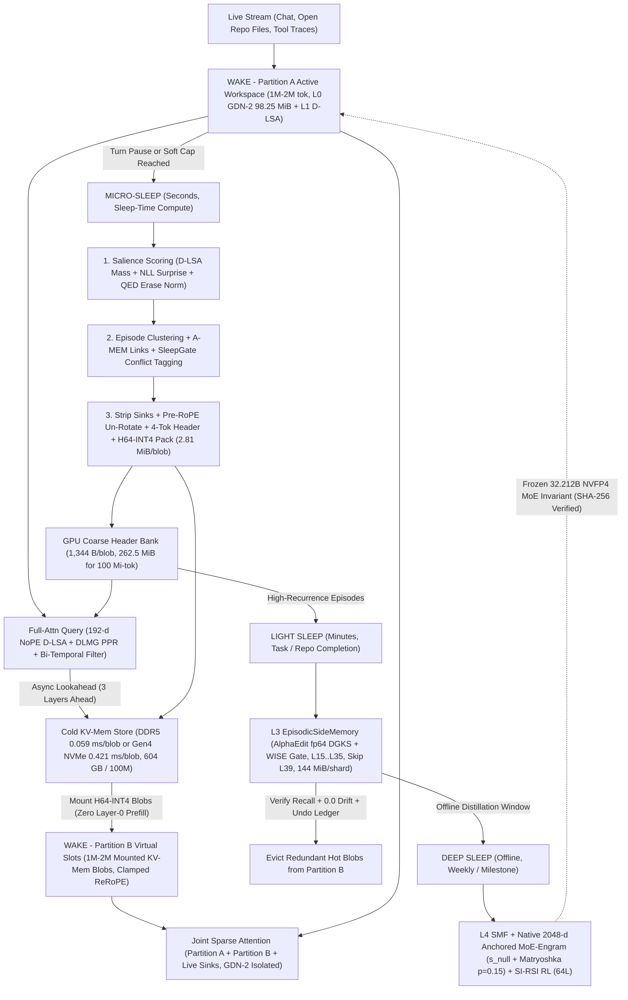

# Latent-Sparse Nested Learning (`LSA-NL`): A Split-Horizon Continuum Memory Architecture for Frozen 64-Layer Hybrid MoEs

> **Document Class:** Research Essay & Architectural Proposal · **Target Architecture:** `Qwen3.6-64L-CoMem` (`LSA-NL` Memory Subsystem)  
> **Primary Backbone:** Frozen `Qwen3.6-35B-A3B-Loop64` (`d=2`, `64L`, `[0,12)×1 + [12,36)×2 + [36,40)×1`, `34.661B` total / `32.212B` frozen MoE, `4.916B → ~5.8–6.1B` active, `10` physical `kv_share=True` full-attention layers with `partial_rotary_factor=0.25` [`64`-d mRoPE + `192`-d NoPE], `48` virtual `GDN-2-1M + QED` linear states)  
> **Development Hardware:** `1× NVIDIA RTX PRO 6000 Blackwell Server Edition` (`GB202`, `sm_120`, **`96 GB GDDR7 ECC`** [`94.97 GiB` CUDA-usable], `512-bit`, **`1,597 GB/s`** peak bandwidth, `24,064` CUDA cores, `600 W` TDP)  
> **Companion Documents:** [Next-Gen Roadmap (`Qwen3.6-64L-CoMem`)](ROADMAP_NEXTGEN_LOOP64_COMEM.md) · [Empirical Report (EN)](EXPERIMENT_REPORT.md) · [Empirical Report (ZH)](EXPERIMENT_REPORT_ZH.md) · [Compute Grant Proposal](COMPUTE_GRANT_PROPOSAL.md) · [SI-RSI Roadmap](RSI_ROADMAP.md)

> [!IMPORTANT]
> **Epistemic Grounding & Zero-Fabrication Contract:** Every quantitative statement in this proposal is explicitly tagged as **`Measured`** (directly verified from repository logs, unit tests, or public Hub commits), **`Derived Formula`** (exact closed-form byte, latency, or parameter accounting from `src/qloop/` constants), **`Published (External)`** (cited primary-source specification or result), **`Estimated`** (engineering projection from measured single-card throughput), or **`Proposed / Kill-Gate`** (falsifiable hypothesis gated by explicit pass/fail criteria before engineering commitment). **Zero unmeasured benchmark results are claimed.**

---

## Abstract

Long-horizon reasoning agents require both high-fidelity working memory over active tool traces and durable episodic recall across months of sessions, repositories, and revised facts. Current approaches fall into two unsatisfactory extremes: stretching a single flat KV cache toward an unrealistic `10M`-token contiguous chat window—which overflows single-GPU memory and drowns linear-attention recurrent states in archival noise—or training pure parametric test-time neural memories (such as *Titans* [1] and *Nested Learning / HOPE* [2]) from scratch, which cannot be grafted non-destructively onto frozen `35B+` Mixture-of-Experts (MoE) weights and suffer capacity-limited proactive interference [3] on verbatim identifiers and code.

We propose **Latent-Sparse Nested Learning (`LSA-NL`)**, a non-destructive **5-Frequency Continuum Memory System (`L0 → L4`)** engineered around a frozen `64`-layer looped hybrid MoE (`Qwen3.6-35B-A3B-Loop64` [4]) on a single **`96 GB GDDR7 ECC`** Blackwell GPU (`1,597 GB/s`). Instead of a flat `10M` window, `LSA-NL` establishes a **realistic `3M–4M` Split-Horizon Logical Context** backed by **`100M+` cold consolidated tokens on Host DDR5 / NVMe SSD**:
1. **Partition A (`1M–2M` Adjustable Live Active Workspace):** Live dialogue, active repository buffers, and current tool traces. Online delta-rule linear attention (`GDN-2-1M + Bounded QED + Soft Neg-Eigval` [5], [6], [7], `48` virtual states = `98.25 MiB`) runs *exclusively* on Partition A, guaranteeing that cold archival memories never pollute the coherent recurrent stream.
2. **Partition B (`1M–2M` GPU-Mounted Consolidated KV-Mem Blob Bank + `100M+` Cold SSD Archive):** Past sessions and learned codebases are consolidated into sink-stripped, Pre-RoPE **`512`-token KV-Mem Blobs** (`2.8125 MiB/blob` in Block-64 Hadamard INT4), indexed by `1,344 B` GPU-resident coarse headers (`250.00 MiB` centroids + `12.50 MiB` bi-temporal/graph metadata = `262.50 MiB` for `100 Mi-tokens` / `604.0 GB` SSD). Retrieved blobs prefetch asynchronously (`0.059 ms/blob` DDR5, `0.421 ms/blob` Gen4 NVMe) and inject directly into sparse attention—eliminating Layer-0 text re-prefill and context-stuffing.

We rigorously decompose cross-session KV-blob splicing error into **Geometric Error ($G$)** and **Dynamic / Sink Error ($D$)**, prove why `Qwen3.6`'s `partial_rotary_factor = 0.25` (`192/256` NoPE dims) and orthogonal `H_64` block isolation neutralize $G$ exactly, present a four-layer defense against $D$, formalize the **Wake → Micro-Sleep → Light Sleep → Deep Sleep** consolidation lifecycle, and specify an immediate `30`-minute zero-training **Kill-Gate (`K0`)** runnable right after `s2_v2@600` to falsify or validate training-free KV-blob injection before writing production storage code.

---

## §1. Thesis & Positioning: Why *Latent-Sparse Nested Learning (`LSA-NL`)* Instead of Pure *Titans / HOPE* or Raw `10M` Context

### 1.1 The Two Structural Failures of Existing Ultra-Long Memory Paradigms

Building a persistent coding and research agent on a single `96 GB GDDR7 ECC` GPU exposes a sharp architectural dilemma. Two competing paradigms dominate current literature, and each fails a non-negotiable engineering constraint when applied to a frozen `34.661B` hybrid MoE backbone:

1. **Failure Mode 1 — The Raw `10M` Contiguous Context Fallacy:** Treating weeks of past sessions, repository snapshots, and API manuals as a single flat autoregressive prefix conflates *active working memory* with *archival episodic memory*. Even with `10` physical `kv_share=True` full-attention layers, a `10M`-token `FP8` cache consumes `100.00 GiB`—exceeding `94.97 GiB` usable GDDR7 before loading a single weight. More subtly, on a hybrid linear-attention backbone (`30` physical / `48` virtual `GDN-2` layers), streaming millions of heterogeneous archival tokens sequentially through fixed-size recurrent state matrices $S_t \in \mathbb{R}^{d_k \times d_v}$ subjects the online delta rule to relentless overwrite churn, erasing the short-horizon syntactic and reasoning trace that linear attention is best suited to maintain.
2. **Failure Mode 2 — The Two Walls of Pure Parametric Neural Memory (*Titans* & *Nested Learning / HOPE*):**
   Google's *Titans* [1] (`arXiv:2501.00663`) and *Nested Learning / HOPE* [2] (`arXiv:2512.24695`, NeurIPS 2025) contribute a profound theoretical unification: **the Continuum Memory System (CMS)**. Nested Learning demonstrates that neural architectures and gradient-based optimizers are instances of the same mathematical primitive—nested, multi-frequency associative memories $\mathcal{M}^{(f_k)}$ that compress distinct context flows at ordered update frequencies $f_0 > f_1 > \dots > f_K$. We adopt the CMS paradigm wholeheartedly, while confronting the **two hard walls** that prevent deploying pure *HOPE*-style neural memory when retrofitting a frozen `35B+` MoE (`Qwen3.6-35B-A3B` [4]):
   - **Wall A — The Pretraining-from-Scratch Requirement:** HOPE's self-modifying test-time meta-optimizers and deep momentum memory modules co-evolve their inner update rules alongside outer token representations from random initialization. Grafting unconstrained self-modifying inner-loop gradient updates onto a frozen `32.212B` NVFP4 MoE fractures the pretrained residual manifold—a failure mode we empirically observed during our v1 HSSD v3.2 ablation (`+0.79`-nat shock and dead vault pages whenever non-identity recurrent dynamics perturb frozen downstream layers; see [Empirical Report](EXPERIMENT_REPORT.md)).
   - **Wall B — Finite-Capacity Saturation and Proactive Interference:** Any purely parametric test-time neural memory compresses an unbounded token stream $N \to \infty$ into a fixed parameter vector $\theta_{\text{mem}} \in \mathbb{R}^{P}$. Beyond the associative capacity limit $N \gtrsim O(P)$, overlapping key-value writes induce **proactive interference** [3] (`SleepGate`, `arXiv:2603.14517`): old associations bleed into newly updated bindings, silently corrupting verbatim identifiers (UUIDs, git SHAs, exact function signatures, line numbers, numeric constants). Software-engineering and scientific agents cannot tolerate lossy neural approximations of a file path or API contract retrieved from three weeks ago.

### 1.2 Split-Horizon Logical Context: Decoupling Coherent Working Streams from Archival KV Blobs

`LSA-NL` resolves both failure modes by replacing a flat `10M` stream with a **Split-Horizon `3M–4M` Logical Context** backed by an unbounded (`100M+`-token) cold archive on Host DDR5 / NVMe SSD:

- **Partition A — Adjustable Live Active Workspace (`1M–2M` tokens):** Holds the live session transcript, open source files, and active tool traces as a causally coherent stream. **`GDN-2-1M + Bounded QED + Soft Neg-Eigval`** [5], [6], [7] (`48` virtual states = `98.25 MiB` exact in `64L`, [`src/qloop/model/gdn2.py`](../src/qloop/model/gdn2.py)) operates **strictly inside Partition A**—never ingesting cold archival KV blobs—paired with exact `D-LSA` [8] (`192`-D NoPE Ward clustering, [`src/qloop/model/lsa.py`](../src/qloop/model/lsa.py)).
- **Partition B — Consolidated KV-Mem Blob Bank (`1M–2M` GPU-mounted virtual slots, backed by `100M+` cold tokens on DDR5 / NVMe SSD):** Past sessions, indexed codebases, verified facts, and completed agent trajectories are consolidated into compact **`512`-token KV-Mem Blobs**. Each blob retains a tiny **`1,344 B` GPU-resident coarse semantic header** (compressed `10L × 64-d fp16` NoPE centroid, keywords/abstraction pointer, and bi-temporal graph metadata), while cold K/V payloads reside on Host DDR5 or NVMe SSD in **Block-64 Hadamard INT4** (`Block64HadamardINT4Cache` in [`src/qloop/model/offload.py`](../src/qloop/model/offload.py), grounded in `TurboQuant` [9]). At query time, `D-LSA` + `DynamicLatentMemoryGraph` (`DLMG`) Personalized PageRank routes to the top-$B$ relevant blobs, prefetches them asynchronously from DDR5/SSD, mounts them into Partition B's virtual KV slots, and injects them directly into full attention—achieving **zero Layer-0 text re-prefill, zero text context-stuffing, and verbatim non-parametric fidelity**.

### 1.3 Realizing a Non-Destructive 5-Frequency Continuum Memory System (`L0 → L4`)

Formally, `LSA-NL` instantiates a five-level Continuum Memory System $\mathcal{C}_{\text{LSA-NL}} = (\mathcal{M}_0, \mathcal{M}_1, \mathcal{M}_2, \mathcal{M}_3, \mathcal{M}_4)$ spanning six orders of magnitude in update frequency—strictly preserving Step-0 IEEE-754 identity (`max_abs_diff == 0.0`) and keeping all `32.212B` frozen NVFP4 MoE experts immutable (SHA-256 verified):

- **L0 (`f = 1 / tok`, Online Active Stream):** `GDN-2-1M + Bounded QED + Soft Neg-Eigval` [5], [6], [7] (`48` virtual linear states = `98.25 MiB` fixed VRAM, `27.53M` adapter params). Solves an online rank-1 L2 regression delta rule with decoupled channel-wise erase/write/decay and query-directed orthogonal erasure, confined exclusively to Partition A:
  $$S_t = \big(I - \hat{k}_t e_t^{\top}\big)\operatorname{Diag}\!\big(\exp(g_t)\big) S_{t-1} + \hat{k}_t (w_t \odot v_t)^{\top}, \qquad e_t = b_t \odot \hat{k}_t + \lambda_h \big(b_t \odot \hat{q}_t - \langle \hat{k}_t, b_t \odot \hat{q}_t \rangle \hat{k}_t\big).$$
- **L1 (`f = 1 / 512 tok`, Active Working Context):** Partition A `D-LSA` [8] (`1M–2M` adjustable active horizon across `10` physical `kv_share=True` layers). Every `512`-token block commits `4:1`-pooled `192`-D NoPE Ward clusters into `BucketIndex`, combining exact local window (`512` tok) + live session sinks (`64` tok) + `Top-64` sparse Ward buckets (`<= 768` packed remote keys/query).
- **L2 (`f = 1 / session` or Micro-Sleep, Consolidated Non-Parametric Episodic Memory):** Partition B **Consolidated KV-Mem Blob Bank** (`1M–2M` GPU-mounted virtual slots, `100M+` cold SSD tokens). Integrates episodic KV clustering/eviction (`EpiCache` [10]), proactive-interference conflict gating (`SleepGate` [3]), shadow/speculative/query-aware paged KV offloading (`ShadowKV` [11], `InfiniGen` [12], `Quest` [13]), and `Spark-X2.6-Recursion` [14]'s `DynamicLatentMemoryGraph` (`HippoRAG 2` Personalized PageRank [15] + `A-MEM` reciprocal semantic links [16] + `Zep / Graphiti` bi-temporal validity intervals [17]).
- **L3 (`f = 1 / task`, Light Sleep — Horizontal KV → Vertical Null-Space Weight Compilation):** `Spark-X2.6-Recursion` [14]'s `EpisodicSideMemory` (`AlphaEdit` Float64 DGKS null-space ridge projection [18] + `WISE` activation scope gate [19], `144 MiB/shard`, attached at the `6` core full-attention boundaries `L15, L19, L23, L27, L31, L35`, **explicitly skipping Coda `L39`** per verified `S2` calibration rule). Compiles high-recurrence KV-Mem Blobs from horizontal $O(N)$ KV lookup into $O(1)$ vertical null-space residual projections satisfying $\Delta W K_0 = 0$ (exact `0.0` general-text drift) with an exact transactional undo ledger.
- **L4 (`f = 1 / week`, Deep Sleep — Sparse Long-Term Parametric & Skill Consolidation):** Native `2048`-D Anchored `MoE-Engram` (`DeepSeek Engram` signed-sqrt RMSNorm QK gating [20] + `SMF` TF-IDF/surprise-weighted sparse memory finetuning [21] + **`s_null` Matryoshka Slicing** [null-sink sigmoid routing + nested capacity slicing + `p=0.15` module dropout]) paired with Tier-1 adaptive native `top_k` (`8 → 10..16`, `0` extra VRAM) and `SI-RSI` (`s4_v2_rl`) verifiable RL on `64L` (`4.916B → ~5.8–6.1B` active), riding strictly atop the frozen `32.212B` `Qwen3.6` MoE prior.

Each adjacent boundary $\Phi_{k \to k+1}: \mathcal{M}_k \to \mathcal{M}_{k+1}$ implements an explicit frequency-matched consolidation operator—turning high-frequency context flows into lower-frequency, higher-leverage representations without ever mutating the immutable `32.212B` MoE prior (`L0/L1 → L2` via Micro-Sleep KV-blob packing; `L2 → L3` via Light Sleep `AlphaEdit` null-space compilation; `L3 → L4` via Deep Sleep `SMF` / `MoE-Engram` + `SI-RSI`).

#### Table 1.1 — Architectural Positioning: `LSA-NL` vs. *Titans / HOPE* and Raw `10M` Contiguous Context

| Dimension | Raw `10M` Contiguous Window | Pure *Titans* [1] / *HOPE* [2] | **`LSA-NL` (`Qwen3.6-64L-CoMem`)** |
| :--- | :--- | :--- | :--- |
| **Memory Representation** | Flat monolithic KV stream (`10M` raw tokens) | Fixed-size parametric neural memory MLPs + self-modifying optimizers | **5-Frequency Hybrid CMS (`L0 → L4`):** Split-Horizon `3M–4M` KV (`100M+` cold SSD) + `GDN-2` + `ESM` + `MoE-Engram` |
| **Frozen `35B` MoE Retrofitting** | Possible, but `100 GiB` FP8 KV **OOMs `96 GB` GPU** | **Infeasible without pretraining** (self-modifying rules break frozen residual manifold) | **100% Non-Destructive** (`0.0` Step-0 identity; `32.212B` NVFP4 MoE cryptographically frozen) |
| **Recurrent State Integrity (`GDN-2`)** | Polluted by millions of archival/cold tokens | Shared parametric capacity suffers overwrite churn | **Strictly Isolated to Partition A** (`98.25 MiB` `GDN-2` never sees cold Partition-B blobs) |
| **Verbatim Code / Identifier Recall** | Exact if in window, prohibitive KV/compute cost | Degrades under capacity saturation & **proactive interference** [3] | **Lossless Non-Parametric (`L1`/`L2`)** + Bi-Temporal `[t_valid, t_invalid)` conflict masking [3], [17] |
| **Cross-Session Reuse Latency** | Full Layer-0 re-prefill on every new session | Single forward pass, but lossy on cold sessions | **Zero Layer-0 Re-Prefill:** Direct Pre-RoPE `H64-INT4` KV-blob mount (`0.059–0.421 ms/blob`) |
| **Long-Term Knowledge Compilation** | None (KV grows forever) | Implicit gradient compression only | **Explicit Multi-Tier Graduation:** `L2` KV Blobs → `L3` `AlphaEdit` (`0.0` drift) → `L4` `SMF`/`MoE-Engram` |

---

## §2. Exact Split-Horizon Memory, Bandwidth & SSD Tiering Math (`3M–4M` Logical / `100M` Cold SSD)

Every byte and latency figure in this section is a **`Derived Formula`** directly anchored to `Qwen3.6-35B-A3B`'s exact physical KV geometry (`L_phys = 10` physical full-attention layers via `kv_share=True`, `H_kv = 2` GQA KV heads, `D = 256` head dim) and our implemented quantization primitives in [`src/qloop/model/offload.py`](../src/qloop/model/offload.py) (`FP8KVCacheQuantizer`, `Block64HadamardINT4Cache`) and [`src/qloop/model/lsa.py`](../src/qloop/model/lsa.py) (`LSAConfig`, `block_size = 512`). Throughout, `1M` denotes $2^{20} = 1{,}048{,}576$ tokens (consistent with `FP8KVCacheQuantizer.tier1_1m_ledger_bytes` in `offload.py:616-623`) and `GiB`/`MiB` denote binary units ($2^{30}, 2^{20}$), while SSD/PCIe bandwidth and capacity also state decimal `GB`/`GB/s` ($10^9$) explicitly.

### 2.1 Closed-Form KV-Mem Blob & GPU Header Accounting (`Derived Formula`)

A canonical **KV-Mem Blob** encapsulates $B_{\text{tok}} = 512$ tokens (`128` four-token micro-pages of `2,304 B` per layer in `Block64HadamardINT4Cache`, `offload.py:121-122`) across all $L_{\text{phys}} = 10$ physical `kv_share` layers:

$$N_{\text{scalars}}^{\text{blob}} = L_{\text{phys}} \cdot 2_{(K,V)} \cdot H_{\text{kv}} \cdot D \cdot B_{\text{tok}} = 10 \times 2 \times 2 \times 256 \times 512 = 5{,}242{,}880\ \text{scalars}.$$

1. **FP8 E4M3 Payload (`1.00 B/scalar`, `FP8KVCacheQuantizer`):**
   $$S_{\text{blob}}^{\text{FP8}} = 5{,}242{,}880\ \text{B} = \mathbf{5.00\ \text{MiB}}\quad (512.0\ \text{KiB/layer}).$$
2. **Block-64 Hadamard INT4 Payload (`36 B / 64 scalars = 0.5625 B/scalar`, `Block64HadamardINT4Cache` [9]):**
   Each 64-scalar group packs `32 B` of unsigned 4-bit nibbles + `2 B` `fp16` scale + `2 B` `fp16` min (`GROUP_PACKED_BYTES = 36`, `offload.py:29`):
   $$S_{\text{blob}}^{\text{H64}} = 5{,}242{,}880 \times \frac{36}{64} = 2{,}949{,}120\ \text{B} = \mathbf{2.8125\ \text{MiB}}\ \ (\approx \mathbf{2.81\ \text{MiB}},\ 288.0\ \text{KiB/layer} = 128 \times 2{,}304\ \text{B}).$$
3. **GPU-Resident Coarse Semantic Header (`1,344 B` / blob):**
   Each cold blob leaves a compact routing descriptor pinned in GDDR7 VRAM:
   $$S_{\text{hdr}} = \underbrace{L_{\text{phys}} \cdot d_{\text{idx}} \cdot 2\ \text{B}}_{10 \times 64 \times 2 = 1{,}280\ \text{B}\ (\text{fp16 } 10\text{L NoPE centroids})} + \underbrace{64\ \text{B}}_{\substack{\text{bi-temporal } [t_{\text{valid}}, t_{\text{invalid}}),\ \text{salience}, \\ \text{DLMG CSR ptr},\ 4\text{-tok header IDs},\ \text{SSD LBA}}} = \mathbf{1{,}344\ \text{B}}.$$

### 2.2 Streaming Fetch Latency & `async_lookahead` Overlap (`Derived Formula`)

Streaming one complete `10`-layer `H64-INT4` blob (`2,949,120 B`) from tiered host storage obeys exact bandwidth bounds:

- **PCIe Gen4 ×4 NVMe SSD (`7.0 GB/s` sequential read):**
  $$t_{\text{NVMe}}^{\text{blob}} = \frac{2{,}949{,}120\ \text{B}}{7.0 \times 10^9\ \text{B/s}} = \mathbf{0.421\ \text{ms/blob}}\quad (\mathbf{0.0421\ \text{ms/layer}}).$$
- **Pinned Host DDR5 DMA (`50.0 GB/s` sustained PCIe Gen5 ×16 / DDR5 bandwidth):**
  $$t_{\text{DDR5}}^{\text{blob}} = \frac{2{,}949{,}120\ \text{B}}{50.0 \times 10^9\ \text{B/s}} = \mathbf{0.059\ \text{ms/blob}}\quad (\mathbf{0.0059\ \text{ms/layer}}).$$

**Why Latency Hides Cleanly Behind `3` Interleaved `GDN-2 + MoE` Layers (`async_lookahead`):**
In `Qwen3.6-35B-A3B`, physical full-attention layers occur every `4`th layer (`L3, L7, L11, L15, L19, L23, L27, L31, L35, L39`), separated by `3` consecutive `GDN-2 + MoE` layers. Using `Block64HadamardINT4Cache.prefetch_micro_pages(layer_idx, page_indices, target_device=None)` (`offload.py:321-355`, with `prefetch_layers_ahead=3` configured via `Block64HadamardINT4Cache.__init__` at `offload.py:137`) extended to an async `io_uring`/GPUDirect/pinned-host staging queue:
1. Full-attention layer $\ell$ (or early query lookahead at layer $\ell - 3$) issues the next layer's `288 KiB/blob` slice while `3` full `GDN-2 + MoE` layers execute (`~180M` active NVFP4 weights + Triton `fla` DPLR scans).
2. Crucially, **cold-blob fetch latency is paid ONLY on cold-miss mount events**—not on every generated decode token! Once a retrieved set of $B$ blobs (e.g., $B = 16$ blobs = `8,192` tokens = `45.0 MiB` H64-INT4, taking `0.94 ms` from DDR5 or `6.74 ms` from NVMe total across all 10 layers) is mounted into Partition B's GPU-resident virtual slots (`1M–2M` capacity), all subsequent tokens in the multi-hundred-token reasoning turn attend to those mounted blobs directly at **`1,597 GB/s` GDDR7 ECC** bandwidth with zero PCIe/SSD traffic.

### 2.3 `100M`-Token Cold NVMe Archive Scaling (`Derived Formula`)

Scaling the cold archive to **`100 Mi-tokens`** ($100 \times 2^{20} = 104{,}857{,}600$ consolidated tokens = **`204,800 × 512`-token blobs**):
- **Cold NVMe SSD Footprint:** $204{,}800 \times 2{,}949{,}120\ \text{B} = 603{,}979{,}776{,}000\ \text{B} = \mathbf{604.0\ \text{GB}}$ decimal (`562.50 GiB` binary)—easily fitting on a single consumer/server `1–2 TB` NVMe SSD! *(For decimal `100,000,000` tokens = `195,313` blobs: `576.0 GB` / `536.44 GiB` SSD.)*
- **GPU-Resident Coarse Header Bank:**
  - `10L × 64-d fp16` semantic centroids: $204{,}800 \times 1{,}280\ \text{B} = 262{,}144{,}000\ \text{B} = \mathbf{250.00\ \text{MiB}}$ (**`0.244 GiB`**) exact!
  - `64 B/blob` bi-temporal + `DLMG` graph metadata: $204{,}800 \times 64\ \text{B} = \mathbf{12.50\ \text{MiB}}$ (`0.012 GiB`).
  - **Combined GPU Catalog for `100 Mi-tokens`:** **`262.50 MiB` (`0.256 GiB`)** total (`250.34 MiB` / `0.244 GiB` for decimal `100M` tokens = `195,313` blobs)—less than **`0.27%`** of our `94.97 GiB` CUDA-usable GDDR7 ECC!
- **Exhaustive `100M`-Token GPU Header Routing Latency (`Derived Formula`):** Scoring a query against *all* `204,800` coarse `64`-D `fp16` headers at one physical full-attention layer reads exactly $204{,}800 \times 64 \times 2\ \text{B} = \mathbf{25.00\ \text{MiB}}$ (`26.21 MB`) from GDDR7 ECC—taking **`0.0164 ms/layer`** at `1,597 GB/s` peak (`0.0234 ms/layer` at `70%` realized bandwidth, or **`~0.23 ms` total across all `10` layers**), even before applying two-level tree routing (`search="tree"` in `src/qloop/model/lsa.py`).

### 2.4 Realistic Single-GPU Operating Envelopes (`1× 96 GB GDDR7 ECC`, `94.97 GiB` Usable)

Using pure NVFP4 base weights (`21.85 GiB` `Measured`; add `+2.24 GiB` for the `24.09 GiB` mixed NVFP4/FP8 HF checkpoint), exact `48`-state `64L` `GDN-2` recurrent state (`98.25 MiB = 0.096 GiB`, rounded to `0.10 GiB` in table sums), and `0.3525 GiB / 1M` Partition-A routing metadata (`0.3125 GiB` `bf16` Ward centroids + `~0.04 GiB` compacted `int8` `BucketIndex` after fixing `lsa.py:728-768`) plus `0.0051–0.2563 GiB` GPU coarse headers (`4,096` mounted standalone blobs up to `204,800` `100 Mi-tok` SSD blobs), Table 2.1 details our three target operating envelopes alongside raw `10M` and `Inkling 2 Mini` [22] reference points.

#### Table 2.1 — Exact Single-GPU GDDR7 ECC Memory Ledger Across Operating Envelopes (`Derived Formula` + `Measured` Weights)

| Operating Envelope (`64L d=2`, `batch=1`) | Partition A (Active KV) | Partition B (Mounted KV) | Total KV (GiB) | NVFP4 Wts + `GDN-2` (GiB) | Compact Index + GPU Headers (GiB) | **Total GDDR7 (GiB)** | **Free on `94.97 GiB`** | Cold Archive (SSD) |
| :--- | :---: | :---: | :---: | :---: | :---: | :---: | :---: | :---: |
| **Env. A — `3M` Precision Split** (`1M` FP8 + `2M` H64-INT4) | `10.00` (FP8) | `11.25` (H64) | **`21.25`** | `21.85 + 0.10` | `0.36–0.61` *(`0.3525` + hdrs)* | **`43.55–43.81`** *(`~43.6–43.8`)* | **`~51.2–51.4 GiB`** *(`51.16–51.42`)* | Optional `100M` (`604 GB`) |
| **Env. B — `4M` Max Logical Split** (`2M` H64 + `2M` H64) | `11.25` (H64) | `11.25` (H64) | **`22.50`** | `21.85 + 0.10` | `0.71–0.96` *(`0.7050` + hdrs)* | **`45.16–45.41`** *(`~45.2–45.4`)* | **`~49.6–49.8 GiB`** *(`49.56–49.81`)* | Optional `100M` (`604 GB`) |
| **Env. C — `2M` Hot + `100 Mi-tok` Cold SSD** (`1M` H64 + `1M` H64) | `5.625` (H64) | `5.625` (H64) | **`11.25`** | `21.85 + 0.10` | `0.61` *(`0.3525 + 0.2563`)* | **`33.81`** *(`~33.8`)* | **`~61.2 GiB`** *(`61.16`)* | **`100M` (`604.0 GB`)** |
| *Contrast: Raw `10M` Contiguous FP8 (`10L`)* | `100.00` (FP8) | — | `100.00` | `21.85 + 0.10` | `~3.53` | **`125.5` (OOM)** | `-30.5 GiB` | None |
| *Contrast: `Inkling 2 Mini` (`1M` F16, `Published` [22])* | `32.00` (F16) | — | `32.00` | `~18.6` (`~20 GB`) + `0.16` SWA | `0.00` | `~50.8` *(at `1M` only)* | `~44.2 GiB` | None reported |

> [!TIP]
> **Headroom for Full 5-Level Stack:** Even under the `4M` Split-Horizon envelope (`45.16–45.41 GiB` total), **`~49.6–49.8 GiB` of GDDR7 ECC remains completely free**—amply accommodating `EpisodicSideMemory` (`0.141 GiB/shard`), `AnchoredMoEEngram` (`0.65–0.99 GiB` NVFP4), `DLMG` sparse adjacency tables, CUDA graphs, and multi-agent request batching on a single server card.

---

## §3. The Hard Problem of Cross-Session KV-Blob Injection: Geometric Error ($G$) vs. Dynamic Error ($D$)

Injecting precomputed KV-Mem Blobs from past sessions directly into live attention without Layer-0 text re-prefill is the single highest-leverage mechanism in `LSA-NL`—and the exact place where sloppy designs fail. We refuse to hand-wave cross-session KV splicing. Drawing directly on the empirical and theoretical literature on non-prefix KV reuse—**`CacheBlend`** [23] (`arXiv:2405.16444`, EuroSys 2025), **`EPIC`** [24] (`arXiv:2410.15332`, ICML 2025), **`TurboRAG`** [25] (`arXiv:2410.07590`, EMNLP 2025), and **`Block-Attention`** [26] (`arXiv:2409.15355`, ICLR 2025)—we decompose spliced-KV fidelity loss into two orthogonal error terms and solve each explicitly.

### 3.1 Exact Error Decomposition: Geometric ($G$) vs. Dynamic / Sink ($D$)

Consider a `512`-token blob $\mathcal{B}_m$ originally prefilled during past session $s$ at absolute positions $P_s = [p_s, p_s + 512)$ behind past prefix $X_s$, yielding layer-$\ell$ cached tensors $(K_m^{(s)}, V_m^{(s)})$. When mounted later into live session $u$ behind an unrelated active Partition-A context $X_u$ (length $T_A$), a live query $q_t^{(u)}$ attends jointly over $(K_A, V_A) \cup \{(K_m, V_m)\}$. Let $o_t^*$ denote the full contiguous re-prefill oracle output obtained by concatenating the raw text of $\mathcal{B}_m$ ahead of $X_u$ and running all layers from Layer 0, and let $\tilde{o}_t$ denote the spliced Partition-B output. The total attention discrepancy splits cleanly:

$$\|\tilde{o}_t - o_t^*\|_2 \;\le\; \underbrace{\mathcal{E}_{\text{geom}}\!\left(\Delta\theta_{\text{RoPE}}(t, P_s)\right)}_{\text{Geometric / Positional Error } (G)} \;+\; \underbrace{\mathcal{E}_{\text{dyn}}\!\left(\Delta K_m^{(u|s)},\, \Delta V_m^{(u|s)},\, \Delta s_{\text{sink}}\right)}_{\text{Dynamic Cross-Attention \& Sink Error } (D)}.$$

- **Geometric Error ($G$):** Standard RoPE caches store post-rotation keys $K_{\text{rot}}^{(s)} = R(P_s \omega) K_{\text{rot}}^{\text{pre}}$. Splicing $\mathcal{B}_m$ into session $u$ produces nonsensical or out-of-distribution relative angles $(t - p_s)\omega$—including negative relative offsets if $p_s > t$ or frequencies far beyond the pretrained `max_position_embeddings` arc—collapsing rotary attention logits even when token semantics are identical.
- **Dynamic / Sink Error ($D$):** Even if positional phases are perfectly repaired ($G = 0$), two residual discrepancies remain across layers $\ell \ge 1$:
  1. *Spurious Internal Attention Sinks (`EPIC` [24]):* Autoregressive Transformers dump large softmax mass onto the first `1–4` sequence tokens (attention sinks). If a cached blob preserves its original session's `[0:4)` tokens, splicing introduces anomalous mid-context high-norm attractors that steal probability mass from both the live session's sinks and target answer tokens.
  2. *Missing Cross-Context Layer Conditioning (`CacheBlend` [23], `Block-Attention` [26]):* Inside layers $\ell \ge 1$, the hidden states generating $(K_m^{(s)}, V_m^{(s)})$ attended to old prefix $X_s$ rather than live prefix $X_u$. Tokens with strong cross-document dependencies (e.g., anaphora, shadowed identifiers, or cross-file type references) exhibit non-zero key/value deviation $(\Delta K_m, \Delta V_m)$ relative to contiguous re-prefill.

### 3.2 Why `Qwen3.6-35B-A3B` Is Uniquely Privileged for Eliminating Geometric Error ($G$)

Standard full-RoPE models (`partial_rotary_factor = 1.0`, e.g., Llama-3) apply rotary phase across 100% of every key vector, making position-independent KV reuse fragile. **`Qwen3.6-35B-A3B` [4] possesses three structural properties that already align with our codebase (`src/qloop/model/`) to crush Geometric Error ($G$) cleanly:**

1. **`75%` Native Position-Free NoPE Key Subspace (`192/256` dims):** `Qwen3.6` enforces `partial_rotary_factor = 0.25` (`head_dim = 256`, `rotary_dim = 64`), partitioning every key and query vector into:
   $$k = \big[\,\underbrace{k_{\text{rot}} \in \mathbb{R}^{64}}_{\text{mRoPE } [0:64)},\;\; \underbrace{k_{\text{nope}} \in \mathbb{R}^{192}}_{\text{Position-Free NoPE } [64:256)}\,\big].$$
   Three-quarters of every attention dot product $\langle q_{\text{nope}}, k_{\text{nope}} \rangle$ is **strictly position-invariant by architecture**. Moreover, `D-LSA` (`index_on="nope"`, [`src/qloop/model/lsa.py:154`](../src/qloop/model/lsa.py#L154)) computes `64`-D latent projections and Ward centroids *exclusively* on `[64:256)`—meaning **a blob's `D-LSA` routing centroids are bit-for-bit invariant to which session or virtual Partition-B slot it occupies!**
2. **Exact Block-64 Orthogonal Separation Inside `H_64` Compression:** Our `walsh_hadamard_block(x, block_size=64)` ([`src/qloop/model/offload.py:32-56`](../src/qloop/model/offload.py#L32-L56)) applies block-diagonal $I_4 \otimes H_{64}$. Group 0 transforms *only* `[0:64)` (mRoPE), while Groups 1–3 transform *only* `[64:256)` (NoPE), guaranteeing zero cross-subspace leakage (`Fix C2`, `< 1e-12` commutativity error in `fp64`).
3. **Pre-RoPE Archival Storage + Virtual Partition-B Clamped ReRoPE ([`src/qloop/model/pos_rerope.py`](../src/qloop/model/pos_rerope.py)):**
   - During Micro-Sleep consolidation, we **un-rotate** only the `64`-d rotary slice by the inverse per-token rotation $R(-(p_s + j)\omega) = R((p_s + j)\omega)^{\top}$ via `apply_partial_rope_k(k, -k_positions)` (`pos_rerope.py:166-195`):
     $$k_j^{\text{pre}} = \big[R(-(p_s + j)\omega)\, k_{\text{rot}}^{(s)}(j),\;\; k_{\text{nope}}^{(s)}(j)\big], \qquad j \in \{0, \dots, 511\},$$
     and store $(k^{\text{pre}}, v)$ packed in `H_64` INT4.
   - At Partition-B mount time, blob $m$ receives a clean **virtual Partition-B slot position** $p_{\text{virt}}(m, j) = P_{\text{partB}}(m) + j$, preserving exact intra-blob syntax distances $(j_1 - j_2)$ while mapping cross-partition query-to-blob distance $\Delta = t - p_{\text{virt}}$ through our smooth $C^1$ **`clamped_relative_distance`** (`pos_rerope.py:89-124`, `linear_ceil = 131,072`, `log_scale = 32,768`, `max_pos = 240,000`—strictly inside `Qwen3.6`'s pretrained `262,144` arc!):
     $$\Delta_{\text{eff}}(\Delta) = \begin{cases} \Delta, & 0 \le \Delta \le L_c, \\ \min\!\left(L_{\max},\; L_c + S_c \ln\!\left(1 + \dfrac{\Delta - L_c}{S_c}\right)\right), & \Delta > L_c. \end{cases}$$
   - **Group-0 Isolation & Exact `H_64` Commutativity:** Because $H_{\text{blk}} = \operatorname{diag}(H_{64}, H_{64}, H_{64}, H_{64})$ is block-diagonal self-adjoint orthogonal ($H_{64}^{\top} = H_{64}$, $H_{64}^2 = I_{64}$) and partial RoPE $R_{\text{part}}(\theta) = \operatorname{diag}(R_{64}(\theta), I_{192})$ acts strictly on Group 0, un-rotating by the blob base offset $p_s$ (storing local intra-blob phase $R(j\omega) k_{\text{rot}}^{\text{pre}}$ or pure Pre-RoPE $k^{\text{pre}}$) means **ONLY Group 0 (`64/256 = 25%` of `K`) ever undergoes mount-time ReRoPE phase alignment**, while **`Groups 1..3` (`192` NoPE dims = `75%` of `K`) remain permanently in `H_64` space** and are scored directly via $\langle H_{64} q_{\text{nope}}, H_{64} k_{\text{nope}} \rangle = \langle q_{\text{nope}}, k_{\text{nope}} \rangle$ (`gather_kv_and_reconstruct_v`, `offload.py:445-514`) with zero inverse transform on keys!
   - Query-side differential rotation (`apply_partial_rerope_q`, `pos_rerope.py:198-261`) leaves all `192` NoPE dims untouched (`torch.equal`) while placing the `64` rotary dims cleanly inside the pretrained long-range band—**eliminating Geometric Error ($G$) cleanly.**

### 3.3 Explicit Four-Layer Defense Against Dynamic & Sink Error ($D$)

Rather than assuming $D \approx 0$, `LSA-NL` stacks four progressive defenses ordered from zero-cost to bounded-cost:

1. **Defense 1 — Original-Session Sink Stripping (`EPIC` LegoLink Rule [24]):** Before sealing any KV-Mem Blob, strip the original session's initial `[0:4)` attention-sink tokens (and system-prompt anchor span). When mounted into Partition B, softmax normalizes cleanly against the **live session's** Partition-A sinks (`sinks = 64` in `LSAConfig`), eliminating mid-context sink competition.
2. **Defense 2 — Self-Contained `4`-Token Boundary & Abstraction Header + Bi-Temporal Conflict Masking (`TurboRAG` [25] + `Zep/Graphiti` [17] + `SleepGate` [3]):** Consolidate blobs along natural semantic boundaries (file/function/turn splits) rather than blind fixed cuts, prefixed with a compact `4`-token **Boundary & Abstraction Header** (canonical entity/file/symbol identifier + boundary delimiter) so keys/values inside the blob are self-anchored without requiring the old prefix $X_s$. Every blob header carries bi-temporal validity `[t_valid, t_invalid)` [17] maintained by a `SleepGate` [3] conflict tagger so superseded code edits or retracted facts are masked out *before* attention softmax—neutralizing proactive interference directly.
3. **Defense 3 — Selective High-Variance Token Refresh (`CacheBlend` [23] Escalation):** When a query performs dense multi-hop synthesis across multiple Partition-B blobs, measure first-global-layer key/value deviation (HKVD) on blob boundary/anchor tokens and selectively refresh ONLY the top **`5%–10%`** highest-variance tokens across downstream layers (`CacheBlend` [23])—recovering cross-blob conditioning at `~10×–18×` lower compute than Layer-0 text re-prefill.
4. **Defense 4 — Bounded `Block-Attention` Spliced-KV Adapter Calibration (`~2–4 h` Single GPU, Contingency Only [26]):** *If and only if* our zero-training Kill-Gate `K0` (§5.1) reveals non-trivial Dynamic Error ($D$) that Defenses 1–3 cannot keep within `>= 92%` of the contiguous oracle, we run a targeted `2–4 h` single-card calibration following **`Block-Attention`** [26]: training **ONLY** `D-LSA` indexers + global `q/k/v/o` adapters via **APOLLO** [27] on spliced multi-document mixtures while keeping all `32.212B` MoE experts **100% frozen** (SHA-256 verified) and `GDN-2` weights untouched.

---

## §4. Consolidation Lifecycle ("Wake → Micro-Sleep → Light Sleep → Deep Sleep")

Borrowing the biological division of labor formalized across *Sleep-time Compute* [28] (`arXiv:2504.13171`), *EpiCache* [10], *SleepGate* [3], and *Nested Learning* [2], `LSA-NL` orchestrates memory across **four asynchronous lifecycle phases** running over the identical frozen `Qwen3.6-64L` weights.

### 4.1 Phase I — Wake (Online Serving, Millisecond Scale)
- **Active Stream Processing (`L0` + `L1`):** Incoming user tokens, file edits, and tool responses flow sequentially through Partition A (`GDN-2-1M + QED` `98.25 MiB` recurrent state + `D-LSA` `512`-token Ward blocks). Cold Partition-B blobs are **never** fed into `GDN-2`, preserving clean delta-rule tracking over active syntax and reasoning chains.
- **Asynchronous Split-Horizon Retrieval (`L2`):** At each physical full-attention layer, untied per-pass `D-LSA` query indexers score (i) Partition-A Ward centroids and (ii) the GPU-resident `262.5 MiB` coarse blob header catalog (`100M` cold tokens). Top-$k$ coarse seeds expand `1–2` hops across `DLMG` via `HippoRAG 2` Personalized PageRank [15], prune any blobs with $t_{\text{invalid}} \le t_{\text{now}}$ (`Zep/Graphiti` [17]), and asynchronously prefetch cache-miss blobs (`async_lookahead`, 3 layers ahead) from Host DDR5 (`0.059 ms/blob`) or NVMe SSD (`0.421 ms/blob`) into Partition B's GPU ring buffer. Joint sparse attention then attends over Partition A + Partition B + live sinks using clamped ReRoPE (`pos_rerope.py`)—with zero Layer-0 text re-prefill.

### 4.2 Phase II — Micro-Sleep (Seconds, Turn Pause / Budget Pressure)
Grounded in *Sleep-time Compute* [28] (shifting memory organization into idle time between turns), *EpiCache* [10], and *SleepGate* [3]:
1. **Multi-Signal Salience Scoring:** Score outgoing Partition-A `512`-token blocks by combining cumulative `D-LSA` attention mass (`EpiCache` [10]), token prediction surprise (high cross-entropy regions identifying novel facts/bugs), and `GDN-2+QED` erase/write gate energy. Evict transient tool-log boilerplate outright instead of polluting the cold store.
2. **Semantic Episode Clustering & Proactive-Interference Resolution:** Cluster retained blocks into topic/file episodes (`EpiCache` [10]), wire reciprocal `A-MEM` semantic edges [16] in `DLMG`, and run `SleepGate` [3] conflict detection against existing GPU headers. Whenever a newly edited function or corrected fact supersedes an older blob, stamp `t_invalid = t_now` on the older blob's `64 B` metadata tail so subsequent queries automatically resolve to the latest truth without deleting audit history.
3. **Pre-RoPE `H64-INT4` Sealing & Tier Spill:** Strip `[0:4)` sinks (`EPIC` [24]), un-rotate `[0:64)` rotary slices (`apply_partial_rope_k(k, -p)`), attach the `4`-token Boundary & Abstraction Header (`TurboRAG` [25]), pack via `walsh_hadamard_block` + `pack_group64_int4` (`2.8125 MiB/blob`), spill cold payloads asynchronously to Host DDR5 / NVMe SSD, and commit the `1,344 B` coarse header into the GPU catalog.

### 4.3 Phase III — Light Sleep (Minutes, Task / Repository Completion)
When `DLMG` access counters show that specific KV-Mem Blobs (e.g., core repository invariants, recurring MCP tool schemas, persistent user preferences) are repeatedly mounted across $\ge K_{\text{grad}}$ independent sessions, Light Sleep **graduates them from horizontal KV memory (`L2`) into vertical weight memory (`L3`)**:
- Compute closed-form residual updates into `Spark-X2.6-Recursion` [14]'s **`EpisodicSideMemory`** (`144 MiB/shard`, attached at the `6` core boundaries `L15, L19, L23, L27, L31, L35`, **strictly skipping Coda `L39`** per the verified `S2` rule) via Float64 DGKS **`AlphaEdit`** null-space ridge projection [18] ($\Delta W K_0 = 0$) guarded by **`WISE`** scope gates [19].
- Run an automated post-consolidation verification check: confirm recall on the graduated fact/schema, confirm `0.000` general-text locality drift on held-out calibration text, commit the delta into the transactional **undo ledger** (allowing exact millisecond rollback if a project is archived or a fact is retracted), and free the now-redundant hot KV slots in Partition B.

### 4.4 Phase IV — Deep Sleep (Offline, Periodic Consolidation)
Across weeks of accumulated experience, Deep Sleep consolidates durable domain skills and high-frequency factual priors into **`L4`** without touching the frozen `32.212B` NVFP4 MoE backbone:
- **Sparse Parametric Memory Consolidation:** Apply **`SMF`** [21] (TF-IDF / surprise-weighted sparse slot selection preventing catastrophic forgetting) to update native `2048`-D **Anchored `MoE-Engram`** (`L15..L35`, `12` virtual visits in `64L`) protected by all 5 verified shields (`gamma = 0` Step-0 identity, `min_active_pos` prefix suppression, `DeepSeek Engram` signed-sqrt RMSNorm QK gating [20], `WISE` scope + `<= 3%` relative norm cap, and independent sigmoid routing with **`s_null` Matryoshka Slicing** [null-sink competition + nested capacity slicing + `p = 0.15` module dropout] guaranteeing `CE_off <= 0.005` nats).
- **Verifiable Skill Scaling (`SI-RSI`):** Execute `s4_v2_rl` (GRPO/DAPO + surgical `[loop_adapters, router]` unlikelihood) focused on `64L (d=2)` alongside Tier-1 adaptive native `top_k` (`8 → 10..16`, `4.916B → ~5.8–6.1B` active), verified against 13-gram-decontaminated coding, math, and clean MCP benchmarks.

---

## §5. Empirical Falsification Protocol & Immediate Zero-Training Kill-Gates (Right After `s2_v2@600`)

Research proposals without falsification gates risk months of sunk systems engineering on an invalid assumption. The single load-bearing hypothesis of `LSA-NL` is whether **Pre-RoPE, sink-stripped `H64-INT4` KV-Mem Blobs from prior sessions can be injected into Partition B on `Qwen3.6-64L` with high fidelity and zero (or minimal) retraining**. We test this **first**—immediately upon `s2_v2_joint_bptt@600` completion, before building `KVMemBlobStore` or `DLMG`.

### 5.1 Immediate Zero-Training Kill-Gate `K0` (`30 min` Single-GPU, ZERO Retraining)

- **Checkpoint & Hardware:** Promoted `s2_v2_joint_bptt@600` checkpoint (`64L d=2`, `GDN-2-1M + QED` + `D-LSA`), evaluated on `1× NVIDIA RTX PRO 6000 Blackwell Server Edition (96 GB GDDR7 ECC, 1,597 GB/s)` in **`~30` wall-minutes** with **zero gradient updates**.
- **Evaluation Suite:** Multi-hop needle-in-a-haystack and real multi-file codebase QA (synthesizing definitions, callers, and config values spread across `2–4` independent historical sessions) swept across total effective context horizons of **`18K`, `64K`, `256K`, and `1M` tokens**.
- **Four Strictly Paired Experimental Arms:**
  1. **Arm (a) — Contiguous Prefill Oracle (`100%` Reference):** Concatenates all historical sessions and live prompt into one continuous Layer-0 prefill (`D-LSA` sparse/dense).
  2. **Arm (b) — Naive Spliced KV *(Negative Control — Expected Failure)*:** Prefills each session independently and concatenates raw post-RoPE KV tensors directly (no Pre-RoPE un-rotation, no sink stripping). Measures raw $G + D$ failure severity.
  3. **Arm (c) — Training-Free `LSA-NL` Partition-B Injection:** Prefills historical sessions independently, strips `[0:4)` sinks (`EPIC` [24]), un-rotates `[0:64)` rotary slices (`apply_partial_rope_k(k, -p)`), attaches `4`-token boundary headers, packs via `Block64HadamardINT4Cache`, mounts into Partition B with clamped ReRoPE (`pos_rerope.py`) + `D-LSA` NoPE routing, and isolates `GDN-2` strictly to live Partition A.
  4. **Arm (d) — Arm (c) + `5%` `CacheBlend` Selective Refresh [23]:** Recomputes only the top-`5%` highest-HKVD tokens per mounted blob to measure exact Dynamic Error ($D$) recoverability.

#### Table 5.1 — `Kill-Gate K0` Quantitative Decision Tree (`Proposed / Kill-Gate`)

| Observed Outcome on `18K / 64K / 256K / 1M` Multi-Hop QA | Diagnosis | Mandatory Engineering Decision |
| :--- | :--- | :--- |
| **`Arm (c) >= 92%` of Oracle `Arm (a)`** AND NLL gap `<= 0.05` nats | `Qwen3.6` `192`-d NoPE + Pre-RoPE + sink-strip neutralize both $G$ and $D$ natively | **GREEN — Training-Free Deployment:** Ship zero-retrain `KVMemBlobStore` + `DLMG` directly (Phase 2B); zero calibration GPU-h needed. |
| **`75% <= Arm (c) < 92%`** AND **`Arm (d) >= 92%`** of Oracle | $G \approx 0$, moderate cross-blob Dynamic Error $D$ isolated to boundary/entity tokens | **YELLOW-A — Selective Refresh:** Enable `5%` `CacheBlend` [23] selective token refresh on multi-hop Partition-B mounts (`~10×–18×` faster than Layer-0 re-prefill). |
| **`75% <= Arm (c) < 92%`** AND **`Arm (d) < 92%`** of Oracle | Non-trivial layer-conditioning mismatch $D$ under stock frozen attention projections | **YELLOW-B — Lightweight `Block-Attention` [26] Calibration:** Run `2–4 h` single-GPU APOLLO [27] calibration training *only* `D-LSA` indexers + global `q/k/v/o` adapters (`32.212B` MoE 100% frozen); re-run `K0` (must reach `>= 90%`). |
| **`Arm (c) < 75%`** AND (`Arm (d) < 85%` OR post-calib `< 90%`) | Cross-session KV splicing is fundamentally misaligned with looped `64L` dynamics | **RED — Clean Pivot:** Abort direct KV-blob splicing; pivot Partition B to **`L3` `EpisodicSideMemory` vertical compilation + compact text-abstraction header re-prefill**. |

### 5.2 Secondary Systems & Memory Kill-Gates (`K1–K3`)

- **`K1` (Memory & Async Prefetch Overhead):** Compacted `int8` `BucketIndex` (`src/qloop/model/lsa.py:728-768`) `<= 0.06 GiB` at `1M` tokens (`-1.0 GiB` reclaimed); `204,800` coarse headers `<= 270 MiB` GPU; `async_lookahead` mounting of `B = 8` DDR5 blobs adds `< 1.5 ms` total mount overhead and `< 2%` steady-state decode latency impact after mounting.
- **`K2` (Proactive Interference & Multi-Hop Fidelity):** On a controlled contradictory-update suite (mutating code symbols, config parameters, and factual bindings across `5–20` sessions), `DLMG` (`HippoRAG 2` PPR [15]) + `SleepGate` [3] bi-temporal masking (`[t_valid, t_invalid)` [17]) outperforms both flat `D-LSA` and naive text RAG by `>= +15` absolute accuracy points on latest-state retrieval and `>= +10` points on 2-hop cross-session queries.
- **`K3` (`L3` Graduation & `L4` Engram Invariants):** `EpisodicSideMemory` (`L15..L35`, skip `L39`) demonstrates exact `0.000` held-out general-text locality drift and `100%` bit-exact undo rollback; `AnchoredMoEEngram` verifies Step-0 `max_abs_diff == 0.0`, `CE_off <= 0.005` nats under `p = 0.15` Matryoshka dropout, and frozen-MoE SHA-256 invariance.

### 5.3 Controlled Ablation Matrix for Flagship `LSA-NL` Paper (`NL-0` to `NL-6`)

Every `NL-*` row executes on the **exact same frozen `unsloth/Qwen3.6-35B-A3B-NVFP4` checkpoint** (identical SHA-256 expert digest, identical 13-gram-decontaminated 2026 evaluation splits), toggling one memory frequency at a time and reporting measured TTFT, GDDR7 peak VRAM, multi-session proactive-interference accuracy, `1M–100M` archival recall, and coding/math/MCP task scores alongside published `Inkling 2 Mini` [22] reference figures.

#### Table 5.2 — Controlled `LSA-NL` Research Paper Ablation Matrix (`Proposed / Kill-Gate`)

| Config ID | Backbone & `L0` (`GDN-2+QED`) | `L1` / `L2` Context Architecture | `DLMG` + `SleepGate` Bi-Temp | `L3` `ESM` (`AlphaEdit`+`WISE`) | `L4` (`top_k` + `Engram`/`SMF`) | `s4_v2_rl` (`64L`) | Primary Scientific Hypothesis Tested |
| :---: | :---: | :--- | :---: | :---: | :---: | :---: | :--- |
| **Ref** | `Inkling 2 Mini` (`48L`, `Published` [22]) | `1M` F16 (`32.16 GiB`) | OFF | OFF | `~5.4B` active | Vendor RL | External published SOTA single-card efficiency/capability reference |
| **NL-0** | Stock `Qwen3.6` (`40L`, Native GDN) | Naive Text RAG (Layer-0 Re-Prefill) | OFF | OFF | `k=8` (`~3B`) | OFF | Standard RAG TTFT, context-stuffing cost, and proactive-interference baseline |
| **NL-1** | `64L (d=2)` + **`L0` `GDN-2+QED`** | Flat `L1` `D-LSA` (`1M` contiguous) | OFF | OFF | `k=8` (`4.92B`) | OFF | Clean `s2_v2@600` baseline (`GDN-2` + flat `D-LSA`, no split horizon) |
| **NL-2** | `64L (d=2)` + `L0` (Part. A Only) | **Split-Horizon (`3M–4M` Pre-RoPE Blobs)** | OFF | OFF | `k=8` (`4.92B`) | OFF | Pure causal value of Pre-RoPE KV-blob injection & `GDN-2` isolation (TTFT vs. `NL-0`, fidelity vs. `NL-1`) |
| **NL-3** | `64L (d=2)` + `L0` (Part. A Only) | Split-Horizon + `100M` Cold SSD | **ON (Micro-Sleep)** | OFF | `k=8` (`4.92B`) | OFF | Multi-hop `PPR`/`A-MEM` recall & `SleepGate` proactive-interference resolution across `100M` cold archive |
| **NL-4** | `64L (d=2)` + `L0` (Part. A Only) | Split-Horizon + `100M` Cold SSD | ON | **ON (Light Sleep)** | `k=8` (`4.92B`) | OFF | Horizontal KV → vertical `AlphaEdit`/`WISE` graduation (`L15..L35` vs `+L39`, `0.0` drift, KV eviction savings) |
| **NL-5** | `64L (d=2)` + `L0` (Part. A Only) | Split-Horizon + `100M` Cold SSD | ON | ON | **ON (`5.8–6.1B`, Deep Sleep)** | OFF | Elastic native `top_k` + `SMF`/`MoE-Engram` 5-shield ablation (`min_active_pos`, `s_null`, `CE_off`) |
| **NL-6** | `64L (d=2)` + `L0` (Part. A Only) | **Full `LSA-NL` Split-Horizon (`3M–4M` / `100M` SSD)** | **ON** | **ON** | **ON (Adaptive)** | **ON (`SI-RSI`)** | **Flagship `Qwen3.6-64L-CoMem` (`LSA-NL`)** — full 5-frequency CMS + verifiable coding/math/MCP RL |

---

## References

[1] A. Behrouz, P. Zhong, and V. Mirrokni, "Titans: Learning to Memorize at Test Time," *arXiv preprint arXiv:2501.00663*, Jan. 2025.

[2] A. Behrouz, M. Razaviyayn, P. Zhong, and V. Mirrokni, "Nested Learning: The Illusion of Deep Learning Architectures," in *Adv. Neural Inf. Process. Syst. (NeurIPS)*, 2025, arXiv:2512.24695.

[3] Y. Xie, "Learning to Forget: Sleep-Inspired Memory Consolidation for Resolving Proactive Interference in Large Language Models (SleepGate)," *arXiv preprint arXiv:2603.14517*, Mar. 2026.

[4] Qwen Team, "Qwen3.6-35B-A3B," Alibaba Cloud, Model Release, Apr. 16, 2026. [Online]. Available: https://huggingface.co/Qwen/Qwen3.6-35B-A3B

[5] A. Hatamizadeh, Y. Choi, and J. Kautz, "Gated DeltaNet-2: Decoupling Erase and Write in Linear Attention," *arXiv preprint arXiv:2605.22791*, May 2026.

[6] D. Gupta, A. Das, and D. Gupta, "The Query Knows What to Forget: A Second Erase Direction for Linear Attention," *arXiv preprint arXiv:2608.13668*, Aug. 2026.

[7] R. Grazzi, J. Siems, A. Zela, J. K. H. Franke, F. Hutter, and M. Pontil, "Unlocking State-Tracking in Linear RNNs Through Negative Eigenvalues," in *Proc. Int. Conf. Learn. Represent. (ICLR)*, 2025, arXiv:2411.12537.

[8] A. Kubicek, A. Caciolai, L. Peng, S. Sumant, B. Hoover, F. Greenlee, R. M. Battleday, R. Urban, T. Hoefler, and J. C. R. Whittington, "Latent Sparse Attention: Towards Subquadratic Ultra-Long Context Attention," *arXiv preprint arXiv:2610.42147*, Oct. 2026.

[9] A. Zandieh, M. Daliri, M. Hadian, and V. Mirrokni, "TurboQuant: Online Vector Quantization with Near-optimal Distortion Rate," in *Proc. Int. Conf. Learn. Represent. (ICLR)*, 2026, arXiv:2504.19874.

[10] M. Kim, A. Kundu, H.-B. Kim, R. Dixit, and M. Cho, "EpiCache: Episodic KV Cache Management for Long Conversational Question Answering," *arXiv preprint arXiv:2509.17396*, Sep. 2025.

[11] H. Sun, L.-W. Chang, W. Bao, S. Zheng, N. Zheng, X. Liu, H. Dong, Y. Chi, and B. Chen, "ShadowKV: KV Cache in Shadows for High-Throughput Long-Context LLM Inference," in *Proc. Int. Conf. Mach. Learn. (ICML)*, 2025, arXiv:2410.21465.

[12] W. Lee, J. Lee, J. Seo, and J. Sim, "InfiniGen: Efficient Generative Inference of Large Language Models with Dynamic KV Cache Management," in *Proc. USENIX Symp. Operating Syst. Des. Implement. (OSDI)*, 2024, arXiv:2406.19707.

[13] J. Tang, Y. Zhao, K. Zhu, G. Xiao, B. Kasikci, and S. Han, "Quest: Query-Aware Sparsity for Efficient Long-Context LLM Inference," in *Proc. Int. Conf. Mach. Learn. (ICML)*, 2024, arXiv:2406.10774.

[14] BaiTian6641, "Spark-X2.6-Recursion: Dynamic Latent Memory Graphs, Null-Space Vertical Episodic Adapters, and Anchored MoE-Engram Stability Shields," GitHub Repository, 2026. [Online]. Available: https://github.com/BaiTian6641/Spark-X2.6-Recursion

[15] B. J. Gutiérrez, Y. Shu, W. Qi, S. Zhou, and Y. Su, "From RAG to Memory: Non-Parametric Continual Learning for Large Language Models (HippoRAG 2)," *arXiv preprint arXiv:2502.14802*, Feb. 2025.

[16] W. Xu, Z. Liang, K. Mei, H. Gao, J. Tan, and Y. Zhang, "A-MEM: Agentic Memory for LLM Agents," *arXiv preprint arXiv:2502.12110*, Feb. 2025.

[17] P. Rasmussen, P. Paliychuk, T. Beauvais, J. Ryan, and D. Chalef, "Zep: A Temporal Knowledge Graph Architecture for Agent Memory (Graphiti)," *arXiv preprint arXiv:2501.13956*, Jan. 2025.

[18] J. Fang *et al.*, "AlphaEdit: Null-Space Constrained Knowledge Editing for Language Models," in *Proc. Int. Conf. Learn. Represent. (ICLR)*, 2025, arXiv:2410.02355.

[19] P. Wang *et al.*, "WISE: Rethinking the Knowledge Memory for Lifelong Model Editing of Large Language Models," in *Adv. Neural Inf. Process. Syst. (NeurIPS)*, 2024, arXiv:2405.14768.

[20] DeepSeek-AI, "Conditional Memory via Scalable Lookup: A New Axis of Sparsity for Large Language Models (Engram / Signed-Sqrt RMSNorm QK Gating)," *arXiv preprint arXiv:2601.07372*, Jan. 2026.

[21] J. Lin, L. Zettlemoyer, G. Ghosh, W.-T. Yih, A. Markosyan, V.-P. Berges, and B. Oğuz, "Continual Learning via Sparse Memory Finetuning," *arXiv preprint arXiv:2510.15103*, Oct. 2025.

[22] Thinking Machines Lab, "Inkling 2 Mini," Technical Release, Nov. 20, 2026. [Online]. Available: https://thinkingmachines.ai

[23] J. Yao, H. Li, Y. Liu, S. Ray, Y. Cheng, Q. Zhang, K. Du, S. Lu, and J. Jiang, "CacheBlend: Fast Large Language Model Serving for RAG with Cached Knowledge Fusion," in *Proc. ACM Eur. Conf. Comput. Syst. (EuroSys)*, 2025, arXiv:2405.16444.

[24] J. Hu, W. Huang, W. Wang, H. Wang, T. Hu, Q. Zhang, H. Feng, X. Chen, Y. Shan, and T. Xie, "EPIC: Efficient Position-Independent Caching for Serving Large Language Models," in *Proc. Int. Conf. Mach. Learn. (ICML)*, 2025, arXiv:2410.15332.

[25] S. Lu, H. Wang, Y. Rong, Z. Chen, and Y. Tang, "TurboRAG: Accelerating Retrieval-Augmented Generation with Precomputed KV Caches for Chunked Text," in *Proc. Conf. Empirical Methods Nat. Lang. Process. (EMNLP)*, 2025, arXiv:2410.07590.

[26] D. Ma, Y. Wang, and T. Lan, "Block-Attention for Efficient Prefilling," in *Proc. Int. Conf. Learn. Represent. (ICLR)*, 2025, arXiv:2409.15355.

[27] H. Zhu, Z. Zhang, W. Cong, X. Liu, S. Park, V. Chandra, B. Long, D. Z. Pan, Z. Wang, and J. Lee, "APOLLO: SGD-like Memory, AdamW-level Performance," *arXiv preprint arXiv:2412.05270*, Dec. 2024.

[28] K. Lin, C. Snell, Y. Wang, C. Packer, S. Wooders, I. Stoica, and J. E. Gonzalez, "Sleep-time Compute: Beyond Inference Scaling at Test-time," *arXiv preprint arXiv:2504.13171*, Apr. 2025.
