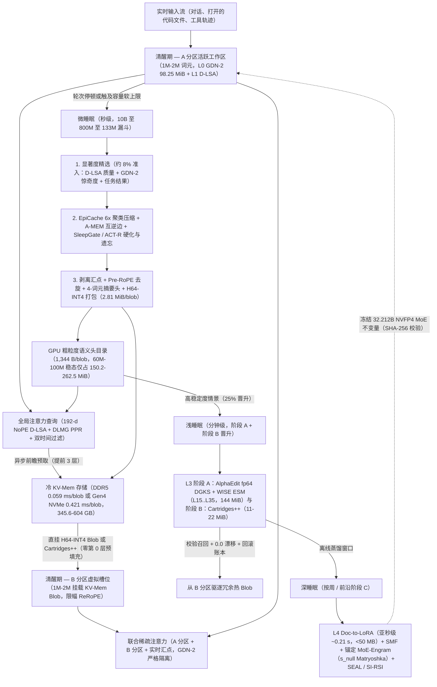

# 潜在稀疏嵌套学习（`LSA-NL`）v2.0：面向冻结混合 MoE 的分域连续记忆、动态递归算力与无损中途草稿解码

> **文档类别：** 旗舰研究论文级架构提案（`v2.0`） · **目标架构：** `Qwen3.6-64L-CoMem`（`LSA-NL` 记忆与弹性计算子系统）  
> **核心基座：** 冻结 `Qwen3.6-35B-A3B-Loop64`（`d=2`，`64L`，`[0,12)×1 + [12,36)×2 + [36,40)×1`，总参 `34.661B` / 冻结 MoE `32.212B`，稠密核心 `2.448B`，标准激活 `4.916B` → `3.45B ↔ 6.38B+` 弹性激活，`10` 个 `kv_share=True` 物理全局注意力层，`partial_rotary_factor=0.25` [`64`-d `3D mRoPE` + `192`-d NoPE]，`48` 个虚拟 `GDN-2-1M + QED` 线性状态）  
> **研发硬件：** `1× NVIDIA RTX PRO 6000 Blackwell Server Edition`（`GB202`，`sm_120`，**`96 GB GDDR7 ECC`** [`94.97 GiB` CUDA 可用]，`512-bit`，**`1,597 GB/s`** 峰值带宽，`24,064` CUDA 核心，`600 W` TDP） · **消费级部署目标：** `16 GB`（`RTX 4080 / 5070 Ti`）、`24 GB`（`RTX 3090 / 4090`）与 `32 GB`（`RTX 5090`）显存  
> **配套文档：** [英文原版提案 (`PROPOSAL_LSA_NESTED_LEARNING.md`)](PROPOSAL_LSA_NESTED_LEARNING.md) · [下一代路线图 (`Qwen3.6-64L-CoMem`)](ROADMAP_NEXTGEN_LOOP64_COMEM.md) · [算力申请与合作提案（中文 v2.0）](COMPUTE_GRANT_PROPOSAL_ZH.md) · [算力申请提案（英文 v2.0）](COMPUTE_GRANT_PROPOSAL.md) · [实证技术报告（EN）](EXPERIMENT_REPORT.md) · [实证技术报告（ZH）](EXPERIMENT_REPORT_ZH.md) · [SI-RSI 路线图](RSI_ROADMAP.md)

> [!IMPORTANT]
> **认知边界与零虚构契约：** 本提案中的每一项定量陈述均显式标注来源类别：**`实测（Measured）`**（直接溯源至仓库日志、单元测试或公开 Hub 提交）、**`闭式推导（Derived Formula）`**（基于 `src/qloop/` 架构常量的精确字节、延迟或参数闭式公式）、**`已发表（Published / External）`**（引用外部原始论文规格或公开数据）、**`估算（Estimated）`**（基于单卡实测吞吐的工程推演），或 **`拟议 / 熔断门（Proposed / Kill-Gate）`**（在投入工程开发前受明确通过/中止标准约束的可证伪假设）。**全文绝不宣称任何未实测的基准测试成绩。**

---

## 摘要

长程推理智能体既需要对当前活跃工具轨迹保持高保真工作记忆，又需要跨越数月的会话、代码库与持续修订的事实实现持久情景回忆。现有路线普遍陷入两个难以令人满意的极端：其一是将单一扁平 KV 缓存硬拉至不切实际的 `10M` 词元连续对话窗口——这不仅直接击穿单卡显存上限，更会让线性注意力的循环状态淹没在冷归档噪声中；其二是从零预训练纯参数化的测试时神经记忆模型（如 *Titans* [1] 与 *Nested Learning / HOPE* [2]），这类方法无法无损嫁接至已冻结的 `35B+` 混合专家（MoE）权重，且在精确标识符与代码字面量上受制于有限容量引发的**前摄干扰（Proactive Interference）**[3]。

本文提出**潜在稀疏嵌套学习（`LSA-NL`, v2.0）**——一种围绕单张 **`96 GB GDDR7 ECC`** Blackwell 服务器显卡（`1,597 GB/s`）上的冻结 `64` 层循环混合 MoE 基座（`Qwen3.6-35B-A3B-Loop64` [4]）构建的非破坏性 **5 频段连续记忆系统（`L0 → L4`）**与**三轴动态弹性计算**架构，同时提供可直接落地 **`<= 24 GB` 显存**的消费级部署配置（`RTX 3090/4090` 仅占 `17.66–18.93 GiB`，`16 GB` `4080/5070 Ti` 占 `10.89 GiB`，`32 GB` `5090` 占 `26.98 GiB`）。不同于扁平 `10M` 窗口，`LSA-NL` 建立了一套由主机 DDR5 / NVMe SSD 上 **`100M+` 冷巩固词元**支撑的**务实 `3M–4M` 分域逻辑上下文（Split-Horizon Logical Context）**，并配套**四阶段终身遗忘、硬化与 KV-to-Engram 晋升漏斗**，将 `100 亿（10B）` 原始终身词元（原始 SSD 需 `57.60 TB`）稳定压缩为有界的 `60M` 词元稳态归档（仅占 `345.6 GB` NVMe SSD + `150.2 MiB` GPU 粗粒度头部）：
1. **A 分区（Partition A，`1M–2M` 可调活跃工作区）：** 承载当前对话、活跃代码缓冲区与实时工具轨迹。在线 Delta 规则线性注意力（`GDN-2-1M + Bounded QED + Soft Neg-Eigval` [5], [6], [7]，`48` 个虚拟状态 = `98.25 MiB`）**仅运行于 A 分区内部**，确保冷归档记忆永不污染连贯的循环隐状态流。
2. **B 分区（Partition B，`1M–2M` GPU 挂载巩固 KV-Mem Blob 记忆库 + `100M+` 冷 SSD 归档）：** 历史会话与已掌握代码库被离线巩固为去汇点（sink-stripped）、旋转前（Pre-RoPE）的 **`512` 词元 KV-Mem Blob**（采用 Block-64 Hadamard INT4 压缩，每个 Blob 仅 `2.8125 MiB`），并由常驻 GPU 的 `1,344 B` 粗粒度语义头索引（`100 Mi-tokens` / `604.0 GB` SSD 仅需 `250.00 MiB` 质心 + `12.50 MiB` 双时间/图元数据 = `262.50 MiB`）。命中的 Blob 异步预取（DDR5 `0.059 ms/blob`，Gen4 NVMe `0.421 ms/blob`）后直接注入稀疏注意力——彻底消除第 0 层文本重预填充（Layer-0 text re-prefill）与上下文硬塞（context-stuffing）。

我们严格将跨会话 KV-Blob 拼接误差分解为**几何误差（$G$）**与**动态 / 汇点误差（$D$）**，证明 `Qwen3.6` 的 `partial_rotary_factor = 0.25`（`192/256` 维位置无关 NoPE）与正交 `H_64` 分块隔离如何精确消除 $G$，针对 $D$ 设计了四层渐进式防御，在形式化**清醒 → 微睡眠 → 浅睡眠 → 深睡眠（Wake → Micro-Sleep → Light Sleep → Deep Sleep）**记忆巩固周期的同时提出**对原始 LSA [8] 的六项外科手术式升级**；进一步地，为超越静态循环模型（*Inkling 2 Mini* [9]），我们引入**三轴动态弹性计算（`MoR` [10] + 动态激活参数）**、诚实的**第一性原理预填充 vs. 解码加速体系**（`MoR` 第 2 轮词元跳过 + 零额外模型的第 1 轮显著度引导预填充将 `64L` 预填充 GEMM 加速 **`1.23×–1.39×`**、压低至 `40L` 的 `1.15×–1.30×`，同时 B 分区 KV-Mem Blob 彻底消除回归会话重预填充）以及**与 `Mixture-of-Engram` 深度耦合的无损 `L35` 中途自投机草稿解码（`EAGLE-3` [11] + `LoopSpec` [12] + `TreeWY` [13] + `SAM-Decoding`）**——即便在诚实的 MoE Zipf 赠券收集器带宽模型下，裸 `64L` 仍可实现 **`1.58×–1.76×` 的无损解码加速（较原始 `40L` 快 `1.07×–1.19×`）**，而 **`64L + 全量 MoE-Engram（5.86B 激活）`** 更实现 **`1.73×–2.28×` 加速**——令完整 `5.86B` 激活模型在解码端无损反超未循环的 `40L（3.45B）` 模型（**`1.02×–1.35×`**）。文末给出零训练成本即可立即执行的**熔断验证门（`K0–K4`）**，并在长期第 5 阶段附录中展示如何依托 `Qwen3.6` 内置 VLM 视觉塔将 `192`-D NoPE Blob 原生拓展至多模态记忆。

---

## §1. 核心论点与定位：为何选择*潜在稀疏嵌套学习（`LSA-NL`）*而非纯 *Titans / HOPE* 或原始 `10M` 连续上下文

### 1.1 现有超长记忆范式的两大结构性失效

在单张 `96 GB GDDR7 ECC` GPU 上构建持久化编程与科研智能体，会立即暴露出一个尖锐的架构两难。当前文献由两种范式主导，而将二者直接套用于冻结的 `34.661B` 混合 MoE 基座时，各自均会触碰不可妥协的工程硬墙：

1. **失效模式 1 —— 原始 `10M` 连续上下文谬误：** 将数周的历史会话、代码库快照与 API 手册视作单一扁平的自回归前缀，本质上混淆了*活跃工作记忆（Working Memory）*与*归档情景记忆（Archival Episodic Memory）*。即便借助 `10` 个 `kv_share=True` 物理全局注意力层，`10M` 词元的 `FP8` KV 缓存仍需消耗 `100.00 GiB`——在加载任何模型权重前就已击穿 `94.97 GiB` 可用 GDDR7 显存。更隐蔽的隐患在于混合线性注意力主干（`30` 物理层 / `48` 虚拟 `GDN-2` 层）：将数百万异构冷归档词元顺次灌入定长循环状态矩阵 $S_t \in \mathbb{R}^{d_k \times d_v}$，会让在线 Delta 规则承受无休止的覆写抖动，迅速冲刷掉线性注意力最擅长的短程句法与活跃推理轨迹。
2. **失效模式 2 —— 纯参数化神经记忆（*Titans* 与 *Nested Learning / HOPE*）的两道硬墙：**
   Google 的 *Titans* [1]（`arXiv:2501.00663`）与 *Nested Learning / HOPE* [2]（`arXiv:2512.24695`, NeurIPS 2025）贡献了极为深刻的理论统一：**连续记忆系统（Continuum Memory System, CMS）**。Nested Learning 揭示神经网络架构与梯度优化器本质上是同一数学原语的不同实例——即以递增时间尺度、递减更新频率 $f_0 > f_1 > \dots > f_K$ 压缩不同上下文信息流的嵌套多频关联记忆体 $\mathcal{M}^{(f_k)}$。我们完全采纳 CMS 理论框架，但必须直面在改造冻结 `35B+` MoE（`Qwen3.6-35B-A3B` [4]）时阻碍纯 *HOPE* 风格参数化记忆落地的**两道硬墙**：
   - **硬墙 A —— 从零预训练依赖：** HOPE 的自修改测试时元优化器（self-modifying test-time meta-optimizers）与深度动量记忆模块需要在随机初始化阶段与外层词元表征协同演化。若将无约束的内循环自修改梯度更新直接嫁接到冻结的 `32.212B` NVFP4 MoE 上，会立刻撕裂预训练残差流形——我们在 v1 HSSD v3.2 负面消融中已实证观测到该现象（只要非恒等循环动力学扰动了冻结下游层，便引发 `+0.79` nat 分布冲击与死记忆槽；详见[实证技术报告](EXPERIMENT_REPORT_ZH.md)）。
   - **硬墙 B —— 有限容量饱和与前摄干扰（Proactive Interference）：** 任何纯参数化测试时神经记忆都试图将无界词元流 $N \to \infty$ 压缩进定长参数向量 $\theta_{\text{mem}} \in \mathbb{R}^{P}$。一旦超越关联容量极限 $N \gtrsim O(P)$，重叠的键值写入便诱发**前摄干扰**[3]（`SleepGate`, `arXiv:2603.14517`）：旧关联渗入新更新的绑定中，静默破坏逐字标识符（UUID、Git SHA、精确函数签名、行号、数值常量）。软件工程与科研智能体绝无法容忍神经网络对三周前某文件路径或 API 契约的“有损模糊近似”。

### 1.2 分域逻辑上下文（Split-Horizon Logical Context）：解耦连贯工作流与归档 KV Blob

`LSA-NL` 以由主机 DDR5 / NVMe SSD 上无界（`100M+` 词元）冷归档支撑的**`3M–4M` 分域逻辑上下文**替代扁平 `10M` 数据流，一次性化解上述两大失效模式：

- **A 分区（Partition A）—— 可调实时活跃工作区（`1M–2M` 词元）：** 以因果连贯的数据流形态承载当前会话记录、打开的源码文件与实时工具调用轨迹。**`GDN-2-1M + Bounded QED + Soft Neg-Eigval`** [5], [6], [7]（`64L` 精确占用 `48` 个虚拟状态 = `98.25 MiB`，见 [`src/qloop/model/gdn2.py`](../src/qloop/model/gdn2.py)）**严格限定在 A 分区内部运行**——绝不摄入冷归档 KV Blob——并与精确的 `D-LSA` [8]（`192`-D NoPE Ward 聚类，见 [`src/qloop/model/lsa.py`](../src/qloop/model/lsa.py)）协同工作。
- **B 分区（Partition B）—— 巩固 KV-Mem Blob 记忆库（`1M–2M` GPU 挂载虚拟槽位，底层由 DDR5 / NVMe SSD 上 `100M+` 冷词元支撑）：** 历史会话、已索引代码库、经验证事实与已完成的智能体轨迹会被巩固为紧凑的 **`512` 词元 KV-Mem Blob**。每个 Blob 在 GDDR7 显存中仅保留一枚 **`1,344 B` 的粗粒度语义头**（压缩后的 `10L × 64-d fp16` NoPE 质心、关键词/摘要指针及双时间图元数据），而冷 K/V 载荷以 **Block-64 Hadamard INT4** 格式驻留主机 DDR5 或 NVMe SSD（[`src/qloop/model/offload.py`](../src/qloop/model/offload.py) 中的 `Block64HadamardINT4Cache`，理论基础为 `TurboQuant` [14]）。查询时，`D-LSA` 联合 `DynamicLatentMemoryGraph`（`DLMG`）个性化 PageRank 路由出最相关的 Top-$B$ 个 Blob，经异步预取从 DDR5/SSD 拉入 B 分区虚拟 KV 槽位并直接注入全局注意力——实现**零第 0 层文本重预填充、零文本上下文硬塞以及逐字无损的非参数保真度**。

### 1.3 构建非破坏性 5 频段连续记忆系统（`L0 → L4`）

从形式上看，`LSA-NL` 实例化了一套跨越六个数量级更新频率的五级连续记忆系统 $\mathcal{C}_{\text{LSA-NL}} = (\mathcal{M}_0, \mathcal{M}_1, \mathcal{M}_2, \mathcal{M}_3, \mathcal{M}_4)$——严格保持第 0 步 IEEE-754 位级恒等（`max_abs_diff == 0.0`），并确保全部 `32.212B` 冻结 NVFP4 MoE 专家不可变（SHA-256 校验）：

- **L0（`f = 1 / tok`，在线活跃数据流）：** `GDN-2-1M + Bounded QED + Soft Neg-Eigval` [5], [6], [7]（`48` 个虚拟线性状态 = `98.25 MiB` 固定显存，`27.53M` 适配器参数）。求解带有解耦通道级擦除/写入/衰减与查询导向正交擦除的在线秩-1 L2 回归 Delta 规则，且严格局限于 A 分区内部：
  $$S_t = \big(I - \hat{k}_t e_t^{\top}\big)\operatorname{Diag}\!\big(\exp(g_t)\big) S_{t-1} + \hat{k}_t (w_t \odot v_t)^{\top}, \qquad e_t = b_t \odot \hat{k}_t + \lambda_h \big(b_t \odot \hat{q}_t - \langle \hat{k}_t, b_t \odot \hat{q}_t \rangle \hat{k}_t\big).$$
- **L1（`f = 1 / 512 tok`，活跃工作上下文）：** A 分区 `D-LSA` [8]（跨越 `10` 个 `kv_share=True` 物理层的 `1M–2M` 可调活跃视界）。每 `512` 词元块向 `BucketIndex` 提交 `4:1` 池化的 `192`-D NoPE Ward 聚类，融合精确局部窗口（`512` 词元）+ 实时会话汇点（`64` 词元）+ `Top-64` 稀疏 Ward 桶（每查询远端压缩键 `<= 768`）。
- **L2（`f = 1 / session` 或微睡眠，巩固非参数情景记忆）：** B 分区**巩固 KV-Mem Blob 记忆库**（`1M–2M` GPU 挂载虚拟槽位，`100M+` 冷 SSD 词元，经由 §4.5 四阶段漏斗从 `10B` 终身词元流修剪而来）。融合情景 KV 聚类/淘汰（`EpiCache` [15]）、前摄干扰冲突门控（`SleepGate` [3]）、影子/投机/查询感知分页 KV 卸载（`ShadowKV` [16]、`InfiniGen` [17]、`Quest` [18]），以及 `Spark-X2.6-Recursion` [19] 的 `DynamicLatentMemoryGraph`（`HippoRAG 2` 个性化 PageRank [20] + `A-MEM` 互逆语义边 [21] + `Zep / Graphiti` 双时间有效区间 [22]）。
- **L3（`f = 1 / task`，浅睡眠 —— 横向 KV → 纵向零空间权重与 Cartridge 编译）：** 依托 `Spark-X2.6-Recursion` [19] 的 `EpisodicSideMemory`（`AlphaEdit` Float64 DGKS 零空间岭投影 [23] + `WISE` 激活作用域门控 [24]，每分片 `144 MiB`，挂载于 `6` 个核心全局注意力边界 `L15, L19, L23, L27, L31, L35`，**严格遵循已验证的 `S2` 校准规则跳过尾声层 `L39`**），辅以模块化 `2K–4K` `H64-INT4` **KV Cartridges**（`Cartridges` / `Cartridges++` / `Cartridges at Scale` [25], [26], [27]）。将高频复现的 KV-Mem Blob 从横向 $O(N)$ KV 检索编译为满足 $\Delta W K_0 = 0$（精确 `0.0` 通用文本漂移）的 $O(1)$ 纵向零空间残差投影，并配套精确事务级回滚账本（undo ledger）。
- **L4（`f = 1 / week`，深睡眠 —— 稀疏长期参数化、超网络与技能巩固）：** 原生 `2048`-D 锚定 `MoE-Engram`（`DeepSeek Engram` 带符号平方根 RMSNorm QK 门控 [28] + `SMF` TF-IDF/惊奇度加权稀疏记忆微调 [29] + **`s_null` Matryoshka 切片** [空汇点 Sigmoid 路由 + 嵌套容量切片 + `p=0.15` 模块丢弃]）、单前向 **`Doc-to-LoRA`** [30] KV-to-Engram 编译 + **`SEAL`** [31] 自编辑指令，叠加第一层自适应原生 `top_k`（`8 → 10..16`，`0` 额外显存）、`MoR` 动态深度 [10] 及 `64L` 可验证 `SI-RSI` 强化学习（`s4_v2_rl`，`3.45B ↔ 6.38B+` 弹性激活），全程严格架设于冻结 `32.212B` `Qwen3.6` MoE 先验之上。

每一相邻层级边界 $\Phi_{k \to k+1}: \mathcal{M}_k \to \mathcal{M}_{k+1}$ 均实现了显式的频率匹配巩固算子——在不触碰不可变 `32.212B` MoE 先验的前提下，将高频上下文流持续沉淀为低频、高杠杆的表征（`L0/L1 → L2` 经微睡眠 KV-Blob 打包；`L2 → L3` 经浅睡眠 `AlphaEdit` 零空间编译与 `Cartridges++`；`L3 → L4` 经深睡眠 `Doc-to-LoRA` / `SMF` / `MoE-Engram` 与 `SI-RSI`）。

#### 表 1.1 — 架构定位对比：`LSA-NL` vs. *Titans / HOPE* 与原始 `10M` 连续上下文

| 对比维度 | 原始 `10M` 连续窗口 | 纯 *Titans* [1] / *HOPE* [2] | **`LSA-NL` v2.0（`Qwen3.6-64L-CoMem`）** |
| :--- | :--- | :--- | :--- |
| **记忆表征形式** | 单一扁平 KV 流（`10M` 原始词元） | 定长参数化神经记忆 MLP + 自修改优化器 | **5 频段混合 CMS（`L0 → L4`）：** `3M–4M` 分域 KV（`100M+` 冷 SSD，`10B` 词元漏斗）+ `GDN-2` + `ESM` / `Cartridges++` + `MoE-Engram` |
| **冻结 `35B` MoE 改造兼容性** | 理论可行，但 `100 GiB` FP8 KV **直接击穿 `96 GB` 单卡** | **无法脱离从零预训练**（自修改规则撕裂冻结残差流形） | **100% 非破坏性**（第 0 步 `0.0` 恒等；`32.212B` NVFP4 MoE 密码学冻结） |
| **循环状态完整性（`GDN-2`）** | 被数百万冷归档词元持续污染 | 共享参数容量承受严重覆写抖动 | **严格隔离于 A 分区**（`98.25 MiB` `GDN-2` 永不接触 B 分区冷 Blob） |
| **逐字代码 / 标识符保真度** | 窗内精确，但 KV 与计算代价不可承受 | 容量饱和与**前摄干扰**[3] 导致性能退化 | **无损非参数（`L1`/`L2`）** + 双时间 `[t_valid, t_invalid)` 冲突屏蔽 [3], [22] |
| **跨会话复用延迟** | 每次新会话均需从第 0 层完整文本重预填充 | 单次前向，但冷会话记忆有损 | **零第 0 层重预填充：** Pre-RoPE `H64-INT4` KV-Blob 直挂（`0.059–0.421 ms/blob`） |
| **硬件门槛与端到端吞吐** | 依赖多卡集群；解码随长度线性变慢 | 仅支持从零预训练；算力静态固定 | **`96 GB` 服务器（`4M` 分域）下探至 `<= 24 GB` 消费卡（`17.66–18.93 GiB`）** + **`1.23×–1.39×` `MoR` 预填充提速** + **`1.58×–2.28×` 无损 `L35` Engram 耦合解码**（`64L+Engram` 反超 `40L`！） |

---

## §2. 分域显存、带宽、SSD 分级与 `<= 24 GB` 消费级部署精确数学账本

本节全部字节与延迟数据均为**`闭式推导（Derived Formula）`**，直接锚定 `Qwen3.6-35B-A3B` 的真实物理 KV 几何（经由 `kv_share=True` 的 `L_phys = 10` 个物理全局注意力层，`H_kv = 2` 个 GQA KV 头，`D = 256` 头维度）以及仓库已实现的量化与索引原语：[`src/qloop/model/offload.py`](../src/qloop/model/offload.py)（`FP8KVCacheQuantizer`、`Block64HadamardINT4Cache`）与 [`src/qloop/model/lsa.py`](../src/qloop/model/lsa.py)（`LSAConfig`，`block_size = 512`）。全文中 `1M` 统一指代 $2^{20} = 1{,}048{,}576$ 词元（与 `offload.py:616-623` 中的 `FP8KVCacheQuantizer.tier1_1m_ledger_bytes` 一致），`GiB`/`MiB` 表示二进制单位（$2^{30}, 2^{20}$），SSD 与 PCIe 带宽/容量则同步显式给出十进制 `GB`/`GB/s`（$10^9$）。

### 2.1 KV-Mem Blob 与 GPU 粗粒度语义头闭式账本（`闭式推导`）

一个标准 **KV-Mem Blob** 封装 $B_{\text{tok}} = 512$ 个词元（在 `Block64HadamardINT4Cache` 中每层对应 `128` 个 `2,304 B` 四词元微页，`offload.py:121-122`），横跨全部 $L_{\text{phys}} = 10$ 个物理 `kv_share` 层：

$$N_{\text{scalars}}^{\text{blob}} = L_{\text{phys}} \cdot 2_{(K,V)} \cdot H_{\text{kv}} \cdot D \cdot B_{\text{tok}} = 10 \times 2 \times 2 \times 256 \times 512 = 5{,}242{,}880\ \text{scalars}.$$

1. **FP8 E4M3 载荷（`1.00 B/scalar`，`FP8KVCacheQuantizer`）：**
   $$S_{\text{blob}}^{\text{FP8}} = 5{,}242{,}880\ \text{B} = \mathbf{5.00\ \text{MiB}}\quad (512.0\ \text{KiB/layer}).$$
2. **Block-64 Hadamard INT4 载荷（`36 B / 64 scalars = 0.5625 B/scalar`，`Block64HadamardINT4Cache` [14]）：**
   每组 64 个标量打包为 `32 B` 无符号 4-bit 半字节 + `2 B` `fp16` 缩放因子 + `2 B` `fp16` 最小值（`GROUP_PACKED_BYTES = 36`，`offload.py:29`）：
   $$S_{\text{blob}}^{\text{H64}} = 5{,}242{,}880 \times \frac{36}{64} = 2{,}949{,}120\ \text{B} = \mathbf{2.8125\ \text{MiB}}\ \ (\approx \mathbf{2.81\ \text{MiB}},\ 288.0\ \text{KiB/layer} = 128 \times 2{,}304\ \text{B}).$$
3. **常驻 GPU 的粗粒度语义头（`1,344 B` / blob）：**
   每个冷 Blob 在 GDDR7 显存中仅留存一枚极简路由描述符：
   $$S_{\text{hdr}} = \underbrace{L_{\text{phys}} \cdot d_{\text{idx}} \cdot 2\ \text{B}}_{10 \times 64 \times 2 = 1{,}280\ \text{B}\ (\text{fp16 } 10\text{L NoPE 质心})} + \underbrace{64\ \text{B}}_{\substack{\text{双时间 } [t_{\text{valid}}, t_{\text{invalid}}),\ \text{显著度}, \\ \text{DLMG CSR 指针},\ 4\text{-词元头部 ID},\ \text{SSD LBA}}} = \mathbf{1{,}344\ \text{B}}.$$

### 2.2 流式拉取延迟与 `async_lookahead` 掩盖分析（`闭式推导`）

从分级主机存储中流式读取一个完整 `10` 层 `H64-INT4` Blob（`2,949,120 B`）满足如下精确带宽界限：

- **PCIe Gen4 ×4 NVMe SSD（`7.0 GB/s` 顺序读取）：**
  $$t_{\text{NVMe}}^{\text{blob}} = \frac{2{,}949{,}120\ \text{B}}{7.0 \times 10^9\ \text{B/s}} = \mathbf{0.421\ \text{ms/blob}}\quad (\mathbf{0.0421\ \text{ms/layer}}).$$
- **主机锁页 DDR5 DMA（`50.0 GB/s` PCIe Gen5 ×16 / DDR5 持续带宽）：**
  $$t_{\text{DDR5}}^{\text{blob}} = \frac{2{,}949{,}120\ \text{B}}{50.0 \times 10^9\ \text{B/s}} = \mathbf{0.059\ \text{ms/blob}}\quad (\mathbf{0.0059\ \text{ms/layer}}).$$

**为何读取延迟可完美隐藏于 `3` 个交错 `GDN-2 + MoE` 层之后（`async_lookahead`）：**
在 `Qwen3.6-35B-A3B` 中，物理全局注意力层每 `4` 层出现一次（`L3, L7, L11, L15, L19, L23, L27, L31, L35, L39`），其间穿插 `3` 个连续的 `GDN-2 + MoE` 层。依托 `Block64HadamardINT4Cache.prefetch_micro_pages(layer_idx, page_indices, target_device=None)`（`offload.py:321-355`，其中 `prefetch_layers_ahead=3` 在 `offload.py:137` 的 `Block64HadamardINT4Cache.__init__` 中配置）并将其扩展至异步 `io_uring`/GPUDirect/锁页主机暂存队列：
1. 全局注意力层 $\ell$（或位于 $\ell - 3$ 层的提前查询前瞻）在连续 `3` 层 `GDN-2 + MoE`（约 `~180M` 激活 NVFP4 权重与 Triton `fla` DPLR 扫描）执行期间，并行发起下一全局层所需的 `288 KiB/blob` 分片拉取。
2. 更为关键的是，**冷 Blob 拉取延迟仅在发生缓存未命中挂载事件时支付一次**——而非逐个生成词元重复支付！一旦检索命中的 $B$ 个 Blob（例如 $B = 16$ 个 Blob = `8,192` 词元 = `45.0 MiB` H64-INT4，全部 10 层累计仅需 DDR5 `0.94 ms` 或 NVMe `6.74 ms`）挂载至 B 分区的 GPU 虚拟槽位（`1M–2M` 容量），随后数百词元的深度推理回合均直接以 **`1,597 GB/s` GDDR7 ECC** 带宽访问已挂载 Blob，全程零 PCIe/SSD 流量。

### 2.3 `100M` 词元冷 NVMe 归档扩展账本（`闭式推导`）

将冷归档扩展至 **`100 Mi-tokens`**（$100 \times 2^{20} = 104{,}857{,}600$ 个巩固词元 = **`204,800` 个 `512` 词元 Blob**）：
- **冷 NVMe SSD 容量占用：** $204{,}800 \times 2{,}949{,}120\ \text{B} = 603{,}979{,}776{,}000\ \text{B} = \mathbf{604.0\ \text{GB}}$ 十进制（`562.50 GiB` 二进制）——单块消费级或服务器级 `1–2 TB` NVMe SSD 即可轻松容纳！*（按十进制 `100,000,000` 词元 = `195,313` Blob 计算：`576.0 GB` / `536.44 GiB` SSD。）*
- **常驻 GPU 粗粒度语义头目录：**
  - `10L × 64-d fp16` 语义质心：$204{,}800 \times 1{,}280\ \text{B} = 262{,}144{,}000\ \text{B} = \mathbf{250.00\ \text{MiB}}$（精确 **`0.244 GiB`**）！
  - 每 Blob `64 B` 双时间与 `DLMG` 图元数据：$204{,}800 \times 64\ \text{B} = \mathbf{12.50\ \text{MiB}}$（`0.012 GiB`）。
  - **`100 Mi-tokens` 合并 GPU 目录总计：** **`262.50 MiB`（`0.256 GiB`）**（十进制 `100M` 词元 = `195,313` Blob 为 `250.34 MiB` / `0.244 GiB`）——尚不足 `94.97 GiB` CUDA 可用 GDDR7 ECC 显存的 **`0.27%`**！
- **`100M` 词元 GPU 头部穷举路由延迟（`闭式推导`）：** 在单个物理全局注意力层将查询与**全部** `204,800` 枚粗粒度 `64`-D `fp16` 头部打分，仅需从 GDDR7 ECC 读取 $204{,}800 \times 64 \times 2\ \text{B} = \mathbf{25.00\ \text{MiB}}$（`26.21 MB`）——按 `1,597 GB/s` 峰值仅耗时 **`0.0164 ms/层`**（按 `70%` 实际有效带宽计为 `0.0234 ms/层`，全 `10` 层合计仅 **`~0.23 ms`**），这甚至尚未启用两级树状检索（`src/qloop/model/lsa.py` 中的 `search="tree"`）。

### 2.4 单服务器卡务实运行包络（`1× 96 GB GDDR7 ECC`，`94.97 GiB` 可用）

基于纯 NVFP4 基座权重（`21.85 GiB` `实测`；若采用混合 NVFP4/FP8 HF 检查点 `24.09 GiB` 则增加 `+2.24 GiB`）、精确 `48` 状态 `64L` `GDN-2` 循环状态（`98.25 MiB = 0.096 GiB`，表内汇总四舍五入为 `0.10 GiB`）、每 `1M` A 分区 `0.3525 GiB` 路由元数据（`0.3125 GiB` `bf16` Ward 质心 + 修复 `lsa.py:728-768` 后约 `~0.04 GiB` 紧凑 `int8` `BucketIndex`）以及 `0.0051–0.2563 GiB` GPU 粗粒度头部（覆盖 `4,096` 个独立挂载 Blob 直至 `204,800` 个 `100 Mi-tok` SSD Blob），表 2.1 列出三种目标服务器运行包络及与原始 `10M` 和 `Inkling 2 Mini` [9] 的精确对照。

#### 表 2.1 — 单卡 GDDR7 ECC 各服务器运行包络精确显存账本（`闭式推导` + `实测` 权重）

| 运行包络（`64L d=2`，`batch=1`） | A 分区（活跃 KV） | B 分区（挂载 KV） | KV 总计 (GiB) | NVFP4 权重 + `GDN-2` (GiB) | 紧凑索引 + GPU 头部 (GiB) | **GDDR7 总计 (GiB)** | **`94.97 GiB` 可用余量** | 冷归档（SSD） |
| :--- | :---: | :---: | :---: | :---: | :---: | :---: | :---: | :---: |
| **包络 A —— `3M` 精度分域**（`1M` FP8 + `2M` H64-INT4） | `10.00` (FP8) | `11.25` (H64) | **`21.25`** | `21.85 + 0.10` | `0.36–0.61` *(`0.3525` + hdrs)* | **`43.55–43.81`** *(`~43.6–43.8`)* | **`~51.2–51.4 GiB`** *(`51.16–51.42`)* | 可选 `100M`（`604 GB`） |
| **包络 B —— `4M` 最大逻辑分域**（`2M` H64 + `2M` H64） | `11.25` (H64) | `11.25` (H64) | **`22.50`** | `21.85 + 0.10` | `0.71–0.96` *(`0.7050` + hdrs)* | **`45.16–45.41`** *(`~45.2–45.4`)* | **`~49.6–49.8 GiB`** *(`49.56–49.81`)* | 可选 `100M`（`604 GB`） |
| **包络 C —— `2M` 热区 + `100 Mi-tok` 冷 SSD**（`1M` H64 + `1M` H64） | `5.625` (H64) | `5.625` (H64) | **`11.25`** | `21.85 + 0.10` | `0.61` *(`0.3525 + 0.2563`)* | **`33.81`** *(`~33.8`)* | **`~61.2 GiB`** *(`61.16`)* | **`100M`（`604.0 GB`）** |
| *对照：原始 `10M` 连续 FP8（`10L`）* | `100.00` (FP8) | — | `100.00` | `21.85 + 0.10` | `~3.53` | **`125.5`（OOM）** | `-30.5 GiB` | 无 |
| *对照：`Inkling 2 Mini`（`1M` F16，`已发表` [9]）* | `32.00` (F16) | — | `32.00` | `~18.6`（`~20 GB`）+ `0.16` SWA | `0.00` | `~50.8` *（仅限 `1M`）* | `~44.2 GiB` | 未公开 |

> [!TIP]
> **完整五级架构的充裕显存余量：** 即使在 `4M` 分域极限包络下（总计 `45.16–45.41 GiB`），单张服务器卡仍保有 **`~49.6–49.8 GiB` 完全空闲的 GDDR7 ECC 显存**——足以从容容纳 `EpisodicSideMemory`（`0.141 GiB/分片`）、`AnchoredMoEEngram`（NVFP4 `0.65–0.99 GiB`）、`DLMG` 稀疏邻接表、CUDA Graphs 以及多智能体并发批处理。

### 2.5 消费级 `<= 24 GB` 显存部署方案（`RTX 3090 / 4090`、`16 GB` `4080 / 5070 Ti`、`32 GB` `5090`）

相较于扁平上下文架构，`LSA-NL` 的一项决定性优势在于：**完全相同的训练完毕 `Qwen3.6-64L-CoMem` 检查点可直接无损部署至 `16–32 GB` 消费级显卡**，同时保留完整的 `256K–1M` 活跃上下文与全部 `100M` 词元 NVMe SSD 终身归档。

**结构参数拆解（`闭式推导`）：**
在 `Qwen3.6-35B-A3B`（`34.661B` 文本参数）中，高达 **`32.212B`（`92.93%`）** 集中于 `256` 个路由 MoE 专家（每词元仅激活 `8/256 = 3.125%`；按 `NVFP4` `0.5625 B/param` 计算总计 `16.875 GiB`，跨全部 `40` 层合计每专家仅 `0.06592 GiB`）。相比之下，**全部常驻激活的稠密核心总计仅 `2.448B` 参数（含归一化与缩放因子的 FP8/Q8 格式仅占 `2.42 GiB`）**：
- 非绑定 `embed_tokens` + `lm_head`：`1.017B`
- `30` 个门控 DeltaNet（`GDN-2`）线性注意力混合器：`1.011B`
- `10` 个门控全局注意力（GQA）混合器：`0.273B`
- `40` 个共享 MoE 专家：`0.126B`
- `40` 个 MoE 路由器：`0.021B`

由于编程与对话负载中路由 MoE 专家的访问呈现陡峭的 **Zipf 流行度分布**，将全部 `2.42 GiB` 稠密核心及最热的 `80–160/256` 个 NVFP4 专家常驻 GPU 显存，而仅将冷尾路由专家直接交由主机 CPU DDR5 执行——借助 **`KTransformers`** [32]（`kvcache-ai/ktransformers`, SOSP 2025 专家延迟调度与 Intel AMX/AVX-512 混合内核）、**`MoE-Lightning`** [33]（`arXiv:2411.11217`, ASPLOS 2025 `CGOPipe` + 分层屋顶线模型 `HRM`）及 **`Fiddler`** [34]（`arXiv:2402.07033`, ICLR 2025 激活值传输 CPU-GPU 协同调度）——可彻底规避灾难性的 PCIe 专家权重换入换出停顿。

表 2.2 中全部部署档位均计入相同的**固定运行时开销（`1.706 GiB`）**：`0.10 GiB` 循环/GDN-2/LSA 适配器 + `0.096 GiB`（`98.25 MiB`）`48L` `GDN-2` 循环状态 + `0.35 GiB`（`64K` 词元）热 B 分区 Blob LRU 缓存 + `0.26 GiB`（`262.5 MiB`）`100 Mi-token` SSD 粗粒度头部 + `0.90 GiB` CUDA 临时缓冲区/激活值，并叠加按比例缩放的紧凑 `D-LSA` A 分区索引（对应 `256K / 512K / 1M` 活跃 KV 分别为 `0.088 / 0.176 / 0.353 GiB`）。*（因单位 GiB 质量被无损 NVFP4 Zipf 切分档位 C 严格帕累托支配，本文略去全稠密 `Q4_K_M`“档位 B”。）*

#### 表 2.2 — 消费级 GPU（`16 GB / 24 GB / 32 GB` 显存）部署配置账本（`闭式推导`）

| 部署档位与目标显卡 | 稠密核心 (FP8/Q8) | GPU 路由 MoE (`热专家/256`) | 活跃 `H64-INT4` KV + 紧凑索引 | 固定运行时 (`适配+GDN2+LRU+100M头+临时`) | **GPU 显存总计 (GiB)** | **主机 DDR5 冷 MoE (GiB)** | 冷归档（SSD） |
| :--- | :---: | :---: | :---: | :---: | :---: | :---: | :---: |
| **`24 GB` 档位 A（`RTX 3090 / 4090`）** —— 全 GPU `IQ3_XXS`（`~3.15 bpw`）+ `512K` KV | `2.42` | `11.81` (`256/256` `IQ3_XXS`) | `2.813 + 0.176` (`512K`) | `1.706` | **`18.93 GiB`** | **`0.00 GiB`** | `100M`（`604 GB`） |
| **`24 GB` 档位 C（`RTX 3090 / 4090`）** —— 无损 NVFP4 Zipf 切分（`160/256` 热）+ `512K` KV | `2.42` | `10.55` (`160/256` NVFP4) | `2.813 + 0.176` (`512K`) | `1.706` | **`17.66 GiB`** | **`6.33 GiB`** (`96/256`) | `100M`（`604 GB`） |
| **`24 GB` 档位 D（`RTX 3090 / 4090`）** —— 无损 NVFP4 切分（`128/256` 热）+ **完整 `1M` KV** | `2.42` | `8.44` (`128/256` NVFP4) | `5.625 + 0.353` (**`1M`**) | `1.706` | **`18.54 GiB`** | **`8.44 GiB`** (`128/256`) | `100M`（`604 GB`） |
| **`16 GB` 档位 E（`RTX 4080 / 5070 Ti`）** —— 无损 NVFP4 切分（`80/256` 热）+ `256K` KV | `2.42` | `5.27` (`80/256` NVFP4) | `1.406 + 0.088` (`256K`) | `1.706` | **`10.89 GiB`** | **`11.60 GiB`** (`176/256`) | `100M`（`604 GB`） |
| **`32 GB` 档位 F（`RTX 5090`）** —— 全 GPU 无损 NVFP4（`256/256` 热）+ **完整 `1M` KV** | `2.42` | `16.88` (`256/256` NVFP4) | `5.625 + 0.353` (**`1M`**) | `1.706` | **`26.98 GiB`** | **`0.00 GiB`** | `100M`（`604 GB`） |

每一消费级档位均留有 **`>= 5.0 GiB`** 的操作系统、显示与 CUDA Graph 安全余量（`24 GB` 卡余 `5.07–6.34 GiB`，`16 GB` 卡余 `5.11 GiB`，`32 GB` 卡余 `5.02 GiB`），同时交付完整的 `64L` 深度推理、精确 A 分区 `GDN-2-1M + QED` 流式处理与亚毫秒级 `100M` 词元 SSD 头部路由。

---

## §3. 跨会话 KV-Blob 注入的核心难题：几何误差（$G$）与动态误差（$D$）

将历史会话预计算的 KV-Mem Blob 跳过第 0 层文本重预填充而直接注入实时注意力，是 `LSA-NL` 杠杆率最高的机制——也是草率设计最容易崩盘的环节。我们拒绝模糊带过跨会话 KV 拼接问题。直接立足于非前缀 KV 复用的实证与理论文献——**`CacheBlend`** [35]（`arXiv:2405.16444`, EuroSys 2025）、**`EPIC`** [36]（`arXiv:2410.15332`, ICML 2025）、**`TurboRAG`** [37]（`arXiv:2410.07590`, EMNLP 2025）与 **`Block-Attention`** [38]（`arXiv:2409.15355`, ICLR 2025）——我们将拼接 KV 的保真度损失分解为两项正交误差并逐一显式攻克。

### 3.1 精确误差分解：几何误差（$G$）与动态 / 汇点误差（$D$）

考虑一个原本在历史会话 $s$ 的绝对位置 $P_s = [p_s, p_s + 512)$、紧随历史前缀 $X_s$ 预填充生成的 `512` 词元 Blob $\mathcal{B}_m$，其在第 $\ell$ 层产出缓存张量 $(K_m^{(s)}, V_m^{(s)})$。当它随后被挂载到新会话 $u$ 中一个无关活跃 A 分区上下文 $X_u$（长度 $T_A$）之后时，当前查询 $q_t^{(u)}$ 联合关注 $(K_A, V_A) \cup \{(K_m, V_m)\}$。令 $o_t^*$ 表示将 $\mathcal{B}_m$ 原文拼接在 $X_u$ 之前并从第 0 层起运行全层连续重预填充得到的理想神谕（oracle）输出，$\tilde{o}_t$ 表示拼接 B 分区的输出。总注意力偏差清晰拆分为两项：

$$\|\tilde{o}_t - o_t^*\|_2 \;\le\; \underbrace{\mathcal{E}_{\text{geom}}\!\left(\Delta\theta_{\text{RoPE}}(t, P_s)\right)}_{\text{几何 / 位置误差 } (G)} \;+\; \underbrace{\mathcal{E}_{\text{dyn}}\!\left(\Delta K_m^{(u|s)},\, \Delta V_m^{(u|s)},\, \Delta s_{\text{sink}}\right)}_{\text{动态跨上下文条件与汇点误差 } (D)}.$$

- **几何误差（$G$）：** 标准 RoPE 缓存保存旋转后的键 $K_{\text{rot}}^{(s)} = R(P_s \omega) K_{\text{rot}}^{\text{pre}}$。直接将 $\mathcal{B}_m$ 拼入会造成荒谬或越界的相对相位角 $(t - p_s)\omega$——若 $p_s > t$ 甚至出现负相对偏移，或落入远超预训练 `max_position_embeddings` 弧长的频段——即便词元语义完全一致，也会瞬间瓦解旋转注意力 logits。
- **动态 / 汇点误差（$D$）：** 即便位置相位被完美修复（$G = 0$），在 $\ell \ge 1$ 的深层中仍残留两类偏差：
  1. *伪内部注意力汇点（`EPIC` [36]）：* 自回归 Transformer 会将大量 softmax 概率质量倾倒至序列开头 `1–4` 个词元（注意力汇点）。若缓存 Blob 保留了原会话的 `[0:4)` 词元，拼接后会在上下文中部引入异常高范数吸引子，掠夺实时会话汇点与目标答案词元的注意力权重。
  2. *缺失跨上下文深层条件化（`CacheBlend` [35], `Block-Attention` [38]）：* 在 $\ell \ge 1$ 层，生成 $(K_m^{(s)}, V_m^{(s)})$ 的隐藏状态曾关注旧前缀 $X_s$ 而非当前前缀 $X_u$。具有强跨文档依赖的词元（如指代消解、同名遮蔽标识符或跨文件类型引用）相对连续重预填充存在非零键值偏移 $(\Delta K_m, \Delta V_m)$。

### 3.2 为何 `Qwen3.6-35B-A3B` 拥有消除几何误差（$G$）的独特先天优势

标准全维度 RoPE 模型（`partial_rotary_factor = 1.0`，如 Llama-3）对键向量的 100% 维度施加旋转相位，导致位置无关 KV 复用极为脆弱。**`Qwen3.6-35B-A3B` [4] 具备三项与我们现有代码库（`src/qloop/model/`）天然契合的结构性质，能够彻底碾碎几何误差（$G$）：**

1. **`75%` 原生位置无关 NoPE 键子空间（`192/256` 维）：** `Qwen3.6` 强制设定 `partial_rotary_factor = 0.25`（`head_dim = 256`，`rotary_dim = 64`），将每个键与查询向量精准切分为：
   $$k = \big[\,\underbrace{k_{\text{rot}} \in \mathbb{R}^{64}}_{\text{mRoPE } [0:64)},\;\; \underbrace{k_{\text{nope}} \in \mathbb{R}^{192}}_{\text{位置无关 NoPE } [64:256)}\,\big].$$
   每一记注意力点积中有四分之三 $\langle q_{\text{nope}}, k_{\text{nope}} \rangle$ **从架构根源上严格位置不变**。此外，`D-LSA`（`index_on="nope"`，[`src/qloop/model/lsa.py:154`](../src/qloop/model/lsa.py#L154)）**完全仅在 `[64:256)` 上**计算 `64`-D 潜在投影与 Ward 质心——意味着**任一 Blob 的 `D-LSA` 路由质心与其归属哪次会话或挂载于 B 分区哪一虚拟槽位均呈逐位不变性（bit-for-bit invariant）！**
2. **`H_64` 压缩内部的精确分块-64 正交隔离：** 我们的 `walsh_hadamard_block(x, block_size=64)`（[`src/qloop/model/offload.py:32-56`](../src/qloop/model/offload.py#L32-L56)）施加块对角变换 $I_4 \otimes H_{64}$。第 0 组*仅*变换 `[0:64)`（mRoPE），第 1–3 组*仅*变换 `[64:256)`（NoPE），确保零跨子空间串扰（`Fix C2`，`fp64` 交换律误差 `< 1e-12`）。
3. **Pre-RoPE 归档存储 + 虚拟 B 分区限幅 ReRoPE（[`src/qloop/model/pos_rerope.py`](../src/qloop/model/pos_rerope.py)）：**
   - 在微睡眠巩固阶段，我们仅对 `64`-d 旋转切片施加逆向逐词元旋转 $R(-(p_s + j)\omega) = R((p_s + j)\omega)^{\top}$（调用 `apply_partial_rope_k(k, -k_positions)`，`pos_rerope.py:166-195`）：
     $$k_j^{\text{pre}} = \big[R(-(p_s + j)\omega)\, k_{\text{rot}}^{(s)}(j),\;\; k_{\text{nope}}^{(s)}(j)\big], \qquad j \in \{0, \dots, 511\},$$
     并将 $(k^{\text{pre}}, v)$ 打包为 `H_64` INT4 存储。
   - 在 B 分区挂载时，Blob $m$ 获配规整的**虚拟 B 分区槽位坐标** $p_{\text{virt}}(m, j) = P_{\text{partB}}(m) + j$，既完整保留 Blob 内部精确句法间距 $(j_1 - j_2)$，又通过平滑 $C^1$ **`clamped_relative_distance`** 函数（`pos_rerope.py:89-124`，`linear_ceil = 131,072`，`log_scale = 32,768`，`max_pos = 240,000`——严格收敛于 `Qwen3.6` 原生预训练的 `262,144` 弧长以内！）映射跨分区相对距离 $\Delta = t - p_{\text{virt}}$：
     $$\Delta_{\text{eff}}(\Delta) = \begin{cases} \Delta, & 0 \le \Delta \le L_c, \\ \min\!\left(L_{\max},\; L_c + S_c \ln\!\left(1 + \dfrac{\Delta - L_c}{S_c}\right)\right), & \Delta > L_c. \end{cases}$$
   - **第 0 组隔离与精确 `H_64` 交换律：** 由于 $H_{\text{blk}} = \operatorname{diag}(H_{64}, H_{64}, H_{64}, H_{64})$ 是块对角自伴正交矩阵（$H_{64}^{\top} = H_{64}$，$H_{64}^2 = I_{64}$），且部分 RoPE $R_{\text{part}}(\theta) = \operatorname{diag}(R_{64}(\theta), I_{192})$ 严格仅作用于第 0 组，按 Blob 基偏移 $p_s$ 去旋（保存 Blob 内局部相位 $R(j\omega) k_{\text{rot}}^{\text{pre}}$ 或纯 Pre-RoPE $k^{\text{pre}}$）意味着：**在挂载期仅有第 0 组（占 `K` 的 `64/256 = 25%`）需要 ReRoPE 相位对齐**，而**第 `1..3` 组（`192` 维 NoPE = `75%` 的 `K`）永久停留在 `H_64` 变换域**，直接经 $\langle H_{64} q_{\text{nope}}, H_{64} k_{\text{nope}} \rangle = \langle q_{\text{nope}}, k_{\text{nope}} \rangle$（`gather_kv_and_reconstruct_v`，`offload.py:445-514`）完成打分，键向量无需任何逆变换！
   - 查询端差分旋转（`apply_partial_rerope_q`，`pos_rerope.py:198-261`）保持全部 `192` 维 NoPE 逐位不变（`torch.equal`），同时将 `64` 维旋转维度精准锚定在预训练长程频段内——**干净彻底地消除几何误差（$G$）。**

### 3.3 面向动态与汇点误差（$D$）的四层显式防御体系

`LSA-NL` 不盲目假设 $D \approx 0$，而是按“零成本 → 有界成本”梯度堆叠四层渐进式防御：

1. **防御 1 —— 原始会话汇点剥离（`EPIC` LegoLink 规则 [36]）：** 在封装任何 KV-Mem Blob 前，剥离原会话开头的 `[0:4)` 注意力汇点词元（及系统提示锚点区间）。挂载入 B 分区后，softmax 干净地向**实时会话**的 A 分区汇点（`LSAConfig` 中 `sinks = 64`）归一化，杜绝上下文中部汇点竞争。
2. **防御 2 —— 自包含 `4` 词元边界摘要头 + 双时间冲突屏蔽（`TurboRAG` [37] + `Zep/Graphiti` [22] + `SleepGate` [3]）：** 沿自然语义边界（文件/函数/对话轮次切点）切分巩固 Blob 而非机械定长截断，并在头部前置紧凑的 `4` 词元**边界与摘要头**（规范实体/文件/符号标识 + 边界分隔符），使 Blob 内键值对无需依赖旧前缀 $X_s$ 即可自锚定。每枚 Blob 头部均携带由 `SleepGate` [3] 冲突标记器维护的双时间有效期 `[t_valid, t_invalid)` [22]，令已被覆写的代码变更或已撤回的旧事实在注意力 softmax *之前*即被屏蔽——直击前摄干扰根源。
3. **防御 3 —— 选择性高方差词元刷新（`CacheBlend` [35] 升级通道）：** 当查询跨越多个 B 分区 Blob 执行密集多跳综合时，在首个全局注意力层度量 Blob 边界/锚点词元的键值偏离度（HKVD），并在下游层中*仅*对偏差最高的 **`5%–10%`** 词元执行选择性重算刷新（`CacheBlend` [35]）——以较第 0 层文本重预填充低 **`~10×–18×`** 的计算代价恢复跨 Blob 上下文条件化。
4. **防御 4 —— 有界 `Block-Attention` 拼接 KV 适配器校准（单卡 `~2–4 h`，仅作应急预案 [38]）：** *当且仅当*零训练熔断门 `K0`（§5.1）暴露出防御 1–3 无法压至连续神谕 `>= 92%` 以内的显著动态误差（$D$）时，才按 **`Block-Attention`** [38] 范式启动 `2–4 h` 单卡定向校准：利用 **APOLLO** [39] 在拼接多文档混合语料上**仅训练** `D-LSA` 索引器与全局 `q/k/v/o` 适配器，保持全部 `32.212B` MoE 专家 **100% 冻结**（SHA-256 校验）且 `GDN-2` 权重纹丝不动。

---

## §4. 巩固生命周期、`10B` 词元漏斗、原始 LSA 审计与三轴弹性计算

借鉴 *Sleep-time Compute* [40]（`arXiv:2504.13171`）、*EpiCache* [15]、*SleepGate* [3] 与 *Nested Learning* [2] 所形式化的生物记忆分工，`LSA-NL` 在同一份冻结的 `Qwen3.6-64L` 权重上编排**四个异步生命周期阶段**。

### 4.1 阶段 I —— 清醒期（Wake：在线服务，毫秒级）
- **活跃流处理（`L0` + `L1`）：** 实时用户输入、文件编辑与工具返回顺次流经 A 分区（`GDN-2-1M + QED` `98.25 MiB` 循环状态 + `D-LSA` `512` 词元 Ward 块）。冷 B 分区 Blob **绝不**送入 `GDN-2`，确保活跃句法与推理链的 Delta 规则跟踪纯净无噪。
- **异步分域检索（`L2`）：** 在每个物理全局注意力层，每轮解耦的 `D-LSA` 查询索引器同时对（i）A 分区 Ward 质心与（ii）GPU 常驻粗粒度 Blob 头部目录（`60M–100M` 巩固词元仅占 `150.2–262.5 MiB`）打分。Top-$k$ 粗种子在 `DLMG` 图上经 `HippoRAG 2` 个性化 PageRank [20] 扩展 `1–2` 跳，剔除所有 $t_{\text{invalid}} \le t_{\text{now}}$ 的过期 Blob（`Zep/Graphiti` [22]），并将缓存未命中的 Blob 经 `async_lookahead`（提前 3 层）从主机 DDR5（`0.059 ms/blob`）或 NVMe SSD（`0.421 ms/blob`）异步预取至 B 分区 GPU 环形缓冲区。随后，联合稀疏注意力在限幅 ReRoPE（`pos_rerope.py`）下统一关注 A 分区 + B 分区 + 实时汇点——全程零第 0 层文本重预填充。

### 4.2 阶段 II —— 微睡眠（Micro-Sleep：秒级，轮次间隙 / 预算承压）
立足于 *Sleep-time Compute* [40]（将记忆整理移至轮次空闲期）、*EpiCache* [15] 与 *SleepGate* [3]：
1. **多信号显著度精选（Salience Cherry-Picking）：** 融合累计 `D-LSA` 注意力质量（`EpiCache` [15]）、`GDN-2+QED` 擦除/写入惊奇度能量以及下游任务结果（测试通过、修复确认、用户决策），对即将移出 A 分区的 `512` 词元块打分；直接淘汰瞬态工具日志样板，绝不污染冷存储。
2. **语义情景聚类与前摄干扰消解：** 将保留块聚类为主题/文件情景（`EpiCache` [15]），在 `DLMG` 中连结互逆 `A-MEM` 语义边 [21]，并针对现有 GPU 头部执行 `SleepGate` [3] 冲突检测。每当新修改的函数或纠偏后的事实替代旧 Blob 时，在旧 Blob 的 `64 B` 尾部元数据打上 `t_invalid = t_now` 时间戳，使后续查询自动解析为最新真相而不抹除审计历史。
3. **Pre-RoPE `H64-INT4` 封装与分级溢写：** 剥离 `[0:4)` 汇点（`EPIC` [36]），对 `[0:64)` 旋转切片去旋（`apply_partial_rope_k(k, -p)`），附加 `4` 词元边界摘要头（`TurboRAG` [37]），调用 `walsh_hadamard_block` + `pack_group64_int4` 打包（`2.8125 MiB/blob`），将冷载荷异步溢写至主机 DDR5 / NVMe SSD，并将 `1,344 B` 粗粒度头部提交至 GPU 目录。

### 4.3 阶段 III —— 浅睡眠（Light Sleep：分钟级，任务 / 代码库完结）
当 `DLMG` 访问计数器显示特定 KV-Mem Blob（例如核心仓库不变量、高频复用的 MCP 工具模式、长期用户偏好）已在 $\ge K_{\text{grad}}$ 次独立会话中被反复挂载时，浅睡眠**将其从横向原始 KV 记忆（`L2`）晋升为纵向权重记忆或极紧凑 KV 压缩包（`L3`）**：
- 通过 Float64 DGKS **`AlphaEdit`** 零空间岭投影 [23]（$\Delta W K_0 = 0$）配合 **`WISE`** 作用域门控 [24]，闭式计算残差更新写入 `Spark-X2.6-Recursion` [19] 的 **`EpisodicSideMemory`**（`144 MiB/分片`，挂载于 `6` 个核心边界 `L15, L19, L23, L27, L31, L35`，**严格遵循 `S2` 验证规则跳过尾声层 `L39`**）；或将跨文件 `100K` 词元簇压缩为模块化 `2K–4K` `H64-INT4` **KV Cartridges**（`Cartridges++` [26]）。
- 执行自动化巩固后校验：确认晋升事实/模式的精准召回，确认在留出校准语料上通用文本局部漂移精确为 `0.000`，将增量记入事务级**回滚账本（undo ledger）**（项目归档或事实撤回时可毫秒级精确回退），并释放 B 分区中已冗余的热 KV 槽位。

### 4.4 阶段 IV —— 深睡眠（Deep Sleep：离线，周期性巩固）
跨越数周的积累后，深睡眠在不触碰冻结 `32.212B` NVFP4 MoE 基座的前提下，将持久领域技能与高频事实先验沉淀入 **`L4`**：
- **稀疏参数化记忆巩固：** 应用 **`SMF`** [29]（基于 TF-IDF / 惊奇度加权的稀疏槽位选择，防止灾难性遗忘）更新原生 `2048`-D **锚定 `MoE-Engram`**（`L15..L35`，在 `64L` 中访问 `12` 次），全程受五重已验证护盾保护（`gamma = 0` 第 0 步恒等、`min_active_pos` 前缀抑制、`DeepSeek Engram` 带符号平方根 RMSNorm QK 门控 [28]、`WISE` 作用域与 `<= 3%` 相对范数上限，以及带 **`s_null` Matryoshka 切片** [空汇点竞争 + 嵌套容量切片 + `p = 0.15` 模块丢弃] 的独立 Sigmoid 路由，确保关闭态漂移 `CE_off <= 0.005` nats）。
- **可验证技能扩展（`SI-RSI`）与自编辑巩固：** 聚焦 `64L (d=2)` 运行 `s4_v2_rl`（GRPO/DAPO + 仅针对 `[loop_adapters, router]` 的外科手术式负似然抑制），叠加第一层自适应原生 `top_k`（`8 → 10..16`）、`MoR` 动态深度路由以及前沿 **`SEAL`** [31] / **`Doc-to-LoRA`** [30] 巩固机制，全程在经 13-gram 去污染的编程、数学与洁净 MCP 基准上验证。

### 4.5 扩展至 `100 亿（10B）` 终身词元：精选、硬化、主动遗忘与三阶段 KV-Blob → 知识 Engram 蒸馏

一个跨越数年持续服务软件仓库、科研论文与终端日志的个人或实验室智能体，其全生命周期处理量级可达 **`100 亿（10B）` 词元**。在单节点硬件上，朴素的只增不减归档从数学上即不可行（**`闭式推导`**）：
- 将 `10,000,000,000` 原始词元存为 `512` 词元 `H64-INT4` Blob 共产生 **`19,531,250` 个 Blob**。
- **原始冷 NVMe SSD 占用：** $19{,}531{,}250 \times 2{,}949{,}120\ \text{B} = \mathbf{57.60\ \text{TB}}$ 十进制（**`52.39 TiB`** 二进制）。
- **原始 GPU 粗粒度头部目录：** $19{,}531{,}250 \times 1{,}344\ \text{B} = \mathbf{24.45\ \text{GiB}}$——仅路由描述符便已撑爆整张 `24 GB` 消费级显卡！

因此，终身尺度扩展必须依赖显式的**四阶段记忆压缩、硬化与主动遗忘漏斗**（`10B → 800M → 133M → 80M → 60M` 稳态），将 `57.60 TB` 压降至 **`345.6 GB` NVMe SSD（`321.87 GiB`）与 `150.2 MiB` GPU 头部**（不足 `94.97 GiB` 服务器显存的 `0.16%`，亦不足 `24 GB` 消费级显存的 `0.65%`）：

1. **阶段 1 —— 显著度精选（`10B → 800M` 词元，`~8%` 准入率）：** 微睡眠期间，通过零反向传播显著度泛函对每个 `512` 词元 A 分区块评分，综合（i）下游词元投射的累计 `D-LSA` 注意力质量、（ii）`GDN-2+QED` 惊奇度/擦除能量与（iii）可验证任务结果（单元测试通过、已合入 diff、用户显式固定）。约 `92%` 的原始终身词元（瞬态 stdout、失败编译重试、冗余文件滚屏）即刻淘汰，永不落盘 SSD。
2. **阶段 2 —— `EpiCache` 语义聚类压缩（`800M → 133M` 词元，`~6×` 去重）：** 准入的 Blob 在 `Qwen3.6` 位置无关的 `192`-D NoPE 子空间内完成聚类（`EpiCache` [15]），将重复文件读取、重叠提交 diff 与近似重复的工具轨迹塌缩为规范情景质心。
3. **阶段 3 —— `SleepGate` + 艾宾浩斯 ACT-R 硬化与主动遗忘（`133M → 80M` 词元，修剪 `~40%`）：** 每个归档 Blob $b$ 携带标量记忆稳定度 $S_b > 0$ 与距上次命中的闲置时长 $\Delta t = t_{\text{now}} - t_{\text{last\_hit}}$，服从艾宾浩斯 / ACT-R 保持率定律：
   $$R_b(t) = \exp\!\left(-\frac{\Delta t}{S_b}\right).$$
   - *间隔重复硬化（Spaced-Repetition Hardening）：* 每当 Blob $b$ 被检索至 B 分区并对经验证的答案贡献超过阈值的注意力质量，其稳定度倍增（$S_b \leftarrow 2 S_b$）且 $\Delta t \leftarrow 0$，以指数级强度牢牢钉住高价值代码库不变量与科学定义。
   - *主动遗忘与双时间取代：* 冲突事实或被修改的代码文件触发 `SleepGate` [3] + `Zep/Graphiti` [22] `[t_valid, t_invalid)` 墓碑标记，而长期无人问津、$R_b(t)$ 跌破淘汰阈值的低价值 Blob 则被垃圾回收（实现 `~40%` 稳态修剪）。
4. **阶段 4 —— 三阶段直接 KV-Blob → 插件式知识 Engram 晋升（`80M → 60M` 稳态，最热的 `~25%` 语义簇晋升，全程 `0` 基座重训练！）：**
   高稳定度语义簇（$S_b \ge S_{\text{grad}}$）通过三条递进通道纵向脱离原始 KV Blob，且**绝不改动冻结的 `32.212B` MoE 基座**：
   - **阶段 A（*零反向传播 —— 立即可用*）：** 采用 `Spark-X2.6` [19] `LRCD` + **`AlphaEdit`** [23]（`arXiv:2410.02355`）Float64 DGKS 闭式零空间岭投影，写入 `L15..L35` 处 `144 MiB` 的 **`WISE`** 门控 [24] `EpisodicSideMemory`（`ESM`）分片（`0.000` 通用文本局部漂移，精确回滚账本）。
   - **阶段 B（*模块化压缩 KV 弹匣包*）：** 借助 **`Cartridges`** [25]（`arXiv:2506.06266`）、**`Cartridges++`** [26]（`arXiv:2609.35621`，通过路由与数据混合消除跨上下文偏航）以及 **`Cartridges at Scale`** [27]（`arXiv:2606.04557`，面向大规模文档集合的模块化干扰项混合与预算管控），将 `100K` 词元级仓库/文档簇蒸馏为紧凑的 `2K–4K` 合成 `H64-INT4` **KV Cartridges**（`4–8` 个 Blob = **`11.25–22.50 MiB`**，**`~25×–50×` / 典型 `~38×` 压缩率**），零架构改动即可经 `D-LSA` 直接插回 B 分区。
   - **阶段 C（*算力资助前沿方向 —— 单次前向超网络与自编辑巩固*）：** 依托 **`Doc-to-LoRA`**（Sakana AI, [30], `arXiv:2602.15902`, ICML 2026）元训练轻量级超网络，在**单次亚秒级（`~0.21 s`）前向传播**内将热 KV-Mem Blob 簇即时编译为适配器显存 **`<50 MB`** 的插件式知识 LoRA / Engram（彻底免去逐文档 SGD！），并配合按周执行的 **`SMF`** [29]（`arXiv:2510.15103`）向 `AnchoredMoEEngram` 的稀疏参数化巩固与 **`SEAL`** [31]（`arXiv:2506.10943`）强化学习自编辑指令生成。

#### 表 4.1 — `100 亿（10B）` 终身词元压缩与晋升漏斗（`闭式推导`）

| 漏斗阶段 | 核心机制 | 留存率 / 压缩因子 | 累计词元数 | `512` 词元 Blob 数 | 冷 NVMe SSD 占用 | GPU 粗粒度头部（`1,344 B`） |
| :--- | :--- | :---: | :---: | :---: | :---: | :---: |
| **原始终身数据流** | 无过滤只增不减 `H64-INT4` KV 归档 | `100%` *（不可行）* | `10,000,000,000` (`10B`) | `19,531,250` | **`57.60 TB`** (`52.39 TiB`) | **`24.45 GiB`** *（击穿 `24 GB` 显卡）* |
| **阶段 1：显著度精选** | 微睡眠显著度（`D-LSA` 质量 + `GDN-2` 惊奇度 + 任务结果） | `~8%` 准入 | `800,000,000` (`800M`) | `1,562,500` | `4.61 TB` (`4.19 TiB`) | `1.96 GiB` |
| **阶段 2：语义聚类压缩** | `EpiCache` [15] `192`-D NoPE 语义簇去重 | `~6×` 去重 | `133,333,333` (`133M`) | `260,417` | `768.0 GB` (`715.26 GiB`) | `333.8 MiB` |
| **阶段 3：硬化与主动遗忘** | `SleepGate` [3] 墓碑 + ACT-R $R_b(t)=e^{-\Delta t/S_b}$（`S_b ← 2S_b`） | 修剪 `~40%` | `80,000,000` (`80M`) | `156,250` | `460.8 GB` (`429.15 GiB`) | `200.3 MiB` |
| **阶段 4：Engram 晋升** | 最热 `25%` 簇 → 阶段 A `ESM` / 阶段 B `Cartridges++` / 阶段 C `Doc-to-LoRA` | 晋升 `~25%` | **`60,000,000` (`60M`)** | **`117,188`** | **`345.6 GB`** (`321.87 GiB`) | **`150.2 MiB`** (`0.147 GiB`) |

### 4.6 对标原始 `Latent Sparse Attention`（`arXiv:2610.42147`）的交叉审计

`LSA-NL` 直接建立在原始**潜在稀疏注意力（`LSA`）**[8]（`arXiv:2610.42147`，参考仓库 `Prefrontal-AI/latent-sparse-attention`）的算法基石之上。原始 LSA 的四项特质使其成为 `Qwen3.6-35B-A3B` 的理想地基：
1. 其 **`RotaryLayout("prefix", 64)`** 划分与 `Qwen3.6` 原生 `partial_rotary_factor = 0.25`（`64`-d mRoPE + `192`-d NoPE）严丝合缝，无需修改基座结构；
2. 其**单位行因果聚类契约（unit-row causal clustering contract）**保证跨块边界的严格因果性；
3. 其**递归 `node_buckets` 树状层次结构**（`hierarchy.py`）实现亚二次 $O(\log N)$ 自顶向下桶检索；
4. 其**“注意力核函数保持不变”**理念完整保留硬件高度优化的稀疏聚合 FlashAttention 内核。

更为重要的是，将原始 LSA 与我方 `src/qloop/model/lsa.py` 及终身智能体需求逐项审计后，我们明确提炼出界定 `LSA-NL` 超越原版 LSA 的**六项外科手术式升级**（表 4.2）：

#### 表 4.2 — `LSA-NL` 相对原始 `Latent Sparse Attention` [8] 的六项外科手术式升级

| # | 维度 | 原始 LSA（`Prefrontal-AI/latent-sparse-attention` [8]） | **`LSA-NL` v2.0 升级与精确仓库代码触点** |
| :-: | :--- | :--- | :--- |
| **1** | **蒸馏损失与温度校准** | `src/lsa/training/distillation/losses.py`：面向选中叶节点的**逐键前向 KL（per-key forward KL）** + 显式吸收未访问尾部概率质量的**截断深度“剩余桶（rest bucket）”** + 事后 **`calibrate_tau`** | 在第 2A 阶段将我们当前的桶级质量 KL `_distill_kl()`（[`src/qloop/model/lsa.py:1231-1268`](../src/qloop/model/lsa.py#L1231-L1268)）升级为**逐键前向 KL + 截断深度剩余桶 + `calibrate_tau`**，弥合 `512K–1M` 头级召回缺口（`0.5715` → 目标 `> 0.75`）。 |
| **2** | **索引可变性与生命周期** | 不可变的按时间顺序追加聚类树（`hierarchy.py`）；不支持遗忘或事实修订 | **可变 `DynamicLatentMemoryGraph`（`DLMG`）**，集成 `A-MEM` [21] 跨会话语义边、`HippoRAG 2` PPR [20]、ACT-R 稳定度 $S_b$ 硬化及 `SleepGate` [3] `[t_valid, t_invalid)` 墓碑屏蔽。 |
| **3** | **跨会话位置几何** | 假设单一连续会话与单调递增 RoPE 坐标 | **Pre-RoPE `H64-INT4` + `[0:4)` 汇点剥离（`EPIC` [36]）+ 限幅 ReRoPE**（[`pos_rerope.py`](../src/qloop/model/pos_rerope.py)、[`offload.py`](../src/qloop/model/offload.py)），将 `[0:64)` mRoPE 与 `192`-D NoPE 严格隔离，实现零重预填充跨会话挂载。 |
| **4** | **内存分级与索引开销** | 全量 GPU 常驻 KV + 即席 `int64` 索引表（`lsa.py:728-768` 在 `1M` 下占 `+1.04 GiB`） | **GPU 头部 / SSD 载荷分级存储（兼容 `<= 24 GB` 消费卡）**（`1,344 B` GPU 头部 + `2.8125 MiB` DDR5/NVMe Blob）+ **`int8` `BucketIndex` 压缩（回收 `-1.0 GiB` 显存）**。 |
| **5** | **循环多跳查询路由** | 每个物理全局注意力层仅单一查询投影 `W_q` | **每轮解耦 `W_q^{(p)}`**（`64L` 设 `num_query_passes = 2`，`88L` 最高至 `3`，已在 [`src/qloop/model/lsa.py:175,376-384`](../src/qloop/model/lsa.py#L175) 实现），在 `1.0×` `kv_share=True` KV 上实现差异化第二跳稀疏检索。 |
| **6** | **横向记忆向纵向记忆晋升** | 纯横向稀疏注意力（KV 随时间单调膨胀） | **三阶段纵向 KV-Blob → 知识 Engram 晋升**（`L2 → L3 → L4`：`AlphaEdit`/`WISE` `ESM` → `Cartridges++` → `Doc-to-LoRA` / `SMF` `AnchoredMoEEngram`）。 |

### 4.7 超越 `Inkling 2 Mini`：三轴动态弹性计算（`MoR`）与无损中途自投机草稿解码（`L35` `EAGLE-3` + `LoopSpec` + `TreeWY`）

我们的架构目标**明确不是复刻 `Inkling 2 Mini`** [9]——后者本质上是*静态* `48L`（`24L` 物理层、中部 `12` 层循环 `3×`）模型搭配扁平 `32.16 GiB` F16 KV 缓存，对平庸的样板词元与艰难的推理分支耗费完全相同的深度与激活参数。`Qwen3.6-64L-CoMem`（`LSA-NL` v2.0）沿**三条可正交组合的弹性计算轴**大幅超越静态循环 MoE：

1. **轴 1 —— 词元级动态递归深度（`MoR` [10] 与 `Recurrent Depth` [41]）：**
   基于 *Mixture-of-Recursions*（`MoR`, `arXiv:2507.10524` [10]）与 *Recurrent Depth*（`arXiv:2502.05171` [41]），词元级深度路由**已在我们的代码库中搭好骨架**：[`src/qloop/model/loop.py:19-20, 94-96, 548-554, 771-786`](../src/qloop/model/loop.py)（`mor=True`、因果词元选择 `mor_router`，并配备 `GDN-2` 写掩码钩子，使提前退出的简单词元既不覆写第 2/3 轮循环状态，也不混入第 2 轮短卷积窗口，从而确保训练与解码语义逐位等价！）。推理时：
   - **简单 / 样板词元**在第 1 轮结束后即干净退出，仅耗 **`40L`（`3.454B` 激活）**；
   - **常规推理词元**执行标定的 **`64L`（`4.916B` 激活）** 回路；
   - **顶部 `5%–10%` 困难分支 / 证明 / 调试词元**零额外权重动态爆发至 **`88L`（`6.378B` 激活）**。
2. **轴 2 —— 动态激活参数规模（`3.45B ↔ 6.38B+`）：**
   将 `MoR` 动态深度（`40L / 64L / 88L`）与**第一层熵自适应原生 `top_k`**（`8 ↔ 12–16`，`0` 额外权重显存实现 `+0.30B..+1.21B` 弹性算力）以及**第三层 C 弹性 `AnchoredMoEEngram`**（`s_null` Matryoshka 容量切片 + `WISE` 作用域门控）正交组合，仅在预测熵真正需要处投放算力。
3. **轴 3 —— 无损中途自投机草稿解码（彻底破解循环 MoE 解码带宽瓶颈！）：**
   对 `64L` 循环 MoE 最常见的朴素质疑，是其单词元显存带宽代价为 `40L` 的 `1.475×`。综合 **`LayerSkip`** [42]（`arXiv:2404.16710`, ACL 2024）、**`Kangaroo`** [43]（`arXiv:2404.18911`, NeurIPS 2024）、**`EAGLE-3`** [11]（`arXiv:2503.01840`）、**`LoopSpec`** [12]（`arXiv:2609.17184`，面向循环 Transformer 的流水线自投机解码）与 **`TreeWY`** [13]（`arXiv:2608.20961`，树状结构 WY 变换，仅需**一次三角求解**即可完成 Gated DeltaNet 投机验证与精确状态回滚，每层仅需 **`O(1)` 单状态块、与草稿树宽度无关——相比朴素状态快照峰值状态显存降低 `2–3×`**！），我们给出两种自投机方案的**诚实 MoE Zipf 赠券收集器带宽数学分析**。

#### 诚实 MoE Zipf 赠券收集器带宽数学分析（`闭式推导`）

不同于稠密 Transformer——并行验证 $K = \gamma + 1$ 个草稿词元仅需读取模型权重*一次*——拥有 `256` 个专家的 MoE（每词元激活 `k = 8`）必须读取这 $K$ 个被验证词元所触发的所有不同路由专家的**并集（union）**。
- **单词元权重访存流量（`NVFP4 + FP8`）：**
  - `40L` 基线 = **`2.441 GB`（`1.000×`）**：`0.509 GB` FP8 `lm_head` + `1.258 GB` `40L` 稠密混合器/共享专家/路由器（`0.03145 GB/L`）+ `0.674 GB` `40L` 路由 MoE（`0.01685 GB/L`，含 NVFP4 权重与 FP16 分块缩放/聚合开销）。
  - `64L` 目标 = **`3.600 GB`（`1.475×`）**：额外增加 `24` 个核心层（`+0.755 GB` 稠密 + `+0.404 GB` 路由 MoE = `+1.159 GB`；`64L` 总计稠密+头部 `2.522 GB`，路由 MoE `1.078 GB`）。
- **MoE 专家并集惩罚因子（$u_{\text{MoE}}$）：** 在 `256` 专家独立同分布均匀路由假设下，$u_{\text{iid}}(K) = \frac{256}{8}\big(1 - (1 - 8/256)^K\big) \in \{3.82\times, 4.70\times, 5.55\times\}$（对应 $K = \gamma + 1 \in \{4, 5, 6\}$）。引入符合代码/数学相邻词元专家共现特征的现实 **Zipf 边际并集系数 `0.65×`**：
  $$u_{\text{MoE}}(K) = 1 + 0.65\big(u_{\text{iid}}(K) - 1\big) \;\in\; \{\mathbf{2.83\times}\ (K=4),\;\mathbf{3.40\times}\ (K=5),\;\mathbf{3.96\times}\ (K=6)\}.$$
- **期望接受词元数与净加速比：** 设草稿接受率为 $\alpha$、草稿步长为 $\gamma$，则 $\mathbb{E}[\text{acc}] = \frac{1 - \alpha^{\gamma+1}}{1 - \alpha}$，有效加速比为 $\text{Speedup}_{\text{vs }64\text{L}} = \frac{\mathbb{E}[\text{acc}] \cdot 3.600}{C_{\text{cycle}}(\gamma)}$ 且 $\text{Speedup}_{\text{vs }40\text{L}} = \text{Speedup}_{\text{vs }64\text{L}} / 1.475$：
  - **方案 A（*零额外权重完整 `40L` 第 1 轮草稿 → 并行第 2 轮 + 尾声验证*）：** 以完整 `40L` 自回归起草 $\gamma$ 个词元（`2.441 GB/步`），随后批量验证 `24L` 第 2 轮 + `4L` 尾声层（`0.881 + u_MoE · 0.472 GB`；若额外再读一次 `0.509 GB` `lm_head`，加速比还会再降 `~5%`）。由于 `40L` 起草阶段*在叠加 `u_MoE` 并集惩罚之前*便已消耗 `64L` `67.8%` 的代价，方案 A 相对 `64L` 仅能获得 **`1.03×–1.30×`（相对 `40L` 仅 `0.70×–0.88×`）**（即使按纯 `0.5625 B/p` NVFP4 MoE 计算也仅 **`1.04×–1.31×` / `0.71×–0.89×`**）。
  - **方案 B（*真正中途 `L35` `EAGLE-3` 单层草稿头 `~35M` + `lm_head` = `40L` 的 `0.23×` [`0.561 GB`/步] → 并行 `64L` 验证 + `TreeWY` GDN-2 + `kv_share` `O(1)` 回滚*）：** 从 `L35`（核心第 1/2 轮出口）提取融合中途特征，在仅 `0.561 GB/步` 内自回归起草 $\gamma$ 个词元（`0.509 GB` `lm_head` + `0.052 GB` `35M` 单层头——起草期零 MoE 访存！），随后单次并行批量验证全部 $K = \gamma + 1$ 个词元（`2.522 + u_MoE · 1.078 GB`），利用 `TreeWY` [13] 执行精确 `GDN-2` 状态回滚（每层 `O(1)` 单状态块、与草稿树宽度无关，峰值状态显存降低 `2–3×`），并借 `kv_share=True` 在仅 `10` 个物理 KV 层上完成 `O(1)` 指针截断！
  - **方案 B+（*可选 `32K` 高频词表短名单 `lm_head` 草稿头 = `0.119 GB`/步*）：** 将草稿头投影限定于高频前 `32,768` 词元（`0.067 GB` + `0.052 GB` = `0.119 GB`，验证阶段仍对完整 `248,320` 词表 `64L` logits 执行 100% 无损校验！），可将无损 `64L` 解码进一步推向 **`~2.00×–2.28×`（相对 `64L`）**。

#### 表 4.3 — 诚实 MoE Zipf 带宽加速比对比：方案 A（`40L` 草稿）vs. 方案 B（`L35` `EAGLE-3` + `TreeWY`）（`闭式推导`）

| 接受率与步长 ($\alpha$, $\gamma$) | $K = \gamma+1$ | $\mathbb{E}[\text{acc}]$ | $u_{\text{MoE}}(K)$ | **方案 A（`40L` 草稿 → 第 2 轮+尾声）** *（相对 `64L` / 相对 `40L`）* | **方案 B（`L35` `EAGLE-3` `0.23×` + `TreeWY`）** *（相对 `64L` / 相对 `40L`）* | **方案 B+（`32K` 短名单草稿）** *（相对 `64L` / 相对 `40L`）* |
| :---: | :---: | :---: | :---: | :---: | :---: | :---: |
| $\alpha = 0.75,\ \gamma = 3$ | `4` | `2.73` | `2.83×` | `1.03×` / `0.70×` *（纯 NVFP4 `1.04×`/`0.71×`）* | `1.36×` / `0.92×` | **`1.66×`** / **`1.13×`** |
| $\alpha = 0.85,\ \gamma = 3$ | `4` | `3.19` | `2.83×` | `1.20×` / `0.82×` | **`1.58×`** / **`1.07×`** *（快于 `40L`！）* | **`1.93×`** / **`1.31×`** |
| $\alpha = 0.85,\ \gamma = 4$ | `5` | `3.71` | `3.40×` | `1.09×` / `0.74×` | **`1.58×`** / **`1.07×`** *（快于 `40L`！）* | **`2.00×`** / **`1.36×`** |
| $\alpha = 0.90,\ \gamma = 3$ | `4` | `3.44` | `2.83×` | `1.30×` / `0.88×` *（纯 NVFP4 `1.31×`/`0.89×`）* | **`1.71×`** / **`1.16×`** | **`2.09×`** / **`1.42×`** |
| $\alpha = 0.90,\ \gamma = 4$ | `5` | `4.10` | `3.40×` | `1.20×` / `0.82×` | **`1.75×`** / **`1.18×`** *（100% 无损 `64L`！）* | **`2.21×`** / **`1.50×`** |
| $\alpha = 0.90,\ \gamma = 5$ | `6` | `4.69` | `3.96×` | `1.13×` / `0.76×` | **`1.76×`** / **`1.19×`** *（100% 无损 `64L`！）* | **`2.28×`** / **`1.55×`** |

> [!IMPORTANT]
> **为何方案 B 彻底改写循环 MoE 的经济学：** 仅凭约 `~35M` 额外草稿参数（不足 `34.661B` 的 `0.1%`），方案 B 在 `α = 0.85, γ = 3–4` 下即可达成 **`1.58×`（相对 `64L`，即较原始 `40L` 还快 `1.07×`！）**，在 `α = 0.90, γ = 4–5` 下更可达到 **`1.75×–1.76×`（相对 `64L`，较原始 `40L` 快 `1.18×–1.19×`！）**（`α = 0.85–0.90, γ = 3–5` 区间整体 **`1.58×–1.76×` 相对 `64L` / `1.07×–1.19×` 快于 `40L`**）——同时 **100% 无损保持 `64L` 精确输出分布**！

**模式 1（无损 `L35` 中途草稿）与模式 2（`MoR` 动态深度）的无缝组合：**
在统一推理管线（`LoopSpec` [12] + `MoR` [10] + `TreeWY` [13]）中，`L35` `EAGLE-3` 草稿头以 `0.23×` 单步代价生成 $\gamma$ 个候选词元；验证批次先共同穿过 `Prelude [0,12) + Core Pass 1 [12,36)`，其中因果 `mor_router`（`src/qloop/model/loop.py:548-554`）即刻令简单词元于 `40L` 提前退出（同时通过 `GDN-2` 写掩码防止第 2 轮状态污染），而**仅将余下的困难词元**送入由 `TreeWY` 与 `kv_share=True` `O(1)` 回滚守护的批量 `Core Pass 2 + Coda` 验证。简单片段享有 `40L` 成本的快路径吞吐；困难推理片段则以比 `40L` 更快的无损投机端到端速度获取 `64L`/`88L` 推理深度。

#### 4.7.1 循环混合 MoE 中的预填充 vs. 解码吞吐分析（诚实的第一性原理拆解）

严谨的系统分析必须明确区分**解码（Decode）**与**预填充（Prefill）**两类截然不同的物理瓶颈：
- **解码期（`T = 1`，显存带宽受限）：** 每生成一个词元均需从 GDDR7 ECC（`1,597 GB/s`）读取 `2.441–4.131 GB` 权重，算术强度极低；因此投机草稿（`方案 B / B+`）能将只读一次的稠密权重均摊至 $K = \gamma + 1$ 个并行验证词元，直接倍增解码吞吐。
- **预填充期（`T >> 1`，计算 / GEMM 算力受限）：** 全部 $T$ 个提示词元**原本即已并行已知**，因此**投机草稿无法直接加速预填充！** 相反，每个流经第 2 轮的提示词元都会实打实消耗 Tensor Core GEMM 算力（每个激活 GEMM 权重参数每词元 `2` FLOPs）。

**`Qwen3.6-64L` 精确预填充 GEMM 账本（`闭式推导`）：**
扣除 $O(1)$ 查表式 `embed_tokens`（`0.509B`）及仅末词元计算的 `lm_head`（`0.509B`），预填充期单词元精确激活 GEMM 参数量为：
- **`40L` 基线预填充：** **`2.436B`** GEMM 参数/词元（`1.000×`）。
- **启用 `kv_share=True` 的第 2 轮核心 `[12,36)`：** 新增 `24` 个核心层原本耗费 `1.462B` 参数/词元，但 `kv_share=True` 直接跳过全部 `6` 个核心 GQA 层的 `k_proj` 与 `v_proj`（节省 `6 × 2 × (2 × 256) × 2048 = 0.0126B`），净增 **`+1.449B`** GEMM 参数/词元 → **完整 `64L` 预填充 = `3.885B` GEMM 参数/词元（为 `40L` 的 `1.595×`）**。

为在不触碰任何冻结权重的前提下干净消除上述 `1.595×` 预填充开销，`LSA-NL` 正交叠加**三项预填充加速机制**：

1. **机制 1 —— `MoR` [10] + `Mixture-of-Depths` [44]（`arXiv:2404.02258`）容量因子第 2 轮词元跳过（配 `GDN-2` 写掩码）：**
   拒绝让全部 $T$ 个提示词元盲目重复穿越核心第 2 轮，而是利用容量因子路由器（已在 [`src/qloop/model/loop.py:548-554, 771-786`](../src/qloop/model/loop.py) 搭好 `GDN-2` 写掩码骨架）仅保留显著度最高的 $c_{\text{P2}} \in \{50\%, 35\%, 25\%\}$ 提示词元进入第 2 轮；低显著度样板词元走恒等残差旁路，且被严格屏蔽于第 2 轮 `GDN-2` 状态写入与短卷积窗口之外。单词元预填充 GEMM 呈线性下降：
   $$P_{\text{prefill}}(c_{\text{P2}}) = 2.436\text{B} + c_{\text{P2}} \cdot 1.449\text{B} \;\in\; \{\mathbf{3.160\text{B}}\ (50\%),\; \mathbf{2.943\text{B}}\ (35\%),\; \mathbf{2.798\text{B}}\ (25\%)\},$$
   相较完整 `64L` 预填充直接提速 **`1.23× / 1.32× / 1.39×`**——将 `64L` 预填充成本压低至未循环 `40L` 的 **`1.30× / 1.21× / 1.15×`！**
2. **机制 2 —— 零额外模型的第 1 轮显著度引导预填充（`Speculative Prefill` [45] `arXiv:2502.02789` [ICML 2025] & `Cross-Family Speculative Prefill` [46] `arXiv:2603.02631`）+ `D-LSA` [8]：**
   传统 *Speculative Prefill* [45] 与 *Cross-Family Speculative Prefill* [46] 必须额外运行一个独立小型草稿模型来估计提示词元重要性并在重型预填充前裁剪冗余片段。而我们的 `64L` 循环架构**本身即原生执行第 1 轮（`40L`）**，因此做到**零辅助模型**：直接复用第 1 轮全局注意力质量与局部 logit 熵分数筛选进入第 2 轮的高价值提示词元，并叠加 **`D-LSA`** [8]（`已发表`：`10M` 长度下单注意力层较稀疏注意力快 **`22.7×`**、较全注意力快 **`72.4×`**），令超长活跃提示词的注意力开销微乎其微。
3. **机制 3 —— `LSA-NL` B 分区巩固 KV-Mem Blob（彻底消除回归会话重复预填充）：**
   面向回归会话、已索引代码库与长周期智能体工作流，B 分区直接以 **`0.059 ms/blob`**（主机 DDR5）或 **`0.421 ms/blob`**（Gen4 NVMe SSD）挂载 Pre-RoPE `H64-INT4` KV-Mem Blob（§2.2）——从根源上消除 $O(T)$ 第 0 层重预填充，令冷上下文 TTFT 较任何文本重预填充快出数个数量级。

#### 表 4.4 — `Qwen3.6-64L` 预填充 GEMM 与 TTFT 加速账本（`闭式推导`）

| 预填充模式（`Qwen3.6-35B-A3B`） | 第 2 轮词元容量 $c_{\text{P2}}$ | 单词元激活 GEMM 参数 | 相对完整 `64L` 提速 | 相对 `40L` 开销比 | 注意力 / 免重预填充协同机制 |
| :--- | :---: | :---: | :---: | :---: | :--- |
| **未循环 `40L` 基线** | `0%` *（无第 2 轮）* | `2.436B` | `1.595×` | `1.00×` | `D-LSA` [8]（`10M` 单注意力层 `22.7×–72.4×`） |
| **完整 `64L` 预填充（`kv_share=True`）** | `100%` | `3.885B` *（+`1.449B` 第 2 轮）* | `1.00×` | `1.595×` | 跳过 `6` 个 GQA 层 `k_proj/v_proj`（省 `-0.0126B`） |
| **`MoR` + `MoD` [44] 第 1 轮引导（`50%`）** | **`50%`** | **`3.160B`** | **`1.23×`** | **`1.30×`** | 第 1 轮显著度 [45], [46] + `GDN-2` 写掩码 |
| **`MoR` + `MoD` [44] 第 1 轮引导（`35%`）** | **`35%`** | **`2.943B`** | **`1.32×`** | **`1.21×`** | 第 1 轮显著度 [45], [46] + `GDN-2` 写掩码 |
| **`MoR` + `MoD` [44] 第 1 轮引导（`25%`）** | **`25%`** | **`2.798B`** | **`1.39×`** | **`1.15×`** | 第 1 轮显著度 [45], [46] + `GDN-2` 写掩码 |
| **回归会话（B 分区 Blob 直挂）** | *完全旁路* | **`0` 第 0 层 GEMM** | **彻底消除 $O(T)$ 重预填充** | **`0.059–0.421 ms/blob`** | Pre-RoPE `H64-INT4` DDR5 / NVMe 直接挂载 |

#### 4.7.2 方案 B/B+ 深度交叉对标（`EAGLE-3` + `LoopSpec` + `SAM-Decoding` + `TreeWY`）及与 `Mixture-of-Engram`（`5.86B` 激活）的三重协同

为在真实仓库级编程与推理负载上最大化草稿接受率 $\alpha$——并严格验证叠加完整 `L4` **`Mixture-of-Engram`（`ZipfianTieredMoEEngram` + `ESM`，`+0.94B` 激活 → 总激活 `5.86B`）**后绝不拖慢解码吞吐——我们将四项互补投机解码引擎的精确机制深度交叉整合，并与 `Mixture-of-Engram` 直接绑定：

- **`EAGLE-3`（`arXiv:2503.01840` [11]）面向 `Qwen3.6-64L` 的三项精确创新映射：**
  1. **多层特征融合（Multi-Layer Feature Fusion）：** 摒弃仅读取顶层特征的做法，我们的单层 `~35M` 草稿头直接融合来自序幕出口（`L11`）、核心中段（`L23`）与第 1 轮出口（`L35`）的低、中、高层隐藏表征 **$[h_{L11}, h_{L23}, h_{L35}]$**。
  2. **直接词元预测 + 训练时测试（Training-Time Test, TTT）：** 以基于多步展开 TTT 的直接下一词元预测取代脆弱的特征回归约束，在 **`~100M–120M`** 条目标模型轨迹上消除训练-推理暴露偏差（exposure bias），突破数据扩展瓶颈。
  3. **`32K` 高频词表短名单（`方案 B+`）：** 将草稿头投影限定于前 `32,768` 高频词元（即便采用保守 BF16 亦可将单步草稿访存由 `0.55 GB` 压至 `0.195 GB`），而验证阶段仍针对完整 `248,320` 词表的 `64L` 目标分布执行 **100% 无损校验**。
- **`LoopSpec`（`arXiv:2609.17184` [12]）：** 引入门控**选择性二次提议（Selective Second Proposal）**回退机制，在首轮浅层提议可能被拒时借由更深循环状态补救（`已发表`：稠密循环模型上最高可达 **`6.83×`** 加速，对贪婪与采样解码均严格无损）。
- **`SAM-Decoding`（`arXiv:2411.10666` [47], ACL 2025）：** 在实时提示词、打开的代码库缓冲区与工具轨迹上维护 **$O(1)$ 后缀自动机（Suffix Automaton）**，以**零神经网络权重访存**瞬间提议逐字多词元续写（标识符、导入路径、代码 diff、JSON 键名），在精确后缀命中时与 `EAGLE-3` 动态混合。
- **`TreeWY`（`arXiv:2608.20961` [13]）：** 仅凭一次三角 WY 求解即完成全部 `48` 个虚拟 `GDN-2` 层的任意树状投机验证与精确回滚，每层仅耗 **`O(1)` 单状态块**（相比朴素状态快照峰值状态显存降低 `2–3×`）。

**与 `Mixture-of-Engram`（`ZipfianTieredMoEEngram` + `ESM`）的三重原生协同：**
1. **协同 1 —— *Engram 条件化起草（近零成本拉升 $\alpha$）：*** 在每个自回归草稿步中，直接查表提取 $O(1)$ Tier-1A/1B 因果 N-gram Engram 嵌入（**`<0.02 ms`**、**`~0.002 GB`**）并结合 `SAM-Decoding` [47] 精确匹配线索，拼入融合 `L35` `EAGLE-3` 输入 **$[h_{L11}, h_{L23}, h_{L35}, e_{\text{ngram}}]$**，在代码库专属符号与已记忆模式上显著拉高接受率 $\alpha$（`0.85 → 0.90–0.92`），同时**在起草期完全跳过沉重的路由 `MoE-Engram` SwiGLU 权重读取！**
2. **协同 2 —— *投机批次前瞻预取（Batch Lookahead Prefetching）：*** 生成的 $\gamma = 4\text{–}5$ 个草稿词元连同其 `192`-D 潜在查询向量，在**第 2 轮并行验证启动之前**即为主机 DDR5 与 NVMe `io_uring` 提供聚合的批量前瞻窗口，将 Tier-1B DDR5（`0.059 ms/blob`）与 B 分区 Gen4 NVMe SSD（`0.421 ms/blob`）DMA 传输干净掩盖于起草与第 1 轮计算之后。
3. **协同 3 —— *无状态验证与 `+0.94B` `MoE-Engram`（`5.86B` 总激活）的快速 Zipf 带宽均摊：*** `MoE-Engram` 与 `ESM` 在验证批次上均为**无状态逐点残差**——仅 Tier-1 因果 `conv1d(k=4)` 维护一枚极小的 `3` 词元 **`12 KiB/锚点`** 滑动缓存（`3 × 2048 × 2 B`），草稿被拒时仅需 **`O(1)`** 切片回退（而 `GDN-2` 经 `TreeWY` 实现每层 `O(1)` 单状态块回滚！）。更关键的是，由于 `MoE-Engram` 采用远更紧凑的专家池 **`E = 32, K = 7`**（对比基座 `E = 256, K = 8`），其 Zipf 专家并集饱和速度大幅加快：
   $$u_{\text{Eng}}(K) = 1 + 0.65\!\left(\frac{32}{7}\!\left(1 - \left(1 - \frac{7}{32}\right)^K\right) - 1\right) \;\in\; \{\mathbf{2.21\times}\ (\gamma=3),\;\mathbf{2.46\times}\ (\gamma=4),\;\mathbf{2.65\times}\ (\gamma=5)\},$$
   且其 **`0.085 GB`** 共享 Engram 专家（`12` 次访问 × `1` 共享 SwiGLU，`0.151B` NVFP4）在全部 $K = \gamma + 1$ 个被验证词元间**仅读取一次！**

**`64L + 全量 Spark-X MoE-Engram（5.86B 激活）` 精确带宽拆解（`闭式推导`）：**
叠加全量 `MoE-Engram`（`+0.944B` 激活 = `0.151B` 共享 [`0.085 GB`] + `0.793B` 路由 `7/32` [`0.446 GB`]）后，单词元权重访存由 `2.441 GB`（`40L`）与 `3.600 GB`（裸 `64L`）升至 **`4.131 GB`（为 `40L` 的 `1.692×`）**——精确分解为 `2.647 GB` 只读一次项（`2.562 GB` `64L` 稠密+头部 + `0.085 GB` 共享 Engram）+ `1.038 GB` `64L` 路由 MoE（按 `u_MoE = 2.83×/3.40×/3.96×` 缩放）+ `0.446 GB` 路由 `MoE-Engram`（按 `u_Eng = 2.21×/2.46×/2.65×` 缩放）。表 4.5 给出**方案 B（完整 `lm_head`，`0.55 GB`/草稿步）**与**方案 B+（`32K` 短名单，`0.195 GB`/草稿步）**在 Engram/`SAM` 增益接受率 $\alpha \in \{0.85, 0.90, 0.92\}$ 下的精确闭式结果。

#### 表 4.5 — `64L + 全量 Spark-X MoE-Engram（5.86B 激活，4.131 GB/词元）` 无损投机解码加速账本（`闭式推导`）

| 接受率与步长 ($\alpha$, $\gamma$) | $\mathbb{E}[\text{acc}]$ | $u_{\text{MoE}}$ / $u_{\text{Eng}}$ | **方案 B（`0.55 GB` 草稿）** *（等效 `GB/词元`）* | **方案 B 加速比** *（对 `64L+Eng` / 裸 `64L` / `40L`）* | **方案 B+（`0.195 GB`, `32K`）** *（等效 `GB/词元`）* | **方案 B+ 加速比** *（对 `64L+Eng` / 裸 `64L` / `40L`）* |
| :---: | :---: | :---: | :---: | :---: | :---: | :---: |
| $\alpha = 0.85,\ \gamma = 3$ | `3.19` | `2.83×` / `2.21×` | `2.580 GB` | `1.60×` / `1.40×` / `0.95×` | `2.246 GB` | **`1.84×`** / **`1.60×`** / **`1.09×`** *（快于 `40L`！）* |
| $\alpha = 0.85,\ \gamma = 4$ | `3.71` | `3.40×` / `2.46×` | `2.555 GB` | `1.62×` / `1.41×` / `0.96×` | `2.172 GB` | **`1.90×`** / **`1.66×`** / **`1.12×`** *（快于 `40L`！）* |
| $\alpha = 0.85,\ \gamma = 5$ | `4.15` | `3.96×` / `2.65×` | `2.573 GB` | `1.61×` / `1.40×` / `0.95×` | `2.146 GB` | **`1.93×`** / **`1.68×`** / **`1.14×`** *（快于 `40L`！）* |
| $\alpha = 0.90,\ \gamma = 3$ | `3.44` | `2.83×` / `2.21×` | `2.391 GB` | **`1.73×`** / **`1.51×`** / **`1.02×`** | `2.081 GB` | **`1.98×`** / **`1.73×`** / **`1.17×`** |
| $\alpha = 0.90,\ \gamma = 4$ | `4.10` | `3.40×` / `2.46×` | `2.314 GB` | **`1.79×`** / **`1.56×`** / **`1.05×`** | `1.967 GB` | **`2.10×`** / **`1.83×`** / **`1.24×`** *（快于 `40L`！）* |
| $\alpha = 0.90,\ \gamma = 5$ | `4.69` | `3.96×` / `2.65×` | `2.280 GB` | **`1.81×`** / **`1.58×`** / **`1.07×`** | `1.902 GB` | **`2.17×`** / **`1.89×`** / **`1.28×`** *（快于 `40L`！）* |
| $\alpha = 0.92,\ \gamma = 4$ | `4.26` | `3.40×` / `2.46×` | `2.223 GB` | **`1.86×`** / **`1.62×`** / **`1.10×`** | `1.890 GB` | **`2.19×`** / **`1.90×`** / **`1.29×`** *（快于 `40L`！）* |
| $\alpha = 0.92,\ \gamma = 5$ | `4.92` | `3.96×` / `2.65×` | `2.172 GB` | **`1.90×`** / **`1.66×`** / **`1.12×`** | `1.811 GB` | **`2.28×`** / **`1.99×`** / **`1.35×`** *（快于 `40L`！）* |

> [!TIP]
> **核心系统结论：** 在 Engram 条件化 `L35` `EAGLE-3`（$[h_{L11}, h_{L23}, h_{L35}, e_{\text{ngram}}]$）+ `SAM-Decoding` + `LoopSpec` + `TreeWY` 协同下，**一座 `64L + 5.86B` 激活参数的 `MoE-Engram` 模型在解码端可无损运行得比未循环 `40L（3.45B）` 模型更快！** 方案 B 在 `α = 0.90–0.92` 下相对 `64L+Engram` 提速 **`1.73×–1.90×`（反超 `40L` `1.02×–1.12×`）**；方案 B+（`32K` 短名单）在 `α = 0.85` 时即已全面超越 `40L`（**相对 `64L+Engram` `1.84×–1.93×`，较 `40L` 快 `1.09×–1.14×`**），并在 `α = 0.90–0.92` 下跃升至 **`2.10×–2.28×`（较 `40L` 快 `1.24×–1.35×`）**——且保持 `100%` 精确 `64L + MoE-Engram` 输出等价。

---

## §5. 实证证伪协议、熔断门（`K0–K4`）与长期多模态附录

缺乏证伪熔断门的研究提案极易把数月系统工程浪费在错误前提之上。`LSA-NL` 最核心的承重假设在于：**源自历史会话的 Pre-RoPE、去汇点 `H64-INT4` KV-Mem Blob 能否在零训练（或极轻量校准）下高保真地注入 `Qwen3.6-64L` 的 B 分区**。我们在 `s2_v2_joint_bptt@600` 完工后、动手编写 `KVMemBlobStore` 或 `DLMG` 之前，**第一时间**对该假设实施证伪检验。

### 5.1 立即执行的零训练熔断门 `K0`（单卡 `30 min`，零梯度更新）

- **检查点与硬件：** 已晋级的 `s2_v2_joint_bptt@600` 检查点（`64L d=2`，`GDN-2-1M + QED` + `D-LSA`），在 `1× NVIDIA RTX PRO 6000 Blackwell Server Edition (96 GB GDDR7 ECC, 1,597 GB/s)` 上以 **`~30` 分钟**完成评测，**零梯度更新**。
- **评测集：** 多跳大海捞针（multi-hop needle-in-a-haystack）与真实跨文件代码库问答（需综合分散于 `2–4` 个独立历史会话中的定义、调用方与配置值），覆盖 **`18K`、`64K`、`256K` 与 `1M` 词元**总有效上下文视界。
- **四组严格配对的实验臂：**
  1. **实验臂 (a) —— 连续预填充神谕（`100%` 基准参考）：** 将全部历史会话与实时提示词拼接为一次完整的第 0 层连续预填充（`D-LSA` 稀疏/稠密）。
  2. **实验臂 (b) —— 朴素直接拼接 KV *（阴性对照 —— 预期失效）*：** 独立预填充各历史会话后直接拼接原始旋转后 KV 张量（无 Pre-RoPE 去旋，无汇点剥离），定量标定原始 $G + D$ 误差破坏程度。
  3. **实验臂 (c) —— 免训练 `LSA-NL` B 分区注入：** 独立预填充历史会话，剥离 `[0:4)` 汇点（`EPIC` [36]），对 `[0:64)` 旋转切片去旋（`apply_partial_rope_k(k, -p)`），附加 `4` 词元边界头，以 `Block64HadamardINT4Cache` 打包，借限幅 ReRoPE（`pos_rerope.py`）+ `D-LSA` NoPE 路由挂载入 B 分区，并将 `GDN-2` 严格隔离于活跃 A 分区。
  4. **实验臂 (d) —— 实验臂 (c) + `5%` `CacheBlend` 选择性刷新 [35]：** 每挂载 Blob 仅重算 HKVD 最高的 `5%` 词元，精确测度动态误差（$D$）的可恢复上界。

#### 表 5.1 — `熔断门 K0` 定量决策树（`拟议 / 熔断门`）

| 在 `18K / 64K / 256K / 1M` 多跳问答上的实测结果 | 诊断结论 | 强制工程决策 |
| :--- | :--- | :--- |
| **`实验臂 (c) >= 92%` 神谕 `实验臂 (a)`** 且 NLL 差距 `<= 0.05` nats | `Qwen3.6` `192`-d NoPE + Pre-RoPE + 汇点剥离已原生中和 $G$ 与 $D$ | **绿灯（GREEN）—— 免训练直发：** 直接交付零重训 `KVMemBlobStore` + `DLMG`（阶段 2B）；零校准 GPU 小时开销。 |
| **`75% <= 实验臂 (c) < 92%`** 且 **`实验臂 (d) >= 92%`** 神谕 | $G \approx 0$，中等程度跨 Blob 动态误差 $D$ 集中于边界/实体词元 | **黄灯 A（YELLOW-A）—— 选择性刷新：** 在多跳 B 分区挂载时开启 `5%` `CacheBlend` [35] 选择性词元刷新（较第 0 层重预填充快 `~10×–18×`）。 |
| **`75% <= 实验臂 (c) < 92%`** 且 **`实验臂 (d) < 92%`** 神谕 | 冻结原生注意力投影存在显著深层条件化失配 $D$ | **黄灯 B（YELLOW-B）—— 轻量 `Block-Attention` [38] 校准：** 单卡运行 `2–4 h` APOLLO [39] 校准，*仅*微调 `D-LSA` 索引器与全局 `q/k/v/o` 适配器（`32.212B` MoE 100% 冻结）；复测 `K0`（须达 `>= 90%`）。 |
| **`实验臂 (c) < 75%`** 且（`实验臂 (d) < 85%` 或校准后 `< 90%`） | 跨会话 KV 拼接与 `64L` 循环动力学存在根本性失配 | **红灯（RED）—— 干脆转向：** 立即中止直接 KV-Blob 拼接；将 B 分区转向 **`L3` `EpisodicSideMemory` 纵向编译 + 紧凑文本摘要头重预填充**。 |

### 5.2 系统、记忆与弹性计算二级熔断门（`K1–K4`）

- **`K1`（显存、LSA 逐键 KL 与异步预取开销）：** 升级后的逐键剩余桶 KL + `calibrate_tau` 将 `512K–1M` `D-LSA` 头级召回率从 `0.5715` 提升至 `> 0.75`；压缩 `int8` `BucketIndex`（`src/qloop/model/lsa.py:728-768`）在 `1M` 词元下 `<= 0.06 GiB`（回收 `-1.0 GiB`）；`204,800` 枚粗粒度头部 `<= 270 MiB` GPU；`async_lookahead` 挂载 `B = 8` 个 DDR5 Blob 总挂载开销 `< 1.5 ms`，对稳态解码延迟影响 `< 2%`；消费级 `24 GB` 档位 C/D 实测峰值显存 `<= 19.0 GiB`。
- **`K2`（前摄干扰、多跳保真度与 `10B` 漏斗健康度）：** 在受控矛盾更新评测集（跨 `5–20` 个会话连续改写代码符号、配置参数与事实绑定）上，`DLMG`（`HippoRAG 2` PPR [20]）+ `SleepGate` [3] 双时间屏蔽（`[t_valid, t_invalid)` [22]）+ ACT-R 硬化在最新状态检索上较扁平 `D-LSA` 与朴素文本 RAG 绝对准确率领先 `>= +15` 个百分点，在跨会话 2 跳查询上领先 `>= +10` 个百分点，同时将模拟 `10B` 词元归档体积严格约束在 `<= 400 GB` SSD 内。
- **`K3`（`L3` 晋升与 `L4` Engram 不变量）：** `EpisodicSideMemory`（`L15..L35`，跳过 `L39`）在留出通用文本上实现精确 `0.000` 局部漂移与 `100%` 逐位精确回滚；`Cartridges++` [26] `2K–4K` KV 弹匣包跨上下文偏航 `<= 0.02` nat；`AnchoredMoEEngram` 验证第 0 步 `max_abs_diff == 0.0`、`p = 0.15` Matryoshka 丢弃下关闭态漂移 `CE_off <= 0.005` nats，且冻结 MoE SHA-256 哈希恒定不变。
- **`K4`（`MoR` 预填充加速与 Engram 耦合无损 `L35` 中途自投机验证）：**
  - *预填充（`MoR` + `MoD` [44] + 第 1 轮显著度 [45], [46]）：* 带 `GDN-2` 写掩码的容量因子第 2 轮词元跳过（$c_{\text{P2}} \in [0.25, 0.50]$）在 `8K–256K` 提示词上实测 **`>= 1.20×` `64L` 预填充加速**，相对完整 `64L` 预填充的提示词 NLL 偏差 `<= 0.015` nat 且大海捞针等价率 `>= 98%`；`MoR` 解码提前退出将平均激活深度压低 `>= 20%` 且 NLL 退化 `<= 0.01` nat。
  - *无损解码（`L35` `EAGLE-3` [11] + `LoopSpec` [12] + `SAM-Decoding` [47] + `TreeWY` [13] + `MoE-Engram`）：* `TreeWY` GDN-2 树状验证在 `fp64` 下与串行 `recurrent_gdn2` 偏差 `<= 1e-9`，Tier-1 `conv1d(k=4)`（`12 KiB/锚点`）切片回滚逐位精确（`0.0` 偏差）；融合 $[h_{L11}, h_{L23}, h_{L35}, e_{\text{ngram}}]$ + `SAM-Decoding` 达成 `α >= 0.85`（仓库代码 `>= 0.90`），与未投机 `64L` 及 `64L+MoE-Engram` 达成 **`100%` 逐位贪婪等价**，并在 Blackwell `sm_120` 上实测获得 **相对裸 `64L` `>= 1.45×`（相对 `64L+MoE-Engram` `>= 1.60×`，方案 B+ 下解码 `tok/s` 反超原生 `40L`）** 的端到端墙钟加速。

### 5.3 旗舰 `LSA-NL` 论文受控消融矩阵（`NL-0` 至 `NL-7`）

每一行 `NL-*` 配置均严格运行在**完全相同的冻结 `unsloth/Qwen3.6-35B-A3B-NVFP4` 检查点**（相同专家 SHA-256 摘要、相同 13-gram 去污染 2026 评测集）之上，每次仅切换单一记忆频段或计算轴，统一报告实测首词元延迟（TTFT）、解码 `tok/s`、GDDR7 峰值显存、多会话前摄干扰准确率、`1M–100M` 归档召回率以及编程/数学/MCP 任务得分，并与公开的 `Inkling 2 Mini` [9] 参考指标并列对照。

#### 表 5.2 — `LSA-NL` v2.0 旗舰论文受控消融矩阵（`拟议 / 熔断门`）

| 配置 ID | 主干与 `L0`（`GDN-2+QED`） | `L1` / `L2` 上下文架构 | `DLMG` + `SleepGate` + 漏斗 | `L3` `ESM` / `Cartridges++` | `L4` 与三轴弹性计算 | `s4_v2_rl`（`64L`） | 检验的核心科学假设 |
| :---: | :---: | :--- | :---: | :---: | :---: | :---: | :--- |
| **Ref** | `Inkling 2 Mini`（`48L`，`已发表` [9]） | `1M` F16（`32.16 GiB`） | 关 | 关 | 静态 `~5.4B` | 官方 RL | 外部公开 SOTA 单卡效率与能力参照系 |
| **NL-0** | 原生 `Qwen3.6`（`40L`，Native GDN） | 朴素文本 RAG（第 0 层重预填充） | 关 | 关 | 静态 `k=8`（`~3B`） | 关 | 标准 RAG 首词元延迟、上下文硬塞开销与前摄干扰基线 |
| **NL-1** | `64L (d=2)` + **`L0` `GDN-2+QED`** | 扁平 `L1` `D-LSA`（`1M`，逐键 KL） | 关 | 关 | 静态 `k=8`（`4.92B`） | 关 | 洁净 `s2_v2@600` + 逐键剩余桶 KL 基线（无分域） |
| **NL-2** | `64L (d=2)` + `L0`（仅 A 分区） | **分域（`3M–4M` Pre-RoPE Blob）** | 关 | 关 | 静态 `k=8`（`4.92B`） | 关 | Pre-RoPE KV-Blob 注入与 `GDN-2` 隔离的纯粹因果收益（TTFT 对标 `NL-0`，保真度对标 `NL-1`） |
| **NL-3** | `64L (d=2)` + `L0`（仅 A 分区） | 分域 + `100M` 冷 SSD | **开（微睡眠 + ACT-R）** | 关 | 静态 `k=8`（`4.92B`） | 关 | `100M` / `10B` 漏斗归档下的多跳 `PPR`/`A-MEM` 召回与 `SleepGate` 前摄干扰消解 |
| **NL-4** | `64L (d=2)` + `L0`（仅 A 分区） | 分域 + `100M` 冷 SSD | 开 | **开（浅睡眠）** | 静态 `k=8`（`4.92B`） | 关 | 横向 KV → 纵向 `AlphaEdit`/`WISE`（`0.0` 漂移）与 `Cartridges++`（`~38×` 压缩包）晋升 |
| **NL-5** | `64L (d=2)` + `L0`（仅 A 分区） | 分域 + `100M` 冷 SSD | 开 | 开 | **`MoR`/`MoD` 预填充 + Engram 耦合 `L35` `EAGLE-3`/`SAM`+`TreeWY` + `SMF`** | 关 | `1.23×–1.39×` `MoR` 预填充加速、三轴弹性（`3.45B↔6.38B+`）、无损 `1.73×–2.28×` `64L+Engram` 解码（`> 40L`）与五重护盾 `Engram` 消融 |
| **NL-6** | `64L`（`40/64/88L` `MoR`）+ `L0` | **完整 `LSA-NL`（`3M–4M` / `100M` SSD）** | **开** | **开** | **全弹性 + `MoR` 预填充 + Engram-`L35`/`SAM`+`TreeWY`** | **开（`SI-RSI`）** | **旗舰 `Qwen3.6-64L-CoMem`（`LSA-NL` v2.0）** —— 完整 5 频段 CMS + 端到端预填充/解码加速 + 可验证编程/数学/MCP RL |
| **NL-7** | 消费级 `<= 24 GB` 部署 `NL-6` | `512K–1M` `H64-INT4` + `100M` SSD | 开 | 开 | Zipf NVFP4 切分（`128–160/256`） | 开（`SI-RSI`） | 消费级 `RTX 3090/4090`（`17.66–18.93 GiB`）与 `RTX 4080`（`10.89 GiB`）质量与吞吐一致性校验 |

### 5.4 长期第 5 阶段附录：原生多模态 KV-Mem Blob（`Qwen3.6` 内置 VLM 视觉塔）

> [!NOTE]
> **严格范围纪律（`拟议 / 长期第 5 阶段`）：** 为杜绝范围蔓延，第 `0–4` 阶段（`NL-0..NL-7` 与熔断门 `K0–K4`）保持 **100% 聚焦文本与代码**。第 5 阶段**严格仅在**文本/代码 `64L` + `LSA-NL` 完成实证验证后激活，并直接面向论文 3。

**为何在 `Qwen3.6-35B-A3B` 上构建多模态终身记忆无需任何架构重构：**
不同于需要外挂视觉适配器的纯文本解码器，`Qwen/Qwen3.6-35B-A3B` [4] **本身即原生支持 `image-text-to-text`**，自带一体化视觉 Transformer（ViT）编码塔，在 **`3D mRoPE`（`mrope_section = [11, 11, 10]`，`32` 个旋转对 = `64` 旋转维度，`partial_rotary_factor = 0.25`）**下直接馈入共享 `2048`-D 文本解码器。由于 `3D mRoPE` 严格局限于 `[0:64)`，而 `[64:256)` 保持为 **`192`-D 位置无关 NoPE**，来自 UI 截图、多页科研 PDF、IDE 画面与流式视频帧的视觉词元**天然产出与文本/代码完全同构的 `192`-D NoPE 语义键与 `Block64HadamardINT4Cache` `512` 词元 KV-Mem Blob！**

立足三项互补的多模态记忆系统文献：
- **`ReKV`** [48]（`arXiv:2503.00540`, ICLR 2025）：证明了免训练、按需将流式视频 KV 缓存卸载至主机内存/磁盘并按查询动态检索的可行性——直接在视觉数据流上印证了我们的 B 分区分页 `H64-INT4` Blob 架构；
- **`M3-Agent`** [49]（`arXiv:2508.09736`）：在实时视听数据流上构建以实体为中心的情景与语义多模态长期记忆图——精准映射至我们的 `DynamicLatentMemoryGraph`（`DLMG`）+ 双时间 `SleepGate` 元数据；
- **`M+`** [50]（`arXiv:2502.00592`, ICML 2025）：借助协同训练检索器在有界 GPU 显存下将长期潜在记忆扩展至 `160K+` 词元以上。

在第 5 阶段，因第 `0–4` 阶段完整保留了 `Qwen3.6` 原生 `embed_tokens` 与 `3D mRoPE` 几何结构，我们无需重新对齐文本权重即可直接重新启用内置 ViT 视觉塔——将视觉截图、论文图表与视频片段作为统一的 Pre-`3D-mRoPE` `H64-INT4` KV-Mem Blob 存入同一份 `100M` 词元 NVMe 归档与 `DLMG` 图谱，直接对标多模态智能体前沿基准（`ScreenSpot Pro`、`OmniDocBench` 与流式长视频问答）。

---

## 参考文献

[1] A. Behrouz, P. Zhong, and V. Mirrokni, "Titans: Learning to Memorize at Test Time," *arXiv preprint arXiv:2501.00663*, Jan. 2025.

[2] A. Behrouz, M. Razaviyayn, P. Zhong, and V. Mirrokni, "Nested Learning: The Illusion of Deep Learning Architectures," in *Adv. Neural Inf. Process. Syst. (NeurIPS)*, 2025, arXiv:2512.24695.

[3] Y. Xie, "Learning to Forget: Sleep-Inspired Memory Consolidation for Resolving Proactive Interference in Large Language Models (SleepGate)," *arXiv preprint arXiv:2603.14517*, Mar. 2026.

[4] Qwen Team, "Qwen3.6-35B-A3B," Alibaba Cloud, Model Release, Apr. 16, 2026. [Online]. Available: https://huggingface.co/Qwen/Qwen3.6-35B-A3B

[5] A. Hatamizadeh, Y. Choi, and J. Kautz, "Gated DeltaNet-2: Decoupling Erase and Write in Linear Attention," *arXiv preprint arXiv:2605.22791*, May 2026.

[6] D. Gupta, A. Das, and D. Gupta, "The Query Knows What to Forget: A Second Erase Direction for Linear Attention," *arXiv preprint arXiv:2608.13668*, Aug. 2026.

[7] R. Grazzi, J. Siems, A. Zela, J. K. H. Franke, F. Hutter, and M. Pontil, "Unlocking State-Tracking in Linear RNNs Through Negative Eigenvalues," in *Proc. Int. Conf. Learn. Represent. (ICLR)*, 2025, arXiv:2411.12537.

[8] A. Kubicek, A. Caciolai, L. Peng, S. Sumant, B. Hoover, F. Greenlee, R. M. Battleday, R. Urban, T. Hoefler, and J. C. R. Whittington, "Latent Sparse Attention: Towards Subquadratic Ultra-Long Context Attention," *arXiv preprint arXiv:2610.42147*, Oct. 2026.

[9] Thinking Machines Lab, "Inkling 2 Mini," Technical Release, Nov. 20, 2026. [Online]. Available: https://thinkingmachines.ai

[10] S. Bae, Y. Kim, R. Bayat, S. Kim, J. Ha, T. Schuster, A. Fisch, H. Harutyunyan, Z. Ji, A. Courville, and S.-Y. Yun, "Mixture-of-Recursions: Learning Dynamic Recursive Depths for Adaptive Token-Level Computation," *arXiv preprint arXiv:2507.10524*, Jul. 2025.

[11] Y. Li, F. Wei, C. Zhang, and H. Zhang, "EAGLE-3: Scaling up Inference Acceleration of Large Language Models via Training-Time Test," *arXiv preprint arXiv:2503.01840*, Mar. 2025.

[12] S. Cho, L. Cui, S. Kim, D. Han, and I. Han, "LoopSpec: Pipelined Self-Speculative Decoding for Looped Transformers," *arXiv preprint arXiv:2609.17184*, Sep. 2026.

[13] S. M. Ghantasala, "TreeWY: Speculative Verification for Gated DeltaNet Hybrids," *arXiv preprint arXiv:2608.20961*, Aug. 2026.

[14] A. Zandieh, M. Daliri, M. Hadian, and V. Mirrokni, "TurboQuant: Online Vector Quantization with Near-optimal Distortion Rate," in *Proc. Int. Conf. Learn. Represent. (ICLR)*, 2026, arXiv:2504.19874.

[15] M. Kim, A. Kundu, H.-B. Kim, R. Dixit, and M. Cho, "EpiCache: Episodic KV Cache Management for Long Conversational Question Answering," *arXiv preprint arXiv:2509.17396*, Sep. 2025.

[16] H. Sun, L.-W. Chang, W. Bao, S. Zheng, N. Zheng, X. Liu, H. Dong, Y. Chi, and B. Chen, "ShadowKV: KV Cache in Shadows for High-Throughput Long-Context LLM Inference," in *Proc. Int. Conf. Mach. Learn. (ICML)*, 2025, arXiv:2410.21465.

[17] W. Lee, J. Lee, J. Seo, and J. Sim, "InfiniGen: Efficient Generative Inference of Large Language Models with Dynamic KV Cache Management," in *Proc. USENIX Symp. Operating Syst. Des. Implement. (OSDI)*, 2024, arXiv:2406.19707.

[18] J. Tang, Y. Zhao, K. Zhu, G. Xiao, B. Kasikci, and S. Han, "Quest: Query-Aware Sparsity for Efficient Long-Context LLM Inference," in *Proc. Int. Conf. Mach. Learn. (ICML)*, 2024, arXiv:2406.10774.

[19] BaiTian6641, "Spark-X2.6-Recursion: Dynamic Latent Memory Graphs, Null-Space Vertical Episodic Adapters, and Anchored MoE-Engram Stability Shields," GitHub Repository, 2026. [Online]. Available: https://github.com/BaiTian6641/Spark-X2.6-Recursion

[20] B. J. Gutiérrez, Y. Shu, W. Qi, S. Zhou, and Y. Su, "From RAG to Memory: Non-Parametric Continual Learning for Large Language Models (HippoRAG 2)," *arXiv preprint arXiv:2502.14802*, Feb. 2025.

[21] W. Xu, Z. Liang, K. Mei, H. Gao, J. Tan, and Y. Zhang, "A-MEM: Agentic Memory for LLM Agents," *arXiv preprint arXiv:2502.12110*, Feb. 2025.

[22] P. Rasmussen, P. Paliychuk, T. Beauvais, J. Ryan, and D. Chalef, "Zep: A Temporal Knowledge Graph Architecture for Agent Memory (Graphiti)," *arXiv preprint arXiv:2501.13956*, Jan. 2025.

[23] J. Fang *et al.*, "AlphaEdit: Null-Space Constrained Knowledge Editing for Language Models," in *Proc. Int. Conf. Learn. Represent. (ICLR)*, 2025, arXiv:2410.02355.

[24] P. Wang *et al.*, "WISE: Rethinking the Knowledge Memory for Lifelong Model Editing of Large Language Models," in *Adv. Neural Inf. Process. Syst. (NeurIPS)*, 2024, arXiv:2405.14768.

[25] S. Eyuboglu, R. Ehrlich, S. Arora, N. Guha, D. Zinsley, E. Liu, W. Tennien, A. Rudra, J. Zou, A. Mirhoseini, and C. Ré, "Cartridges: Lightweight and General-Purpose Long Context Representations via Self-Study," *arXiv preprint arXiv:2506.06266*, Jun. 2025.

[26] S. Laguna, J. Monteiro, M. Cuturi, P. Ablin, and E. Gualdoni, "Cartridges++: KV Cache Compression without Off-Context Derailment," *arXiv preprint arXiv:2609.35621*, Sep. 2026.

[27] M. Hardalov, G. Iglesias, and A. de Gispert, "Cartridges at Scale: Training Modular KV Caches over Large Document Collections," *arXiv preprint arXiv:2606.04557*, Jun. 2026.

[28] DeepSeek-AI, "Conditional Memory via Scalable Lookup: A New Axis of Sparsity for Large Language Models (Engram / Signed-Sqrt RMSNorm QK Gating)," *arXiv preprint arXiv:2601.07372*, Jan. 2026.

[29] J. Lin, L. Zettlemoyer, G. Ghosh, W.-T. Yih, A. Markosyan, V.-P. Berges, and B. Oğuz, "Continual Learning via Sparse Memory Finetuning," *arXiv preprint arXiv:2510.15103*, Oct. 2025.

[30] R. Charakorn, E. Cetin, S. Uesaka, and R. T. Lange, "Doc-to-LoRA: Learning to Instantly Internalize Contexts," in *Proc. Int. Conf. Mach. Learn. (ICML)*, 2026, arXiv:2602.15902.

[31] A. Zweiger, J. Pari, H. Guo, E. Akyürek, Y. Kim, and P. Agrawal, "Self-Adapting Language Models (SEAL)," *arXiv preprint arXiv:2506.10943*, Jun. 2025.

[32] H. Chen *et al.*, "KTransformers: Unleashing the Full Potential of CPU/GPU Hybrid Inference for MoE Models," in *Proc. ACM Symp. Operating Syst. Principles (SOSP)*, 2025. [Online]. Available: https://github.com/kvcache-ai/ktransformers

[33] S. Cao, S. Liu, T. Griggs, P. Schafhalter, X. Liu, Y. Sheng, J. E. Gonzalez, M. Zaharia, and I. Stoica, "MoE-Lightning: High-Throughput MoE Inference on Memory-Constrained GPUs," in *Proc. ACM Int. Conf. Architectural Support Program. Lang. Operating Syst. (ASPLOS)*, 2025, arXiv:2411.11217.

[34] K. Kamahori, T. Tang, Y. Gu, K. Zhu, and B. Kasikci, "Fiddler: CPU-GPU Orchestration for Fast Inference of Mixture-of-Experts Models," in *Proc. Int. Conf. Learn. Represent. (ICLR)*, 2025, arXiv:2402.07033.

[35] J. Yao, H. Li, Y. Liu, S. Ray, Y. Cheng, Q. Zhang, K. Du, S. Lu, and J. Jiang, "CacheBlend: Fast Large Language Model Serving for RAG with Cached Knowledge Fusion," in *Proc. ACM Eur. Conf. Comput. Syst. (EuroSys)*, 2025, arXiv:2405.16444.

[36] J. Hu, W. Huang, W. Wang, H. Wang, T. Hu, Q. Zhang, H. Feng, X. Chen, Y. Shan, and T. Xie, "EPIC: Efficient Position-Independent Caching for Serving Large Language Models," in *Proc. Int. Conf. Mach. Learn. (ICML)*, 2025, arXiv:2410.15332.

[37] S. Lu, H. Wang, Y. Rong, Z. Chen, and Y. Tang, "TurboRAG: Accelerating Retrieval-Augmented Generation with Precomputed KV Caches for Chunked Text," in *Proc. Conf. Empirical Methods Nat. Lang. Process. (EMNLP)*, 2025, arXiv:2410.07590.

[38] D. Ma, Y. Wang, and T. Lan, "Block-Attention for Efficient Prefilling," in *Proc. Int. Conf. Learn. Represent. (ICLR)*, 2025, arXiv:2409.15355.

[39] H. Zhu, Z. Zhang, W. Cong, X. Liu, S. Park, V. Chandra, B. Long, D. Z. Pan, Z. Wang, and J. Lee, "APOLLO: SGD-like Memory, AdamW-level Performance," *arXiv preprint arXiv:2412.05270*, Dec. 2024.

[40] K. Lin, C. Snell, Y. Wang, C. Packer, S. Wooders, I. Stoica, and J. E. Gonzalez, "Sleep-time Compute: Beyond Inference Scaling at Test-time," *arXiv preprint arXiv:2504.13171*, Apr. 2025.

[41] J. Geiping, S. McLeish, N. Jain, J. Kirchenbauer, S. Singh, B. R. Bartoldson, B. Kailkhura, A. Bhatele, and T. Goldstein, "Scaling up Test-Time Compute with Latent Reasoning: A Recurrent Depth Approach," *arXiv preprint arXiv:2502.05171*, Feb. 2025.

[42] M. Elhoushi, A. Shrivastava, D. Liskovich, B. Hosmer, B. Wasti, L. Lai, A. Mahmoud, B. Acun, S. Agarwal, A. Roman, A. Aly, B. Chen, and C.-J. Wu, "LayerSkip: Enabling Early Exit Inference and Self-Speculative Decoding," in *Proc. Annu. Meeting Assoc. Comput. Linguistics (ACL)*, 2024, arXiv:2404.16710.

[43] F. Liu, Y. Tang, Z. Liu, Y. Ni, D. Tang, K. Han, and Y. Wang, "Kangaroo: Lossless Self-Speculative Decoding for Accelerating LLMs via Double Early Exiting," in *Adv. Neural Inf. Process. Syst. (NeurIPS)*, 2024, arXiv:2404.18911.

[44] D. Raposo, S. Ritter, B. Richards, T. Lillicrap, P. C. Humphreys, and A. Santoro, "Mixture-of-Depths: Dynamically allocating compute in transformer-based language models," *arXiv preprint arXiv:2404.02258*, Apr. 2024.

[45] J. Liu, B. Chen, and C. Zhang, "Speculative Prefill: Turbocharging TTFT with Lightweight and Training-Free Token Importance Estimation," in *Proc. Int. Conf. Mach. Learn. (ICML)*, 2025, arXiv:2502.02789.

[46] S. Upasani, R. S. Raju, B. Li, M. Ji, J. Long, C. Wu, U. Thakker, and G. Wang, "Cross-Family Speculative Prefill: Training-Free Long-Context Compression with Small Draft Models," *arXiv preprint arXiv:2603.02631*, Mar. 2026.

[47] Y. Hu, K. Wang, X. Zhang, F. Zhang, C. Li, H. Chen, and J. Zhang, "SAM Decoding: Speculative Decoding via Suffix Automaton," in *Proc. Annu. Meeting Assoc. Comput. Linguistics (ACL)*, 2025, arXiv:2411.10666.

[48] S. Di, Z. Yu, G. Zhang, H. Li, T. Zhong, H. Cheng, B. Li, W. He, F. Shu, and H. Jiang, "Streaming Video Question-Answering with In-Context Video KV-Cache Retrieval (ReKV)," in *Proc. Int. Conf. Learn. Represent. (ICLR)*, 2025, arXiv:2503.00540.

[49] L. Long, Y. He, W. Ye, Y. Pan, Y. Lin, H. Li, J. Zhao, and W. Li, "Seeing, Listening, Remembering, and Reasoning: A Multimodal Agent with Long-Term Memory (M3-Agent)," *arXiv preprint arXiv:2508.09736*, Aug. 2025.

[50] Y. Wang, D. Krotov, Y. Hu, Y. Gao, W. Zhou, J. McAuley, D. Gutfreund, R. Feris, and Z. He, "M+: Extending MemoryLLM with Scalable Long-Term Memory," in *Proc. Int. Conf. Mach. Learn. (ICML)*, 2025, arXiv:2502.00592.
