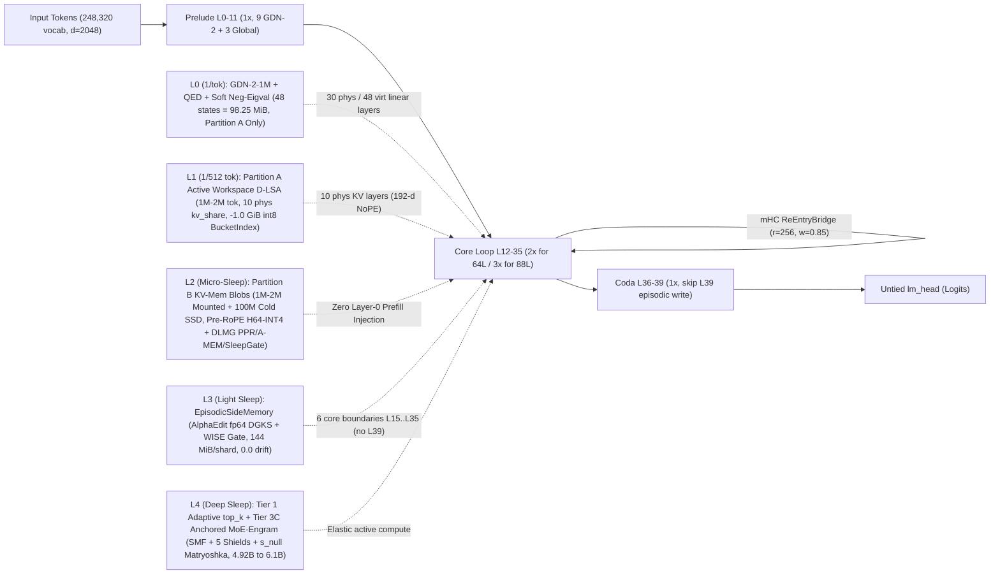

# Next-Gen Architecture Roadmap & Research Paper Plan: `Qwen3.6-64L-CoMem` (`LSA-NL`)

> **Repository:** `Qwen3.6-35B-A3B-Loop60` (`TassP0lar/Qwen3.6-35B-A3B-Loop64`) · **Branch Policy:** Pure `Qwen3.6` Primary Backbone (`0` external-donor license entanglement)  
> **Development Hardware:** `1× NVIDIA RTX PRO 6000 Blackwell Server Edition` (`GB202`, `sm_120`, **`96 GB GDDR7 ECC`** [`94.97 GiB` CUDA-usable], `512-bit`, **`1,597 GB/s`** peak bandwidth, `24,064` CUDA cores, `600 W` TDP)  
> **Companion Artifacts:** [LSA-NL Research Proposal](PROPOSAL_LSA_NESTED_LEARNING.md) · [Empirical Report (EN)](EXPERIMENT_REPORT.md) · [Empirical Report (ZH)](EXPERIMENT_REPORT_ZH.md) · [Compute Grant Proposal](COMPUTE_GRANT_PROPOSAL.md) · [SI-RSI Roadmap](RSI_ROADMAP.md) · [Tokenizer Parity CLI](../scripts/verify_q36_q38_tokenizer_parity.py)

> [!IMPORTANT]
> **Empirical Grounding & Zero-Fabrication Policy:** Every number in this roadmap is explicitly categorized as **`Measured`** (verified from repo logs, HF Hub commits, or direct file/header inspection), **`Derived Formula`** (exact closed-form parameter/byte accounting), **`Published (External)`** (vendor-reported external benchmark/spec), or **`Estimated`** (forward GPU-hour projection derived from measured single-card throughput). **Zero unmeasured downstream 2026 benchmark scores are claimed for our models.**

---

## §1. Executive Summary & Target Comparison vs. `Inkling 2 Mini`

Our clean v2 pipeline has already de-risked looped hybrid retrofitting on a single `96 GB GDDR7 ECC` GPU (`167.60` active supervisor hours; `s3_v2_long_1m_lsa@600` completed with `12/12` Gate 2 sharp passes and `100%` `18K`/`64K` needle recall; `GDN-2-1M + QED` live in `s2_v2_joint_bptt` at `67.80 GiB` peak VRAM with `0` skips). The next architectural leap—**`Qwen3.6-64L-CoMem`** powered by **Latent-Sparse Nested Learning (`LSA-NL`)** (see full theoretical formulation and falsification protocol in [`docs/PROPOSAL_LSA_NESTED_LEARNING.md`](PROPOSAL_LSA_NESTED_LEARNING.md))—targets the sweet spot of **`64` effective layers (`d=2`, `[0,12)×1 + [12,36)×2 + [36,40)×1`)** while preserving dynamic `R ∈ {1, 2, 3}` (`40L / 64L / 88L`) runtime scaling.

Instead of chasing an unrealistic raw `10M`-token contiguous chat window, `Qwen3.6-64L-CoMem` implements a **realistic `3M–4M` Split-Horizon Logical Context** (`1M–2M` live active workspace + `1M–2M` GPU-mounted consolidated KV-Mem Blobs, backed by **`100M+` cold consolidated tokens on Host DDR5 / NVMe SSD**) inside a **5-Level `LSA-NL` Continuum Memory System (`L0 → L4`)**, uniting our clean v2 `Qwen3.6-64L` backbone with verified dynamic memory modules from **`Spark-X2.6-Recursion`** (`BaiTian6641/Spark-X2.6-Recursion`) [1] and elastic active compute scaling (`4.916B → ~5.8–6.1B`) on a single `96 GB GDDR7 ECC` card.

### 1.1 Grounded Head-to-Head Specification & Benchmark Table

| Dimension | `Qwen3.6-64L (d=2)` Clean v2 *(Baseline)* | **`Qwen3.6-64L-CoMem` (`LSA-NL`)** *(Target)* | **`Inkling 2 Mini`** *(TML, Nov 20, 2026 [2])* | Provenance / Class |
| :--- | :--- | :--- | :--- | :---: |
| **Total Text Params** | `34.661B` (`~35B`; `32.212B` frozen MoE) | `34.661B` + `0.65–0.99 GiB` NVFP4 Engram | `26.4B` total | `Derived` / `Published` |
| **Physical → Effective Layers** | `40L` → **`64L`** (`[12,36)` core `×2`; `48` GDN-2 + `16` Global) | `40L` → **`64L`** (dynamic `40L/64L/88L` intact) | `24L` → `48L` (middle `12` looped `3×`) | `Derived` / `Published` |
| **Active Params (Exact Total)** | **`4.916B`** (`1.017B` untied embed+head + `2.053B` mixers + `1.845B` MoE; `4.41B` ex-input-embed) | **`~5.30B–6.1B`** elastic (Tier 1 `top_k` `+0.30B..+1.21B` and/or Tier 3C `5.30/5.45/5.86B`) | `~3.4B` base → **`~5.4B`** effective active | `Derived` / `Published` |
| **Weight Footprint** | `21.85 GiB` pure NVFP4 (`24.09 GiB` mixed NVFP4/FP8 HF ckpt) | `~22.5–25.1 GiB` NVFP4 (+ `144 MiB/shard` episodic) | `~20 GB` (`NVFP4 + MXFP8`) | `Measured` / `Published` |
| **Logical Context & KV State** | **`10.65 GiB`** FP8 / **`5.96–6.28 GiB`** Hadamard INT4 (`1M` contiguous; `10` physical `kv_share` layers) | **Split-Horizon `3M–4M` GPU** (`1M–2M` Active + `1M–2M` Mounted Blobs = **`21.25–22.50 GiB`** KV, `~43.7–45.0 GiB` total; **`-1.0 GiB`** `BucketIndex` fix) + **`100M+` Cold NVMe SSD** (`604.0 GB` SSD, `262.5 MiB` GPU headers) | `32.16 GiB` F16 (`1M` only: `32.00 GiB` across `8` unshared global + `0.16 GiB` across `40` SWA) | `Derived Formula` / `Published` |
| **Linear / SWA Recurrent State** | **`98.25 MiB`** exact (`48` virtual `fp32` GDN-2 + `bf16` conv states; `O(1)` infinite horizon) | **`98.25 MiB`** fixed `GDN-2-1M + QED + Soft Neg-Eigval` (**strictly isolated to Partition A**) | `163.8 MiB` (`0.16 GiB`, `40` fixed `1,024`-tok SWA) | `Derived Formula` / `Published` |
| **Multi-Hop / Episodic Memory** | Single-hop `D-LSA` (`192`-D NoPE); read-only weights | **5-Level `LSA-NL` CMS (`L0 → L4`):** Pre-RoPE KV-Mem Blobs (`L2`) + `DynamicLatentMemoryGraph` (`PPR` + `A-MEM` + bi-temporal `SleepGate`) + `EpisodicSideMemory` (`L3`, `AlphaEdit` + `WISE`, `0.0` drift) | None reported | `Architecture` |
| **SWE-bench Verified** | `TBD` *(post-`s2_v2` + `s4_v2_rl`)* | Target: close gap via `64L` SI-RSI + `LSA-NL` CoMem | `~79.2%` | `Published (External)` |
| **SWE-bench Pro v2 Hard** | `TBD` | Target: 13-gram decontaminated sweep | `~77.9%` | `Published (External)` |
| **SWE-bench Multilingual** | `TBD` | Target: 13-gram decontaminated sweep | `~73.7%` | `Published (External)` |
| **DeepSWE v1.1 / FrontierCode v2.0** | `TBD` / `TBD` | Target: verifiable coding/repo RL | `~48.2%` / `~15.1%` | `Published (External)` |
| **MCP-Atlas** | `TBD` | Target: clean multi-turn tool RL + episodic schema memory | `~82.7%` | `Published (External)` |
| **AA Intelligence Index** | `TBD` | Target: full 2026 suite post-Phase 4 | `~20.1` | `Published (External)` |
| **ScreenSpot Pro / OmniDocBench** | *Out of scope (text decoder only)* | *Out of scope (Phases 0–4 text-only)* | `~76.5%` / `~92.8%` | `Published (External)` |

### 1.2 Honest Architectural & Post-Training Gap Analysis

**Where `Qwen3.6-64L-CoMem` (`LSA-NL`) Already Leads Structurally:**
1. **`3.02×–5.40×` Smaller `1M`-Token State & Split-Horizon `3M–4M` / `100M` Cold SSD Scale:** `10` physical KV layers via `kv_share=True` + `D-LSA` + Block-64 Hadamard INT4 [3] fit a full **`3M–4M` Split-Horizon Logical Context** (`21.25–22.50 GiB` KV, `~43.7–45.0 GiB` total GPU footprint, `~50 GiB` free!) plus **`100M+` cold SSD tokens** (`604.0 GB` SSD, `262.5 MiB` GPU headers) inside a single `96 GB GDDR7 ECC` GPU—whereas Inkling 2 Mini consumes `32.16 GiB` F16 for `1M` alone.
2. **Deeper Sequential Reasoning Circuit & Larger Frozen Knowledge Pool:** `64L` (`d=2`, expandable to `88L` at `d=3`) vs. `48L`, backed by `34.661B` total parameters (`256` routed experts/layer, `32.212B` frozen) vs. `26.4B`.
3. **Stream-Isolated $O(1)$ Recurrent Memory vs. Fixed `1,024`-Token SWA:** `GDN-2-1M + Bounded QED + Soft Neg-Eigval` [4], [5], [6] maintains continuous delta-rule state tracking across all `48` virtual linear layers in `98.25 MiB` fixed VRAM (`0` extra state bytes over stock GDN), strictly isolated to Partition A (`1M–2M` active workspace) so archival KV blobs never cause recurrent overwrite churn.
4. **Non-Destructive 5-Frequency Continual Memory (`L0 → L4`):** Unlike pure *Titans / HOPE* neural memories [7], [8] (which require pretraining from scratch and suffer capacity-limited proactive interference [9] on verbatim identifiers), `LSA-NL` combines zero-re-prefill Pre-RoPE KV-Mem Blobs (`L2`, leveraging `Qwen3.6`'s `192/256` NoPE dims), `Spark-X2.6-Recursion` [1] `DynamicLatentMemoryGraph` (`HippoRAG 2` PPR + `A-MEM` + bi-temporal supersession), closed-form `EpisodicSideMemory` (`L3`, `AlphaEdit` Float64 DGKS + `WISE`, `0.0` drift), and `SMF`-stabilized `MoE-Engram` (`L4`)—capabilities absent in Inkling 2 Mini.
5. **Zero-Extra-Weight Self-Speculative Drafting:** Preserving `R=1` (`40L`) inside the identical weights allows `40L → 64L/88L` self-speculative drafting without training a separate auxiliary model (unlike TML's external `DSpark`).

**Where `Inkling 2 Mini` Currently Leads—and How Our Single-GPU Plan Closes the Gap:**
1. **Industrial SWE / Coding / MCP Tool-Use Post-Training (`79.2%` SWE-bench Verified, `82.7%` MCP-Atlas):** Inkling 2 Mini benefits from massive multi-node RLVR execution environments. On a single **`NVIDIA RTX PRO 6000 Blackwell Server Edition (96 GB GDDR7 ECC, 1,597 GB/s)`**, we close the gap through high-leverage sample efficiency: (a) focusing Stage-4 `s4_v2_rl` SI-RSI rollouts on **`64L (d=2)`** (`~1.4×` faster decode than `88L`), (b) consolidating repository architecture & MCP tool schemas from `L2` KV-Mem Blobs into `L3` `EpisodicSideMemory` in closed form without catastrophic forgetting, (c) deploying `DynamicLatentMemoryGraph` with `SleepGate` [9] bi-temporal supersession so long multi-file coding sessions never attend to stale edited code, and (d) pairing verifiable math, CUDA/Triton (`KernelBench`), sandboxed unit-test coding, and clean (non-redacted) MCP tool trajectories with surgical `[loop_adapters, router]` SI-RSI unlikelihood.
2. **Active Compute Parity (`~5.4B` vs. `4.916B`):** Closed immediately in Phase 1 via zero-VRAM Tier 1 native `top_k` scaling (`8 → 10–16`, adding `+0.30B..+1.21B`) and consolidated in Phase 3 via native `2048`-D Anchored `MoE-Engram` (`5.30B / 5.45B / 5.86B` active).
3. **Multimodal Vision/Document Benchmarks (`ScreenSpot Pro`, `OmniDocBench`):** Explicitly acknowledged as out-of-scope for Phases 0–4; our text-decoder modifications preserve `Qwen3.6-35B-A3B`'s exact embedding space (`248,320 × 2,048`) so the stock ViT tower can be re-attached in future multimodal work without re-aligning text weights.

---

## §2. Primary-Source External Donor & Tokenizer Parity Audit

Before considering any external weights or lookup tables, we performed primary-source forensic inspection of **`Qwen/Qwen3.6-35B-A3B`** [10], **`Qwen/Qwen3.8-Flash-Next`**, and **`Qwen/Qwen3.8-2.4T-A95B`**. All tokenizer and header checks are fully reproducible via [`scripts/verify_q36_q38_tokenizer_parity.py`](../scripts/verify_q36_q38_tokenizer_parity.py).

### 2.1 Forensic Tokenizer Parity: `Qwen/Qwen3.6-35B-A3B` vs. `Qwen/Qwen3.8-Flash-Next` (`Measured`)

| Inspected Artifact / Section | `Qwen/Qwen3.6-35B-A3B` | `Qwen/Qwen3.8-Flash-Next` | Parity Result |
| :--- | :--- | :--- | :---: |
| **`tokenizer.json` — All 18 Sections (Shared Scope)** | `version`, `truncation`, `padding`, `normalizer`, `pre_tokenizer`, `post_processor`, `decoder`, `model.{type, dropout, unk_token, continuing_subword_prefix, end_of_word_suffix, fuse_unk, byte_fallback, ignore_merges}` | Identical byte-for-byte / JSON-value-for-value across all core pipeline & model settings | **100% `exact_equal: True`** |
| **`model.vocab`** | `248,044` IDs (`0..248043`) | `248,044` IDs (`0..248043`) | **100% `exact_equal: True`** |
| **`model.merges`** | `247,587` BPE merge rules | `247,587` BPE merge rules | **100% `exact_equal: True`** |
| **Shared `added_tokens`** | `26` tokens (IDs `248044..248069`) | `26` tokens (IDs `248044..248069`) | **100% `exact_equal: True`** |
| **Sole Diff — Appended Audio/TTS Tokens** | *(none)* | **`7` appended IDs (`248070..248076`):** `<|audio_start|>`, `<|audio_end|>`, `<tts_pad>`, `<tts_text_bos>`, `<tts_text_eod>`, `<tts_text_bos_single>`, `<|audio_pad|>` | **Strictly appended only** |
| **`tokenizer_config.json`** | `eos='<|im_end|>'`, `pad='<|endoftext|>'`, `bos=None`, `model_max_length=262144` | `eos='<|im_end|>'`, `pad='<|endoftext|>'`, `bos=None`, `model_max_length=262144` | **100% identical** |

**Key Engineering Finding:** Every text and vision token ID (`0..248069`) is **bit-exact identical** between `Qwen3.6-35B-A3B` and `Qwen3.8-Flash-Next`. Any token-ID-indexed N-gram memory table from `Qwen3.8-Flash-Next` can be queried directly from `Qwen3.6` input IDs with zero retokenization.

### 2.2 Direct Safetensors Header Audit of External Candidates (`Measured`)

| Candidate Repo | Architecture & Scale | License | Direct Header / Config Finding | Disposition |
| :--- | :--- | :---: | :--- | :---: |
| **`Qwen/Qwen3.8-Flash-Next`** | `model_type: qwen4_exp`, `360.0 GB` BF16 (`131` shards) | `qwen-community-1.0` | Inspected directly via safetensors headers across the `33` PLE-bearing shards (`model-00005..model-00037` of `131`): **`137` `.ple.` tensors** at **0-indexed `model.language_model.layers.1.ple.*`** (despite `config.json` listing `ple_layer_ids: [2]`): `128` shards × `BF16 [2,500,012, 160]` = **`51,200,245,760` (`51.20B`)** params (`16` heads = `2` n-gram orders × `8` heads × `160` dim = `2,560`), `layer_multipliers: I64 [3]`, `ngram_heads_offsets: I64 [16]`, `ngram_heads_vocab_sizes: I64 [16]`, `value_proj: BF16 [2560, 2560]`, and `4`-branch GR `key_proj/conv1d` (`10240 = 4×2560`) bypassed when porting into single-stream `d=2048`. | **Tier 2: Optional Plug-In Ablation Only (Phase 4B)** |
| **`Qwen/Qwen3.8-2.4T-A95B`** *(official base of `Qwen3.8-Max`)* | `model_type: qwen3_5_moe_text`, `92L`, `d=8192`, `512` experts, `moe_intermediate=2048` | `qwen3.8-max` | **NO `ple` table.** Hidden width `d=8192` is **`4×` wider** than `Qwen3.6`'s `d=2048`; incompatible residual geometry and restrictive `qwen3.8-max` license. | **Ruled Out as Weight Donor** |

### 2.3 Binding Policy Decisions: Pure Primary Backbone, Optional Tier 2, and Dropping Tier 4

1. **Primary Model (`Qwen3.6-64L-CoMem`) = 100% Pure `Qwen3.6`:** Zero external-donor weights are merged into the primary release. All primary training, checkpoints, and Paper 2 headline claims rest cleanly on `Qwen/Qwen3.6-35B-A3B` with zero external license entanglement.
2. **Tier 2 (`51.20B` Layer-1 `ple` External Memory Port) = Strictly Optional Plug-In Ablation:** Evaluated in Phase 4B as a standalone plugin (`qwen-community-1.0` table kept zero-copy `mmap`-ed in Host DDR5/NVMe + **`~10.5M` GPU adapter params** projecting `2560 ↔ 2048` and bypassing the `4`-branch `10240`-D GR `key_proj/conv1d`). Requires **zero `360 GB` donor inference**.
3. **Tier 4 (Cross-Model Procrustes SwiGLU Expert Transplanting) = EXPLICITLY DROPPED:**
   - *Non-Linear SiLU Cone Mismatch:* Orthogonal Procrustes alignment $R \in O(d)$ matches linear residual subspaces, but SwiGLU $(\operatorname{SiLU}(W_{\text{gate}} x) \odot W_{\text{up}} x) W_{\text{down}}$ operates over an axis-aligned non-linear activation cone; rotating input coordinates breaks expert gating sparsity unless intermediate bases are jointly retrained.
   - *Hidden `+0.503B` Dense Bridge Tax:* Projecting between donor (`d=2560`) and host (`d=2048`) via dense entry/exit bridges across `48` core visits adds `48 × 2 × (2048 × 2560) = 503.32M` (**`+0.503B`**) dense active parameters spent purely on linear coordinate translation rather than expert capacity.
   - *Single-GPU Distillation Waste:* Re-aligning transplanted SwiGLU cones consumes **`110–230` single-GPU hours** of distillation on `1× 96 GB GDDR7 ECC`—strictly dominated in quality-per-GPU-hour by native `Qwen3.6` `top_k` scaling (`0` extra VRAM) and native `2048`-D `MoE-Engram` (`20–35` GPU-h).

---

## §3. Target Next-Gen Architecture: `Qwen3.6-64L-CoMem` (5-Level `LSA-NL` Continuum Memory + Elastic Compute)

`Qwen3.6-64L-CoMem` organizes memory and compute into a **5-Level `LSA-NL` Continuum Memory System (`L0 → L4`)** around the calibrated `64L (d=2)` core (`[0,12)×1 + [12,36)×2 + [36,40)×1`) with a **Split-Horizon `3M–4M` Logical Context** (`1M–2M` Partition A Active + `1M–2M` Partition B Consolidated Blobs, backed by `100M+` cold NVMe SSD tokens). See [`docs/PROPOSAL_LSA_NESTED_LEARNING.md`](PROPOSAL_LSA_NESTED_LEARNING.md) for the complete mathematical proofs (`Geometric Error G` vs. `Dynamic Error D`), bandwidth derivations, and Wake → Micro-Sleep → Light Sleep → Deep Sleep consolidation protocol. Two global invariants are enforced by unit tests and SHA-256 guards across all phases:
- **Strict Step-0 IEEE-754 Bit-Identity (`max_abs_diff == 0.0`):** Every added module initializes to exact zero residual contribution (`GDN2Adapter`, `PassExitGate`, `PassRouterAdapters`, `EpisodicSideMemory`, `AnchoredMoEEngram`).
- **100% Frozen `32.212B` NVFP4 Routed Experts:** Verified before and after every training step via `sha256_frozen_experts()` in [`src/qloop/model/experts.py`](../src/qloop/model/experts.py) and [`src/qloop/model/loop.py`](../src/qloop/model/loop.py).

### 3.1 Level `L0` (`f = 1/tok`) — Partition-A Recurrent State (`GDN-2-1M + QED + Soft Neg-Eigval`)
- **State & Compute Footprint (`Measured` / `Derived Formula`):** `48` virtual linear layers in `64L (d=2)` hold exactly **`98.25 MiB`** fixed recurrent+conv state (`48 × [2.00 MiB fp32 state + 48 KiB bf16 conv]`, `0` extra state bytes over stock GDN) with `27.53M` trainable adapter parameters (`0.079%`) in [`src/qloop/model/gdn2.py`](../src/qloop/model/gdn2.py).
- **Split-Horizon Isolation Rule:** `GDN-2` runs **strictly on Partition A** (the coherent `1M–2M` live active stream) and never ingests cold Partition-B KV blobs, preventing archival overwrite churn.
- **Kernel Stack:** Mapped 1-to-1 onto `fla 0.6.0` `DPLR` Triton kernels [11] with fused `tl.int64` QED+DPLR prep (`53.55 ms` @ `32K`, `0.0787 ms` @ `T=1`) and checkpointed `4×8K` macro-segmenting (`fla_segment_len=8192`, `need_grad`-gated, `3.28×` wrapper VRAM cut from `23.051 → 7.032 GiB`).
- **Status:** **In Progress (Phase 0)** — currently training in `s2_v2_joint_bptt` (`1,040–1,173 tok/s`, `67.77–67.80 GiB` peak VRAM, `0` skips).

### 3.2 Levels `L1` + `L2` (`f = 1/512 tok` & Micro-Sleep) — Split-Horizon `3M–4M` Logical Context + `100M+` Cold NVMe SSD (`Tier 3A`)
- **Partition A (`L1`, `1M–2M` Adjustable Active Workspace):** Operates over `10` physical `kv_share=True` full-attention layers (`10.00 GiB` FP8 / `5.625 GiB` `Block64HadamardINT4Cache` per `1M` tokens) and **`192`-D position-free NoPE `D-LSA` key space** (`LSAIndexer` with `index_on="nope"`, `d_idx=64`, `rotary_dim=64`, `head_dim=256` in [`src/qloop/model/lsa.py`](../src/qloop/model/lsa.py)).
- **`BucketIndex` Compaction (`-1.0 GiB` VRAM Reclaim):** Auditing `LSAIndexer._assemble()` ([`src/qloop/model/lsa.py:728-768`](../src/qloop/model/lsa.py#L728-L768)) showed eager `int64` index tables consume `+1.04 GiB` at `1M` tokens (`members` `0.625`, `key2slot` `0.156`, `unit_members` `0.156`, `labels`/`slot_labels` `0.078`, misc `0.025 GiB`). Storing local indices in `int8`, skipping training-only `key2slot` during inference, and materializing `members` on-the-fly for selected `Top-64` buckets reduces overhead to **`~0.04 GiB`** (reclaiming **`-1.0 GiB` GDDR7 VRAM**).
- **Partition B (`L2`, `1M–2M` GPU-Mounted Consolidated KV-Mem Blob Bank + `100M+` Cold NVMe SSD):**
  - **Pre-RoPE `H64-INT4` KV-Mem Blobs (`512` tokens/blob):** Each consolidated blob packs `2.8125 MiB` (`2,949,120 B`, `0.5625 B/scalar` via `Block64HadamardINT4Cache` in [`src/qloop/model/offload.py`](../src/qloop/model/offload.py)) with `[0:4)` original-session sinks stripped (`EPIC` [12]), `[0:64)` rotary dims un-rotated (`apply_partial_rope_k(k, -p)` in [`src/qloop/model/pos_rerope.py`](../src/qloop/model/pos_rerope.py)) while `192` NoPE dims stay untouched in `H_64` space, and a `4`-token Boundary & Abstraction Header.
  - **Tiered Bandwidth & GPU Envelope:** `100 Mi-tokens` (`204,800` blobs) consume **`604.0 GB` NVMe SSD** with only **`250.00 MiB` (`0.244 GiB`)** GPU centroids (`262.50 MiB` / `0.256 GiB` including `64 B/blob` bi-temporal/graph metadata). Async 3-layer-ahead prefetch streams blobs at **`0.059 ms/blob`** (DDR5 `50 GB/s`) or **`0.421 ms/blob`** (Gen4 NVMe `7 GB/s`). Realistic envelopes: **`3M` Precision Split** (`1M` FP8 + `2M` H64 = `21.25 GiB` KV, **`~43.7 GiB` total**), **`4M` Max Split** (`2M` + `2M` H64 = `22.50 GiB` KV, **`~45.0 GiB` total**), or **`2M` Hot + `100M` Cold SSD** (`11.25 GiB` KV, **`~33.7 GiB` total**, **`>61 GiB` free**!).
  - **`HotColdPagedKVStore` + `DynamicLatentMemoryGraph` (`Spark-X2.6-Recursion` [1] + `EpiCache` [13] + `SleepGate` [9]):** Combines `HippoRAG 2` Personalized PageRank (PPR) [14] for multi-hop bridge traversal, `A-MEM` reciprocal semantic links [15], and `Zep / Graphiti` bi-temporal validity intervals `[t_valid, t_invalid)` [16] with `SleepGate` [9] proactive-interference conflict tagging and optional `5%` `CacheBlend` [17] selective refresh (gated by Kill-Gate `K0`).

### 3.3 Level `L3` (`f = 1/task`, Light Sleep) — Fast Writable Episodic Memory (`Tier 3B`, Zero Gradient Training)
- **Architecture:** Ports `Spark-X2.6-Recursion`'s **`EpisodicSideMemory` / `NullSpaceVerticalAdapter`** [1] to graduate highest-recurrence `L2` KV-Mem Blobs from horizontal KV slots into $O(1)$ vertical residual projections without gradient descent.
- **Attachment Topology (`6` Core Boundaries — Strict `S2` Coda Skip Rule):** Attached strictly at the **`6` core full-attention boundaries `L15, L19, L23, L27, L31, L35`** (`12` virtual visits in `64L`), **explicitly skipping Coda `L39`** per Spark-X2.6's verified `S2` rule (final-layer edits distort pre-logit calibration and unembedding geometry).
- **Closed-Form Light-Sleep Consolidation & Locality Protection:**
  - **`AlphaEdit` Float64 DGKS Null-Space Ridge [18]:** Computes the general-knowledge covariance null-space projector $P_{\text{null}}$ using Float64 Daniel-Gragg-Kaufman-Stewart (DGKS) re-orthogonalization and ridge-stabilized closed-form updates, guaranteeing **exact `0.0` general-text locality drift** ($\Delta W K_0 = 0$) backed by a transactional **undo ledger** for instant rollback.
  - **`WISE` Activation Scope Gate [19]:** Gates episodic residual injection strictly on in-manifold activation similarity, keeping general benchmarks untouched outside the edited scope.
- **Footprint:** **`144 MiB/shard`** across all `6` core boundaries—hot-swappable per repository, tool suite, or user session in milliseconds with **zero gradient training**.

### 3.4 Level `L4` (`f = 1/week`, Deep Sleep) — Elastic Active Compute & Sparse Long-Term Consolidation (`4.916B → ~6.1B`, `Tier 1 + Tier 3C`)

#### Tier 1: Native `Qwen3.6` Dynamic `top_k` Scaling (`+0.30B` to `+1.21B` Active at `0` Extra VRAM)
- **Mechanism:** Unlocks additional frozen experts from the existing `256`-expert NVFP4 pool without adding a single byte of weight VRAM by extending `_pass_router_hook()` ([`src/qloop/model/loop.py`](../src/qloop/model/loop.py)), `parse_router_output()` ([`src/qloop/model/experts.py`](../src/qloop/model/experts.py)), and `_build_moe_dispatch_plan()` / `_moe_routed_forward_impl()` ([`src/qloop/model/quant_autograd.py`](../src/qloop/model/quant_autograd.py)) to support runtime `top_k ∈ {8, 10, 12, 14, 16}` (renormalized top-`k` probabilities).
- **Three Selectable Scaling Policies:**
  1. *Fixed Core `top_k`* (`8 → 10 / 12 / 14 / 16` across `48` core visits): adds exactly **`+0.30B / +0.60B / +0.91B / +1.21B`** native active compute (`48 × Δk × 3.146M`) at `0` extra VRAM.
  2. *Pass-2-Only Escalation* (`top_k=8` on Prelude/Pass-1/Coda, `top_k=12..16` on Core Pass 2): preserves fast `R=1` (`40L`) draft speed while boosting Pass-2 refinement (`+0.30B..+0.60B`).
  3. *Entropy-Adaptive `top_k`*: allocates `k=8` on low-entropy routine tokens and escalates up to `k=16` on high-entropy reasoning/coding branch points, maintaining near-`k=8` average latency with `k=14–16` peak expressivity.

#### Tier 3C: Native `2048`-D Anchored `MoE-Engram` + `SMF` (`L15, L19, L23, L27, L31, L35` — `12` Visits in `64L`)
- **Topology & Budget Presets:** Attached at the same `6` core boundaries (`L15, L19, L23, L27, L31, L35` → **`12` virtual visits** in `64L`), paired with a pinned Host-DDR5 **Tier-1B causal N-gram memory table** (pure `Qwen3.6` vocabulary, zero donor weights) and **`SMF`** [20] TF-IDF/surprise-weighted sparse memory finetuning during Deep Sleep. Three calibrated active-compute presets:
  - **Native-Grain (`5.30B` total active):** `512`-D SwiGLU grain matching native `Qwen3.6` experts (`+0.38B` active).
  - **Compact (`5.45B` total active):** Matches Inkling 2 Mini's `~5.4B` active compute bracket (`0.65 GiB` NVFP4 / `2.32 GiB` BF16).
  - **Full (`5.86B` total active):** High-capacity Engram FFN budget (`0.99 GiB` NVFP4 / `3.52 GiB` BF16).
- **Warm-Start Initialization (Curing `H1` Cold-Start Data Starvation):** Instead of random initialization (which caused `H1` data starvation in `Spark-X2.6-Recursion` [1]), Engram expert prototypes are initialized via **native `Qwen3.6` frozen-expert clustering / SVD warm-start** from each boundary layer's `256`-expert bank, giving meaningful specialization from step 1.
- **All 5 Verified Stability Shields (Mandatory Before Any Phase-3 Run):**
  1. **Step-0 `gamma = 0` Identity Shield:** Zero-initialized output scale $\gamma = 0$ guaranteeing exact `max_abs_diff == 0.0` at Step 0.
  2. **`min_active_pos` Prompt-Prefix Suppression:** Masks Engram injection on early prompt-prefix tokens ($t < \text{min\_active\_pos}$), porting the Spark-X2.6 fix that cured **`93.6%`** of OOD prompt-prefix perplexity degradation.
  3. **DeepSeek Signed-Sqrt RMSNorm QK Gate (`arXiv:2601.07372` [21]):** Applies signed-sqrt RMSNorm normalization to Engram QK gating logits, stabilizing attention/retrieval scale across `8K–4M` contexts.
  4. **`WISE` Scope Gate + `<= 3%` Relative Norm Cap:** Enforces $\|\Delta h_{\text{engram}}\|_2 \le 0.03 \|h\|_2$ gated by WISE activation scope so out-of-distribution inputs cannot destabilize frozen core trajectories.
  5. **Independent Sigmoid Routing + `s_null` Matryoshka Slicing (`p = 0.15` OFF):** Replaces sum-to-1 softmax with independent per-expert sigmoids competing against a learnable no-op null sink $s_{\text{null}}$, paired with Matryoshka capacity slicing and `p = 0.15` full-module dropout during training so the core never co-adapts to require Engram (**zero `CE_off` drift**, guaranteeing exact standalone `64L` fallback).

---

## §4. Phased Execution Plan, File Hooks, Kill-Gates & Milestone Tracker

All GPU-hour estimates below are **`Estimated`** for **`1× NVIDIA RTX PRO 6000 Blackwell Server Edition (96 GB GDDR7 ECC, 1,597 GB/s)`** calibrated directly from our measured `s3_v2` (`2,365 tok/s`) and `s2_v2` (`1,040–1,173 tok/s`) single-card telemetry.

| Phase | Scope & Core Deliverables | Exact `src/qloop/` File Touchpoints | Single-GPU Budget (`1× 96 GB GDDR7`) | Hard Pass / Fail Kill-Gates | Status |
| :---: | :--- | :--- | :---: | :--- | :---: |
| **Phase 0** | **Clean v2 `GDN-2-1M + QED` Completion (`L0`):** Finish `s2_v2_joint_bptt` (`s110 → 600`), run Gate 2 `18K/64K/256K` needle & coherence truth-check, run `GDN-2 ON vs OFF` causal ablation, publish Paper 1 (v1.5). | [`src/qloop/model/gdn2.py`](../src/qloop/model/gdn2.py), [`src/qloop/train/bptt.py`](../src/qloop/train/bptt.py), [`configs/stages/s2_v2_joint_bptt.yaml`](../configs/stages/s2_v2_joint_bptt.yaml) | `~35–38 h` remaining (`~45 h` total for `600` steps) | `0` NaNs/skips; peak VRAM `< 75 GiB`; `100%` `18K/64K` needle pass; `0` loops/slop; monotonic `d=1→2→3` NLL & positive `GDN-2 ON` gain over `s3_v2@600` | **`In Progress`** *(live @ `s110/600`)* |
| **Phase 1** | **Zero-Retrain Inference Upgrades (`Tier 1` + `L1` Compaction):** (a) Dynamic native `top_k` (`8→10/12/14/16`, fixed / Pass-2 / entropy-adaptive, `0` extra VRAM); (b) `BucketIndex` `int8`/on-the-fly compaction reclaiming `-1.0 GiB` GDDR7 VRAM. | [`src/qloop/model/quant_autograd.py`](../src/qloop/model/quant_autograd.py), [`src/qloop/model/experts.py`](../src/qloop/model/experts.py), [`src/qloop/model/loop.py`](../src/qloop/model/loop.py), [`src/qloop/model/lsa.py`](../src/qloop/model/lsa.py) (`:728-768`) | `~2–4 h` *(zero training; parity & eval sweeps)* | `0.0` `top_k=8` parity diff; `BucketIndex` @ `1M` `<= 0.06 GiB`; `top_k>8` improves held-out hard math/code NLL or pass@1 at `0` extra weight VRAM | **`Planned`** |
| **Phase 2A** | **Pre-RoPE KV-Mem Blob Injection Kill-Gate `K0` (Zero Retraining):** Immediately after `s2_v2@600`, evaluate 4 paired arms (`(a)` contiguous oracle, `(b)` naive spliced KV, `(c)` Pre-RoPE `[0:64)` un-rotated + sink-stripped `H64-INT4` Partition-B injection, `(d)` `+ 5% CacheBlend` [17]) across `18K / 64K / 256K / 1M` multi-hop QA (see [`PROPOSAL_LSA_NESTED_LEARNING.md`](PROPOSAL_LSA_NESTED_LEARNING.md) §5.1). | [`src/qloop/model/pos_rerope.py`](../src/qloop/model/pos_rerope.py), [`src/qloop/model/offload.py`](../src/qloop/model/offload.py), [`src/qloop/model/lsa.py`](../src/qloop/model/lsa.py), new `scripts/eval_killgate_k0_kv_blobs.py` | **`~0.5 h`** *(zero training; optional `+2–4 h` `Block-Attention` [22] adapter calib only if Yellow-B)* | **GREEN:** `Arm (c) >= 92%` of oracle & NLL gap `<= 0.05` nats → training-free Phase 2B. **YELLOW:** `75–92%` → enable `5% CacheBlend` or `2–4 h` adapter calib. **RED:** `< 75%` → pivot Partition B to `ESM` + text-header re-prefill | **`Planned`** |
| **Phase 2B** | **`L2` `KVMemBlobStore` + `DLMG` (Micro-Sleep) & `L3` `EpisodicSideMemory` (Light Sleep):** Implement Split-Horizon `3M–4M` (`1M–2M` Active + `1M–2M` Mounted + `100M+` Cold NVMe SSD), `HotColdPagedKVStore` (`async_lookahead`), `DynamicLatentMemoryGraph` (`HippoRAG 2` PPR + `A-MEM` + `Zep/Graphiti` bi-temporal + `SleepGate`), and `EpisodicSideMemory` (`AlphaEdit` fp64 DGKS + `WISE`, `L15..L35`, skip `L39`). | [`src/qloop/model/offload.py`](../src/qloop/model/offload.py), [`src/qloop/infer/engine.py`](../src/qloop/infer/engine.py), new `src/qloop/model/kv_blobs.py`, new `src/qloop/model/memory_graph.py`, new `src/qloop/model/episodic.py` | `~4–8 h` *(zero backbone training; calibration + multi-session sweeps)* | `K1`: `204,800` headers `<= 270 MiB`, `< 1.5 ms` DDR5 `8`-blob mount; `K2`: `DLMG` + `SleepGate` beats flat `D-LSA`/RAG by `>= +15` pts on contradictory updates & `>= +10` pts on 2-hop; `K3`: `ESM` `0.000` general-text drift + `100%` undo rollback | **`Planned`** |
| **Phase 3** | **`L4` Elastic Active Compute (`Tier 3C` Anchored `MoE-Engram` + `SMF` Deep Sleep):** Implement native `2048`-D `AnchoredMoEEngram` at `L15..L35` (`12` visits in `64L`) + DDR5 Tier-1B causal N-gram + native `Qwen3.6` clustering warm-start + all 5 stability shields (`s_null` Matryoshka Slicing) + `SMF` [20] sparse updates; train Compact (`5.45B`) & compare vs Native-Grain (`5.30B`) / Full (`5.86B`). | New `src/qloop/model/engram.py`, [`src/qloop/model/loop.py`](../src/qloop/model/loop.py), [`src/qloop/model/experts.py`](../src/qloop/model/experts.py) (`param_group_of`), [`src/qloop/train/stack.py`](../src/qloop/train/stack.py), [`src/qloop/train/optim.py`](../src/qloop/train/optim.py), new `configs/stages/s2b_comem_engram.yaml` | `~20–35 h` *(APOLLO-enabled single-card SFT/distill)* | `max_abs_diff == 0.0` at Step 0; frozen experts SHA-256 unchanged; `CE_off` drift `<= 0.005` nats under Matryoshka `p=0.15` dropout; OOD prompt-prefix delta `<= 0.01` nats (`min_active_pos`); beats FLOP-matched `top_k`-only `64L` baseline | **`Planned`** |
| **Phase 4** | **Stage-4 Verifiable `SI-RSI` RL (`s4_v2_rl`, `64L d=2` Focus) + Optional `4B` Tier-2 `ple` Ablation:** Run GRPO/DAPO + surgical `[loop_adapters, router]` `SI-RSI` on `64L (d=2)` across math (`DAPO-Math-17k`), CUDA/Triton (`KernelBench`), sandboxed coding/SWE, & clean MCP tool-use with `40L→64L` self-speculative rollouts. Optional Phase 4B quarantines `Qwen3.8-Flash-Next` Layer-1 `51.20B` `ple` DDR5 `mmap` plugin (`~10.5M` GPU adapter) for isolated Paper 2 ablation. | [`src/qloop/train/rl.py`](../src/qloop/train/rl.py), [`src/qloop/train/sirsi.py`](../src/qloop/train/sirsi.py), [`src/qloop/infer/engine.py`](../src/qloop/infer/engine.py), [`src/qloop/eval/registry.py`](../src/qloop/eval/registry.py), [`configs/stages/s4_v2_rl.yaml`](../configs/stages/s4_v2_rl.yaml), optional `src/qloop/plugins/ple_mmap.py` | `~80–140 h` *(or `~12–20` wall-h on `8×` grant node; `+12–20 h` opt. 4B)* | Holdout promotion gate (`min_delta >= 0.0`, `max_len_growth <= 1.5`, `0` loop degeneration); measurable gains on 13-gram-decontaminated `AIME 2026`, `KernelBench L3`, `SWE-bench`, `MCP-Atlas`, `MRCR 1M`; export `safetensors` Whole Model Pack; kill 4B if pure-`Qwen3.6` Tier 3C achieves `>= 95%` of Tier 2 factuality gain | **`Planned`** |

---

## §5. Research Paper, Technical Report & Grant Deliverable Plan

We maintain a two-stage publication pipeline so completed clean-v2 empirical findings are disseminated immediately while the full **5-Level `LSA-NL` Continuum Memory** system targets top-tier 2027 peer-reviewed venues. **[`docs/PROPOSAL_LSA_NESTED_LEARNING.md`](PROPOSAL_LSA_NESTED_LEARNING.md)** serves as the formal theoretical, mathematical, and empirical falsification foundation for **Paper 2**.

### 5.1 Publication & Reporting Matrix

| Deliverable | Timing | Tracked Files / Artifacts | Primary Scientific Content | Target Venue / Channel |
| :--- | :---: | :--- | :--- | :--- |
| **Paper 1 (v1.5 Technical Report & Grant Update)** | Immediate after **Phase 0** (`s2_v2@600`) | [`docs/EXPERIMENT_REPORT.md`](EXPERIMENT_REPORT.md), [`docs/EXPERIMENT_REPORT_ZH.md`](EXPERIMENT_REPORT_ZH.md), [`docs/COMPUTE_GRANT_PROPOSAL.md`](COMPUTE_GRANT_PROPOSAL.md), [`docs/papers/Loop64_Technical_Report_EN.pdf`](papers/Loop64_Technical_Report_EN.pdf), [`docs/papers/Loop64_Technical_Report_ZH.pdf`](papers/Loop64_Technical_Report_ZH.pdf) | Final `s2_v2@600` (`40L / 64L / 88L`) telemetry, **GDN-2 ON vs. OFF causal ablation** (vs. `s3_v2@600`), Gate 2 `18K–256K` needle sweep, and first measured 13-gram-decontaminated 2026 benchmark comparisons against Stock `Qwen3.6-35B-A3B` and published `Inkling 2 Mini` baselines. | Open bilingual US-Letter IEEE technical report + arXiv preprint + compute grant updates |
| **Paper 2 (Flagship `LSA-NL` / `Loop64-CoMem` Paper)** | After **Phases 1–4** | Theoretical foundation: [`docs/PROPOSAL_LSA_NESTED_LEARNING.md`](PROPOSAL_LSA_NESTED_LEARNING.md) → New `docs/papers/Loop64_CoMem_Paper_{EN,ZH}.pdf` + reproducible `K0` & `NL-0..NL-6` logs | **Working Title:** *"Latent-Sparse Nested Learning (`LSA-NL`): Split-Horizon Continuum Memory and Elastic Active Compute for Single-GPU 64-Layer Frozen-MoE Reasoning"* | **NeurIPS / ICML / ICLR / COLM 2027** (Systems & Reasoning tracks) + arXiv preprint + bilingual EN/ZH technical reports |

### 5.2 Paper 2 (`LSA-NL` / `Loop64-CoMem`) Proposed Section Outline

1. **Introduction & Continuum Memory Thesis ([`PROPOSAL_LSA_NESTED_LEARNING.md`](PROPOSAL_LSA_NESTED_LEARNING.md) §1):** Why persistent single-GPU (`96 GB GDDR7 ECC`) reasoning requires a **5-Frequency Continuum Memory System (`L0 → L4`)** over a realistic **Split-Horizon `3M–4M` Logical Context (`100M+` cold SSD)** rather than an OOM-prone raw `10M` contiguous window or scratch-trained parametric *Titans / HOPE* memories [7], [8].
2. **Cross-Session KV-Mem Blob Theory & Zero-Training Kill-Gate `K0` ([`PROPOSAL_LSA_NESTED_LEARNING.md`](PROPOSAL_LSA_NESTED_LEARNING.md) §2–§3, §5.1):** Formal decomposition of Geometric Error ($G$) vs. Dynamic / Sink Error ($D$), proving why `Qwen3.6`'s `192/256` NoPE dims + orthogonal `H_64` isolation + Pre-RoPE un-rotation neutralize $G$ cleanly, alongside empirical `K0` results across `18K–1M`.
3. **Wake → Micro-Sleep → Light Sleep → Deep Sleep Lifecycle ([`PROPOSAL_LSA_NESTED_LEARNING.md`](PROPOSAL_LSA_NESTED_LEARNING.md) §4):** Formal mechanisms across `L0` (`GDN-2-1M+QED` isolated to Partition A), `L1` (Partition A `D-LSA` + `-1.0 GiB` compacted `BucketIndex`), `L2` (Partition B Pre-RoPE `H64-INT4` blobs + `DLMG` `PPR`/`A-MEM`/`Zep`/`SleepGate`), `L3` (`EpisodicSideMemory` via Float64 DGKS `AlphaEdit` + `WISE`, `L15..L35` skipping `L39`), and `L4` (Dynamic `top_k` + Anchored `MoE-Engram` + `SMF` + all 5 stability shields).
4. **Negative Results & Principled Exclusions:** (a) HSSD v3.2 non-identity shock & vault collapse post-mortem; (b) why Tier 4 cross-model Procrustes SwiGLU transplanting is mathematically and economically dominated (`SiLU` cone mismatch, `+0.503B` dense bridge tax, `110–230` GPU-h waste); (c) `Spark-X2.6` lessons (`H1` cold-start starvation, `S2` Coda `L39` distortion, `min_active_pos` `93.6%` OOD prefix cure, `CE_off` `s_null` Matryoshka Slicing).
5. **Blackwell `sm_120` Single-GPU Systems Engineering:** APOLLO low-rank optimization, `4×8K` macro-segmented `fla 0.6.0` DPLR (`3.28×` VRAM cut), `BucketIndex` `int8` compaction (`-1.0 GiB`), `250–262.5 MiB` `100M`-token GPU header routing (`~0.02 ms/layer`), `async_lookahead` NVMe/DDR5 streaming, and `40L → 64L` self-speculative rollout acceleration.
6. **Controlled Ablation Matrix (`A0–A7` / `NL-0..NL-6`), 2026 Frontier Suite & Optional Tier-2 Plug-In Study:** Apples-to-apples evaluation on the exact same frozen `Qwen3.6` checkpoint across coding (`SWE-bench Verified/Pro`, `KernelBench`), math (`AIME 2026`, `HMMT`), agentic tool-use (`MCP-Atlas`, `Terminal-Bench 4.1`), proactive-interference multi-session QA, and `1M–100M` archival recall (`MRCR 1M`, `LongBench v2`), compared honestly against Stock `Qwen3.6`, Naive Text RAG, FLOP-matched `40L` CoT, optional Phase-4B `51.20B` `ple` DDR5 `mmap` plug-in, and published `Inkling 2 Mini` numbers.

### 5.3 Required Controlled Ablation Matrix for Paper 2 (Aligned with `NL-0..NL-6`)

Every ablation row toggles **one tier independently** on the **exact same frozen `unsloth/Qwen3.6-35B-A3B-NVFP4` checkpoint** (identical SHA-256 expert digest, identical 13-gram-decontaminated evaluation splits; cross-referenced with `NL-0..NL-6` in [`PROPOSAL_LSA_NESTED_LEARNING.md`](PROPOSAL_LSA_NESTED_LEARNING.md) §5.3):

| Config ID (`NL` Map) | `L0` (`GDN-2+QED`) | `L1/L2` (`Split-Horizon + DLMG`) | `L3` (`Episodic`) | `L4`-T1 (`top_k`) | `L4`-T3C (`Engram+SMF`) | `s4_v2_rl` (`64L`) | Tier 2 (`ple` Opt.) | Controlled Hypothesis Tested |
| :---: | :---: | :---: | :---: | :---: | :---: | :---: | :---: | :--- |
| **A0** | OFF (Native) | OFF (Flat `1M`) | OFF | `8` | OFF | OFF | OFF | Clean `s3_v2@600` (`40L/64L/88L`) baseline |
| **A1** (`NL-1`) | **ON** | OFF (Flat `1M`) | OFF | `8` | OFF | OFF | OFF | Pure causal value of `GDN-2-1M + QED` (`s2_v2@600`) |
| **A2** (`NL-2/3`) | ON (Part. A) | **ON (`3M–4M` / `100M` SSD + `DLMG`)** | OFF | `8` | OFF | OFF | OFF | `-1.0 GiB` `BucketIndex` + Pre-RoPE KV-blob injection (`K0`) + `PPR`/`A-MEM`/`SleepGate` multi-hop & proactive-interference gain |
| **A3** (`NL-4`) | ON (Part. A) | ON | **ON** | `8` | OFF | OFF | OFF | Zero-gradient horizontal KV → vertical `ESM` accuracy vs. exact `0.0` locality drift (`L15..L35` vs `+L39`) |
| **A4** | ON (Part. A) | ON | OFF | **`10/12/16` / Ent.** | OFF | OFF | OFF | Zero-VRAM native `top_k` elastic compute curve (`+0.30B..+1.21B`) |
| **A5** (`NL-5`) | ON (Part. A) | ON | ON | `8` | **ON (`5.30/5.45/5.86B`)** | OFF | OFF | Native `MoE-Engram` + `SMF` + 5-shield ablation (`min_active_pos`, `s_null` Matryoshka `p=0.15`, `CE_off`) |
| **A6** (`NL-6`) | ON (Part. A) | **ON (Full `LSA-NL`)** | **ON** | **Adaptive** | **ON** | **ON** | OFF | **Primary Flagship `Qwen3.6-64L-CoMem` (`LSA-NL`, 100% Pure `Qwen3.6`)** |
| **A7** | ON (Part. A) | ON | ON | `8` | OFF | ON | **ON (`mmap`)** | Optional Phase-4B Tier 2 `51.20B` `ple` DDR5 plug-in vs. Pure-`Qwen3.6` A6 |

### 5.4 Strict Measurement & Citation Hygiene Policy
- **Zero Unmeasured Claims:** Any unexecuted run or benchmark remains explicitly marked `TBD` / `Planned`; no extrapolated scores are ever plotted or placed in result tables.
- **Exact Provenance & Hardware Truthfulness:** Every reported metric links to a public HF Hub commit SHA, archived JSON/CSV telemetry artifact, or explicit closed-form equation. Hardware references always specify **`NVIDIA RTX PRO 6000 Blackwell Server Edition (96 GB GDDR7 ECC, 1,597 GB/s)`** (never mislabeled as stacked datacenter memory or Workstation `1,792 GB/s`).
- **Verified IEEE `[1]..[N]` Citations:** Every external method, benchmark, and model comparison is cited in numbered IEEE format with verified publication dates, arXiv IDs, or primary-source repository URLs, using expanded citation lists (never unparsed range dashes).

---

## References

[1] BaiTian6641, "Spark-X2.6-Recursion: Dynamic Latent Memory Graphs, Null-Space Vertical Episodic Adapters, and Anchored MoE-Engram Stability Shields," GitHub Repository, 2026. [Online]. Available: https://github.com/BaiTian6641/Spark-X2.6-Recursion

[2] Thinking Machines Lab, "Inkling 2 Mini," Technical Release, Nov. 20, 2026. [Online]. Available: https://thinkingmachines.ai

[3] A. Zandieh, M. Daliri, M. Hadian, and V. Mirrokni, "TurboQuant: Online Vector Quantization with Near-optimal Distortion Rate," in *Proc. Int. Conf. Learn. Represent. (ICLR)*, 2026, arXiv:2504.19874.

[4] A. Hatamizadeh, Y. Choi, and J. Kautz, "Gated DeltaNet-2: Decoupling Erase and Write in Linear Attention," *arXiv preprint arXiv:2605.22791*, May 2026.

[5] D. Gupta, A. Das, and D. Gupta, "The Query Knows What to Forget: A Second Erase Direction for Linear Attention," *arXiv preprint arXiv:2608.13668*, Aug. 2026.

[6] R. Grazzi, J. Siems, A. Zela, J. K. H. Franke, F. Hutter, and M. Pontil, "Unlocking State-Tracking in Linear RNNs Through Negative Eigenvalues," in *Proc. Int. Conf. Learn. Represent. (ICLR)*, 2025, arXiv:2411.12537.

[7] A. Behrouz, P. Zhong, and V. Mirrokni, "Titans: Learning to Memorize at Test Time," *arXiv preprint arXiv:2501.00663*, Jan. 2025.

[8] A. Behrouz, M. Razaviyayn, P. Zhong, and V. Mirrokni, "Nested Learning: The Illusion of Deep Learning Architectures," in *Adv. Neural Inf. Process. Syst. (NeurIPS)*, 2025, arXiv:2512.24695.

[9] Y. Xie, "Learning to Forget: Sleep-Inspired Memory Consolidation for Resolving Proactive Interference in Large Language Models (SleepGate)," *arXiv preprint arXiv:2603.14517*, Mar. 2026.

[10] Qwen Team, "Qwen3.6-35B-A3B," Alibaba Cloud, Model Release, Apr. 16, 2026. [Online]. Available: https://huggingface.co/Qwen/Qwen3.6-35B-A3B

[11] S. Yang and Y. Zhang, "FLA: A Triton-Based Library for Hardware-Efficient Implementations of Linear Attention Mechanisms," GitHub Repository (`fla-org/flash-linear-attention`, v0.6.0), 2024–2026.

[12] J. Hu, W. Huang, W. Wang, H. Wang, T. Hu, Q. Zhang, H. Feng, X. Chen, Y. Shan, and T. Xie, "EPIC: Efficient Position-Independent Caching for Serving Large Language Models," in *Proc. Int. Conf. Mach. Learn. (ICML)*, 2025, arXiv:2410.15332.

[13] M. Kim, A. Kundu, H.-B. Kim, R. Dixit, and M. Cho, "EpiCache: Episodic KV Cache Management for Long Conversational Question Answering," *arXiv preprint arXiv:2509.17396*, Sep. 2025.

[14] B. J. Gutiérrez, Y. Shu, W. Qi, S. Zhou, and Y. Su, "From RAG to Memory: Non-Parametric Continual Learning for Large Language Models (HippoRAG 2)," *arXiv preprint arXiv:2502.14802*, Feb. 2025.

[15] W. Xu, Z. Liang, K. Mei, H. Gao, J. Tan, and Y. Zhang, "A-MEM: Agentic Memory for LLM Agents," *arXiv preprint arXiv:2502.12110*, Feb. 2025.

[16] P. Rasmussen, P. Paliychuk, T. Beauvais, J. Ryan, and D. Chalef, "Zep: A Temporal Knowledge Graph Architecture for Agent Memory (Graphiti)," *arXiv preprint arXiv:2501.13956*, Jan. 2025.

[17] J. Yao, H. Li, Y. Liu, S. Ray, Y. Cheng, Q. Zhang, K. Du, S. Lu, and J. Jiang, "CacheBlend: Fast Large Language Model Serving for RAG with Cached Knowledge Fusion," in *Proc. ACM Eur. Conf. Comput. Syst. (EuroSys)*, 2025, arXiv:2405.16444.

[18] J. Fang *et al.*, "AlphaEdit: Null-Space Constrained Knowledge Editing for Language Models," in *Proc. Int. Conf. Learn. Represent. (ICLR)*, 2025, arXiv:2410.02355.

[19] P. Wang *et al.*, "WISE: Rethinking the Knowledge Memory for Lifelong Model Editing of Large Language Models," in *Adv. Neural Inf. Process. Syst. (NeurIPS)*, 2024, arXiv:2405.14768.

[20] J. Lin, L. Zettlemoyer, G. Ghosh, W.-T. Yih, A. Markosyan, V.-P. Berges, and B. Oğuz, "Continual Learning via Sparse Memory Finetuning," *arXiv preprint arXiv:2510.15103*, Oct. 2025.

[21] DeepSeek-AI, "Conditional Memory via Scalable Lookup: A New Axis of Sparsity for Large Language Models (Engram / Signed-Sqrt RMSNorm QK Gating)," *arXiv preprint arXiv:2601.07372*, Jan. 2026.

[22] D. Ma, Y. Wang, and T. Lan, "Block-Attention for Efficient Prefilling," in *Proc. Int. Conf. Learn. Represent. (ICLR)*, 2025, arXiv:2409.15355.
