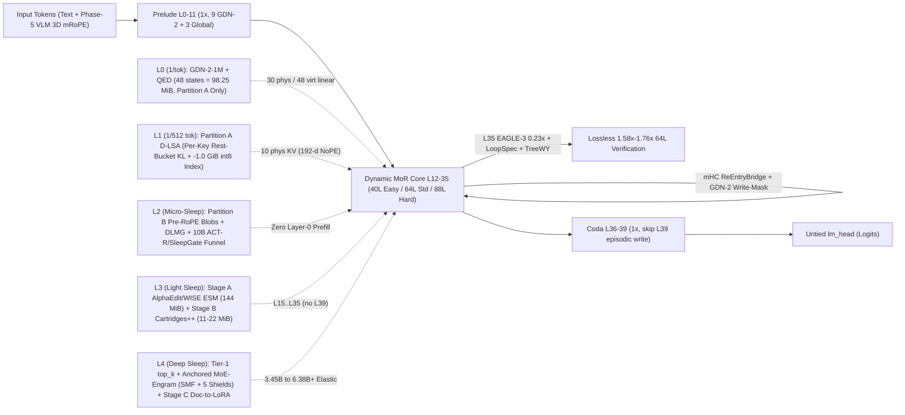

# Next-Gen Architecture Roadmap & Research Paper Plan (`v2.0`): `Qwen3.6-64L-CoMem` (`LSA-NL`)

> **Repository:** `Qwen3.6-35B-A3B-Loop60` (`TassP0lar/Qwen3.6-35B-A3B-Loop64`) · **Branch Policy:** Pure `Qwen3.6` Primary Backbone (`0` external-donor license entanglement)  
> **Development Hardware:** `1× NVIDIA RTX PRO 6000 Blackwell Server Edition` (`GB202`, `sm_120`, **`96 GB GDDR7 ECC`** [`94.97 GiB` CUDA-usable], `512-bit`, **`1,597 GB/s`** peak bandwidth, `24,064` CUDA cores, `600 W` TDP) · **Consumer Deployment Targets:** `16 GB` (`RTX 4080/5070 Ti`), `24 GB` (`RTX 3090/4090`), `32 GB` (`RTX 5090`)  
> **Companion Artifacts:** [LSA-NL Research Proposal (v2.0)](PROPOSAL_LSA_NESTED_LEARNING.md) · [Compute Grant Proposal (v2.0)](COMPUTE_GRANT_PROPOSAL.md) · [Empirical Report (EN)](EXPERIMENT_REPORT.md) · [Empirical Report (ZH)](EXPERIMENT_REPORT_ZH.md) · [SI-RSI Roadmap](RSI_ROADMAP.md) · [Tokenizer Parity CLI](../scripts/verify_q36_q38_tokenizer_parity.py)

> [!IMPORTANT]
> **Empirical Grounding & Zero-Fabrication Policy:** Every number in this roadmap is explicitly categorized as **`Measured`** (verified from repo logs, HF Hub commits, or direct file/header inspection), **`Derived Formula`** (exact closed-form parameter/byte accounting), **`Published (External)`** (vendor-reported external benchmark/spec), or **`Estimated`** (forward GPU-hour projection derived from measured single-card throughput). **Zero unmeasured downstream 2026 benchmark scores are claimed for our models.**

---

## §1. Executive Summary & Target Comparison vs. `Inkling 2 Mini`

Our clean v2 pipeline has already de-risked looped hybrid retrofitting on a single `96 GB GDDR7 ECC` GPU (`167.60+` active supervisor hours; `s3_v2_long_1m_lsa@600` completed with `12/12` Gate 2 sharp passes and `100%` `18K`/`64K` needle recall; `GDN-2-1M + QED` live in `s2_v2_joint_bptt` progressing cleanly past `step 340/600` at `67.77–67.80 GiB` peak VRAM with `0` skips). The next architectural leap—**`Qwen3.6-64L-CoMem` (`LSA-NL` v2.0)** (full mathematical proofs and falsification protocol in [`docs/PROPOSAL_LSA_NESTED_LEARNING.md`](PROPOSAL_LSA_NESTED_LEARNING.md))—targets the **`64`-effective-layer sweet spot (`d=2`, `[0,12)×1 + [12,36)×2 + [36,40)×1`)** while explicitly moving **beyond static looped clones of `Inkling 2 Mini`**.

Instead of chasing an unrealistic raw `10M`-token contiguous chat window or static per-token compute, `Qwen3.6-64L-CoMem` unites:
1. A **5-Level `LSA-NL` Continuum Memory System (`L0 → L4`)** over a **Split-Horizon `3M–4M` Logical Context** (`1M–2M` live active workspace + `1M–2M` GPU-mounted consolidated KV-Mem Blobs backed by **`100M+` cold SSD tokens** and a **`10B`-token Forgetting/Hardening & 3-Stage KV-to-Engram Funnel**), incorporating verified modules from **`Spark-X2.6-Recursion`** (`BaiTian6641/Spark-X2.6-Recursion`) [1] and **six surgical refinements over Original LSA** [2];
2. **3-Axis Dynamic Elastic Compute (`MoR` `40L/64L/88L` + Dynamic Active Parameters `3.45B ↔ 6.38B+`)** paired with **Lossless `L35` Mid-Flight Self-Speculative Drafting (`EAGLE-3` + `LoopSpec` + `TreeWY`)** delivering `1.58×–1.76×` `64L` decode speedup (`1.07×–1.19×` faster than raw `40L`!); and
3. **Consumer `<= 24 GB VRAM` Deployment Profiles** (`17.66–18.93 GiB` on `RTX 3090/4090`, `10.89 GiB` on `16 GB`, `26.98 GiB` on `32 GB`) plus a long-term **Phase-5 Multimodal KV-Mem Blob** path reusing `Qwen3.6`'s built-in VLM tower.

### 1.1 Grounded Head-to-Head Specification & Benchmark Table

| Dimension | `Qwen3.6-64L (d=2)` Clean v2 *(Baseline)* | **`Qwen3.6-64L-CoMem` (`LSA-NL` v2.0)** *(Target)* | **`Inkling 2 Mini`** *(TML, Nov 20, 2026 [3])* | Provenance / Class |
| :--- | :--- | :--- | :--- | :---: |
| **Total Text Params** | `34.661B` (`~35B`; `32.212B` frozen MoE, `2.448B` dense core) | `34.661B` + `0.65–0.99 GiB` NVFP4 Engram + `~35M` `L35` draft head | `26.4B` total | `Derived` / `Published` |
| **Physical → Effective Layers** | `40L` → **`64L`** (`[12,36)` core `×2`; `48` GDN-2 + `16` Global) | **Dynamic `MoR` `40L / 64L / 88L`** (token-level depth + `GDN-2` write-mask) | Static `24L` → `48L` (middle `12` looped `3×`) | `Derived` / `Published` |
| **Active Params (Exact Total)** | **`4.916B`** (`1.017B` embed+head + `2.053B` mixers + `1.845B` MoE; `4.41B` ex-input-embed) | **Elastic `3.45B ↔ 6.38B+`** (`MoR` depth + Tier-1 `top_k` `8↔16` + Tier-3C `5.30/5.45/5.86B`) | Static `~3.4B` base → **`~5.4B`** effective active | `Derived` / `Published` |
| **Weight & Consumer Footprint** | `21.85 GiB` pure NVFP4 (`24.09 GiB` mixed NVFP4/FP8 HF ckpt) | Server `96 GB`: `33.8–45.4 GiB` (`2M–4M` Split) · **Consumer `24 GB`: `17.66–18.93 GiB`** (`16 GB`: `10.89 GiB`; `32 GB`: `26.98 GiB`) | `~20 GB` (`NVFP4 + MXFP8`) | `Measured` / `Derived` / `Published` |
| **Logical Context & KV State** | **`10.65 GiB`** FP8 / **`5.96–6.28 GiB`** `H64-INT4` (`1M` contiguous; `10` physical `kv_share` layers) | **Split-Horizon `3M–4M` GPU** (`21.25–22.50 GiB` KV, **`-1.0 GiB`** `int8` `BucketIndex`) + **`100M+` Cold SSD** (`604 GB`, `262.5 MiB` hdrs) + **`10B`-tok Funnel** (`345.6 GB`, `150.2 MiB` steady-state) | `32.16 GiB` F16 (`1M` only: `32.00 GiB` across `8` unshared global + `0.16 GiB` across `40` SWA) | `Derived Formula` / `Published` |
| **Linear / SWA Recurrent State** | **`98.25 MiB`** exact (`48` virtual `fp32` GDN-2 + `bf16` conv states; `O(1)` infinite horizon) | **`98.25 MiB`** fixed `GDN-2-1M + QED + Soft Neg-Eigval` (**Partition A only** + `TreeWY` rollback) | `163.8 MiB` (`0.16 GiB`, `40` fixed `1,024`-tok SWA) | `Derived Formula` / `Published` |
| **Decode Acceleration** | Standard `64L` (`1.475×` of `40L` weight read) | **Lossless `L35` `EAGLE-3` (`0.23×`) + `LoopSpec` + `TreeWY`:** **`1.58×–1.76×` vs `64L`** (**`1.07×–1.19×` faster than `40L`!**) | External `DSpark` auxiliary drafter | `Derived Formula` / `Published` |
| **Multi-Hop / Episodic Memory** | Single-hop `D-LSA` (`192`-D NoPE); read-only weights | **5-Level `LSA-NL` CMS (`L0 → L4`):** Pre-RoPE Blobs + `DLMG` (`PPR`/`A-MEM`/`SleepGate`/ACT-R) + 3-Stage Graduation (`AlphaEdit`/`WISE` → `Cartridges++` → `Doc-to-LoRA`/`SMF`) | None reported | `Architecture` |
| **SWE-bench Verified / Pro Hard / Multi** | `TBD` *(post-`s2_v2` + `s4_v2_rl`)* | Target: close gap via `64L` SI-RSI + `LSA-NL` CoMem | `~79.2%` / `~77.9%` / `~73.7%` | `Published (External)` |
| **DeepSWE v1.1 / FrontierCode v2.0** | `TBD` / `TBD` | Target: verifiable coding/repo RL | `~48.2%` / `~15.1%` | `Published (External)` |
| **MCP-Atlas / AA Intelligence Index** | `TBD` / `TBD` | Target: clean multi-turn tool RL + episodic schema memory | `~82.7%` / `~20.1` | `Published (External)` |
| **ScreenSpot Pro / OmniDocBench** | *Out of scope (text-only v2)* | *Out of scope Phases 0–4; **Phase-5 Native VLM KV-Mem Blobs** (`3D mRoPE [11,11,10]`)* | `~76.5%` / `~92.8%` | `Published (External)` |

### 1.2 Honest Architectural & Post-Training Gap Analysis

**Where `Qwen3.6-64L-CoMem` (`LSA-NL` v2.0) Leads Structurally (Beyond `Inkling 2 Mini`):**
1. **`3.02×–5.40×` Smaller `1M`-Token State, Split-Horizon `3M–4M` / `10B`-Token Funnel & `<= 24 GB` Consumer Support:** `10` physical KV layers via `kv_share=True` + `D-LSA` + Block-64 Hadamard INT4 [4] fit a full **`3M–4M` Split-Horizon Logical Context** (`21.25–22.50 GiB` KV, `43.55–45.41 GiB` total GPU footprint) plus **`100M+` cold SSD tokens** (`604.0 GB` SSD, `262.5 MiB` GPU headers) inside a single `96 GB GDDR7 ECC` GPU—and scale seamlessly down to **`17.66–18.93 GiB` on consumer `24 GB` GPUs** via Zipfian NVFP4 splitting (`KTransformers` [5], `MoE-Lightning` [6], `Fiddler` [7]).
2. **3-Axis Dynamic Elastic Compute vs. Static `48L` Loops:** Rather than forcing every token through `48` fixed layers, `MoR` [8] (`src/qloop/model/loop.py:548-554,771-786`) + *Recurrent Depth* [9] routes easy tokens to `40L` (`3.454B`), standard to `64L` (`4.916B`), and hard `5–10%` tokens to `88L` (`6.378B`), composed with entropy-adaptive `top_k` (`8↔16`) and `s_null` Matryoshka `MoE-Engram`.
3. **Stream-Isolated $O(1)$ Recurrent Memory vs. Fixed `1,024`-Token SWA:** `GDN-2-1M + Bounded QED + Soft Neg-Eigval` [10], [11], [12] maintains continuous delta-rule state tracking across all `48` virtual linear layers in `98.25 MiB` fixed VRAM (`0` extra state bytes over stock GDN), strictly isolated to Partition A (`1M–2M` active workspace).
4. **Non-Destructive 5-Frequency Continual Memory (`L0 → L4`) + `10B`-Token Funnel:** Unlike pure *Titans / HOPE* neural memories [13], [14] (requiring scratch pretraining and suffering proactive interference [15]), `LSA-NL` combines zero-re-prefill Pre-RoPE KV-Mem Blobs (`L2`), `DLMG` (`HippoRAG 2` PPR [16] + `A-MEM` [17] + bi-temporal `SleepGate` [15] + ACT-R hardening), closed-form `EpisodicSideMemory` (`L3`, `AlphaEdit` [18] + `WISE` [19], `0.0` drift), modular `Cartridges++` [20], [21], [22], and `Doc-to-LoRA` [23] / `SMF` [24] `MoE-Engram` (`L4`).
5. **Honest Mid-Flight Self-Speculative Drafting (`L35` `EAGLE-3` + `LoopSpec` + `TreeWY`):** As proved via honest MoE Zipfian coupon-collector math in [`PROPOSAL_LSA_NESTED_LEARNING.md`](PROPOSAL_LSA_NESTED_LEARNING.md) §4.7, naive full-`40L` Pass-1 drafting stalls at `1.03×–1.30×` vs `64L` (`< 40L` speed) because `40L` already pays `68%` of `64L` cost plus `u_MoE = 2.83×–3.96×` union experts. Replacing it with a `~35M` **`L35` `EAGLE-3` [25] 1-layer head (`0.23×` step) + `LoopSpec` [26] + `TreeWY` [27]** (1 triangular solve, `O(1)` 1-state-block/layer regardless of tree width, `2–3×` lower peak state memory) delivers **`1.58×–1.76×` lossless `64L` speedup (`1.07×–1.19×` faster than raw `40L`!)** without an external multi-billion-parameter draft model.

**Where `Inkling 2 Mini` Currently Leads—and How Our Plan Closes the Gap:**
1. **Industrial SWE / Coding / MCP Tool-Use Post-Training (`79.2%` SWE-bench Verified, `82.7%` MCP-Atlas):** Closed via high-leverage sample efficiency on `1× 96 GB GDDR7 ECC` (and accelerated on our Tier-2 `8×` multi-GPU grant node): (a) focusing `s4_v2_rl` `SI-RSI` rollouts on `64L` accelerated by `L35`+`TreeWY`, (b) graduating repo invariants & MCP schemas into `L3` `ESM` / `Cartridges++`, (c) deploying `DLMG` + `SleepGate` bi-temporal supersession so stale code edits never corrupt multi-file sessions, and (d) pairing verifiable math, `KernelBench` CUDA/Triton, sandboxed SWE tests, and clean MCP trajectories with surgical `[loop_adapters, router]` `SI-RSI` unlikelihood.
2. **Active Compute Parity (`~5.4B` vs. `4.916B`):** Closed immediately in Phase 1 via zero-VRAM Tier-1 native `top_k` (`8 → 10–16`, `+0.30B..+1.21B`) and consolidated in Phase 3 via native `2048`-D `AnchoredMoEEngram` (`5.30B / 5.45B / 5.86B`).
3. **Multimodal Vision/Document Benchmarks (`ScreenSpot Pro`, `OmniDocBench`):** Scoped out of Phases `0–4` to preserve text/code execution discipline, then unlocked cleanly in **Phase 5** by re-enabling `Qwen3.6`'s built-in VLM tower (`3D mRoPE [11, 11, 10]`, identical `192`-D NoPE KV-Mem Blobs).

---

## §2. Primary-Source External Donor & Tokenizer Parity Audit

Before considering any external weights or lookup tables, we performed primary-source forensic inspection of **`Qwen/Qwen3.6-35B-A3B`** [28], **`Qwen/Qwen3.8-Flash-Next`**, and **`Qwen/Qwen3.8-2.4T-A95B`**. All tokenizer and header checks are fully reproducible via [`scripts/verify_q36_q38_tokenizer_parity.py`](../scripts/verify_q36_q38_tokenizer_parity.py).

### 2.1 Forensic Tokenizer Parity: `Qwen/Qwen3.6-35B-A3B` vs. `Qwen/Qwen3.8-Flash-Next` (`Measured`)

| Inspected Artifact / Section | `Qwen/Qwen3.6-35B-A3B` | `Qwen/Qwen3.8-Flash-Next` | Parity Result |
| :--- | :--- | :--- | :---: |
| **`tokenizer.json` — All 18 Sections (Shared Scope)** | `version`, `truncation`, `padding`, `normalizer`, `pre_tokenizer`, `post_processor`, `decoder`, `model.{type, dropout, unk_token, continuing_subword_prefix, end_of_word_suffix, fuse_unk, byte_fallback, ignore_merges}` | Identical byte-for-byte / JSON-value-for-value across all core pipeline & model settings | **100% `exact_equal: True`** |
| **`model.vocab`** | `248,044` IDs (`0..248043`) | `248,044` IDs (`0..248043`) | **100% `exact_equal: True`** |
| **`model.merges`** | `247,587` BPE merge rules | `247,587` BPE merge rules | **100% `exact_equal: True`** |
| **Shared `added_tokens`** | `26` tokens (IDs `248044..248069`) | `26` tokens (IDs `248044..248069`) | **100% `exact_equal: True`** |
| **Sole Diff — Appended Audio/TTS Tokens** | *(none)* | **`7` appended IDs (`248070..248076`):** `<|audio_start|>`, `<|audio_end|>`, `<tts_pad>`, `<tts_text_bos>`, `<tts_text_eod>`, `<tts_text_bos_single>`, `<|audio_pad|>` | **Strictly appended only** |
| **`tokenizer_config.json`** | `eos='<|im_end|>'`, `pad='<|endoftext|>'`, `bos=None`, `model_max_length=262144` | `eos='<|im_end|>'`, `pad='<|endoftext|>'`, `bos=None`, `model_max_length=262144` | **100% identical** |

**Key Engineering Finding:** Every text and vision token ID (`0..248069`) is **bit-exact identical** between `Qwen3.6-35B-A3B` and `Qwen3.8-Flash-Next`. Any token-ID-indexed N-gram memory table from `Qwen3.8-Flash-Next` can be queried directly from `Qwen3.6` input IDs with zero retokenization.

### 2.2 Direct Safetensors Header Audit of External Candidates (`Measured`)

| Candidate Repo | Architecture & Scale | License | Direct Header / Config Finding | Disposition |
| :--- | :--- | :---: | :--- | :---: |
| **`Qwen/Qwen3.8-Flash-Next`** | `model_type: qwen4_exp`, `360.0 GB` BF16 (`131` shards) | `qwen-community-1.0` | Inspected directly via safetensors headers across the `33` PLE-bearing shards (`model-00005..model-00037` of `131`): **`137` `.ple.` tensors** at **0-indexed `model.language_model.layers.1.ple.*`** (despite `config.json` listing `ple_layer_ids: [2]`): `128` shards × `BF16 [2,500,012, 160]` = **`51,200,245,760` (`51.20B`)** params (`16` heads = `2` n-gram orders × `8` heads × `160` dim = `2,560`), `layer_multipliers: I64 [3]`, `ngram_heads_offsets: I64 [16]`, `ngram_heads_vocab_sizes: I64 [16]`, `value_proj: BF16 [2560, 2560]`, and `4`-branch GR `key_proj/conv1d` (`10240 = 4×2560`) bypassed when porting into single-stream `d=2048`. | **Tier 2: Optional Plug-In Ablation Only (Phase 4B)** |
| **`Qwen/Qwen3.8-2.4T-A95B`** *(official base of `Qwen3.8-Max`)* | `model_type: qwen3_5_moe_text`, `92L`, `d=8192`, `512` experts, `moe_intermediate=2048` | `qwen3.8-max` | **NO `ple` table.** Hidden width `d=8192` is **`4×` wider** than `Qwen3.6`'s `d=2048`; incompatible residual geometry and restrictive `qwen3.8-max` license. | **Ruled Out as Weight Donor** |

### 2.3 Binding Policy Decisions: Pure Primary Backbone, Optional Tier 2, and Dropping Tier 4

1. **Primary Model (`Qwen3.6-64L-CoMem`) = 100% Pure `Qwen3.6`:** Zero external-donor weights are merged into the primary release. All primary training, checkpoints, and Paper 2 headline claims rest cleanly on `Qwen/Qwen3.6-35B-A3B` with zero external license entanglement.
2. **Tier 2 (`51.20B` Layer-1 `ple` External Memory Port) = Strictly Optional Plug-In Ablation:** Evaluated in Phase 4B as a standalone plugin (`qwen-community-1.0` table kept zero-copy `mmap`-ed in Host DDR5/NVMe + **`~10.5M` GPU adapter params** projecting `2560 ↔ 2048` and bypassing the `4`-branch `10240`-D GR `key_proj/conv1d`). Requires **zero `360 GB` donor inference**.
3. **Tier 4 (Cross-Model Procrustes SwiGLU Expert Transplanting) = EXPLICITLY DROPPED:** Non-linear `SiLU` cone mismatch breaks axis-aligned gating under orthogonal rotation $R \in O(d)$, dense bridges across `48` core visits waste **`+0.503B`** active parameters on coordinate translation, and re-aligning transplanted cones wastes `110–230` single-GPU hours—strictly dominated by native `Qwen3.6` `top_k` scaling (`0` extra VRAM) and native `2048`-D `MoE-Engram` (`20–35` GPU-h).

---

## §3. Target Next-Gen Architecture: `Qwen3.6-64L-CoMem` (`LSA-NL` v2.0 + 3-Axis Elastic Compute)

`Qwen3.6-64L-CoMem` organizes memory and compute into a **5-Level `LSA-NL` Continuum Memory System (`L0 → L4`)** and **3-Axis Dynamic Elastic Compute** around the calibrated `64L (d=2)` core (`[0,12)×1 + [12,36)×2 + [36,40)×1`) with a **Split-Horizon `3M–4M` Logical Context** (`1M–2M` Partition A Active + `1M–2M` Partition B Consolidated Blobs, `100M+` cold SSD, `10B`-tok funnel). See [`docs/PROPOSAL_LSA_NESTED_LEARNING.md`](PROPOSAL_LSA_NESTED_LEARNING.md) for full proofs (`Geometric Error G` vs. `Dynamic Error D`, Original-LSA 6-point audit, MoE Zipfian coupon-collector self-speculative math, consumer `<= 24 GB` ledger, and Phase-5 multimodal blobs). Two global invariants are enforced across all phases:
- **Strict Step-0 IEEE-754 Bit-Identity (`max_abs_diff == 0.0`):** Every added module initializes to exact zero residual contribution.
- **100% Frozen `32.212B` NVFP4 Routed Experts:** Verified before and after every training step via `sha256_frozen_experts()` in [`src/qloop/model/experts.py`](../src/qloop/model/experts.py) and [`src/qloop/model/loop.py`](../src/qloop/model/loop.py).

### 3.1 Level `L0` (`f = 1/tok`) — Partition-A Recurrent State (`GDN-2-1M + QED + Soft Neg-Eigval`)
- **State & Kernel Stack (`Measured` / `Derived Formula`):** `48` virtual linear layers in `64L (d=2)` hold **`98.25 MiB`** fixed recurrent+conv state (`0` extra state bytes over stock GDN, `27.53M` adapter params in [`src/qloop/model/gdn2.py`](../src/qloop/model/gdn2.py)), mapped 1-to-1 onto `fla 0.6.0` `DPLR` Triton kernels [29] (`53.55 ms` @ `32K`, `0.0787 ms` @ `T=1`, `4×8K` macro-segmenting cutting wrapper VRAM `3.28×`).
- **Split-Horizon & `TreeWY` Rules:** `GDN-2` runs strictly on Partition A (never ingesting cold Partition-B blobs), supports causal `MoR` write-masking (`loop.py:771-786`), and verifies speculative draft trees in 1 triangular solve via **`TreeWY`** [27] (`O(1)` 1-state-block/layer regardless of tree width, `2–3×` lower peak state memory).

### 3.2 Levels `L1` + `L2` (`f = 1/512 tok` & Micro-Sleep) — Upgraded `D-LSA`, Split-Horizon `3M–4M` & `10B`-Token Funnel (`Tier 3A`)
- **Original-LSA Per-Key Rest-Bucket KL Upgrade:** Upgrades `_distill_kl()` ([`src/qloop/model/lsa.py:1231-1268`](../src/qloop/model/lsa.py#L1231-L1268)) from bucket-mass KL to Original LSA's [2] **per-key forward KL with truncated-depth "rest bucket" + `calibrate_tau`** (`512K–1M` recall `0.5715` → target `> 0.75`), alongside `-1.0 GiB` `int8` `BucketIndex` compaction (`lsa.py:728-768`).
- **Partition B + `10B`-Token Forgetting/Hardening Funnel:** Pre-RoPE `H64-INT4` `512`-tok blobs (`2.8125 MiB/blob`, `[0:4)` sink-stripped `EPIC` [30], clamped ReRoPE `pos_rerope.py`, `1,344 B` GPU headers) paired with `DLMG` (`HippoRAG 2` PPR [16] + `A-MEM` [17] + `Zep/Graphiti` [31] + `SleepGate` [15]) and the 4-stage `10B → 800M → 133M → 80M → 60M` funnel (salience cherry-picking + `EpiCache` [32] `6×` NoPE dedup + Ebbinghaus ACT-R $R_b(t)=e^{-\Delta t/S_b}$ hardening/forgetting + `25%` Engram graduation → **`345.6 GB` SSD + `150.2 MiB` GPU headers**).

### 3.3 Level `L3` (`f = 1/task`, Light Sleep) & Level `L4` (`f = 1/week`, Deep Sleep) — 3-Stage KV-to-Engram Graduation & Elastic Compute (`Tier 1 + 3B + 3C`)
- **Stage A (`ESM`, Zero Backprop — Ready Today):** `Spark-X2.6` [1] `LRCD` + Float64 DGKS `AlphaEdit` [18] + `WISE` [19] (`144 MiB/shard` at `L15..L35`, **skipping Coda `L39`**, `0.000` general-text drift, undo ledger).
- **Stage B (Modular Compressed KV Packs):** `Cartridges` [20] / `Cartridges++` [21] / `Cartridges at Scale` [22] distilling `100K`-tok clusters into `2K–4K` synthetic `H64-INT4` packs (`11.25–22.50 MiB`, `~38×` compression) plugging straight into Partition B.
- **Stage C & `L4` Elastic Active Compute:** Native `top_k` (`8 ↔ 16`, `0` extra VRAM), `2048`-D `AnchoredMoEEngram` (`5.30 / 5.45 / 5.86B` active, native clustering warm-start, `SMF` [24], all 5 shields: `gamma=0`, `min_active_pos` `93.6%` OOD fix, `DeepSeek Engram` signed-sqrt RMSNorm QK gate [33], `WISE` + `<= 3%` norm cap, `s_null` Matryoshka `p=0.15`), and grant-funded sub-second (`~0.21 s`, `<50 MB` adapter memory) **`Doc-to-LoRA`** [23] hypernetwork + **`SEAL`** [34] self-edits.
- **Consumer `<= 24 GB` Deployment (`KTransformers` [5] / `MoE-Lightning` [6] / `Fiddler` [7]):** Keeps the `2.42 GiB` FP8 dense core + `80–160/256` Zipfian hot NVFP4 experts on GPU (`17.66–18.93 GiB` on `RTX 3090/4090`, `10.89 GiB` on `16 GB`, `26.98 GiB` all-GPU on `32 GB` `RTX 5090`) while deferring cold-tail experts to DDR5 CPU AMX/AVX-512.

---

## §4. Phased Execution Plan, File Hooks, Kill-Gates & Milestone Tracker (`Phases 0–5`)

All GPU-hour estimates below are **`Estimated`** for **`1× NVIDIA RTX PRO 6000 Blackwell Server Edition (96 GB GDDR7 ECC, 1,597 GB/s)`** calibrated directly from measured `s3_v2` (`2,365 tok/s`) and `s2_v2` (`1,040–1,173 tok/s`) telemetry.

| Phase | Scope & Core Deliverables | Exact `src/qloop/` File Touchpoints | Single-GPU Budget (`1× 96 GB GDDR7`) | Hard Pass / Fail Kill-Gates | Status |
| :---: | :--- | :--- | :---: | :--- | :---: |
| **Phase 0** | **Clean v2 `GDN-2-1M + QED` Completion (`L0`):** Finish `s2_v2_joint_bptt` (`s340+ → 600`), run Gate 2 `18K/64K/256K` needle & coherence truth-check, run `GDN-2 ON vs OFF` causal ablation, publish Paper 1 (v1.5). | [`src/qloop/model/gdn2.py`](../src/qloop/model/gdn2.py), [`src/qloop/train/bptt.py`](../src/qloop/train/bptt.py), [`configs/stages/s2_v2_joint_bptt.yaml`](../configs/stages/s2_v2_joint_bptt.yaml) | `~18–20 h` remaining (`~45 h` total for `600` steps) | `0` NaNs/skips; peak VRAM `< 75 GiB`; `100%` `18K/64K` needle pass; `0` loops/slop; monotonic `d=1→2→3` NLL & positive `GDN-2 ON` gain over `s3_v2@600` | **`In Progress`** *(live past `s340/600`)* |
| **Phase 1** | **Zero-Retrain Inference Upgrades (`Tier 1` + `L1` Compaction):** (a) Dynamic native `top_k` (`8→10/12/14/16`, fixed / Pass-2 / entropy-adaptive, `0` extra VRAM); (b) `BucketIndex` `int8`/on-the-fly compaction reclaiming `-1.0 GiB` GDDR7 VRAM. | [`src/qloop/model/quant_autograd.py`](../src/qloop/model/quant_autograd.py), [`src/qloop/model/experts.py`](../src/qloop/model/experts.py), [`src/qloop/model/loop.py`](../src/qloop/model/loop.py), [`src/qloop/model/lsa.py`](../src/qloop/model/lsa.py) (`:728-768`) | `~2–4 h` *(zero training; parity & eval sweeps)* | `0.0` `top_k=8` parity diff; `BucketIndex` @ `1M` `<= 0.06 GiB`; `top_k>8` improves held-out hard math/code NLL or pass@1 at `0` extra weight VRAM | **`Planned`** |
| **Phase 2A** | **Kill-Gate `K0` (Zero-Retrain KV Blobs) + Original-LSA Per-Key Rest-Bucket KL Upgrade:** (a) Evaluate 4 paired `K0` arms (`(a)` oracle, `(b)` naive splice, `(c)` Pre-RoPE `[0:64)` un-rotated + sink-stripped `H64-INT4`, `(d)` `+ 5% CacheBlend` [35]) across `18K–1M`; (b) Upgrade `_distill_kl()` (`lsa.py:1231-1268`) to Original LSA's **per-key forward KL with truncated-depth "rest bucket" + `calibrate_tau`**. | [`src/qloop/model/pos_rerope.py`](../src/qloop/model/pos_rerope.py), [`src/qloop/model/offload.py`](../src/qloop/model/offload.py), [`src/qloop/model/lsa.py`](../src/qloop/model/lsa.py) (`:1231-1268`), new `scripts/eval_killgate_k0_kv_blobs.py` | **`~0.5 h`** `K0` + `~8–12 h` per-key KL calib *(opt. `+2–4 h` `Block-Attention` [36] only if Yellow-B)* | **GREEN `K0`:** `Arm (c) >= 92%` of oracle & NLL gap `<= 0.05` nats (`YELLOW`: `5% CacheBlend` or `2–4 h` calib; `RED`: pivot to `ESM` + header re-prefill). **LSA Gate:** `512K–1M` recall `0.5715 → > 0.75` | **`Planned`** |
| **Phase 2B** | **`L2` `KVMemBlobStore` + `DLMG` (Micro-Sleep) & `L3` `EpisodicSideMemory` (Light Sleep):** Implement Split-Horizon `3M–4M` (`1M–2M` Active + `1M–2M` Mounted + `100M+` Cold SSD), `HotColdPagedKVStore` (`async_lookahead`), `DynamicLatentMemoryGraph` (`HippoRAG 2` PPR + `A-MEM` + `Zep/Graphiti` + `SleepGate`), and `EpisodicSideMemory` (`AlphaEdit` fp64 DGKS + `WISE`, `L15..L35`, skip `L39`). | [`src/qloop/model/offload.py`](../src/qloop/model/offload.py), [`src/qloop/infer/engine.py`](../src/qloop/infer/engine.py), new `src/qloop/model/kv_blobs.py`, new `src/qloop/model/memory_graph.py`, new `src/qloop/model/episodic.py` | `~4–8 h` *(zero backbone training; calibration + multi-session sweeps)* | `K1`: `204,800` headers `<= 270 MiB`, `< 1.5 ms` DDR5 `8`-blob mount; `K2`: `DLMG`+`SleepGate` beats flat `D-LSA`/RAG by `>= +15` pts on contradictions & `>= +10` pts on 2-hop; `K3`: `ESM` `0.000` drift + `100%` undo | **`Planned`** |
| **Phase 2C** | **3-Axis Dynamic Elastic Compute (`MoR`) & Lossless `L35` Mid-Flight Self-Speculative Drafter:** Enable causal `MoR` dynamic looping (`40L/64L/88L` + `GDN-2` write-masking), train `~35M` 1-layer `L35` `EAGLE-3` [25] mid-flight head (`0.23×` step + optional `32K` shortlist `lm_head`), and implement `LoopSpec` [26] + **`TreeWY`** [27] GDN-2 verification + `kv_share` `O(1)` rollback. | [`src/qloop/model/loop.py`](../src/qloop/model/loop.py) (`:548-554,771-786`), [`src/qloop/model/gdn2.py`](../src/qloop/model/gdn2.py), [`src/qloop/infer/engine.py`](../src/qloop/infer/engine.py), new `src/qloop/infer/spec_draft.py` | `~12–20 h` *(head distill + `MoR` router calib + `TreeWY` Triton kernel)* | **`K4`:** `TreeWY` `fp64` parity `<= 1e-9`; `L35` drafter `α >= 0.82`, `100%` greedy parity vs `64L`, **`>= 1.45×` measured wall-clock speedup over `64L`**; `MoR` cuts avg depth `>= 20%` at `<= 0.01` nat delta | **`Planned`** |
| **Phase 3** | **`10B`-Token Funnel, 3-Stage KV-to-Engram Bridge (`Cartridges++` / `Doc-to-LoRA` / `AnchoredMoEEngram`), & Consumer `<= 24 GB` Profiles:** Implement salience cherry-picking + `EpiCache` + Ebbinghaus ACT-R $R_b(t)=e^{-\Delta t/S_b}$ pruning; Stage-B `Cartridges++` [21] (`2K–4K`, `11–22 MiB`); `L4` `AnchoredMoEEngram` (`5.30/5.45/5.86B`) + `SMF` [24] + 5 shields; prototype Stage-C sub-second (`~0.21 s`, `<50 MB` adapter memory) `Doc-to-LoRA` [23] bridge (scaled in grant Tier 3); verify `<= 24 GB` Zipfian NVFP4 Split profiles (`KTransformers`/`MoE-Lightning`/`Fiddler`). | New `src/qloop/model/engram.py`, new `src/qloop/model/cartridges.py`, [`src/qloop/model/experts.py`](../src/qloop/model/experts.py), [`src/qloop/train/optim.py`](../src/qloop/train/optim.py), new `configs/stages/s2b_comem_engram.yaml` | `~25–45 h` *(single-card SFT/distill + `<= 24 GB` profile bench; Stage-C full meta-train in Grant Tier 3)* | `max_abs_diff == 0.0` at Step 0; frozen MoE SHA-256 unchanged; `CE_off <= 0.005` nats (`p=0.15`); `10B`-sim archive `<= 400 GB` SSD; `Cartridges++` `<= 0.02` nat derailment; consumer `24 GB` Profile C/D `<= 19.0 GiB` | **`Planned`** |
| **Phase 4** | **Stage-4 Verifiable `SI-RSI` RL (`s4_v2_rl`, `64L d=2` Focus) + Optional `4B` Tier-2 `ple` Ablation:** Run GRPO/DAPO + surgical `[loop_adapters, router]` `SI-RSI` (+ `SEAL` [34] self-edits) on `64L` across math (`DAPO-Math-17k`), `KernelBench`, sandboxed SWE, & clean MCP accelerated by Phase-2C `L35`+`TreeWY` lossless rollouts. Optional Phase 4B quarantines `Qwen3.8-Flash-Next` `51.20B` `ple` DDR5 `mmap` plugin (`~10.5M` GPU adapter). | [`src/qloop/train/rl.py`](../src/qloop/train/rl.py), [`src/qloop/train/sirsi.py`](../src/qloop/train/sirsi.py), [`src/qloop/infer/engine.py`](../src/qloop/infer/engine.py), [`src/qloop/eval/registry.py`](../src/qloop/eval/registry.py), [`configs/stages/s4_v2_rl.yaml`](../configs/stages/s4_v2_rl.yaml), optional `src/qloop/plugins/ple_mmap.py` | `~60–110 h` *(accelerated via `L35`+`TreeWY`; `~10–16` wall-h on `8×` grant node; `+12–20 h` opt. 4B)* | Holdout promotion gate (`min_delta >= 0.0`, `max_len_growth <= 1.5`, `0` loops); measurable gains on 13-gram-decontaminated `AIME 2026`, `KernelBench L3`, `SWE-bench`, `MCP-Atlas`, `MRCR 1M`; export `safetensors` Whole Model Pack; kill 4B if pure-`Qwen3.6` Tier 3C hits `>= 95%` of Tier-2 gain | **`Planned`** |
| **Phase 5 *(Long-Term)*** | **Native Multimodal KV-Mem Blobs (`Qwen3.6` Built-In VLM Tower):** Re-attach stock ViT (`3D mRoPE [11, 11, 10]`, identical `192`-D NoPE keys) to archive UI screenshots, PDFs, & streaming video frames as Pre-`3D-mRoPE` `H64-INT4` KV-Mem Blobs (`ReKV` [37], `M3-Agent` [38], `M+` [39]) inside the shared `DLMG` + `100M` SSD store. **Strictly gated on Phases 0–4 completion.** | New `src/qloop/model/vlm_blobs.py`, [`src/qloop/model/pos_rerope.py`](../src/qloop/model/pos_rerope.py), Phase-2B `src/qloop/model/kv_blobs.py` | Grant Tier 3 (`~1,200` GPU-h multi-GPU follow-on) | Zero regression on text/code benchmarks; Pre-`3D-mRoPE` visual blob `K0` `>= 90%` of contiguous VLM oracle; competitive `ScreenSpot Pro`, `OmniDocBench`, & streaming video QA | **`Long-Term (Post-Phase 4)`** |

---

## §5. 3-Paper Publication Ladder, Ablation Matrix & Hygiene Policy

We maintain a **three-paper staged publication ladder** so completed clean-v2 findings ship immediately, flagship `LSA-NL` + 3-Axis Dynamic Compute targets top-tier 2027 venues under our Tier-2 multi-GPU grant, and one-shot `Doc-to-LoRA` + Phase-5 multimodal memory drives Paper 3.

### 5.1 3-Paper Publication & Reporting Matrix

| Deliverable | Timing | Tracked Files / Artifacts | Primary Scientific Content | Target Venue / Channel |
| :--- | :---: | :--- | :--- | :--- |
| **Paper 1 (v1.5 Technical Report & Grant Update)** | Immediate after **Phase 0** (`s2_v2@600`) | [`docs/EXPERIMENT_REPORT.md`](EXPERIMENT_REPORT.md), [`docs/EXPERIMENT_REPORT_ZH.md`](EXPERIMENT_REPORT_ZH.md), [`docs/COMPUTE_GRANT_PROPOSAL.md`](COMPUTE_GRANT_PROPOSAL.md), [`Loop64_Technical_Report_EN.pdf`](papers/Loop64_Technical_Report_EN.pdf), [`Loop64_Technical_Report_ZH.pdf`](papers/Loop64_Technical_Report_ZH.pdf) | Final `s2_v2@600` (`40L / 64L / 88L`) telemetry, **GDN-2 ON vs. OFF causal ablation**, HSSD v3.2 negative ablation, Gate 2 `18K–256K` needle sweep, Blackwell `sm_120` kernels, and first measured 13-gram-decontaminated 2026 comparisons. | Open bilingual US-Letter IEEE technical report + arXiv preprint |
| **Paper 2 (Flagship `LSA-NL` / `Loop64-CoMem` — Tier-2 Multi-GPU Target)** | After **Phases 1–4** | Theoretical foundation: [`docs/PROPOSAL_LSA_NESTED_LEARNING.md`](PROPOSAL_LSA_NESTED_LEARNING.md) (`v2.0`) → New `docs/papers/Loop64_CoMem_Paper_{EN,ZH}.pdf` + `K0–K4` & `NL-0..NL-7` logs | **Working Title:** *"Latent-Sparse Nested Learning (`LSA-NL`): Split-Horizon Continuum Memory, Dynamic Recursive Compute, and Lossless Mid-Flight Drafting for Frozen MoEs"* (5-frequency CMS, `10B`-funnel, 6 LSA upgrades, `MoR` + `L35` `EAGLE-3` + `TreeWY`, `<= 24 GB` consumer profiles). | **NeurIPS / ICML / ICLR / MLSys 2027** + arXiv preprint |
| **Paper 3 (Frontier Lifelong Multimodal Agents — Tier-3 Follow-On)** | After **Phase 5** + Grant Tier 3 | Extension of `LSA-NL` Stage C + Phase-5 VLM logs | **Working Title:** *"Instant Context-to-Engram Compilation (`Doc-to-LoRA`) and Native Multimodal KV-Mem Blobs for Hybrid Looped MoEs"* (sub-second `~0.21 s` / `<50 MB` adapter hypernetwork KV-to-Engram, `SEAL` self-edits, `3D mRoPE` `ReKV`/`M3-Agent` visual-text episodic blobs). | **NeurIPS / ICML / CVPR 2027–2028** |

### 5.2 Required Controlled Ablation Matrix for Paper 2 (Aligned with `NL-0..NL-7`)

Every row toggles **one tier or compute axis independently** on the **exact same frozen `unsloth/Qwen3.6-35B-A3B-NVFP4` checkpoint** (identical SHA-256 expert digest, identical 13-gram-decontaminated splits; cross-referenced with `NL-0..NL-7` in [`PROPOSAL_LSA_NESTED_LEARNING.md`](PROPOSAL_LSA_NESTED_LEARNING.md) §5.3):

| Config ID (`NL` Map) | `L0` (`GDN-2+QED`) | `L1/L2` (`Split-Horizon + DLMG + Funnel`) | `L3` (`ESM` / `Cartridges++`) | `L4` & Elastic Compute (`MoR` / `L35`+`TreeWY` / `Engram`) | `s4_v2_rl` (`64L`) | Tier 2 (`ple` Opt.) | Controlled Hypothesis Tested |
| :---: | :---: | :---: | :---: | :---: | :---: | :---: | :--- |
| **A0** | OFF (Native) | OFF (Flat `1M`) | OFF | Static `k=8` | OFF | OFF | Clean `s3_v2@600` (`40L/64L/88L`) baseline |
| **A1** (`NL-1`) | **ON** | Flat `1M` + **Per-Key Rest-Bucket KL** | OFF | Static `k=8` | OFF | OFF | Causal value of `GDN-2-1M+QED` (`s2_v2@600`) + Original-LSA per-key KL upgrade |
| **A2** (`NL-2/3`) | ON (Part. A) | **ON (`3M–4M` / `100M` SSD + `10B` Funnel + `DLMG`)** | OFF | Static `k=8` | OFF | OFF | `-1.0 GiB` `BucketIndex` + `K0` Pre-RoPE blobs + `PPR`/`A-MEM`/`SleepGate`/ACT-R proactive-interference gain |
| **A3** (`NL-4`) | ON (Part. A) | ON | **ON (`ESM` + `Cartridges++`)** | Static `k=8` | OFF | OFF | Zero-gradient horizontal KV → vertical `AlphaEdit`/`WISE` (`0.0` drift) & `~38×` `Cartridges++` graduation |
| **A4** | ON (Part. A) | ON | OFF | **Tier-1 `top_k` (`8↔16`) + `MoR` + `L35` `EAGLE-3`+`TreeWY`** | OFF | OFF | 3-axis elastic compute curve (`3.45B↔6.38B+`) & lossless `1.58×–1.76×` `64L` decode speedup (`1.07×–1.19×` faster than `40L`, `K4`) |
| **A5** (`NL-5`) | ON (Part. A) | ON | ON | **`MoR` + `L35`+`TreeWY` + `MoE-Engram` (`SMF` + 5 Shields)** | OFF | OFF | Native `MoE-Engram` + `SMF` + 5-shield ablation (`min_active_pos`, `s_null` Matryoshka `p=0.15`, `CE_off`) |
| **A6** (`NL-6`) | ON (Part. A) | **ON (Full `LSA-NL` v2.0)** | **ON** | **Full Elastic + `L35`+`TreeWY`** | **ON (`SI-RSI`)** | OFF | **Primary Flagship `Qwen3.6-64L-CoMem` (`LSA-NL` v2.0, 100% Pure `Qwen3.6`)** |
| **A7** (`NL-7`) | ON (Part. A) | ON (`512K–1M` + `100M` SSD) | ON | **Consumer `<= 24 GB` Zipfian NVFP4 Split (`128–160/256`)** | ON | OFF | Consumer `RTX 3090/4090` (`17.66–18.93 GiB`) & `16 GB` (`10.89 GiB`) parity & throughput |
| **A8** | ON (Part. A) | ON | ON | Static `k=8` | ON | **ON (`mmap`)** | Optional Phase-4B Tier 2 `51.20B` `ple` DDR5 plug-in vs. Pure-`Qwen3.6` A6 |

### 5.3 Strict Measurement & Citation Hygiene Policy
- **Zero Unmeasured Claims:** Any unexecuted run or benchmark remains explicitly marked `TBD` / `Planned`; no extrapolated scores are ever plotted or placed in result tables.
- **Exact Provenance & Hardware Truthfulness:** Every reported metric links to a public HF Hub commit SHA, archived JSON/CSV telemetry artifact, or explicit closed-form equation. Hardware references always specify **`NVIDIA RTX PRO 6000 Blackwell Server Edition (96 GB GDDR7 ECC, 1,597 GB/s)`** (never mislabeled as stacked datacenter memory or Workstation `1,792 GB/s`).
- **Verified IEEE `[1]..[N]` Citations:** Every external method, benchmark, and model comparison is cited in numbered IEEE format with verified publication dates, arXiv IDs, or primary-source repository URLs, using expanded citation lists (never unparsed range dashes).

---

## References

[1] BaiTian6641, "Spark-X2.6-Recursion: Dynamic Latent Memory Graphs, Null-Space Vertical Episodic Adapters, and Anchored MoE-Engram Stability Shields," GitHub Repository, 2026. [Online]. Available: https://github.com/BaiTian6641/Spark-X2.6-Recursion

[2] A. Kubicek, A. Caciolai, L. Peng, S. Sumant, B. Hoover, F. Greenlee, R. M. Battleday, R. Urban, T. Hoefler, and J. C. R. Whittington, "Latent Sparse Attention: Towards Subquadratic Ultra-Long Context Attention," *arXiv preprint arXiv:2610.42147*, Oct. 2026.

[3] Thinking Machines Lab, "Inkling 2 Mini," Technical Release, Nov. 20, 2026. [Online]. Available: https://thinkingmachines.ai

[4] A. Zandieh, M. Daliri, M. Hadian, and V. Mirrokni, "TurboQuant: Online Vector Quantization with Near-optimal Distortion Rate," in *Proc. Int. Conf. Learn. Represent. (ICLR)*, 2026, arXiv:2504.19874.

[5] H. Chen *et al.*, "KTransformers: Unleashing the Full Potential of CPU/GPU Hybrid Inference for MoE Models," in *Proc. ACM Symp. Operating Syst. Principles (SOSP)*, 2025. [Online]. Available: https://github.com/kvcache-ai/ktransformers

[6] S. Cao, S. Liu, T. Griggs, P. Schafhalter, X. Liu, Y. Sheng, J. E. Gonzalez, M. Zaharia, and I. Stoica, "MoE-Lightning: High-Throughput MoE Inference on Memory-Constrained GPUs," in *Proc. ACM Int. Conf. Architectural Support Program. Lang. Operating Syst. (ASPLOS)*, 2025, arXiv:2411.11217.

[7] K. Kamahori, T. Tang, Y. Gu, K. Zhu, and B. Kasikci, "Fiddler: CPU-GPU Orchestration for Fast Inference of Mixture-of-Experts Models," in *Proc. Int. Conf. Learn. Represent. (ICLR)*, 2025, arXiv:2402.07033.

[8] S. Bae, Y. Kim, R. Bayat, S. Kim, J. Ha, T. Schuster, A. Fisch, H. Harutyunyan, Z. Ji, A. Courville, and S.-Y. Yun, "Mixture-of-Recursions: Learning Dynamic Recursive Depths for Adaptive Token-Level Computation," *arXiv preprint arXiv:2507.10524*, Jul. 2025.

[9] J. Geiping, S. McLeish, N. Jain, J. Kirchenbauer, S. Singh, B. R. Bartoldson, B. Kailkhura, A. Bhatele, and T. Goldstein, "Scaling up Test-Time Compute with Latent Reasoning: A Recurrent Depth Approach," *arXiv preprint arXiv:2502.05171*, Feb. 2025.

[10] A. Hatamizadeh, Y. Choi, and J. Kautz, "Gated DeltaNet-2: Decoupling Erase and Write in Linear Attention," *arXiv preprint arXiv:2605.22791*, May 2026.

[11] D. Gupta, A. Das, and D. Gupta, "The Query Knows What to Forget: A Second Erase Direction for Linear Attention," *arXiv preprint arXiv:2608.13668*, Aug. 2026.

[12] R. Grazzi, J. Siems, A. Zela, J. K. H. Franke, F. Hutter, and M. Pontil, "Unlocking State-Tracking in Linear RNNs Through Negative Eigenvalues," in *Proc. Int. Conf. Learn. Represent. (ICLR)*, 2025, arXiv:2411.12537.

[13] A. Behrouz, P. Zhong, and V. Mirrokni, "Titans: Learning to Memorize at Test Time," *arXiv preprint arXiv:2501.00663*, Jan. 2025.

[14] A. Behrouz, M. Razaviyayn, P. Zhong, and V. Mirrokni, "Nested Learning: The Illusion of Deep Learning Architectures," in *Adv. Neural Inf. Process. Syst. (NeurIPS)*, 2025, arXiv:2512.24695.

[15] Y. Xie, "Learning to Forget: Sleep-Inspired Memory Consolidation for Resolving Proactive Interference in Large Language Models (SleepGate)," *arXiv preprint arXiv:2603.14517*, Mar. 2026.

[16] B. J. Gutiérrez, Y. Shu, W. Qi, S. Zhou, and Y. Su, "From RAG to Memory: Non-Parametric Continual Learning for Large Language Models (HippoRAG 2)," *arXiv preprint arXiv:2502.14802*, Feb. 2025.

[17] W. Xu, Z. Liang, K. Mei, H. Gao, J. Tan, and Y. Zhang, "A-MEM: Agentic Memory for LLM Agents," *arXiv preprint arXiv:2502.12110*, Feb. 2025.

[18] J. Fang *et al.*, "AlphaEdit: Null-Space Constrained Knowledge Editing for Language Models," in *Proc. Int. Conf. Learn. Represent. (ICLR)*, 2025, arXiv:2410.02355.

[19] P. Wang *et al.*, "WISE: Rethinking the Knowledge Memory for Lifelong Model Editing of Large Language Models," in *Adv. Neural Inf. Process. Syst. (NeurIPS)*, 2024, arXiv:2405.14768.

[20] S. Eyuboglu, R. Ehrlich, S. Arora, N. Guha, D. Zinsley, E. Liu, W. Tennien, A. Rudra, J. Zou, A. Mirhoseini, and C. Ré, "Cartridges: Lightweight and General-Purpose Long Context Representations via Self-Study," *arXiv preprint arXiv:2506.06266*, Jun. 2025.

[21] S. Laguna, J. Monteiro, M. Cuturi, P. Ablin, and E. Gualdoni, "Cartridges++: KV Cache Compression without Off-Context Derailment," *arXiv preprint arXiv:2609.35621*, Sep. 2026.

[22] M. Hardalov, G. Iglesias, and A. de Gispert, "Cartridges at Scale: Training Modular KV Caches over Large Document Collections," *arXiv preprint arXiv:2606.04557*, Jun. 2026.

[23] R. Charakorn, E. Cetin, S. Uesaka, and R. T. Lange, "Doc-to-LoRA: Learning to Instantly Internalize Contexts," in *Proc. Int. Conf. Mach. Learn. (ICML)*, 2026, arXiv:2602.15902.

[24] J. Lin, L. Zettlemoyer, G. Ghosh, W.-T. Yih, A. Markosyan, V.-P. Berges, and B. Oğuz, "Continual Learning via Sparse Memory Finetuning," *arXiv preprint arXiv:2510.15103*, Oct. 2025.

[25] Y. Li, F. Wei, C. Zhang, and H. Zhang, "EAGLE-3: Scaling up Inference Acceleration of Large Language Models via Training-Time Test," *arXiv preprint arXiv:2503.01840*, Mar. 2025.

[26] S. Cho, L. Cui, S. Kim, D. Han, and I. Han, "LoopSpec: Pipelined Self-Speculative Decoding for Looped Transformers," *arXiv preprint arXiv:2609.17184*, Sep. 2026.

[27] S. M. Ghantasala, "TreeWY: Speculative Verification for Gated DeltaNet Hybrids," *arXiv preprint arXiv:2608.20961*, Aug. 2026.

[28] Qwen Team, "Qwen3.6-35B-A3B," Alibaba Cloud, Model Release, Apr. 16, 2026. [Online]. Available: https://huggingface.co/Qwen/Qwen3.6-35B-A3B

[29] S. Yang and Y. Zhang, "FLA: A Triton-Based Library for Hardware-Efficient Implementations of Linear Attention Mechanisms," GitHub Repository (`fla-org/flash-linear-attention`, v0.6.0), 2024–2026.

[30] J. Hu, W. Huang, W. Wang, H. Wang, T. Hu, Q. Zhang, H. Feng, X. Chen, Y. Shan, and T. Xie, "EPIC: Efficient Position-Independent Caching for Serving Large Language Models," in *Proc. Int. Conf. Mach. Learn. (ICML)*, 2025, arXiv:2410.15332.

[31] P. Rasmussen, P. Paliychuk, T. Beauvais, J. Ryan, and D. Chalef, "Zep: A Temporal Knowledge Graph Architecture for Agent Memory (Graphiti)," *arXiv preprint arXiv:2501.13956*, Jan. 2025.

[32] M. Kim, A. Kundu, H.-B. Kim, R. Dixit, and M. Cho, "EpiCache: Episodic KV Cache Management for Long Conversational Question Answering," *arXiv preprint arXiv:2509.17396*, Sep. 2025.

[33] DeepSeek-AI, "Conditional Memory via Scalable Lookup: A New Axis of Sparsity for Large Language Models (Engram / Signed-Sqrt RMSNorm QK Gating)," *arXiv preprint arXiv:2601.07372*, Jan. 2026.

[34] A. Zweiger, J. Pari, H. Guo, E. Akyürek, Y. Kim, and P. Agrawal, "Self-Adapting Language Models (SEAL)," *arXiv preprint arXiv:2506.10943*, Jun. 2025.

[35] J. Yao, H. Li, Y. Liu, S. Ray, Y. Cheng, Q. Zhang, K. Du, S. Lu, and J. Jiang, "CacheBlend: Fast Large Language Model Serving for RAG with Cached Knowledge Fusion," in *Proc. ACM Eur. Conf. Comput. Syst. (EuroSys)*, 2025, arXiv:2405.16444.

[36] D. Ma, Y. Wang, and T. Lan, "Block-Attention for Efficient Prefilling," in *Proc. Int. Conf. Learn. Represent. (ICLR)*, 2025, arXiv:2409.15355.

[37] S. Di, Z. Yu, G. Zhang, H. Li, T. Zhong, H. Cheng, B. Li, W. He, F. Shu, and H. Jiang, "Streaming Video Question-Answering with In-Context Video KV-Cache Retrieval (ReKV)," in *Proc. Int. Conf. Learn. Represent. (ICLR)*, 2025, arXiv:2503.00540.

[38] L. Long, Y. He, W. Ye, Y. Pan, Y. Lin, H. Li, J. Zhao, and W. Li, "Seeing, Listening, Remembering, and Reasoning: A Multimodal Agent with Long-Term Memory (M3-Agent)," *arXiv preprint arXiv:2508.09736*, Aug. 2025.

[39] Y. Wang, D. Krotov, Y. Hu, Y. Gao, W. Zhou, J. McAuley, D. Gutfreund, R. Feris, and Z. He, "M+: Extending MemoryLLM with Scalable Long-Term Memory," in *Proc. Int. Conf. Mach. Learn. (ICML)*, 2025, arXiv:2502.00592.
