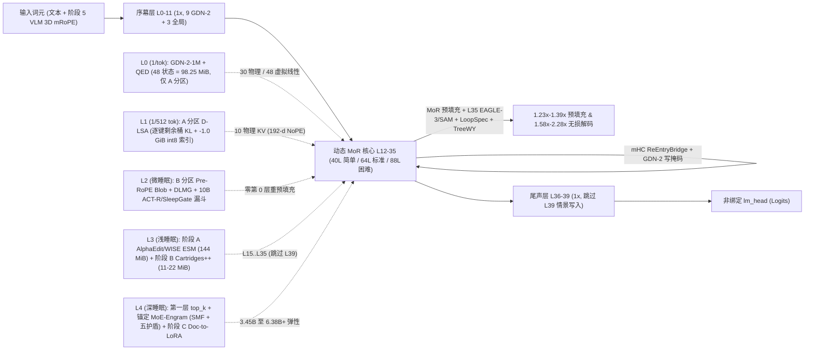

# 下一代架构演进路线图与科研论文规划（`v2.0`）：`Qwen3.6-64L-CoMem`（`LSA-NL`）

> **代码仓库：** `Qwen3.6-35B-A3B-Loop60`（`TassP0lar/Qwen3.6-35B-A3B-Loop64`） · **分支策略：** 纯 `Qwen3.6` 主干基座（`0` 外部供体许可证纠缠）  
> **研发硬件：** `1× NVIDIA RTX PRO 6000 Blackwell Server Edition`（`GB202`，`sm_120`，**`96 GB GDDR7 ECC`** [`94.97 GiB` CUDA 可用]，`512-bit`，**`1,597 GB/s`** 峰值带宽，`24,064` CUDA 核心，`600 W` TDP） · **消费级部署目标：** `16 GB`（`RTX 4080/5070 Ti`）、`24 GB`（`RTX 3090/4090`）、`32 GB`（`RTX 5090`）  
> **配套文档：** [英文原版路线图 (`ROADMAP_NEXTGEN_LOOP64_COMEM.md`)](ROADMAP_NEXTGEN_LOOP64_COMEM.md) · [逐组件架构与实现规范（中文 v1.0）](ARCHITECTURE_NEXTGEN_LOOP64_LSANL_ZH.md) · [LSA-NL 旗舰研究提案（中文 v2.0）](PROPOSAL_LSA_NESTED_LEARNING_ZH.md) · [算力申请与合作提案（中文 v2.0）](COMPUTE_GRANT_PROPOSAL_ZH.md) · [实证技术报告（EN）](EXPERIMENT_REPORT.md) · [实证技术报告（ZH）](EXPERIMENT_REPORT_ZH.md) · [SI-RSI 路线图](RSI_ROADMAP.md) · [词表一致性核验 CLI](../scripts/verify_q36_q38_tokenizer_parity.py)

> [!IMPORTANT]
> **实证锚定与零虚构政策：** 本路线图中的每一项数值均明确标注来源类别：**`实测（Measured）`**（经仓库日志、HF Hub 提交或直接文件/头信息检查核实）、**`闭式推导（Derived Formula）`**（精确闭式参数/字节账本）、**`已发表（Published / External）`**（外部官方公开的基准成绩或规格），或 **`估算（Estimated）`**（基于单卡实测吞吐前推的 GPU 小时预测）。**全文绝不为我方模型宣称任何未实测的 2026 下游基准得分。**

---

## §1. 执行摘要与对标 `Inkling 2 Mini` 目标规格

我们的洁净 v2 管线已在单张 `96 GB GDDR7 ECC` 显卡上充分完成循环混合改造的去风险验证（`167.60+` 小时有效监控运行；`s3_v2_long_1m_lsa@600` 完工并通过 `12/12` Gate 2 清晰输出与 `100%` `18K`/`64K` 大海捞针召回；`GDN-2-1M + QED` 正于 `s2_v2_joint_bptt` 稳定推进并突破 `step 340/600`，峰值显存 `67.77–67.80 GiB` 且 `0` 跳过）。下一代架构跃升——**`Qwen3.6-64L-CoMem`（`LSA-NL` v2.0）**（完整数学证明与证伪协议见 [`docs/PROPOSAL_LSA_NESTED_LEARNING_ZH.md`](PROPOSAL_LSA_NESTED_LEARNING_ZH.md)，逐组件实现蓝图见 [`docs/ARCHITECTURE_NEXTGEN_LOOP64_LSANL_ZH.md`](ARCHITECTURE_NEXTGEN_LOOP64_LSANL_ZH.md)）——锚定 **`64` 有效层甜点区（`d=2`，`[0,12)×1 + [12,36)×2 + [36,40)×1`）**，同时明确超越对 `Inkling 2 Mini` 的静态循环复刻。

`Qwen3.6-64L-CoMem` 摒弃不切实际的原始 `10M` 词元连续聊天窗口与静态单词元算力，深度融合三大支柱：
1. 架设于**分域 `3M–4M` 逻辑上下文**之上的 **5 级 `LSA-NL` 连续记忆系统（`L0 → L4`）**（`1M–2M` 实时活跃工作区 + `1M–2M` GPU 挂载巩固 KV-Mem Blob，底层由 **`100M+` 冷 SSD 词元**与 **`10B` 词元遗忘/硬化及三阶段 KV-to-Engram 晋升漏斗**支撑），整合源自 **`Spark-X2.6-Recursion`**（`BaiTian6641/Spark-X2.6-Recursion`）[1] 的已验证模块及对**原始 LSA** [2] 的**六项外科手术式精炼**；
2. **三轴动态弹性计算（`MoR` `40L/64L/88L` + `3.45B ↔ 6.38B+` 动态激活参数）**，协同**端到端预填充加速（`1.23×–1.39×` `MoR` 第 2 轮跳过 + 零额外模型的第 1 轮显著度引导预填充 + B 分区彻底消除回归会话重预填充）**与**Engram 耦合无损 `L35` 中途自投机草稿解码（`EAGLE-3` + `LoopSpec` + `SAM-Decoding` + `TreeWY`）**，在裸 `64L` 上达成 `1.58×–1.76×` 解码加速（较 `40L` 快 `1.07×–1.19×`），在 **`64L + 全量 MoE-Engram（5.86B 激活）`** 上更达成 **`1.73×–2.28×`** 加速（**较未循环 `40L [3.45B]` 反超 `1.02×–1.35×`！**）；以及
3. **消费级 `<= 24 GB` 显存部署配置**（`RTX 3090/4090` 占 `17.66–18.93 GiB`，`16 GB` 占 `10.89 GiB`，`32 GB` 占 `26.98 GiB`），外加复用 `Qwen3.6` 内置 VLM 视觉塔的长期**阶段 5 多模态 KV-Mem Blob** 演进路径。

### 1.1 实证锚定的端到端规格与基准对照表

| 对比维度 | `Qwen3.6-64L (d=2)` 洁净 v2 *（基线）* | **`Qwen3.6-64L-CoMem`（`LSA-NL` v2.0）** *（目标）* | **`Inkling 2 Mini`** *（TML，2026 年 11 月 20 日 [3]）* | 溯源 / 类别 |
| :--- | :--- | :--- | :--- | :---: |
| **文本总参数量** | `34.661B`（`~35B`；冻结 MoE `32.212B`，稠密核心 `2.448B`） | `34.661B` + `0.65–0.99 GiB` NVFP4 Engram + `~35M` `L35` 草稿头 | 总参 `26.4B` | `闭式推导` / `已发表` |
| **物理层 → 有效层** | `40L` → **`64L`**（`[12,36)` 核心 `×2`；`48` GDN-2 + `16` 全局） | **动态 `MoR` `40L / 64L / 88L`**（词元级深度 + `GDN-2` 写掩码） | 静态 `24L` → `48L`（中部 `12` 层循环 `3×`） | `闭式推导` / `已发表` |
| **激活参数（精确总量）** | **`4.916B`**（`1.017B` embed+head + `2.053B` 混合器 + `1.845B` MoE；不含输入 embed 为 `4.41B`） | **弹性 `3.45B ↔ 6.38B+`**（`MoR` 深度 + 第一层 `top_k` `8↔16` + 第三层 C `5.30/5.45/5.86B`） | 静态基座 `~3.4B` → 有效激活 **`~5.4B`** | `闭式推导` / `已发表` |
| **权重与消费级显存占用** | `21.85 GiB` 纯 NVFP4（`24.09 GiB` 混合 NVFP4/FP8 HF 检查点） | 服务器 `96 GB`：`33.8–45.4 GiB`（`2M–4M` 分域） · **消费级 `24 GB`：`17.66–18.93 GiB`**（`16 GB`：`10.89 GiB`；`32 GB`：`26.98 GiB`） | `~20 GB`（`NVFP4 + MXFP8`） | `实测` / `闭式推导` / `已发表` |
| **逻辑上下文与 KV 状态** | **`10.65 GiB`** FP8 / **`5.96–6.28 GiB`** `H64-INT4`（`1M` 连续；`10` 个物理 `kv_share` 层） | **分域 `3M–4M` GPU**（`21.25–22.50 GiB` KV，**`-1.0 GiB`** `int8` `BucketIndex`）+ **`100M+` 冷 SSD**（`604 GB`，头部 `262.5 MiB`）+ **`10B` 漏斗**（稳态 `345.6 GB`，头部 `150.2 MiB`） | `32.16 GiB` F16（仅 `1M`：`8` 非共享全局层 `32.00 GiB` + `40` SWA 层 `0.16 GiB`） | `闭式推导` / `已发表` |
| **线性 / SWA 循环状态** | **`98.25 MiB`** 精确（`48` 个虚拟 `fp32` GDN-2 + `bf16` 卷积状态；$O(1)$ 无限视界） | **`98.25 MiB`** 固定 `GDN-2-1M + QED + Soft Neg-Eigval`（**仅限 A 分区** + `TreeWY` 回滚） | `163.8 MiB`（`0.16 GiB`，`40` 个固定 `1,024` 词元 SWA） | `闭式推导` / `已发表` |
| **预填充与解码加速** | 标准 `64L`（预填充 GEMM 为 `40L` 的 `1.595×`；解码权重读取 `1.475×`） | **预填充：** `1.23×–1.39×` `MoR`/第 1 轮显著度（压至 `40L` 的 `1.15×–1.30×`）+ B 分区零重预填充 · **解码：** Engram 耦合 `L35` `EAGLE-3`/`SAM` + `LoopSpec` + `TreeWY`：**裸 `64L` `1.58×–1.76×`** 且 **`64L+MoE-Engram (5.86B)` `1.73×–2.28×`**（**较 `40L` 快 `1.02×–1.35×`！**） | 外挂 `DSpark` 辅助草稿模型 | `闭式推导` / `已发表` |
| **多跳 / 情景记忆** | 单跳 `D-LSA`（`192`-D NoPE）；只读权重 | **5 级 `LSA-NL` CMS（`L0 → L4`）：** Pre-RoPE Blob + `DLMG`（`PPR`/`A-MEM`/`SleepGate`/ACT-R）+ 三阶段晋升（`AlphaEdit`/`WISE` → `Cartridges++` → `Doc-to-LoRA`/`SMF`） | 未公开报告 | `架构特性` |
| **SWE-bench Verified / Pro Hard / Multi** | `TBD` *（待 `s2_v2` + `s4_v2_rl` 后测）* | 目标：经 `64L` SI-RSI + `LSA-NL` CoMem 缩小差距 | `~79.2%` / `~77.9%` / `~73.7%` | `已发表（外部）` |
| **DeepSWE v1.1 / FrontierCode v2.0** | `TBD` / `TBD` | 目标：可验证编程/仓库强化学习 | `~48.2%` / `~15.1%` | `已发表（外部）` |
| **MCP-Atlas / AA Intelligence Index** | `TBD` / `TBD` | 目标：洁净多轮工具 RL + 情景模式记忆 | `~82.7%` / `~20.1` | `已发表（外部）` |
| **ScreenSpot Pro / OmniDocBench** | *不在范围（v2 纯文本）* | *阶段 0–4 不在范围；**阶段 5 原生 VLM KV-Mem Blob**（`3D mRoPE [11,11,10]`）* | `~76.5%` / `~92.8%` | `已发表（外部）` |

### 1.2 诚实的架构优势与后训练差距剖析

**`Qwen3.6-64L-CoMem`（`LSA-NL` v2.0）具备结构性领先的五大维度（超越 `Inkling 2 Mini`）：**
1. **`1M` 词元状态缩小 `3.02×–5.40×`、分域 `3M–4M` / `10B` 漏斗与 `<= 24 GB` 消费级支持：** 借助 `kv_share=True` 的 `10` 个物理 KV 层、`D-LSA` 与 Block-64 Hadamard INT4 [4]，单张 `96 GB GDDR7 ECC` 显卡即可容纳完整的 **`3M–4M` 分域逻辑上下文**（KV 仅占 `21.25–22.50 GiB`，整卡总占用 `43.55–45.41 GiB`）外加 **`100M+` 冷 SSD 词元**（`604.0 GB` SSD + `262.5 MiB` GPU 头部）——并通过 Zipf NVFP4 切分（`KTransformers` [5]、`MoE-Lightning` [6]、`Fiddler` [7]）无缝下探至**消费级 `24 GB` 显卡的 `17.66–18.93 GiB`**。
2. **三轴动态弹性计算 vs. 静态 `48L` 循环：** 拒绝强迫所有词元走过固定 `48` 层，`MoR` [8]（`src/qloop/model/loop.py:548-554,771-786`）+ *Recurrent Depth* [9] 将简单词元路由至 `40L`（`3.454B`）、常规词元至 `64L`（`4.916B`）、最难 `5–10%` 词元至 `88L`（`6.378B`），并与熵自适应 `top_k`（`8↔16`）及 `s_null` Matryoshka `MoE-Engram` 正交叠加。
3. **流隔离 $O(1)$ 循环记忆 vs. 固定 `1,024` 词元 SWA：** `GDN-2-1M + Bounded QED + Soft Neg-Eigval` [10], [11], [12] 在 `98.25 MiB` 固定显存内跨全部 `48` 个虚拟线性层维持连续 Delta 规则状态追踪（较原生 GDN `0` 额外状态字节），且严格隔离于 A 分区（`1M–2M` 活跃工作区）。
4. **非破坏性五频段持续记忆（`L0 → L4`）+ `10B` 词元漏斗：** 不同于纯 *Titans / HOPE* 神经记忆 [13], [14]（需从零预训练且受制于前摄干扰 [15]），`LSA-NL` 有机结合免重预填充 Pre-RoPE KV-Mem Blob（`L2`）、`DLMG`（`HippoRAG 2` PPR [16] + `A-MEM` [17] + 双时间 `SleepGate` [15] + ACT-R 硬化）、闭式 `EpisodicSideMemory`（`L3`，`AlphaEdit` [18] + `WISE` [19]，`0.0` 漂移）、模块化 `Cartridges++` [20], [21], [22] 与 `Doc-to-LoRA` [23] / `SMF` [24] `MoE-Engram`（`L4`）。
5. **端到端预填充加速与 Engram 耦合无损中途草稿解码（`MoR` + `L35` `EAGLE-3`/`SAM` + `LoopSpec` + `TreeWY`）：** 正如 [`PROPOSAL_LSA_NESTED_LEARNING_ZH.md`](PROPOSAL_LSA_NESTED_LEARNING_ZH.md) §4.7–§4.7.2 所证，**计算受限预填充**（`3.885B` vs. `40L` `2.436B` GEMM 参数/词元 = `1.595×`）经由 `MoR` [8] 容量因子第 2 轮跳过（`50%/35%/25%` 配 `GDN-2` 写掩码）+ 零额外模型的第 1 轮显著度引导 + `D-LSA` [2]（`10M` 单注意力层 `22.7×–72.4×`）提速 **`1.23×–1.39×`**（压低至 `40L` 的 `1.15×–1.30×`），且 B 分区 KV Blob 彻底消除回归会话重预填充。在**带宽受限解码**端，朴素完整 `40L` 第 1 轮起草仅止步于 `1.03×–1.30×`（慢于 `40L`），而我们的 Engram 条件化 `L35` `EAGLE-3` [25]（$[h_{L11}, h_{L23}, h_{L35}, e_{\text{ngram}}]$ + TTT + `32K` 短名单）+ `LoopSpec` [26] 选择性二次提议 + `SAM-Decoding` + `TreeWY` [27]（每层 `O(1)` 单状态块、峰值状态显存低 `2–3×` + `12 KiB/锚点` `O(1)` `conv1d` 回滚）在裸 `64L` 上达成 **`1.58×–1.76×` 无损提速（较 `40L` 快 `1.07×–1.19×`）**，在 **`64L + 全量 MoE-Engram（5.86B 激活，4.131 GB/词元）`** 上更达成 **`1.73×–2.28×`（较未循环 `40L [3.45B]` 反超 `1.02×–1.35×`！）**，全程无需任何外挂数十亿草稿模型。

**`Inkling 2 Mini` 当前领先的领域——以及本路线图的追赶策略：**
1. **工业级 SWE / 编程 / MCP 工具调用后训练（`79.2%` SWE-bench Verified、`82.7%` MCP-Atlas）：** 通过单张 `96 GB GDDR7 ECC` 显卡上的高杠杆样本效率（并在第 2 档 `8×` 多卡算力节点上加速）追平：(a) 将 `s4_v2_rl` `SI-RSI` 采样聚焦于经 `L35`+`TreeWY` 加速的 `64L`，(b) 将仓库不变量与 MCP 模式晋升至 `L3` `ESM` / `Cartridges++`，(c) 部署 `DLMG` + `SleepGate` 双时间替代机制防止过期代码改动污染跨文件会话，(d) 将可验证数学、`KernelBench` CUDA/Triton、沙箱 SWE 测试与洁净 MCP 轨迹配对至外科手术式 `[loop_adapters, router]` `SI-RSI` 负似然训练。
2. **激活算力对等（`~5.4B` vs. `4.916B`）：** 阶段 1 即刻通过零额外显存的第一层原生 `top_k`（`8 → 10–16`，`+0.30B..+1.21B`）抹平差距，并在阶段 3 经由原生 `2048`-D `AnchoredMoEEngram`（`5.30B / 5.45B / 5.86B`）彻底巩固。
3. **多模态视觉 / 文档基准（`ScreenSpot Pro`、`OmniDocBench`）：** 阶段 `0–4` 严格排除以保持文本/代码执行纪律，随后在**阶段 5** 直接重新启用 `Qwen3.6` 内置 VLM 视觉塔（`3D mRoPE [11, 11, 10]`、完全同构的 `192`-D NoPE KV-Mem Blob）干净解锁。

---

## §2. 外部供体与词表一致性一手取证审计

在考虑任何外部权重或查表之前，我们对 **`Qwen/Qwen3.6-35B-A3B`** [28]、**`Qwen/Qwen3.8-Flash-Next`** 与 **`Qwen/Qwen3.8-2.4T-A95B`** 实施了一手取证级检查。全部词表与文件头检验均可通过 [`scripts/verify_q36_q38_tokenizer_parity.py`](../scripts/verify_q36_q38_tokenizer_parity.py) 完全复现。

### 2.1 取证级词表一致性：`Qwen/Qwen3.6-35B-A3B` vs. `Qwen/Qwen3.8-Flash-Next`（`实测`）

| 核验产物 / 区块 | `Qwen/Qwen3.6-35B-A3B` | `Qwen/Qwen3.8-Flash-Next` | 一致性结论 |
| :--- | :--- | :--- | :---: |
| **`tokenizer.json` —— 全部 18 项共享配置** | `version`, `truncation`, `padding`, `normalizer`, `pre_tokenizer`, `post_processor`, `decoder`, `model.{type, dropout, unk_token, continuing_subword_prefix, end_of_word_suffix, fuse_unk, byte_fallback, ignore_merges}` | 全部核心流水线与模型配置逐字节 / 逐 JSON 值完全一致 | **100% `exact_equal: True`** |
| **`model.vocab`** | `248,044` 个 ID（`0..248043`） | `248,044` 个 ID（`0..248043`） | **100% `exact_equal: True`** |
| **`model.merges`** | `247,587` 条 BPE 合并规则 | `247,587` 条 BPE 合并规则 | **100% `exact_equal: True`** |
| **共享 `added_tokens`** | `26` 个特殊词元（ID `248044..248069`） | `26` 个特殊词元（ID `248044..248069`） | **100% `exact_equal: True`** |
| **唯一差异 —— 末尾追加音频/TTS 词元** | *（无）* | **末尾追加 `7` 个 ID（`248070..248076`）：** `<|audio_start|>`, `<|audio_end|>`, `<tts_pad>`, `<tts_text_bos>`, `<tts_text_eod>`, `<tts_text_bos_single>`, `<|audio_pad|>` | **严格仅限尾部追加** |
| **`tokenizer_config.json`** | `eos='<|im_end|>'`, `pad='<|endoftext|>'`, `bos=None`, `model_max_length=262144` | `eos='<|im_end|>'`, `pad='<|endoftext|>'`, `bos=None`, `model_max_length=262144` | **100% 一致** |

**核心工程发现：** 所有文本与视觉词元 ID（`0..248069`）在 `Qwen3.6-35B-A3B` 与 `Qwen3.8-Flash-Next` 之间**逐位完全等价**。任何来自 `Qwen3.8-Flash-Next` 的基于词元 ID 索引的 N-gram 记忆表均可直接由 `Qwen3.6` 输入 ID 零重分词查询。

### 2.2 外部候选模型 Safetensors 文件头直接审计（`实测`）

| 候选仓库 | 架构与规模 | 许可证 | 直接文件头 / 配置取证结果 | 处置结论 |
| :--- | :--- | :---: | :--- | :---: |
| **`Qwen/Qwen3.8-Flash-Next`** | `model_type: qwen4_exp`，`360.0 GB` BF16（`131` 分片） | `qwen-community-1.0` | 直接检查全部 `33` 个含 PLE 分片（`model-00005..model-00037` / `131`）的 safetensors 文件头：在 **0 索引 `model.language_model.layers.1.ple.*`** 处共 **`137` 个 `.ple.` 张量**（尽管 `config.json` 写为 `ple_layer_ids: [2]`）：`128` 分片 × `BF16 [2,500,012, 160]` = **`51,200,245,760`（`51.20B`）** 参数（`16` 头 = `2` 种 n-gram 阶 × `8` 头 × `160` 维 = `2,560`），`layer_multipliers: I64 [3]`、`ngram_heads_offsets: I64 [16]`、`ngram_heads_vocab_sizes: I64 [16]`、`value_proj: BF16 [2560, 2560]`，移植入单流 `d=2048` 时绕过 `4` 分支 GR `key_proj/conv1d`（`10240 = 4×2560`）。 | **第二层：仅限可选插件消融（阶段 4B）** |
| **`Qwen/Qwen3.8-2.4T-A95B`** *（`Qwen3.8-Max` 官方基座）* | `model_type: qwen3_5_moe_text`，`92L`，`d=8192`，`512` 专家，`moe_intermediate=2048` | `qwen3.8-max` | **无 `ple` 表。** 隐藏宽度 `d=8192` 为 `Qwen3.6` `d=2048` 的 **`4×`**；残差几何不兼容且受限于严格的 `qwen3.8-max` 许可协议。 | **排除作为权重供体** |

### 2.3 具有约束力的架构策略：纯主干发布、隔离第二层、淘汰第四层

1. **主线模型（`Qwen3.6-64L-CoMem`）= 100% 纯 `Qwen3.6`：** 主发布版本不混入任何外部供体权重。全部主线训练、检查点及论文 2 核心主张均纯粹立足于 `Qwen/Qwen3.6-35B-A3B`，零外部许可证纠缠。
2. **第二层（`51.20B` 第 1 层 `ple` 外部记忆移植）= 严格隔离的可选插件消融：** 仅在阶段 4B 作为独立插件评测（`qwen-community-1.0` 表零拷贝 `mmap` 驻留主机 DDR5/NVMe + **`~10.5M` GPU 适配器参数**映射 `2560 ↔ 2048` 并绕过 `4` 分支 `10240`-D GR `key_proj/conv1d`）。全程**无需运行 `360 GB` 供体模型推理**。
3. **第四层（跨模型 Procrustes SwiGLU 专家移植）= 明确淘汰：** 非线性 `SiLU` 激活锥失配导致正交旋转 $R \in O(d)$ 破坏轴对齐门控；跨越 `48` 次核心访问的稠密桥接会凭空浪费 **`+0.503B`** 激活参数于坐标翻译；重对齐移植锥更会耗费 `110–230` 单卡 GPU 小时——在性价比上被原生 `Qwen3.6` `top_k` 扩展（`0` 额外显存）与原生 `2048`-D `MoE-Engram`（`20–35` GPU 小时）全面碾压。

---

## §3. 目标下一代架构：`Qwen3.6-64L-CoMem`（`LSA-NL` v2.0 + 三轴弹性计算）

`Qwen3.6-64L-CoMem` 围绕标定的 `64L (d=2)` 核心（`[0,12)×1 + [12,36)×2 + [36,40)×1`）与**分域 `3M–4M` 逻辑上下文**（`1M–2M` A 分区活跃 + `1M–2M` B 分区巩固 Blob、`100M+` 冷 SSD、`10B` 词元漏斗），将记忆与计算统一组织为 **5 级 `LSA-NL` 连续记忆系统（`L0 → L4`）**与**三轴动态弹性计算**。完整理论推导见 [`docs/PROPOSAL_LSA_NESTED_LEARNING_ZH.md`](PROPOSAL_LSA_NESTED_LEARNING_ZH.md)（几何误差 $G$ vs. 动态误差 $D$、原始 LSA 六点审计、MoE Zipf 赠券收集器自投机数学、消费级 `<= 24 GB` 账本及阶段 5 多模态 Blob），逐组件代码契约见 [`docs/ARCHITECTURE_NEXTGEN_LOOP64_LSANL_ZH.md`](ARCHITECTURE_NEXTGEN_LOOP64_LSANL_ZH.md)。全阶段强制执行两条全局不变量：
- **严格第 0 步 IEEE-754 位级恒等（`max_abs_diff == 0.0`）：** 每个新增模块初始化为精确零残差贡献。
- **100% 冻结 `32.212B` NVFP4 路由专家：** 每训练步前后经 [`src/qloop/model/experts.py`](../src/qloop/model/experts.py) 与 [`src/qloop/model/loop.py`](../src/qloop/model/loop.py) 中的 `sha256_frozen_experts()` 强校验。

### 3.1 层级 `L0`（`f = 1/tok`）—— A 分区循环状态（`GDN-2-1M + QED + Soft Neg-Eigval`）
- **状态与内核栈（`实测` / `闭式推导`）：** `64L (d=2)` 的 `48` 个虚拟线性层仅占 **`98.25 MiB`** 固定循环+卷积状态（较原生 GDN `0` 额外状态字节，[`src/qloop/model/gdn2.py`](../src/qloop/model/gdn2.py) 含 `27.53M` 适配器参数），1 对 1 映射至 `fla 0.6.0` `DPLR` Triton 内核 [29]（`32K` 耗时 `53.55 ms`、`T=1` 耗时 `0.0787 ms`，`4×8K` 宏分段将包装层显存压降 `3.28×`）。
- **分域与 `TreeWY` 约束：** `GDN-2` 严格仅运行于 A 分区（绝不摄入冷 B 分区 Blob），支持因果 `MoR` 写掩码（`loop.py:771-786`），并借由 **`TreeWY`** [27] 以单次三角求解验证投机草稿树（每层 `O(1)` 单状态块、与树宽无关，峰值状态显存低 `2–3×`）。

### 3.2 层级 `L1` + `L2`（`f = 1/512 tok` 与微睡眠）—— 升级版 `D-LSA`、分域 `3M–4M` 与 `10B` 漏斗（`Tier 3A`）
- **原始 LSA 逐键剩余桶 KL 升级：** 将 `_distill_kl()`（[`src/qloop/model/lsa.py:1231-1268`](../src/qloop/model/lsa.py#L1231-L1268)）从桶级质量 KL 升级为原始 LSA [2] 的**逐键前向 KL + 截断深度“剩余桶” + `calibrate_tau`**（将 `512K–1M` 召回从 `0.5715` 提升至 `> 0.75`），并同步完成 `-1.0 GiB` `int8` `BucketIndex` 压缩（`lsa.py:728-768`）。
- **B 分区 + `10B` 词元遗忘/硬化漏斗：** Pre-RoPE `H64-INT4` `512` 词元 Blob（`2.8125 MiB/blob`、`EPIC` [30] `[0:4)` 去汇点、限幅 ReRoPE `pos_rerope.py`、`1,344 B` GPU 头部）协同 `DLMG`（`HippoRAG 2` PPR [16] + `A-MEM` [17] + `Zep/Graphiti` [31] + `SleepGate` [15]）以及四阶段 `10B → 800M → 133M → 80M → 60M` 漏斗（显著度精选 + `EpiCache` [32] `6×` NoPE 去重 + 艾宾浩斯 ACT-R $R_b(t)=e^{-\Delta t/S_b}$ 硬化/遗忘 + `25%` Engram 晋升 → 稳态仅 **`345.6 GB` SSD + `150.2 MiB` GPU 头部**）。

### 3.3 层级 `L3`（`f = 1/task`，浅睡眠）与层级 `L4`（`f = 1/week`，深睡眠）—— 三阶段 KV-to-Engram 晋升与弹性计算（`Tier 1 + 3B + 3C`）
- **阶段 A（`ESM`，零反向传播 —— 即刻就绪）：** `Spark-X2.6` [1] `LRCD` + Float64 DGKS `AlphaEdit` [18] + `WISE` [19]（`L15..L35` 每分片 `144 MiB`，**严格跳过尾声层 `L39`**，`0.000` 通用文本漂移，配套事务回滚账本）。
- **阶段 B（模块化压缩 KV 包）：** `Cartridges` [20] / `Cartridges++` [21] / `Cartridges at Scale` [22] 将 `100K` 词元簇蒸馏为 `2K–4K` 合成 `H64-INT4` 弹匣包（`11.25–22.50 MiB`，`~38×` 压缩），直接插入 B 分区。
- **阶段 C 与 `L4` 弹性激活计算：** 原生 `top_k`（`8 ↔ 16`，`0` 额外显存）、`2048`-D `AnchoredMoEEngram`（`5.30 / 5.45 / 5.86B` 激活，原生聚类热启动，`SMF` [24]，全部五重护盾：`gamma=0`、`min_active_pos` `93.6%` OOD 修复、`DeepSeek Engram` 带符号平方根 RMSNorm QK 门控 [33]、`WISE` + `<= 3%` 范数硬上限、`s_null` Matryoshka `p=0.15`），以及算力资助的亚秒级（`~0.21 s`，适配器显存 `<50 MB`）**`Doc-to-LoRA`** [23] 超网络 + **`SEAL`** [34] 自编辑。
- **消费级 `<= 24 GB` 部署（`KTransformers` [5] / `MoE-Lightning` [6] / `Fiddler` [7]）：** 将 `2.42 GiB` FP8 稠密核心 + 最热 `80–160/256` Zipf NVFP4 专家常驻 GPU（`RTX 3090/4090` 占 `17.66–18.93 GiB`、`16 GB` 占 `10.89 GiB`、`32 GB` `RTX 5090` 全 GPU 占 `26.98 GiB`），将长尾冷专家卸载至 DDR5 CPU AMX/AVX-512 执行。

---

## §4. 分阶段执行计划、代码触点、熔断门与里程碑追踪（`阶段 0–5`）

下表全部 GPU 小时均为面向 **`1× NVIDIA RTX PRO 6000 Blackwell Server Edition (96 GB GDDR7 ECC, 1,597 GB/s)`** 的**`估算（Estimated）`**，直接根据 `s3_v2`（`2,365 tok/s`）与 `s2_v2`（`1,040–1,173 tok/s`）实测吞吐标定。

| 阶段 | 范围与核心交付物 | 精确 `src/qloop/` 代码触点 | 单卡预算（`1× 96 GB GDDR7`） | 硬性通过 / 熔断门（Kill-Gates） | 状态 |
| :---: | :--- | :--- | :---: | :--- | :---: |
| **阶段 0** | **洁净 v2 `GDN-2-1M + QED` 完工（`L0`）：** 完成 `s2_v2_joint_bptt`（`s340+ → 600`），执行 Gate 2 `18K/64K/256K` 针检索与连贯性实测，跑通 `GDN-2 ON vs OFF` 因果消融，发布论文 1（v1.5）。 | [`src/qloop/model/gdn2.py`](../src/qloop/model/gdn2.py), [`src/qloop/train/bptt.py`](../src/qloop/train/bptt.py), [`configs/stages/s2_v2_joint_bptt.yaml`](../configs/stages/s2_v2_joint_bptt.yaml) | 剩余 `~18–20 h`（`600` 步总计 `~45 h`） | `0` NaN/跳过；峰值显存 `< 75 GiB`；`100%` `18K/64K` 针命中；`0` 复读/毒化；`d=1→2→3` NLL 单调下降且 `GDN-2 ON` 较 `s3_v2@600` 正收益 | **`进行中`** *（实时已过 `s340/600`）* |
| **阶段 1** | **零重训推理升级（`第一层` + `L1` 压缩）：** (a) 动态原生 `top_k`（`8→10/12/14/16`，固定 / 第 2 轮 / 熵自适应，`0` 额外显存）；(b) `BucketIndex` `int8`/即算压缩回收 `-1.0 GiB` GDDR7 显存。 | [`src/qloop/model/quant_autograd.py`](../src/qloop/model/quant_autograd.py), [`src/qloop/model/experts.py`](../src/qloop/model/experts.py), [`src/qloop/model/loop.py`](../src/qloop/model/loop.py), [`src/qloop/model/lsa.py`](../src/qloop/model/lsa.py)（`:728-768`） | `~2–4 h` *（零训练；等价性与评测扫描）* | `top_k=8` 偏差 `0.0`；`1M` 下 `BucketIndex <= 0.06 GiB`；`top_k>8` 在零额外权重显存下改善留出困难数学/代码 NLL 或 pass@1 | **`已规划`** |
| **阶段 2A** | **熔断门 `K0`（零重训 KV Blob）+ 原始 LSA 逐键剩余桶 KL 升级：** (a) 在 `18K–1M` 评测 4 组配对 `K0` 实验臂（`(a)` 神谕、`(b)` 朴素拼接、`(c)` Pre-RoPE `[0:64)` 去旋 + 去汇点 `H64-INT4`、`(d)` `+ 5% CacheBlend` [35]）；(b) 将 `_distill_kl()`（`lsa.py:1231-1268`）升级为原始 LSA **逐键前向 KL + 截断深度“剩余桶” + `calibrate_tau`**。 | [`src/qloop/model/pos_rerope.py`](../src/qloop/model/pos_rerope.py), [`src/qloop/model/offload.py`](../src/qloop/model/offload.py), [`src/qloop/model/lsa.py`](../src/qloop/model/lsa.py)（`:1231-1268`）, 新增 `scripts/eval_killgate_k0_kv_blobs.py` | **`~0.5 h`** `K0` + `~8–12 h` 逐键 KL 校准 *（仅黄灯 B 时可选 `+2–4 h` `Block-Attention` [36]）* | **绿灯 `K0`：** `臂 (c) >= 92%` 神谕且 NLL 差 `<= 0.05` nats（`黄灯`：`5% CacheBlend` 或 `2–4 h` 校准；`红灯`：转向 `ESM` + 摘要头重预填充）。**LSA 门：** `512K–1M` 召回 `0.5715 → > 0.75` | **`已规划`** |
| **阶段 2B** | **`L2` `KVMemBlobStore` + `DLMG`（微睡眠）与 `L3` `EpisodicSideMemory`（浅睡眠）：** 实现分域 `3M–4M`（`1M–2M` 活跃 + `1M–2M` 挂载 + `100M+` 冷 SSD）、`HotColdPagedKVStore`（`async_lookahead`）、`DynamicLatentMemoryGraph`（`HippoRAG 2` PPR + `A-MEM` + `Zep/Graphiti` + `SleepGate`）与 `EpisodicSideMemory`（`AlphaEdit` fp64 DGKS + `WISE`，`L15..L35`，跳过 `L39`）。 | [`src/qloop/model/offload.py`](../src/qloop/model/offload.py), [`src/qloop/infer/engine.py`](../src/qloop/infer/engine.py), 新增 `src/qloop/model/kv_blobs.py`, 新增 `src/qloop/model/memory_graph.py`, 新增 `src/qloop/model/episodic.py` | `~4–8 h` *（零基座训练；校准 + 多会话扫描）* | `K1`：`204,800` 头部 `<= 270 MiB`，DDR5 `8` Blob 挂载 `< 1.5 ms`；`K2`：`DLMG`+`SleepGate` 冲突检索领先扁平 `D-LSA`/RAG `>= +15` 分、2 跳领先 `>= +10` 分；`K3`：`ESM` `0.000` 漂移 + `100%` 回滚 | **`已规划`** |
| **阶段 2C** | **端到端预填充加速（`MoR`/`MoD`）与无损 `L35` 中途自投机草稿器（`EAGLE-3`/`SAM` + `LoopSpec` + `TreeWY`）：** (a) 启用因果 `MoR` [8] + `Mixture-of-Depths` [37] 容量因子第 2 轮预填充词元跳过（`50%/35%/25%` 显著词元 → `3.160B/2.943B/2.798B` = `64L` 预填充提速 `1.23×–1.39×`，配 `GDN-2` 写掩码），由零额外模型**第 1 轮显著度引导预填充**（`Speculative Prefill` [38]、`Cross-Family Speculative Prefill` [39]）驱动并衔接 `40L/64L/88L` 解码路由；(b) 训练 `~35M` 单层 `L35` `EAGLE-3` [25] 多层融合（$[h_{L11}, h_{L23}, h_{L35}]$）+ 直接词元 TTT（`~100M–120M` 目标模型词元 / `~532K` 在策略轨迹）+ `32K` 短名单（`方案 B+`），协同 `LoopSpec` [26] 选择性二次提议、**`SAM-Decoding`** [40] $O(1)$ 提示词/代码库后缀自动机、**`TreeWY`** [27] `GDN-2` 验证（每层 `O(1)` 单状态块）与 `kv_share` `O(1)` 回滚。 | [`src/qloop/model/loop.py`](../src/qloop/model/loop.py)（`:548-554,771-786`）, [`src/qloop/model/gdn2.py`](../src/qloop/model/gdn2.py), [`src/qloop/infer/engine.py`](../src/qloop/infer/engine.py), 新增 `src/qloop/infer/spec_draft.py` | `~12–20 h` *（TTT 头蒸馏 + `MoR`/`MoD` 预填充路由校准 + `SAM` + `TreeWY` Triton 内核）* | **`K4`：** *预填充：* `64L` 预填充提速 `>= 1.20×`，提示词 NLL 差 `<= 0.015` nat 且针等价 `>= 98%`；`MoR` 解码降均深 `>= 20%`（`<= 0.01` nat）。*解码：* `TreeWY` `fp64` 精度 `<= 1e-9`；`L35`+`SAM` `α >= 0.85`、与 `64L` `100%` 贪婪等价、**实测相对裸 `64L` 墙钟加速 `>= 1.45×`** | **`已规划`** |
| **阶段 3** | **`10B` 词元漏斗、Engram 耦合 `方案 B/B+` 集成（`ZipfianTieredMoEEngram` + `ESM`）、三阶段 KV-to-Engram 桥接与 `<= 24 GB` 消费级配置：** 实现显著度精选 + `EpiCache` + 艾宾浩斯 ACT-R $R_b(t)=e^{-\Delta t/S_b}$ 修剪；阶段 B `Cartridges++` [21]（`2K–4K`，`11–22 MiB`）；`L4` `AnchoredMoEEngram` / `ZipfianTieredMoEEngram`（`5.30/5.45/5.86B`、`E=32, K=7`、`u_Eng = 2.21×–2.65×`、`0.085 GB` 共享 Engram 只读一次）+ `SMF` [24] + 五护盾；**打通 Engram ↔ 阶段 2C 草稿器三重协同**（$[h_{L11}, h_{L23}, h_{L35}, e_{\text{ngram}}]$ `<0.02 ms` Tier-1A/1B 条件化 + `SAM-Decoding` [40] 起草期跳过路由 `MoE-Engram`、`γ=4–5` 批量前瞻预取掩盖 DDR5/NVMe DMA、无状态验证 + `12 KiB/锚点` `O(1)` `conv1d(k=4)` 回滚 → **相对 `64L+Engram` `1.73×–2.28×`，反超 `40L`！**）；原型验证阶段 C 亚秒级（`~0.21 s`，`<50 MB`）`Doc-to-LoRA` [23] 桥接；核验 `<= 24 GB` Zipf NVFP4 切分档位。 | 新增 `src/qloop/model/engram.py`, 新增 `src/qloop/model/cartridges.py`, `src/qloop/infer/spec_draft.py`, [`src/qloop/model/experts.py`](../src/qloop/model/experts.py), [`src/qloop/train/optim.py`](../src/qloop/train/optim.py), 新增 `configs/stages/s2b_comem_engram.yaml` | `~25–45 h` *（单卡 SFT/蒸馏 + Engram-`L35` TTT + `<= 24 GB` 档位评测；阶段 C 完整元训练归入算力第 3 档）* | 第 0 步 `max_abs_diff == 0.0`；冻结 MoE SHA-256 不变；`CE_off <= 0.005` nats（`p=0.15`）；`10B` 模拟归档 `<= 400 GB` SSD；`Cartridges++` 偏航 `<= 0.02` nat；**Engram `K4`：** `conv1d` 回滚位精确 `0.0`，仓库代码 `α >= 0.90`，**相对 `64L+Engram` `>= 1.60×`（方案 B+ 下反超 `40L`）**；`24 GB` 档位 C/D `<= 19.0 GiB` | **`已规划`** |
| **阶段 4** | **阶段 4 可验证 `SI-RSI` 强化学习（`s4_v2_rl`，聚焦 `64L d=2`）+ 可选 `4B` 第二层 `ple` 消融：** 在经阶段 2C `L35`+`TreeWY` 无损加速的 `64L` 上运行 GRPO/DAPO + 外科手术式 `[loop_adapters, router]` `SI-RSI`（+ `SEAL` [34] 自编辑），覆盖数学（`DAPO-Math-17k`）、`KernelBench`、沙箱 SWE 与洁净 MCP。可选阶段 4B 隔离评测 `Qwen3.8-Flash-Next` `51.20B` `ple` DDR5 `mmap` 插件（`~10.5M` GPU 适配器）。 | [`src/qloop/train/rl.py`](../src/qloop/train/rl.py), [`src/qloop/train/sirsi.py`](../src/qloop/train/sirsi.py), [`src/qloop/infer/engine.py`](../src/qloop/infer/engine.py), [`src/qloop/eval/registry.py`](../src/qloop/eval/registry.py), [`configs/stages/s4_v2_rl.yaml`](../configs/stages/s4_v2_rl.yaml), 可选 `src/qloop/plugins/ple_mmap.py` | `~60–110 h` *（经 `L35`+`TreeWY` 加速；`8×` 算力节点仅 `~10–16` 墙钟小时；可选 4B 另 `+12–20 h`）* | 留出晋升门（`min_delta >= 0.0`、`max_len_growth <= 1.5`、`0` 复读）；在 13-gram 去污染 `AIME 2026`、`KernelBench L3`、`SWE-bench`、`MCP-Atlas`、`MRCR 1M` 上取得可测收益；导出 `safetensors` Whole Model Pack；若纯 `Qwen3.6` 第三层 C 达成第二层 `>= 95%` 收益则终止 4B | **`已规划`** |
| **阶段 5 *（长期）*** | **原生多模态 KV-Mem Blob（`Qwen3.6` 内置 VLM 视觉塔）：** 挂回原生 ViT（`3D mRoPE [11, 11, 10]`、完全同构的 `192`-D NoPE 键），将 UI 截图、PDF 与流式视频帧归档为 Pre-`3D-mRoPE` `H64-INT4` KV-Mem Blob（`ReKV` [41]、`M3-Agent` [42]、`M+` [43]）存入同一 `DLMG` + `100M` SSD 存储。**严格以阶段 0–4 完工为前置门控。** | 新增 `src/qloop/model/vlm_blobs.py`, [`src/qloop/model/pos_rerope.py`](../src/qloop/model/pos_rerope.py), 阶段 2B `src/qloop/model/kv_blobs.py` | 算力第 3 档（`~1,200` 多卡 GPU 小时后续课题） | 文本/代码基准零回退；Pre-`3D-mRoPE` 视觉 Blob `K0 >= 90%` 连续 VLM 神谕；在 `ScreenSpot Pro`、`OmniDocBench` 与流式视频问答上具竞争力 | **`长期（阶段 4 后）`** |

---

## §5. 三篇论文梯队规划、受控消融矩阵与测量卫生规范

我们维护一条**三篇递进式论文发表梯队**，使已完成的洁净 v2 实证成果即刻发布，旗舰 `LSA-NL` + 三轴动态计算依托第 2 档多卡算力冲刺 2027 顶会，单次前向 `Doc-to-LoRA` 与阶段 5 多模态记忆驱动论文 3。

### 5.1 三篇论文发表与报告矩阵

| 论文 / 交付物 | 时间节点 | 追踪文件 / 产物 | 核心科学贡献 | 目标会议 / 渠道 |
| :--- | :---: | :--- | :--- | :--- |
| **论文 1（v1.5 技术报告与算力更新）** | 紧接**阶段 0**（`s2_v2@600`） | [`docs/EXPERIMENT_REPORT.md`](EXPERIMENT_REPORT.md), [`docs/EXPERIMENT_REPORT_ZH.md`](EXPERIMENT_REPORT_ZH.md), [`docs/COMPUTE_GRANT_PROPOSAL.md`](COMPUTE_GRANT_PROPOSAL.md), [`Loop64_Technical_Report_EN.pdf`](papers/Loop64_Technical_Report_EN.pdf), [`Loop64_Technical_Report_ZH.pdf`](papers/Loop64_Technical_Report_ZH.pdf) | 完整 `s2_v2@600`（`40L / 64L / 88L`）遥测、**GDN-2 ON vs. OFF 因果消融**、HSSD v3.2 负面消融剖析、Gate 2 `18K–256K` 针检索扫描、Blackwell `sm_120` 内核与首批 13-gram 去污染 2026 实测对比。 | 开源双语 US-Letter IEEE 技术报告 + arXiv 预印本 |
| **论文 2（旗舰 `LSA-NL` / `Loop64-CoMem` —— 第 2 档多卡目标）** | **阶段 1–4** 完工后 | 理论基础：[`docs/PROPOSAL_LSA_NESTED_LEARNING_ZH.md`](PROPOSAL_LSA_NESTED_LEARNING_ZH.md)（`v2.0`）→ 新增 `docs/papers/Loop64_CoMem_Paper_{EN,ZH}.pdf` + `K0–K4` 与 `NL-0..NL-7` 日志 | **拟定题目：** *"Latent-Sparse Nested Learning (`LSA-NL`): Split-Horizon Continuum Memory, Dynamic Recursive Compute, and Lossless Mid-Flight Drafting for Frozen MoEs"*（五频段 CMS、`10B` 漏斗、六项 LSA 升级、`MoR` + `L35` `EAGLE-3` + `TreeWY`、`<= 24 GB` 消费级配置）。 | **NeurIPS / ICML / ICLR / MLSys 2027** + arXiv 预印本 |
| **论文 3（前沿终身多模态智能体 —— 第 3 档后续工作）** | **阶段 5** + 算力第 3 档后 | 延续 `LSA-NL` 阶段 C + 阶段 5 VLM 日志 | **拟定题目：** *"Instant Context-to-Engram Compilation (`Doc-to-LoRA`) and Native Multimodal KV-Mem Blobs for Hybrid Looped MoEs"*（亚秒级 `~0.21 s` / `<50 MB` 适配器超网络 KV-to-Engram、`SEAL` 自编辑、`3D mRoPE` `ReKV`/`M3-Agent` 视文情景 Blob）。 | **NeurIPS / ICML / CVPR 2027–2028** |

### 5.2 论文 2 强制受控消融矩阵（与 `NL-0..NL-7` 对齐）

每一行均在**完全相同的冻结 `unsloth/Qwen3.6-35B-A3B-NVFP4` 检查点**（相同专家 SHA-256 摘要、相同 13-gram 去污染评测集；与 [`PROPOSAL_LSA_NESTED_LEARNING_ZH.md`](PROPOSAL_LSA_NESTED_LEARNING_ZH.md) §5.3 中的 `NL-0..NL-7` 交叉索引）上独立开关**单一层级或计算轴**：

| 配置 ID（`NL` 映射） | `L0`（`GDN-2+QED`） | `L1/L2`（`分域 + DLMG + 漏斗`） | `L3`（`ESM` / `Cartridges++`） | `L4` 与弹性计算（`MoR` / `L35`+`TreeWY` / `Engram`） | `s4_v2_rl`（`64L`） | 第二层（`ple` 可选） | 受控检验的核心假设 |
| :---: | :---: | :---: | :---: | :---: | :---: | :---: | :--- |
| **A0** | 关（原生） | 关（扁平 `1M`） | 关 | 静态 `k=8` | 关 | 关 | 洁净 `s3_v2@600`（`40L/64L/88L`）基线 |
| **A1**（`NL-1`） | **开** | 扁平 `1M` + **逐键剩余桶 KL** | 关 | 静态 `k=8` | 关 | 关 | `GDN-2-1M+QED`（`s2_v2@600`）因果增益 + 原始 LSA 逐键 KL 升级 |
| **A2**（`NL-2/3`） | 开（仅 A 分区） | **开（`3M–4M` / `100M` SSD + `10B` 漏斗 + `DLMG`）** | 关 | 静态 `k=8` | 关 | 关 | `-1.0 GiB` `BucketIndex` + `K0` Pre-RoPE Blob + `PPR`/`A-MEM`/`SleepGate`/ACT-R 前摄干扰消解 |
| **A3**（`NL-4`） | 开（仅 A 分区） | 开 | **开（`ESM` + `Cartridges++`）** | 静态 `k=8` | 关 | 关 | 零梯度横向 KV → 纵向 `AlphaEdit`/`WISE`（`0.0` 漂移）与 `~38×` `Cartridges++` 晋升 |
| **A4** | 开（仅 A 分区） | 开 | 关 | **第一层 `top_k`（`8↔16`）+ `MoR`/`MoD` 预填充 + `L35` `EAGLE-3`/`SAM`+`TreeWY`** | 关 | 关 | `1.23×–1.39×` `MoR` 预填充、三轴弹性（`3.45B↔6.38B+`）与无损 `1.58×–1.76×` 裸 `64L` 解码（`> 40L`，`K4`） |
| **A5**（`NL-5`） | 开（仅 A 分区） | 开 | 开 | **`MoR`/`MoD` 预填充 + Engram 耦合 `L35`/`SAM`+`TreeWY` + `MoE-Engram`（`SMF` + 五护盾）** | 关 | 关 | 原生 `MoE-Engram`（`5.86B`）+ 三重草稿协同（相对 `64L+Engram` `1.73×–2.28×`，`> 40L`）+ 五护盾消融（`CE_off`） |
| **A6**（`NL-6`） | 开（仅 A 分区） | **开（完整 `LSA-NL` v2.0）** | **开** | **全弹性 + `MoR` 预填充 + Engram-`L35`/`SAM`+`TreeWY`** | **开（`SI-RSI`）** | 关 | **主线旗舰 `Qwen3.6-64L-CoMem`（`LSA-NL` v2.0，100% 纯 `Qwen3.6`）** |
| **A7**（`NL-7`） | 开（仅 A 分区） | 开（`512K–1M` + `100M` SSD） | 开 | **消费级 `<= 24 GB` Zipf NVFP4 切分（`128–160/256`）** | 开 | 关 | 消费级 `RTX 3090/4090`（`17.66–18.93 GiB`）与 `16 GB`（`10.89 GiB`）等价性与吞吐 |
| **A8** | 开（仅 A 分区） | 开 | 开 | 静态 `k=8` | 开 | **开（`mmap`）** | 可选阶段 4B 第二层 `51.20B` `ple` DDR5 插件对比纯 `Qwen3.6` A6 |

### 5.3 严格的测量与引文卫生政策
- **零未测宣称：** 所有尚未运行的实验或基准均明确标注 `TBD` / `已规划`；绝不绘制或填入任何推测成绩。
- **精确溯源与硬件真实性：** 每项报告指标均链接至公开 HF Hub 提交 SHA、归档 JSON/CSV 遥测产物或显式闭式公式。硬件描述始终准确标明 **`NVIDIA RTX PRO 6000 Blackwell Server Edition (96 GB GDDR7 ECC, 1,597 GB/s)`**（绝不误标为堆叠数据中心显存或工作站版 `1,792 GB/s`）。
- **经核验的 IEEE `[1]..[N]` 引文：** 所有外部方法、基准与模型对比均采用经核验出版日期、arXiv 编号或一手仓库链接的编号 IEEE 引文，并一律展开为独立编号（严禁未解析的范围破折号）。

---

## 参考文献

[1] BaiTian6641, "Spark-X2.6-Recursion: Dynamic Latent Memory Graphs, Null-Space Vertical Episodic Adapters, and Anchored MoE-Engram Stability Shields," GitHub Repository, 2026. [Online]. Available: https://github.com/BaiTian6641/Spark-X2.6-Recursion

[2] A. Kubicek, A. Caciolai, L. Peng, S. Sumant, B. Hoover, F. Greenlee, R. M. Battleday, R. Urban, T. Hoefler, and J. C. R. Whittington, "Latent Sparse Attention: Towards Subquadratic Ultra-Long Context Attention," *arXiv preprint arXiv:2610.42147*, Oct. 2026.

[3] Thinking Machines Lab, "Inkling 2 Mini," Technical Release, Nov. 20, 2026. [Online]. Available: https://thinkingmachines.ai

[4] A. Zandieh, M. Daliri, M. Hadian, and V. Mirrokni, "TurboQuant: Online Vector Quantization with Near-optimal Distortion Rate," in *Proc. Int. Conf. Learn. Represent. (ICLR)*, 2026, arXiv:2504.19874.

[5] H. Chen *et al.*, "KTransformers: Unleashing the Full Potential of CPU/GPU Hybrid Inference for MoE Models," in *Proc. ACM Symp. Operating Syst. Principles (SOSP)*, 2025. [Online]. Available: https://github.com/kvcache-ai/ktransformers

[6] S. Cao, S. Liu, T. Griggs, P. Schafhalter, X. Liu, Y. Sheng, J. E. Gonzalez, M. Zaharia, and I. Stoica, "MoE-Lightning: High-Throughput MoE Inference on Memory-Constrained GPUs," in *Proc. ACM Int. Conf. Architectural Support Program. Lang. Operating Syst. (ASPLOS)*, 2025, arXiv:2411.11217.

[7] K. Kamahori, T. Tang, Y. Gu, K. Zhu, and B. Kasikci, "Fiddler: CPU-GPU Orchestration for Fast Inference of Mixture-of-Experts Models," in *Proc. Int. Conf. Learn. Represent. (ICLR)*, 2025, arXiv:2402.07033.

[8] S. Bae, Y. Kim, R. Bayat, S. Kim, J. Ha, T. Schuster, A. Fisch, H. Harutyunyan, Z. Ji, A. Courville, and S.-Y. Yun, "Mixture-of-Recursions: Learning Dynamic Recursive Depths for Adaptive Token-Level Computation," *arXiv preprint arXiv:2507.10524*, Jul. 2025.

[9] J. Geiping, S. McLeish, N. Jain, J. Kirchenbauer, S. Singh, B. R. Bartoldson, B. Kailkhura, A. Bhatele, and T. Goldstein, "Scaling up Test-Time Compute with Latent Reasoning: A Recurrent Depth Approach," *arXiv preprint arXiv:2502.05171*, Feb. 2025.

[10] A. Hatamizadeh, Y. Choi, and J. Kautz, "Gated DeltaNet-2: Decoupling Erase and Write in Linear Attention," *arXiv preprint arXiv:2605.22791*, May 2026.

[11] D. Gupta, A. Das, and D. Gupta, "The Query Knows What to Forget: A Second Erase Direction for Linear Attention," *arXiv preprint arXiv:2608.13668*, Aug. 2026.

[12] R. Grazzi, J. Siems, A. Zela, J. K. H. Franke, F. Hutter, and M. Pontil, "Unlocking State-Tracking in Linear RNNs Through Negative Eigenvalues," in *Proc. Int. Conf. Learn. Represent. (ICLR)*, 2025, arXiv:2411.12537.

[13] A. Behrouz, P. Zhong, and V. Mirrokni, "Titans: Learning to Memorize at Test Time," *arXiv preprint arXiv:2501.00663*, Jan. 2025.

[14] A. Behrouz, M. Razaviyayn, P. Zhong, and V. Mirrokni, "Nested Learning: The Illusion of Deep Learning Architectures," in *Adv. Neural Inf. Process. Syst. (NeurIPS)*, 2025, arXiv:2512.24695.

[15] Y. Xie, "Learning to Forget: Sleep-Inspired Memory Consolidation for Resolving Proactive Interference in Large Language Models (SleepGate)," *arXiv preprint arXiv:2603.14517*, Mar. 2026.

[16] B. J. Gutiérrez, Y. Shu, W. Qi, S. Zhou, and Y. Su, "From RAG to Memory: Non-Parametric Continual Learning for Large Language Models (HippoRAG 2)," *arXiv preprint arXiv:2502.14802*, Feb. 2025.

[17] W. Xu, Z. Liang, K. Mei, H. Gao, J. Tan, and Y. Zhang, "A-MEM: Agentic Memory for LLM Agents," *arXiv preprint arXiv:2502.12110*, Feb. 2025.

[18] J. Fang *et al.*, "AlphaEdit: Null-Space Constrained Knowledge Editing for Language Models," in *Proc. Int. Conf. Learn. Represent. (ICLR)*, 2025, arXiv:2410.02355.

[19] P. Wang *et al.*, "WISE: Rethinking the Knowledge Memory for Lifelong Model Editing of Large Language Models," in *Adv. Neural Inf. Process. Syst. (NeurIPS)*, 2024, arXiv:2405.14768.

[20] S. Eyuboglu, R. Ehrlich, S. Arora, N. Guha, D. Zinsley, E. Liu, W. Tennien, A. Rudra, J. Zou, A. Mirhoseini, and C. Ré, "Cartridges: Lightweight and General-Purpose Long Context Representations via Self-Study," *arXiv preprint arXiv:2506.06266*, Jun. 2025.

[21] S. Laguna, J. Monteiro, M. Cuturi, P. Ablin, and E. Gualdoni, "Cartridges++: KV Cache Compression without Off-Context Derailment," *arXiv preprint arXiv:2609.35621*, Sep. 2026.

[22] M. Hardalov, G. Iglesias, and A. de Gispert, "Cartridges at Scale: Training Modular KV Caches over Large Document Collections," *arXiv preprint arXiv:2606.04557*, Jun. 2026.

[23] R. Charakorn, E. Cetin, S. Uesaka, and R. T. Lange, "Doc-to-LoRA: Learning to Instantly Internalize Contexts," in *Proc. Int. Conf. Mach. Learn. (ICML)*, 2026, arXiv:2602.15902.

[24] J. Lin, L. Zettlemoyer, G. Ghosh, W.-T. Yih, A. Markosyan, V.-P. Berges, and B. Oğuz, "Continual Learning via Sparse Memory Finetuning," *arXiv preprint arXiv:2510.15103*, Oct. 2025.

[25] Y. Li, F. Wei, C. Zhang, and H. Zhang, "EAGLE-3: Scaling up Inference Acceleration of Large Language Models via Training-Time Test," in *Adv. Neural Inf. Process. Syst. (NeurIPS)*, 2025, arXiv:2503.01840.

[26] S. Cho, L. Cui, S. Kim, D. Han, and I. Han, "LoopSpec: Pipelined Self-Speculative Decoding for Looped Transformers," *arXiv preprint arXiv:2609.17184*, Sep. 2026.

[27] S. M. Ghantasala, "TreeWY: Speculative Verification for Gated DeltaNet Hybrids," *arXiv preprint arXiv:2608.20961*, Aug. 2026.

[28] Qwen Team, "Qwen3.6-35B-A3B," Alibaba Cloud, Model Release, Apr. 16, 2026. [Online]. Available: https://huggingface.co/Qwen/Qwen3.6-35B-A3B

[29] S. Yang and Y. Zhang, "FLA: A Triton-Based Library for Hardware-Efficient Implementations of Linear Attention Mechanisms," GitHub Repository (`fla-org/flash-linear-attention`, v0.6.0), 2024–2026.

[30] J. Hu, W. Huang, W. Wang, H. Wang, T. Hu, Q. Zhang, H. Feng, X. Chen, Y. Shan, and T. Xie, "EPIC: Efficient Position-Independent Caching for Serving Large Language Models," in *Proc. Int. Conf. Mach. Learn. (ICML)*, 2025, arXiv:2410.15332.

[31] P. Rasmussen, P. Paliychuk, T. Beauvais, J. Ryan, and D. Chalef, "Zep: A Temporal Knowledge Graph Architecture for Agent Memory (Graphiti)," *arXiv preprint arXiv:2501.13956*, Jan. 2025.

[32] M. Kim, A. Kundu, H.-B. Kim, R. Dixit, and M. Cho, "EpiCache: Episodic KV Cache Management for Long Conversational Question Answering," *arXiv preprint arXiv:2509.17396*, Sep. 2025.

[33] DeepSeek-AI, "Conditional Memory via Scalable Lookup: A New Axis of Sparsity for Large Language Models (Engram / Signed-Sqrt RMSNorm QK Gating)," *arXiv preprint arXiv:2601.07372*, Jan. 2026.

[34] A. Zweiger, J. Pari, H. Guo, E. Akyürek, Y. Kim, and P. Agrawal, "Self-Adapting Language Models (SEAL)," *arXiv preprint arXiv:2506.10943*, Jun. 2025.

[35] J. Yao, H. Li, Y. Liu, S. Ray, Y. Cheng, Q. Zhang, K. Du, S. Lu, and J. Jiang, "CacheBlend: Fast Large Language Model Serving for RAG with Cached Knowledge Fusion," in *Proc. ACM Eur. Conf. Comput. Syst. (EuroSys)*, 2025, arXiv:2405.16444.

[36] D. Ma, Y. Wang, and T. Lan, "Block-Attention for Efficient Prefilling," in *Proc. Int. Conf. Learn. Represent. (ICLR)*, 2025, arXiv:2409.15355.

[37] D. Raposo, S. Ritter, B. Richards, T. Lillicrap, P. C. Humphreys, and A. Santoro, "Mixture-of-Depths: Dynamically allocating compute in transformer-based language models," *arXiv preprint arXiv:2404.02258*, Apr. 2024.

[38] J. Liu, B. Chen, and C. Zhang, "Speculative Prefill: Turbocharging TTFT with Lightweight and Training-Free Token Importance Estimation," in *Proc. Int. Conf. Mach. Learn. (ICML)*, 2025, arXiv:2502.02789.

[39] S. Upasani, R. S. Raju, B. Li, M. Ji, J. Long, C. Wu, U. Thakker, and G. Wang, "Cross-Family Speculative Prefill: Training-Free Long-Context Compression with Small Draft Models," *arXiv preprint arXiv:2603.02631*, Mar. 2026.

[40] Y. Hu, K. Wang, X. Zhang, F. Zhang, C. Li, H. Chen, and J. Zhang, "SAM Decoding: Speculative Decoding via Suffix Automaton," in *Proc. Annu. Meeting Assoc. Comput. Linguistics (ACL)*, 2025, arXiv:2411.10666.

[41] S. Di, Z. Yu, G. Zhang, H. Li, T. Zhong, H. Cheng, B. Li, W. He, F. Shu, and H. Jiang, "Streaming Video Question-Answering with In-Context Video KV-Cache Retrieval (ReKV)," in *Proc. Int. Conf. Learn. Represent. (ICLR)*, 2025, arXiv:2503.00540.

[42] L. Long, Y. He, W. Ye, Y. Pan, Y. Lin, H. Li, J. Zhao, and W. Li, "Seeing, Listening, Remembering, and Reasoning: A Multimodal Agent with Long-Term Memory (M3-Agent)," *arXiv preprint arXiv:2508.09736*, Aug. 2025.

[43] Y. Wang, D. Krotov, Y. Hu, Y. Gao, W. Zhou, J. McAuley, D. Gutfreund, R. Feris, and Z. He, "M+: Extending MemoryLLM with Scalable Long-Term Memory," in *Proc. Int. Conf. Mach. Learn. (ICML)*, 2025, arXiv:2502.00592.
