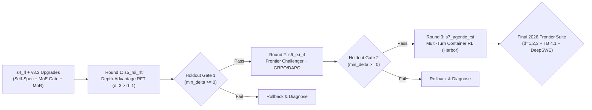

# Post-Training RSI & Architecture Refinement Roadmap (`Qwen3.6-35B-A3B-Loop64` → v3.3)

> **Scope:** Post-`s2_joint_bptt` → `s4_rl` evaluation, architectural refinement (`v3.3`), and closed-loop Recursive Self-Improvement (`s5_rsi_rft` → `s6_rsi_rl` → `s7_agentic_rsi`).
> **Baseline Architecture (`v3.2`):** `unsloth/Qwen3.6-35B-A3B-NVFP4` (`34.661B` text decoder, frozen `32.212B` NVFP4/FP8 MoE experts) retrofitted with calibrated 3-pass ETD sandwich loop (`[0,12)×1 + [12,36)×R + [36,40)×1` = `40L / 64L / 88L`, `~2.95B / 4.46B / 5.97B` effective active compute), `HSSD v3.2` 8-page surprise-gated linear memory (`30` linear layers), and `1M` YaRN + `D-LSA` (`10` full-attention layers, `1.0×` SharedKV, untied per-pass `W_q_idx^(r)`).
> **Target Hardware:** Single `96 GiB` Blackwell G4 (`RTX PRO 6000 sm_120`, `22h` resumable session budgets, HF Hub sync to `TassP0lar/Qwen3.6-35B-A3B-Loop64`).
> **Companion Documents:** [Architecture Specification (v3.2)](ARCHITECTURE_SPEC.md) · [Implementation Plan](IMPLEMENTATION_PLAN.md) · [Formal Research Essay](RESEARCH_ESSAY.md)

---

## 1. Late-2026 Frontier Comparison: `Inkling 2 Mini` vs. `Qwen3.6-35B-A6B-LoopHSSD v3.2`

On November 20, 2026, Thinking Machines Lab released **Inkling 2 Mini** (alongside the research variable-depth variant `TML-d24-varloop-research` and auxiliary speculative drafter `DSpark`), validating recurrent-depth looped MoE as a competitive frontier paradigm in the `~3B–6B` active-compute bracket. Mapping Inkling 2 Mini's architectural and systems choices directly against our `v3.2` stack isolates exactly where we already lead and which targeted `v3.3` upgrades yield the highest leverage per GPU-hour.

| Axis | **Inkling 2 Mini** *(TML, Nov 20, 2026)* | **`Qwen3.6-35B-A6B-LoopHSSD` (`v3.2`)** | **`v3.3` Strategic Delta** |
| :--- | :--- | :--- | :--- |
| **Total / Active Params** | `26.4B` total / `3.4B` base active → `5.4B` effective (3-pass looped MoE) | `34.66B` text / `2.95B` (`R=1`) → `4.46B` (`R=2`) → **`5.97B`** (`R=3`) | Larger frozen knowledge pool (`+8.3B` total) at comparable active FLOPs |
| **Physical → Virtual Depth** | `24L` → `48L` (3-pass core loop) | `40L` → **`88L`** (`[0,12)×1 + [12,36)×3 + [36,40)×1`) | `1.83×` deeper sequential circuit depth; `22` virtual global-attn layers |
| **Precision & Quantization** | Native `NVFP4` / `MXFP8` | `unsloth/Qwen3.6-35B-A3B-NVFP4` (`L0–31` group-16 NVFP4, `L32–39` FP8) + `quant_autograd` bridge | Keep base experts 100% frozen (SHA-256 verified); optional top-2.5% rank-64 `HotExpertDeltas` |
| **Long-Context Engine (`1M`)** | `1M` native context | `1M` (`1,048,576`) YaRN `4.0×` + `10.00 GiB` GPU `FP8` `1.0×` SharedKV + `D-LSA` (`d_idx=64`, `192-d` NoPE) + `HSSD v3.2` 8-page linear memory | Audit MRCR `@ 512K–1M`; upgrade D-LSA index dim / multi-scale buckets if recall bottlenecks |
| **Cross-Pass Communication** | **Rank-64 gated cross-pass messages** injected into **both Q/K/V and MoE inputs** | `ReEntryBridge` (`r=256` subspace bridge at loop boundary) + per-pass `Q/O` LoRA (`r=64`) + `PassRouterAdapters` (`r=32`) | **Adopt rank-64 cross-pass MoE-input gating** (`~6.3M` params) so Pass `r≥2` modulates expert inputs directly, not only router logits |
| **Adaptive Depth / Halting** | `TML-d24-varloop-research` variable-depth per-token / per-problem looping | `LoopSpec.mor` + `write_mask` implemented in `src/qloop/model/loop.py` (`mor: false` in `s2`/`s4`) | **Activate & RL-train adaptive halting controller** over `R ∈ {1, 2, 3, 4}` with compute-penalized reward `R_verified − λ · avg_passes` |
| **Fast Drafting / Rollout Speed** | External **`DSpark`** speculative drafter model | Standard autoregressive decode (`src/qloop/eval/generate.py` & `src/qloop/infer/engine.py`) | **Zero-extra-weight Pass-1 (`40L`) → Pass-3 (`88L`) self-speculative decoding** (`2.0–2.5×` rollout/inference speedup without training a second model) |
| **Headline 2026 Evals** | HLE, GPQA, AIME/HMMT, DeepSWE v1.1, Terminal-Bench 4.1, 1M MRCR | Upgraded `configs/eval/suite.yaml` + `src/qloop/eval/registry.py` (all verified late-2026 datasets + Harbor `@4.1.0`) | Unified apples-to-apples depth-sweep ledger across `d ∈ {1, 2, 3}` |

### Key Architectural Takeaways
1. **Structural Advantage to Exploit:** Because `v3.2` preserves `R=1` (`40L`, stock Qwen3.6 graph) inside the *exact same weights* via `train_pass_probs` (`[0.10, 0.35, 0.55]` in `s4_rl`), we get **built-in self-speculative drafting** (`40L` draft → `88L` batched verify) at zero extra VRAM and zero external drafter training (unlike `DSpark`).
2. **Highest-Leverage Inkling Insight to Port:** In `v3.2`, `PassRouterAdapters` (`src/qloop/model/loop.py`) alters *which* Top-8 experts fire on Passes 2–3, while `ReEntryBridge` only injects cross-pass state at the loop boundary (`L35 → L12`). Adding Inkling-style **rank-64 gated cross-pass residual messages directly before each core MoE block** lets Pass 2/3 steer frozen SwiGLU expert *activations* layer-by-layer without unfreezing `32.212B` NVFP4 weights.
3. **Why Depth-Advantage RSI Works Here:** Stock `40L` already possesses vast world knowledge in `32.212B` experts; the bottleneck is compositional circuit depth and verification. Conditioning RSI specifically on instances where **`d=3` succeeds and `d=1` fails** directly amplifies the latent-reasoning gap that recurrent depth uniquely unlocks.

---

## 2. Phase A — Baseline Depth-Sweep Audit (`d = 1, 2, 3`)

Immediately after `s2_joint_bptt` and `s4_rl` finish on Colab G4, run a full diagnostic depth sweep on the upgraded late-2026 suite (`configs/eval/suite.yaml`, `defaults.depths: [1, 2, 3]`) before modifying any architecture weights.

### 2.1 Execution Commands
```bash
# 1. Local / in-process depth-sweep across all 12 core 2026 benchmarks (d = 1, 2, 3)
python -m qloop eval -c configs/eval/suite.yaml --ckpt runs/s4_rl

# 2. Serve the 88L checkpoint on localhost and run Harbor remote-sandbox benchmarks (Daytona/Modal)
python -m qloop serve -c configs/eval/suite.yaml --ckpt runs/s4_rl --port 8000 &
python -m qloop external harbor -c configs/eval/suite.yaml   # defaults to terminal-bench/terminal-bench@4.1.0

# 3. Additional Harbor container sweeps (SWE-bench Pro Hard & DeepSWE v1.1)
python -m qloop external harbor -c configs/eval/suite.yaml -s eval.external.harbor.dataset=swebenchpro-hard
```

### 2.2 Benchmark Matrix & Diagnostic Signals

| Category | Benchmarks (`eval/registry.py`) | Primary Metric | Key Depth-Sweep Diagnostic (`Δ(d=3 − d=1)`) |
| :--- | :--- | :--- | :--- |
| **Frontier Expert Reasoning** | `hle_diamond` (`1,000`), `hle_rolling` (`1,000`), `hle_verified` (open `gold+revision`) | Local normalized EM (+ optional LLM judge) | Separates pure knowledge recall (`d=1`) from deep multi-step deduction (`d=3`) |
| **Graduate Science & Broad Reasoning** | `gpqa_diamond` (`198`), `gpqa_extended` (`546`), `supergpqa` (`limit=500`, 10-way `A–J`), `mmlu_pro` (`limit=500`, 10-way `A–J`) | `pass@1` | Confirms 10-option MCQ calibration and zero knowledge degradation from looping |
| **2026 Olympiad Mathematics** | `aime_2026` (`avg@16`), `hmmt_feb_2026` (`avg@8`, symbolic `MATH`), `apex_shortlist` (`47` Olympiad) | `mean_score` / `maj@k` | Primary verifiable reasoning signal; compares FLOP-matched `d=1` (`2.1×` CoT budget) vs `d=3` |
| **Abstract Fluid Intelligence** | `arc_agi_2` (`pass@2`) | `pass@2` | Highest sensitivity to virtual depth (`40L → 88L`) and latent spatial search |
| **1M Long-Context Retrieval & Synthesis** | `mrcr` (`limit=200`, `16K → 1M`, prefix-checked `SequenceMatcher`), `longbench_v2`, `browsecomp_long`, `frames` | `mean_score` bucketed by `n_chars` (`64K / 256K / 512K / 1M`) | Pinpoints exact context length where `D-LSA` (`d_idx=64`) or `HSSD` write-mass recall saturates |
| **Coding & GPU Kernels** | `livecodebench` (`>=2025-02-01`), `kernelbench_l3`, `kernelbench_l4` | `pass@1`, `compiled_rate`, `fast_1`, mean speedup | Verifies code synthesis + Blackwell CUDA/Triton optimization transfer from KB L1–L2 |
| **Hardened Container Agents** | `terminal_bench_4_1` (`v4.1.0`, `66` RewardKit tasks), `swe_bench_pro` / `swe_bench_pro_hard`, `deep_swe` (v1.1) | Harbor resolved rate | Apples-to-apples comparison against Inkling 2 Mini on anti-reward-hacking container tasks |

### 2.3 Phase A Exit Criteria (Go / Diagnose Gate)
- **Monotonic Depth Gain:** `Δ(d=3 − d=1) > 0` on `aime_2026`, `hmmt_feb_2026`, `arc_agi_2`, and `hle_diamond`, AND `d=3` beats FLOP-matched `d=1` (`2.1×` thinking tokens) on at least 3 of 4 reasoning benchmarks.
- **No `d=1` Regression:** `d=1` stays within `≤ 1.0 pt` of stock `unsloth/Qwen3.6-35B-A3B-NVFP4` on `gpqa_diamond` and `mmlu_pro` (guaranteeing high self-speculative acceptance rate in Phase B.1!).
- **1M Recall Profile:** Bucket `mrcr` scores into `[0–128K)`, `[128K–512K)`, `[512K–1M]`. If `[512K–1M]` drops by `> 15%` relative to `[0–128K)`, trigger Phase B.4 (`D-LSA` 1M recall upgrade) before Phase C RSI.

---

## 3. Phase B — Pass-1 Self-Speculative Drafting & Architectural Refinements (`v3.3`)

Every `v3.3` modification preserves our core discipline: **zero unfreezing of the `32.212B` NVFP4 base experts** (enforced by `stack.verify_frozen_experts()`), **zero-init step-0 exact equivalence** to the `s4_rl` checkpoint, and **`< 96 GiB` single-GPU Blackwell G4** compatibility.

### 3.1 B.1 — Zero-Extra-Weight Pass-1 (`40L`) → Pass-3 (`88L`) Self-Speculative Decoding

GRPO/DAPO rollouts in `src/qloop/train/rl.py` (`GRPOTrainer.rollout`) and long-horizon evaluations spend `> 80%` of wall-clock time in autoregressive decoding at `d=3` (`88L`, `2.05×` per-token latency vs `40L`). Because `LoopController.set_active_passes(1)` executes the exact `40L` prelude+core-pass-1+coda graph and `kv_share=True` already shares Pass-1 K/V caches across Passes 2–3:

1. **Draft Phase (`K = 4..6` tokens at `d=1`):** Advance `40L` (`active_passes=1`) for `K` tokens using a lightweight scratch view of the Pass-1 KV + Pass-1 HSSD decode ring (`src/qloop/infer/engine.py`), recording draft distributions $q_1, \dots, q_K$.
2. **Parallel Verify Phase (`1` forward step of length `K+1` at `d=3`):** Run a single chunked `K+1`-token pass through Passes 2–3 (`core` layers `[12,36)` × 2 + `coda` `[36,40)`), reusing Pass-1's already-computed full-attention K/V (`kv_share=True`!) and computing target distributions $p_1, \dots, p_{K+1}$ in parallel on Blackwell Tensor Cores (where `K=5` is memory-bandwidth-free relative to `K=1`!).
3. **Exact Lossless Rejection Sampling:** Accept tokens $x_i$ with probability $\min(1, p_i(x_i) / q_i(x_i))$ and resample from $\operatorname{norm}(\max(0, p_j - q_j))$ at the first rejection, rolling back only the HSSD `decode_cache` / KV cache sequence pointer by `K − accepted` slots (supported natively via `HSSDCacheState` snapshot/truncate in `src/qloop/model/hssd.py`).
4. **Expected Speedup:** At acceptance rate $\alpha \in [0.78, 0.88]$ (typical when `d=1` is co-trained via `train_pass_probs`), `K=5` yields `3.4–4.2` verified tokens per `88L` verify call — a **`2.0×–2.5×` wall-clock speedup** for both `GRPOTrainer.rollout()` and `qloop serve` / Harbor evaluations with **0 extra parameters** and **mathematically identical target distribution** (strictly on-policy for GRPO!).

### 3.2 B.2 — Inkling-Inspired Rank-64 Cross-Pass MoE-Input Gating + Adaptive Halting (`R ∈ {1, 2, 3, 4}`)

1. **Cross-Pass MoE-Input Gate (`PassMoEMessage` in `src/qloop/model/loop.py`):**
   - Currently (`v3.2`), each core layer $l \in [12, 36)$ receives cross-pass signal via `ReEntryBridge` (loop boundary only), `PassAttnAdapters` (`q_proj`/`o_proj` on the 6 full-attn core layers), and `PassRouterAdapters` (router logits only).
   - Add a per-layer, per-pass (`r ≥ 2`) low-rank gated message injected into the post-attention residual **immediately before `layer.mlp` (MoE input)**:
     $$\tilde{h}_l^{(r)} = h_l^{(r)} + \sigma(\mathbf{g}_{l}^{(r)}) \odot \Big(W_{\text{up},l}^{(r)}\,\operatorname{SiLU}\big(W_{\text{down},l}^{(r)}\,\operatorname{RMSNorm}(h_l^{(r-1)})\big)\Big), \quad \text{rank } r_m = 64$$
     with $W_{\text{up},l}^{(r)} = \mathbf{0}$ at initialization so step 0 is bit-identical to `s4_rl`.
   - **Parameter Cost:** $24\text{ core layers} \times (R-1)\text{ passes} \times (2 \times 2048 \times 64 + 2048) \approx \mathbf{12.6\text{M}}$ params at $R=3$ (`0.036%` of backbone, `< 50 MiB` VRAM).
   - **Why It Matters:** Allows Pass `r` to carry layer-aligned cross-pass residual state from Pass `r-1` directly into the frozen `256`-expert SwiGLU gates without distorting the shared attention K/V cache.

2. **Variable-Depth Adaptive Halting Controller (`R ∈ {1, 2, 3, 4}`):**
   - Extend `LoopSpec.mor` (`src/qloop/model/loop.py`, already wired with causal `write_mask` for linear-attention layers) from a static depth heuristic into an RL-trained **per-token / per-segment halting controller** inspired by `TML-d24-varloop-research`:
     - Support an optional **extrapolation pass `R = 4`** (`112L`, `~7.48B` active compute) by sharing Pass-3's adapters + distinct step embedding `step_emb[3]` and a learnable halting head $p_{\text{halt}}^{(r)}(h) = \sigma(w_{\text{halt}}^\top \operatorname{RMSNorm}(h^{(r)}) + b_r)$ evaluated at the end of core passes $r \in \{1, 2, 3\}$.
     - **Compute-Aware RL Reward:**
       $$R_{\text{total}}(x, y) = R_{\text{verified}}(x, y) - \lambda_{\text{depth}} \cdot \big(\bar{R}(y) - R_{\text{target}}\big)_+ - \lambda_{\text{len}} \cdot \text{overlong}(y)$$
       where $\bar{R}(y) \in [1, 4]$ is the mean passes executed per generated token (logged in `GRPOTrainer` stats alongside `reward/mean`).
     - **Curriculum:** Warm-start with $\lambda_{\text{depth}} = 0.0$ for the first 50 steps so the model first exploits `R=3/4` freely on hard tokens, then anneal $\lambda_{\text{depth}} \in [0.02, 0.08]$ so boilerplate syntax/formatting tokens exit at `R=1` (`40L`) while arithmetic, proof steps, and tool-call planning tokens allocate `R=3` or `R=4` (`88L–112L`).

### 3.3 B.3 — Targeted Top-2.5% Pass-2/3 Hot-Expert LoRA (`experts.enabled=true`)

Our `src/qloop/model/experts.py` (`scan_router_affinity`, `ExpertStats.select_hot`, `HotExpertDeltas`) already supports zero-init rank-64 SwiGLU deltas over frozen NVFP4 fused expert tensors via the exact factorized residual `W_d (h_m − h_b) + dW_d h_m`.

- **When to Activate:** Trigger **only** if Phase A shows that `d=3` reasoning gains plateau on domain-specific synthesis (e.g., Olympiad algebra, CUDA/Triton kernel patterns, or SWE patch generation) despite healthy cross-pass router specialization.
- **Exact Procedure:**
  1. Run `python -m qloop scan-experts -c configs/eval/suite.yaml --ckpt runs/s4_rl --out runs/s4_rl/esft_stats_v32.json` on a balanced decontaminated reasoning/code/kernel calibration batch at `d=3`, recording per-pass ESFT-Gate affinity.
  2. Select the **top `2.5%` Pass-2/3-enriched experts** (`~256` of `10,240` physical experts; `fraction: 0.025`, `by: affinity`, `per_pass: union`, `rank: 64`, `+96.5M` trainable params = `< 0.4 GiB` optimizer state under `APOLLO` / AdamW).
  3. Enable `-s experts.enabled=true -s experts.stats_path=runs/s4_rl/esft_stats_v32.json` during `s5_rsi_rft` / `s6_rsi_rl`, keeping all base `32.212B` NVFP4 weights strictly frozen and SHA-256 audited; fold deltas cleanly during `qloop export-pack` (`src/qloop/export_pack.py`).

### 3.4 B.4 — `D-LSA` 1M Recall Upgrade (Conditional on Phase A `mrcr` Audit)

If Phase A `mrcr` scores degrade significantly at `512K–1M` tokens (`> 15%` drop vs `≤ 128K`):
1. **Recall Attribution Probe:** Compare `lsa.mode: dense` vs `lsa.mode: sparse` at `128K` and `256K` on `mrcr` (`limit=50`) to separate *indexer recall loss* (`D-LSA` missing needle buckets) from *RoPE / HSSD memory dilution*.
2. **Targeted Upgrades (only the bottlenecked knob):**
   - **Indexer Capacity:** Bump `lsa.index_dim: 64 → 96` (`+2.95M` params across 10 full-attn layers) and `lsa.num_select: 64 → 96` (`max_selected_keys: 768 → 1024`), keeping sparse compute `< 0.15%` of dense `1M` FLOPs.
   - **Multi-Scale Ward Bucketing:** Replace single-scale `avg_bucket_keys: 8` with dual-granularity pooling (`pool=2` fine needle buckets + `pool=8` coarse semantic buckets) over the `192-d` NoPE subspace so short verbatim needles (like MRCR's `random_string_to_prepend` and exact poem indices) do not average out inside 32-key buckets.
   - **512K–1M Retrieval Distillation (`long_calib`):** Run `200` targeted `prefix_suffix_calibration_step` steps (`src/qloop/train/long_calib.py`) on synthetic multi-needle QA / cross-document lookup tasks at `512K–1M` tokens (strictly disjoint from `openai/mrcr` and `zai-org/LongBench-v2`) with `lsa.mode: hybrid` and `recall_threshold: 0.85`.

---

## 4. Phase C — Closed-Loop Multi-Round Verifiable RSI (`s5` → `s6` → `s7`)

Phase C turns our verified `v3.3` stack into a disciplined, self-improving post-training loop with **verifiable-only supervision** (no unverified synthetic self-talk), **strict contamination barriers**, and **automatic holdout rollback**.



### 4.1 Round 1 (`s5_rsi_rft`): Depth-Advantage Rejection Fine-Tuning (DA-RFT)

**Objective:** Distill the model's *own* verified `d=3` (`88L`) breakthroughs into higher-probability trajectories and calibrate the new `v3.3` cross-pass MoE gates (`PassMoEMessage`) before online RL.

1. **Strictly Decontaminated Prompt Pool (`100%` verifiable):**
   - **Olympiad & Symbolic Math:** Decontaminated `DAPO-Math-17k`, OpenMathReasoning-verifiable subsets, and programmatic symbolic-math generators (verified by `qloop.eval.scoring.MATH`).
   - **GPU Kernels:** `kernelbench_train` (`ScalingIntelligence/KernelBench` **Levels 1–2 ONLY**; L3–L4 strictly held out), verified by compile + numerical equivalence (`atol/rtol 1e-2`) + `speedup > 1.05×` via `KERNELBENCH_SCORER`.
   - **Sandboxed Competitive Coding:** Pre-2025-02 algorithmic coding problems with private unit tests (strictly disjoint from `livecodebench` `min_contest_date: 2025-02-01`), verified by `LCB_SCORER`.
   - **256K–1M Synthetic Multi-Needle & Multi-Hop Retrieval:** Programmatically generated long-context key-value, multi-hop code-graph traversal, and document-diff tasks (`256K–1M` tokens, verified by exact/deterministic match; zero overlap with `openai/mrcr`, `LongBench-v2`, `FRAMES`, or `BrowseCompLongContext`).
2. **Depth-Advantage Filtering Rule:**
   - Generate $n=4$ rollouts at `d=1` (`40L`) and $n=8$ rollouts at `d=3` (`88L`, accelerated `2×+` by Phase B.1 self-speculative decoding).
   - Prioritize the **Depth-Advantage Cohort**: problems where $\text{pass@4}(d=1) = 0$ and $\text{pass@8}(d=3) > 0$ (plus a `25%` replay slice of solved `d=1` items to prevent forgetting).
   - Keep the **shortest verified `d=3` trace** per solved problem (suppressing reasoning bloat) that passes format checks (`has_unclosed_think == False`, no repetition loops, verified reward `>= 1.0`).
3. **Training Step:** Run `300–500` steps of `LMTrainer` (`s5_rsi_rft`) with `train_pass_probs: [0.10, 0.30, 0.60]`, `lr = 1e-5` (cosine decay), `lr_mult: {loop_adapters: 5.0, moe_message: 10.0, hssd_adapter: 2.0}`, training only adapters + optional Top-2.5% `HotExpertDeltas` while keeping base NVFP4 experts SHA-256 frozen.

### 4.2 Round 2 (`s6_rsi_rl`): Online Self-Play Frontier Challenger + GRPO/DAPO

**Objective:** Eliminate prompt-pool saturation (where `groups/all_pass` or `groups/all_fail` wastes GRPO steps) by dynamically generating frontier problems inside the **20%–60% pass-rate sweet spot** while jointly optimizing answer accuracy and adaptive loop depth.

1. **Frontier Challenger Pipeline (Verifiable-Only Self-Play):**
   - For domains with deterministic oracles (symbolic math via SymPy/Lean-checkable identities, Python algorithmic problems with brute-force reference oracle + randomized property tests, Triton/CUDA kernel fusions on synthetic PyTorch module graphs, and synthetic `128K–1M` retrieval tasks):
     - A Challenger prompt (run by the same checkpoint at `d=3`) mutates a seed problem from the `groups/all_pass` bucket (increasing constraint coupling, nesting depth, edge-case count, or context distraction density) or simplifies a seed from `groups/all_fail`.
     - **Mandatory Automated Solvability & Uniqueness Filter:** Every mutated problem MUST pass (a) independent reference-solver execution (SymPy / brute-force Python oracle / PyTorch reference model) with deterministic unique answer, (b) `13-gram` decontamination check against all held-out 2026 eval groups, and (c) empirical difficulty check (`0.20 <= pass@8 <= 0.60`) before entering the active RL buffer.
     - Problems that fail solvability/uniqueness checks are **hard-discarded** (zero noisy reward hacking).
2. **GRPO / DAPO Optimization (`src/qloop/train/rl.py`):**
   - Retain asymmetric clip-higher (`clip_low: 0.20`, `clip_high: 0.28`), Dr.GRPO / std advantage normalization, entropy floor (`entropy_floor_frac: 0.6`), and DAPO overlong penalty (`overlong.enabled: true`).
   - Enable **Self-Speculative Rollouts** (B.1) + **Adaptive-Depth Reward** (B.2): `R_total = R_verified − λ_depth * (avg_passes − R_target)_+`.
   - Maintain a `30%` anchor mix of fixed real-world verifiable tasks (`DAPO-Math-17k`, `kernelbench_train` L1–L2, coding) so the Challenger distribution never drifts off-manifold.
   - Optional TGPO fallback (`rl.teacher` already implemented in `src/qloop/train/rl.py`): on persistent `groups/all_fail` real-world tasks, query a frontier teacher only if its solution passes the **same deterministic verifier** (`verify(t, text) > 0`).

### 4.3 Round 3 (`s7_agentic_rsi`): Multi-Turn Containerized Agentic RL

**Objective:** Close the agentic software-engineering and terminal-execution gap against Inkling 2 Mini on **Terminal-Bench 4.1**, **SWE-bench Pro Hard**, and **DeepSWE v1.1** without touching any held-out container tasks.

1. **Strictly Disjoint Container Task Pool:**
   - **Terminal Tasks:** `ot_agent_rl` (`open-thoughts/OpenThoughts-Agent-RL-5K`) + procedurally generated Linux/Docker/build-system debugging sandboxes. **Strictly excluded:** `terminal_bench_4_1`, `terminal_bench_2`, `agentworldbench`, and `openthoughts_tb_dev_v2` (all checked against `contamination_group="terminal_bench"`).
   - **SWE Tasks:** `swe_rebench` (`PrimeIntellect/SWE-rebench-V2-Filtered-Verified`, repo/issue-filtered so zero repositories or commits overlap `ScaleAI/SWE-bench_Pro` or `datacurve/deep-swe`).
2. **Execution Architecture (`qloop.eval.server` + Harbor/Daytona/Modal + HTTP Reward Bridge):**
   - Serve the live RL policy via `qloop.eval.server` (with B.1 self-speculative decoding enabled).
   - Execute `8` concurrent multi-turn `terminus-2` / bash-tool rollouts per task in isolated remote containers (`--env daytona` or `--env modal`, zero local Docker daemon required on Colab G4), returning container test-suite pass/fail verdicts (`0.0 / 1.0` + RewardKit-style anti-cheat checks preventing test-file tampering) to `GRPOTrainer` via its existing `verifier: "http"` hook (`src/qloop/train/rl.py`).
   - Mask tool-output (`<tool_response>`) tokens out of policy-gradient loss (identical to assistant-only loss masking in `src/qloop/data/tokenizer.py`), applying GRPO advantages strictly across assistant `<think>` + `<tool_call>` tokens.

---

## 5. Strict Non-Regression & Anti-Contamination Governance

RSI loops can silently overfit, bloat reasoning length, or leak benchmark items if ungoverned. Every stage from `s5_rsi_rft` through `s7_agentic_rsi` enforces four hard invariants:

1. **Universal 13-Gram Decontamination Across All 2026 Eval Groups (`src/qloop/data/registry.py` + `decontam.py`):**
   - Every RFT dataset, RL prompt pool, and Challenger-generated task MUST pass `Decontaminator(n=13)` covering **all registered eval contamination groups**:
     ```yaml
     decontaminate:
       enabled: true
       ngram: 13
       groups:
         - aime_2026
         - hmmt_2026
         - apex_math
         - gpqa
         - supergpqa
         - hle               # covers cais/hle, hle-rolling, hle-diamond, and open HLE-Verified
         - arc_agi_2
         - kernelbench       # levels 3 & 4
         - mrcr              # prompt + answer (index final needle query + answer on RAM-limited hosts)
         - browsecomp
         - terminal_bench    # covers Terminal-Bench 4.1 (v4.1.0), 2.0, and AgentWorldBench
         - mmlu_pro
         - frames
       on_missing: error     # strict in RSI promotion runs (requires HF_TOKEN for gated HLE/GPQA)
     ```
   - Additionally enforce **repository/commit-level disjointness** for `swe_bench` (`swe_rebench` vs `SWE-bench_Pro` / `DeepSWE`) and **temporal cutoff** (`contest_date < 2025-02-01`) for `livecodebench`.
2. **Mandatory Holdout Promotion Gate (`rl.gate` in `src/qloop/train/rl.py`):**
   - Evaluate every `50` RL steps (and at the end of every RFT round) at `depth: 3` on a fast held-out sentinel slate (`aime_2026`, `hmmt_feb_2026`, `gpqa_diamond` / `hle_verified` subset, `kernelbench_l3` subset, `mrcr` subset):
     - **`min_delta: 0.0`:** Checkpoint is promoted (`CheckpointManager.promote`) **only** if aggregate held-out score `>= best_gate + min_delta` with no single benchmark dropping by `> 2.5 pts`.
     - **Anti-Length-Bloat Cap (`max_len_growth: 1.35`):** Reject any checkpoint whose mean completion length exceeds `1.35×` baseline without proportional accuracy gain (preventing reward hacking via endless CoT padding).
     - **Automatic Rollback (`rollback: true`):** Rejected checkpoints immediately restore the last `PROMOTED` trainable weights and optimizer state (`restore_trainable`).
3. **Frozen-Backbone Integrity (`sha256_frozen_experts: true`):**
   - Verify SHA-256 checksums on all `40 × 256` base NVFP4/FP8 routed experts before and after every RSI round (`stack.verify_frozen_experts()`), ensuring all capability gains live cleanly inside compact (`~100–200M` param) delta bundles synced to `TassP0lar/Qwen3.6-35B-A3B-Loop64`.
4. **Compute & Session Discipline on Colab G4:**
   - Every RSI stage persists exact sampler/optimizer/gate cursors (`ckpt_every: 25`, `time_budget_hours: 21.5`, HF Hub commit sync + clean exit `0` for supervisor rollover) so multi-day `s5 → s6 → s7` runs survive Colab's 24h boundary without losing a single verified rollout.

---

## 6. Execution Schedule & Target Milestones

| Stage | Primary Engineering Deliverable | Estimated G4 Compute | Promotion Gate |
| :--- | :--- | :---: | :--- |
| **Phase A** (`eval_v32`) | Full `d ∈ {1, 2, 3}` sweep on `configs/eval/suite.yaml` + Harbor TB 4.1 / DeepSWE | `~12–18h` (`1` session) | Baseline ledger locked in Hub `eval/suite_summary.json`; `Δ(d=3−d=1) > 0` |
| **Phase B.1–B.2** (`v3.3` code) | Self-speculative `40L → 88L` decoder + `PassMoEMessage` (`r=64`) + adaptive halting `R ∈ {1..4}` | CPU unit tests + `4h` G4 smoke | `>= 2.0×` decode speedup, exact distribution parity (`TVD == 0` under lossless spec), step-0 `torch.equal` |
| **Phase B.3–B.4** *(conditional)* | `qloop scan-experts` Top-2.5% `HotExpertDeltas` + `D-LSA` `512K–1M` recall upgrade | `~8–12h` (if triggered by Phase A) | `mrcr @ 512K–1M` recall gap closed `< 10%` vs `128K` |
| **Phase C.1** (`s5_rsi_rft`) | Depth-Advantage RFT (`d=3` solved ∧ `d=1` failed) across math, KB L1–L2, coding, 1M retrieval | `~16–20h` (`1` session) | Positive held-out delta on `hmmt_feb_2026`, `hle_verified`, `arc_agi_2`, `mrcr` |
| **Phase C.2** (`s6_rsi_rl`) | Frontier Challenger + GRPO/DAPO with adaptive-depth reward `R_verified − λ · avg_passes` | `~36–44h` (`2` sessions) | Higher Pareto frontier (accuracy vs average passes `avg_passes <= 2.4`) + zero holdout regression |
| **Phase C.3** (`s7_agentic_rsi`) | Multi-turn Harbor/Daytona containerized RL (`ot_agent_rl` + disjoint `swe_rebench`) | `~36–44h` (`2` sessions) | Significant lift on **Terminal-Bench 4.1**, **SWE-bench Pro Hard**, and **DeepSWE v1.1** with zero math/1M regression |
